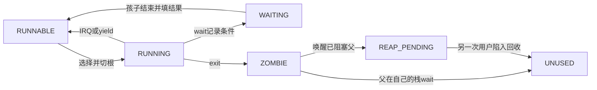

# K22 · 让 fork 的孩子抢占运行，让 wait 的父进程真正阻塞

K21 每次只运行一个用户程序。现在 processes 调用 fork 后，父子需要继续同一个 C 调用点，却保留互不影响的数据；父调用 wait 时，也不能靠在内核里忙等阻止孩子获得 CPU。一次用户退出就回启动栈的做法，已经无法支撑这组关系。本节让多个用户根同时存在：fork逐页复制，父子从同一个用户调用点得到不同返回值；timer在完整用户现场边界轮转；wait让父退出可运行集合，孩子结束后填写父的结果并唤醒。整个会话结束才回启动栈统一核对资源。

用户工作负载在申请页中写42，孩子复制后改99，父仍看到42。随后两个孩子只做用户忙等，不主动yield，用真实IRQ证明不同用户根能抢占切换。最后把八项进程表填满，确认第八个孩子返回−11，再按身份逐个回收七个退出状态。exec下一节接入，当前调用号7仍返回−38。

先更新用户所有者与共享映射失效，再更新timer分派和用户库，加入独立processes程序及其ELF构建，最后替换启动观察。所有文件完成后运行；图形、Linux远端连通和作者工具都不是内核前置。

<a id="process-state"></a>
## 运行资格、退出状态和资源回收分开

先区分“这个孩子是谁”和“现在保存在哪一格”。进程表固定八项，某格回收后还会给后来的进程使用；父保存的孩子身份不能因此改指新进程。PID 单调增长，与可复用数组下标分开。每个控制块持有独立用户根、用户页列表、内核栈、实际返回现场和父PID。用户页列表新增VA与权限，因为fork必须把同一VA映射到新的物理页，再复制内容；只记物理页无法恢复孩子布局。

同一孩子还会经历运行、结束与被父取走结果三个时刻，不能只用一个 running 布尔值。RUNNABLE 表示有资格被选中，RUNNING 表示当前正在执行；wait 改 WAITING，调度器跳过它。退出改ZOMBIE，表示不再运行但状态和资源尚未被父取得。父已经在等待时，孩子先把结果复制到父页面、把父改回RUNNABLE，自己进入REAP_PENDING；这时孩子的内核C函数还在孩子栈上，不能立即释放。直到另一个用户下一次陷入，才从另一条栈清理它。



<a id="shared-kernel-tlb"></a>
## 当前 CR3 不同，内核映射也可能正在使用

用户根借用长期根的高半区表。父在自己的用户根下进入内核，fork为孩子创建新内核栈，更新的是长期根持有的共享页表；父CPU可能也缓存了这条高地址翻译。旧的“只有s->root等于active_root才invlpg”不够，解除共享内核映射也必须失效当前CPU的对应VA，否则槽复用到不同物理页时可能仍用旧缓存。

因此高半区由真正内核根修改时，即使当前CR3是用户根，也执行invlpg。所有进程栈位于同一已存在的高半区分支，创建孩子不依赖向已复制用户根补一个全新PML4项。当前仍是单CPU；这里没有替代SMP的跨CPU失效协议。

**完整替换 `kernel/arch/x86_64/paging.c`。** 其余算法沿K20，修改的是共享内核高半区的缓存失效条件。

<!-- write: kernel/arch/x86_64/paging.c -->
```c
#include <airi/vm.h> // 四级页表的有界接口。
#include <airi/base.h> // 新页表必须用自有 memset 清零。
#define PRESENT 1ull // x86 PTE 的存在位。
#define WRITE 2ull // 页表或叶子允许写入。
#define USER 4ull // 每层都要允许user，不能只改叶子。
#define PWT 8ull // 设备映射的 write-through 位。
#define PCD 16ull // 设备映射的 cache-disable 位。
#define LARGE 128ull // 此实现拒绝已有大页项，不把它当下一级表。
#define NX (1ull << 63) // EFER.NXE 开启后，叶子该位禁止取指。
#define ADDRESS 0x000ffffffffff000ull // x86 页表中的物理页地址部分。
static uint64_t active_root; // 只有当前 CPU 激活的地址空间需要立即失效 TLB。
static bool canonical(uint64_t address) { // 本阶段固定 48 位虚拟地址、四级分页。
    uint64_t top = address >> 47; // 第 47 位及以上应全部为零或全部为一。
    return top == 0 || top == 0x1ffff; // 拒绝中间不规范地址。
}
static uint64_t *table(const struct airi_address_space *s, uint64_t physical) { // 物理页表页通过直接映射访问。
    return (uint64_t *)(uintptr_t)(s->direct_offset + physical); // 转换不会创建映射，调用者必须已有这段 HHDM。
}
static void invalidate(const struct airi_address_space *s, uint64_t address) { // 只使当前活动映射的旧翻译失效。
#ifndef AIRI_HOST_TEST // 主机检查不执行特权指令。
    if (active_root == s->root || (!s->borrowed_kernel && address >= AIRI_USER_LIMIT)) // 内核高半区被用户根借用，即使当前CR3不同也必须失效共享映射。
        __asm__ volatile("invlpg (%0)" :: "r"(address) : "memory"); // 同时阻止编译器把相关内存访问跨过失效动作。
#else // 主机只观察表项和所有权。
    (void)s; // 不使用宿主 CPU 的页表。
    (void)address; // 不把模拟地址交给宿主 MMU。
#endif // 结束目标差异。
}
bool airi_vm_create(struct airi_address_space *s, struct airi_page_pool *pages, uint64_t offset) { // 输出对象此前不能持有未释放的地址空间。
    if (!s || !pages || !offset) // 缺少所有者或可访问别名时不能写页表。
        return false; // 不分配任何页。
    uint64_t physical = airi_page_alloc(pages); // 根页也由页池记录所有权。
    if (!physical) // 耗尽时没有地址可清零。
        return false; // 保持输出对象不变。
    *s = (struct airi_address_space){.root=physical, .direct_offset=offset, .pages=pages}; // 此后地址空间持有根页，不能归还给其他用途。
    airi_memset(table(s, physical), 0, AIRI_PAGE_SIZE); // 清除旧所有者内容，初始没有任何映射。
    return true; // 成功拥有一个空根表。
}
bool airi_vm_map(struct airi_address_space *s, uint64_t address, uint64_t physical, unsigned flags) { // 本阶段只建立 supervisor 4 KiB 映射。
    if (!s || !s->root || !canonical(address) || address % AIRI_PAGE_SIZE || (physical & ~ADDRESS) || (flags & ~(AIRI_VM_WRITE | AIRI_VM_EXEC | AIRI_VM_DEVICE | AIRI_VM_USER))) // 拒绝不规范、未对齐、超物理位宽与未知权限。
        return false; // 输入错误不改变页表或页池。
    if (((flags & AIRI_VM_USER) && address >= AIRI_USER_LIMIT) || (s->borrowed_kernel && (!(flags & AIRI_VM_USER) || address >= AIRI_USER_LIMIT))) // 用户空间不能改写借用的内核高半区。
        return false; // 也不在借用空间中混入自有supervisor低半区分支。
    uint64_t made[3]; // 保存本次新借出的中间页表，失败时逆序归还。
    uint64_t *links[3]; // 对应父表项的地址，用于拆除本次建立的连接。
    unsigned count = 0; // 只有成功新建的中间表才计入回滚范围。
    uint64_t *current = table(s, s->root); // 从 PML4 根表开始。
    for (unsigned level = 3; level > 0; --level) { // 依次消费第 39、30、21 位起的 9 位索引。
        unsigned index = (unsigned)((address >> (12 + level * 9)) & 511); // 512 项表占一页，每项 8 字节。
        uint64_t *entry = &current[index]; // 父表中指向下一层的槽位。
        if ((*entry & LARGE) || ((*entry & PRESENT) && (flags & AIRI_VM_USER) && !(*entry & USER))) // 不支持大页，也不提升既有supervisor路径为user。
            goto rollback; // 不把大页物理起点当页表解引用。
        if (!(*entry & PRESENT)) { // 缺少下一层时才借出页表页。
            uint64_t next = airi_page_alloc(s->pages); // 分配失败必须收回此前新建的表。
            if (!next) // 耗尽没有产生所有权。
                goto rollback; // 已有映射保持不变。
            airi_memset(table(s, next), 0, AIRI_PAGE_SIZE); // 先清零，避免把旧内容解释成有效映射。
            made[count] = next; // 保存本次页表物理地址。
            links[count++] = entry; // 先存父链接，再增加有效回滚条数。
            *entry = next | PRESENT | WRITE | ((flags & AIRI_VM_USER) ? USER : 0); // 中间层允许写，最终叶子仍独立决定权限。
        }
        current = table(s, *entry & ADDRESS); // 去掉权限位后取得下一层物理表的直接映射。
    }
    uint64_t *leaf = &current[(address >> 12) & 511]; // 最后一级的索引消费第 12–20 位。
    if (*leaf & PRESENT) // 禁止静默覆盖已有映射，避免失去原数据页所有者。
        goto rollback; // 此时通常没有新建表，仍走统一回滚出口。
    *leaf = physical | PRESENT | ((flags & AIRI_VM_USER) ? USER : 0) | ((flags & AIRI_VM_WRITE) ? WRITE : 0) | ((flags & AIRI_VM_EXEC) ? 0 : NX) | ((flags & AIRI_VM_DEVICE) ? PWT | PCD : 0); // 叶子写入明确权限、用户位与物理地址。
    invalidate(s, address); // 同地址曾有负面或旧翻译时也不依赖隐式刷新。
    return true; // 数据页仍由调用者持有，页表只拥有中间表与根页。
rollback: // 失败只拆本次新建的链接，不修改早已存在的分支。
    for (unsigned i = count; i > 0; --i) // 先拆完本次全部连接，再处理缓存与所有权。
        *links[i - 1] = 0; // 父项不再引用新建的子表。
    invalidate(s, address); // 阻止活动地址空间继续缓存即将归还的页表路径。
    for (unsigned i = count; i > 0; --i) // 失效之后才允许其他用途复用这些页。
        airi_page_free(s->pages, made[i - 1]); // 精确归还本次拥有的页。
    return false; // 调用者仍拥有传入的数据页。
}
static bool walk(const struct airi_address_space *s, uint64_t address, uint64_t **tables, unsigned *indices) { // 收集四层路径供查询或解除使用。
    if (!s || !s->root || !canonical(address)) // 查询页内地址可以不对齐，但仍须规范。
        return false; // 无效地址空间不访问内存。
    tables[3] = table(s, s->root); // 按硬件层号保存根表。
    for (int level = 3; level >= 0; --level) { // 包括最终叶子所在的第零层。
        indices[level] = (unsigned)((address >> (12 + level * 9)) & 511); // 每层选出 9 位索引。
        uint64_t entry = tables[level][indices[level]]; // 读取当前层的实际表项。
        if (!(entry & PRESENT) || (level && (entry & LARGE))) // 缺项或未支持的大页都不继续解引用。
            return false; // 此 API 不假装知道其他页表格式。
        if (level) // 叶子存数据页，不再把它当页表。
            tables[level - 1] = table(s, entry & ADDRESS); // 为下一轮保留子表地址。
    }
    return true; // 四级路径完整且最终叶子存在。
}
bool airi_vm_lookup(const struct airi_address_space *s, uint64_t address, uint64_t *physical, unsigned *flags) { // 软件查询不触发对目标数据页的访问。
    uint64_t *tables[4]; // 保存当前遍历路径。
    unsigned indices[4]; // 每层所选的表项编号。
    if (!walk(s, address, tables, indices)) // 未映射地址返回失败，不制造缺页异常。
        return false; // 输出参数保持调用前值。
    uint64_t leaf = tables[0][indices[0]]; // 取最终 4 KiB 叶子。
    if (physical) // 调用者可只关心是否存在。
        *physical = (leaf & ADDRESS) | (address & (AIRI_PAGE_SIZE - 1)); // 页内偏移在翻译前后保持不变。
    if (flags) // 可选返回本实现支持的叶子权限。
        *flags = ((leaf & WRITE) ? AIRI_VM_WRITE : 0) | ((leaf & NX) ? 0 : AIRI_VM_EXEC) | ((leaf & PCD) ? AIRI_VM_DEVICE : 0) | ((leaf & USER) ? AIRI_VM_USER : 0); // 中间表由本实现固定为 supervisor RW。
    return true; // 只表示软件页表存在，不代表设备或 RAM 访问一定成功。
}
bool airi_vm_unmap(struct airi_address_space *s, uint64_t address) { // 调用方必须避免解除当前指令、栈或页表自身的映射。
    uint64_t *tables[4]; // 保存由叶子向根回收所需的路径。
    unsigned indices[4]; // 对应每个父子链接。
    if ((s && s->borrowed_kernel && address >= AIRI_USER_LIMIT) || address % AIRI_PAGE_SIZE || !walk(s, address, tables, indices)) // 只接受存在的页起点。
        return false; // 不存在映射不会改变任何所有权。
    tables[0][indices[0]] = 0; // 先移除目标数据页的映射。
    uint64_t release[3]; // 在拆除父链接时暂存待归还的空表。
    unsigned count = 0; // 全部链接更新并失效后再统一归还。
    for (unsigned level = 0; level < 3; ++level) { // 根页由地址空间持续持有，不在这里回收。
        bool empty = true; // 初始认为当前子表没有剩余映射。
        for (unsigned i = 0; i < 512; ++i) // 检查整张子表，而不是只检查刚移除的项。
            if (tables[level][i]) // 任意非零项都说明还有占用。
                empty = false; // 保留该表与所有上层链接。
        if (!empty) // 仍被其他页面使用时必须停止向上回收。
            break; // 不能释放还有映射的表。
        uint64_t *parent = &tables[level + 1][indices[level + 1]]; // 父项拥有当前子表物理地址。
        uint64_t physical = *parent & ADDRESS; // 在清链接前保存要归还的物理页。
        *parent = 0; // 不再让硬件或下一次 walk 找到已释放表。
        release[count++] = physical; // 此时只登记，不提前复用页表内存。
    }
    invalidate(s, address); // 叶子和空父表均拆除后，使翻译与分页结构缓存失效。
    for (unsigned i = 0; i < count; ++i) // CPU 不再引用这些空表后才交还页池。
        airi_page_free(s->pages, release[i]); // 不归还由调用者持有的数据页。
    return true; // 数据页未归还，调用者仍须结束其他别名并处理所有权。
}
bool airi_vm_activate(const struct airi_address_space *s) { // 仅在新表已覆盖当前指令、栈、静态数据和 HHDM 后调用。
#ifndef AIRI_HOST_TEST // 主机观察只验证算法，不安装模拟地址空间。
    uint32_t a, b, c, d; // CPUID 通过四个 32 位寄存器返回能力。
    __asm__ volatile("cpuid" : "=a"(a), "=b"(b), "=c"(c), "=d"(d) : "a"(0x80000000u), "c"(0)); // 先确定扩展能力叶是否存在。
    if (a < 0x80000001u || !s || !s->root) // 不读取不存在的扩展叶。
        return false; // 不能宣称安装成功。
    __asm__ volatile("cpuid" : "=a"(a), "=b"(b), "=c"(c), "=d"(d) : "a"(0x80000001u), "c"(0)); // 获取扩展处理器特性。
    if (!(d & (1u << 20))) // NX 支持位必须存在。
        return false; // 页权限演示不能静默忽略 NX。
    uint64_t cr4; // CR4 控制分页格式与全局翻译。
    __asm__ volatile("mov %%cr4,%0" : "=r"(cr4)); // 读取当前处理器配置。
    if (cr4 & ((1ull << 12) | (1ull << 17))) // 当前只支持四级、未启用 PCID 的固定启动环境。
        return false; // 不把五级根或 PCID 模型误用为本实现。
    __asm__ volatile("rdmsr" : "=a"(a), "=d"(d) : "c"(0xc0000080u)); // 读取 EFER，保留原有 long-mode 等标志。
    a |= 1u << 11; // EFER.NXE 使页表 NX 位真正生效。
    __asm__ volatile("wrmsr" :: "a"(a), "d"(d), "c"(0xc0000080u) : "memory"); // 写回同一 MSR，保留高 32 位。
    uint64_t cr0; // CR0.WP 决定 supervisor 写只读页也需要受限制。
    __asm__ volatile("mov %%cr0,%0" : "=r"(cr0)); // 读取原 CR0。
    cr0 |= 1ull << 16; // 保留其他位并开启 WP。
    __asm__ volatile("mov %0,%%cr0" :: "r"(cr0) : "memory"); // 让后续 supervisor 写遵守只读权限。
    cr4 &= ~(1ull << 7); // 清 PGE，刷新可能来自加载器的全局翻译。
    __asm__ volatile("mov %0,%%cr4" :: "r"(cr4) : "memory"); // 避免旧全局项绕过新页表权限。
    __asm__ volatile("mov %0,%%cr3" :: "r"(s->root) : "memory"); // 当前地址翻译从这一物理根页开始。
    active_root = s->root; // 后续 map/unmap 对该地址空间执行 invlpg。
    return true; // 只有 CR3 切换后仍正常执行到这里才返回成功。
#else // 没有任何宿主特权动作。
    (void)s; // 不安装模拟的根页。
    (void)active_root; // 保留同一源码中的状态声明而避免未使用警告。
    return false; // 主机明确不能证明硬件激活。
#endif // 结束目标差异。
}

bool airi_vm_clone_kernel(struct airi_address_space *space, const struct airi_address_space *kernel) { // 内核根和其高半区表必须比所有用户空间存活更久。
    if (!kernel || !kernel->root || kernel->borrowed_kernel || !airi_vm_create(space, kernel->pages, kernel->direct_offset)) // 只从真实内核根创建新所有者。
        return false; // 失败时不建立共享链接。
    airi_memcpy(table(space, space->root) + 256, table(kernel, kernel->root) + 256, 256 * sizeof(uint64_t)); // 仅借用高半区，用户低半区保持全零。
    space->borrowed_kernel = true; // 后续map/unmap/destroy必须尊重这条所有权边界。
    return true; // 借出的只有根页，不复制内核所有表。
}
static void destroy_table(struct airi_address_space *space, uint64_t physical, unsigned level, unsigned entries) { // 递归深度固定四层，数据页不在此归还。
    uint64_t *current = table(space, physical); // 非活动表仍通过当前内核HHDM可访问。
    for (unsigned i = 0; i < entries; ++i) // 用户根只遍历低256项，其他自有层遍历512项。
        if (level && (current[i] & PRESENT)) // 叶子描述的是外部数据页，不能误当子表释放。
            destroy_table(space, current[i] & ADDRESS, level - 1, 512); // 自有中间表按子到父归还。
    airi_page_free(space->pages, physical); // 当前不活动，不会有CPU继续遍历这个根。
}
bool airi_vm_destroy(struct airi_address_space *space) { // 调用者先切离该空间，并结束所有借用。
    if (!space || !space->root || space->root == active_root) // 禁止销毁当前CPU正在使用的根。
        return false; // 不能在释放页表后继续执行它。
    destroy_table(space, space->root, 3, space->borrowed_kernel ? 256 : 512); // 借用的内核高半区从不回收。
    airi_memset(space, 0, sizeof(*space)); // 清掉根地址，防止重复销毁。
    return true; // 数据页仍由创建进程的调用者逐一归还。
}
```

<a id="process-owners"></a>
## 内核按明确的进程对象访问用户页

例如孩子退出时要把状态写入等待中的父：正在执行的是孩子，目标缓冲区却属于父。同一个低地址在两份根中可能对应不同物理页，所以“用户指针”必须连同目标进程一起解释。原单上下文全局对象改成进程表和 current 指针，准备与复制函数显式接收目标p，不在创建孩子时偷偷把current改成孩子。copy_user先检查目标根的完整USER范围；写回wait状态还必须要求WRITE。使用HHDM别名就能访问非活动父根拥有的数据页，不必暂时切根或把用户地址直接当内核指针。

下面分段写同一个user.c；每段只包含完整函数，最终合成一个编译单元。控制块initial保存首次寄存器值，place_frame在资源准备完后才复制到实际内核栈；运行中的frame始终指向当前进程实际陷入形成的栈上现场。

**完整替换 `kernel/process/user.c`，先写控制块和用户范围访问：**

<!-- write: kernel/process/user.c -->
```c
#include <airi/elf.h> // 独立用户ELF检查器。
#include <airi/user.h> // 完整陷入与安全用户返回。
#include <airi/memory.h> // 页面、内核栈与长期根的所有权。
#include <airi/vm.h> // 每个进程有独立低半区。
#include <airi/timer.h> // 用户时间片依赖真实IRQ0。
#include <airi/kernel.h> // 有界串口输出与故障报告。
#define USER_CODE 0x400000ull // 旧受控映像的用户入口。
#define USER_STACK 0x70000000ull // 当前每进程一页初始用户栈。
#define STACK_BASE 0xffffe10000000000ull // 所有进程陷入栈位于同一长期内核分支。
#define USER_HEAP 0x10000000ull // ELF静态范围之外的用户页分配起点。
#define PROCESS_COUNT 8u // 有界进程表，不做动态扩容。
enum user_state { USER_UNUSED, USER_RUNNABLE, USER_RUNNING, USER_WAITING, USER_ZOMBIE, USER_REAP_PENDING }; // 退出与回收是两个不同状态。
struct user_page { uint64_t address, physical; unsigned flags; }; // fork需要把同一VA映射到另一个物理页。
struct user_process { // 所有权和调度状态由内核持有，用户只能看到PID。
    struct airi_address_space space; // 根和低半区表自有，高半区借用。
    struct airi_kernel_region stack; // 不能在仍使用它的C调用中释放。
    struct user_page owned[64]; // 所有用户数据页，含代码、静态数据、堆页和栈。
    unsigned count, pid, parent, user_ticks; // 资源数量、身份、父PID和本进程实际IRQ数。
    uint64_t fault_error, heap_next; // 用户故障证据与下一次有界用户页地址。
    int exit_code; // 自有wait接口返回普通退出码或负故障编码。
    enum user_state state; // 只有RUNNABLE可被调度器选中。
    int64_t wait_target; // 正PID表示指定孩子，-1表示任意孩子。
    uint64_t wait_status; // 已验证的父进程用户输出地址，阻塞期间父进程不会修改映射。
    struct airi_trap_frame initial; // 尚未运行时的寄存器值，不依赖临时C对象。
    struct airi_trap_frame *frame; // 运行后指向本进程内核栈的实际现场。
};
static struct user_process processes[PROCESS_COUNT]; // 槽可以复用，PID单调增长，不等于槽下标。
static struct user_process *current; // 只在完整陷入边界改变当前身份。
static unsigned next_pid = 1, root_pid, timer_switches, wait_blocks; // 每次运行会话的根身份和实际行为计数。
static bool session_active; // 只有用户会话活动时才接受用户IRQ或系统调用。
static int session_result; // 根用户退出结果，不用最后一个孩子的结果覆盖。
static struct airi_trap_frame *kernel_return; // 启动栈一直保留到整个用户会话结束。
extern const uint8_t airi_user_probe_start[], airi_user_probe_end[]; // 受控正常映像。
extern const uint8_t airi_user_bad_start[], airi_user_bad_end[]; // 用户cli故障。
extern const uint8_t airi_user_load_bad_start[], airi_user_load_bad_end[]; // 用户读supervisor页故障。
extern const uint8_t airi_user_rsp_bad_start[], airi_user_rsp_bad_end[]; // 不规范用户返回栈。
extern const uint8_t airi_hello_elf_start[], airi_hello_elf_end[]; // 既有独立用户C程序。
extern const uint8_t airi_process_elf_start[], airi_process_elf_end[]; // 新的fork/wait和抢占工作负载。
static unsigned slot(const struct user_process *p) { // 只接受processes中的真实槽，不接受临时复制对象。
    return (unsigned)(p - processes); // 同一数组内指针差得到稳定槽号。
}
static bool create_stack(struct user_process *p) { // 每槽前面留一页保护页，所有栈共享已存在高半区分支。
    uint64_t address = STACK_BASE + slot(p) * 5 * 4096ull + 4096; // 四页数据与一页保护，PID增长不扩散地址。
    return airi_memory_region_create(&p->stack, address, 4); // 完整成功后才借给用户根。
}
static bool user_access(const struct user_process *p, uint64_t address, size_t bytes, bool write) { // 检查完整用户范围，不直接解引用它。
    if (address >= AIRI_USER_LIMIT || bytes > AIRI_USER_LIMIT - address) // 排除内核地址与右端溢出。
        return false; // 零长度也保留本项目地址策略。
    for (size_t done = 0; done < bytes;) { // 跨越的每一页都必须满足权限。
        unsigned flags; // 当前叶子权限。
        if (!airi_vm_lookup(&p->space, address + done, NULL, &flags) || !(flags & AIRI_VM_USER) || (write && !(flags & AIRI_VM_WRITE))) // 输出指针还要求用户可写。
            return false; // 不先复制有效前缀。
        size_t part = 4096 - ((address + done) & 4095); // 当前页内剩余跨度。
        if (part > bytes - done) // 最后一段只到请求右端。
            part = bytes - done; // 不额外检查其他页。
        done += part; // 检查下一段。
    }
    return true; // 当前不可抢占内核中没有并发映射修改者。
}
static bool copy_user(struct user_process *p, void *buffer, uint64_t address, size_t bytes, bool to_user) { // 允许从非活动父根复制wait状态，但始终按其所有权查页。
    if (!user_access(p, address, bytes, to_user)) // 写用户缓冲必须检查WRITE，读只需要USER映射。
        return false; // 任何页失败都不复制。
    for (size_t done = 0; done < bytes;) { // 每次用HHDM别名处理一页中的有效段。
        uint64_t physical; // 翻译保留页内偏移。
        airi_vm_lookup(&p->space, address + done, &physical, NULL); // 完整检查后页表在本次内核操作中保持不变。
        size_t part = 4096 - ((address + done) & 4095); // 当前页边界。
        if (part > bytes - done) // 不超出剩余内容。
            part = bytes - done; // 缩到最后一段。
        if (to_user) // wait结果由内核写入父进程自己的页面。
            airi_memcpy(airi_memory_direct(physical), (uint8_t *)buffer + done, part); // 不切到父用户根也能访问其已拥有物理页。
        else // write系统调用把用户数据复制进内核副本。
            airi_memcpy((uint8_t *)buffer + done, airi_memory_direct(physical), part); // 不信任原始VA作为内核指针。
        done += part; // 推进下一段。
    }
    return true; // 同步结束，不借出buffer指针。
}
```

资源清理只要求目标根不活动、当前不在目标栈；调用者既可以是启动任务，也可以是父进程自己的内核栈。initial_frame先建立独立寄存器值，ELF装载仍在分配前完整校验，页的VA/PA/权限成功后才登记；半成品仍按目标p回滚。

**继续追加页所有权、初始栈和ELF准备：**

<!-- append: kernel/process/user.c -->
```c
static void cleanup(struct user_process *p) { // 目标根必须不活动，而且当前不能使用目标内核栈。
    if (p->space.root && !airi_vm_destroy(&p->space)) // 先解除并归还自有页表，不动借用的内核表。
        airi_panic("cannot destroy inactive user tables"); // 不能归还仍被活动根引用的数据页。
    while (p->count) // 用户代码与用户栈数据页分别归还。
        if (!airi_memory_return_page(p->owned[--p->count].physical)) // 先退到最后一个真正拥有的页。
            airi_panic("cannot return owned user page"); // 归属错误不继续复用内存。
    if (p->stack.count && !airi_memory_region_free(&p->stack)) // 调用者已经离开目标内核栈，才可销毁它。
        airi_panic("cannot reclaim user kernel stack"); // 不能在finish中提前做这一步。
    airi_memset(p, 0, sizeof(*p)); // 不留下可重复释放的根或句柄。
}
static void initial_frame(struct user_process *p, uint64_t entry, const char *name) { // 输入页已完整映射并清零，最后才发布首次返回现场。
    uint64_t stack_pointer = USER_STACK + 4096 - 16; // 旧受控汇编映像不读取argc，保持原布局。
    if (name) { // C程序使用本项目最小argc/argv栈协议。
        size_t bytes = airi_strlen(name) + 1; // 包含用户字符串的终止零。
        if (bytes > 64) // 当前程序名是固定短字面量，不支持无界参数。
            airi_panic("initial program name exceeds stack budget"); // 不覆盖用户启动布局。
        uint64_t physical; // 当前根未激活，通过软件翻译找到用户栈数据页。
        if (!airi_vm_lookup(&p->space, USER_STACK, &physical, NULL)) // 栈必须已建立。
            airi_panic("initial user stack mapping is missing"); // 不猜测owned数组中的位置。
        uint8_t *alias = airi_memory_direct(physical); // 通过内核HHDM填写尚未运行的用户栈。
        size_t name_offset = 4096 - bytes; // 字符串放在栈页高端。
        airi_memcpy(alias + name_offset, name, bytes); // 用户只得到自己的字符串副本。
        size_t words_offset = (name_offset & ~(size_t)15) - 4 * sizeof(uint64_t); // 四个64位槽，入口RSP仍16字节对齐。
        uint64_t *words = (uint64_t *)(alias + words_offset); // 已对齐的栈内数组。
        words[0] = 1; // argc目前固定一个程序名。
        words[1] = USER_STACK + name_offset; // argv[0]必须是用户VA，不是HHDM指针。
        words[2] = 0; // argv[1]结束指针数组。
        words[3] = 0; // 空环境，当前没有完整ELF辅助向量。
        stack_pointer = USER_STACK + words_offset; // CPU初始RSP指向argc槽。
    }
    p->frame = &p->initial; // 先保存独立寄存器值，place_frame稍后复制进实际内核栈。
    airi_memset(p->frame, 0, sizeof(*p->frame)); // 首次没有旧GPR。
    p->frame->rip = entry; // ELF入口或已知汇编入口。
    p->frame->cs = 27; // 用户代码段与RPL3。
    p->frame->ss = 35; // 用户数据段与RPL3。
    p->frame->rsp = stack_pointer; // 使用刚准备的用户布局。
    p->frame->rflags = 0x202; // 用户IF开启，IOPL为零。
}
static bool owned_page(struct user_process *p, uint64_t address, unsigned flags) { // 一次只建立一页，失败页面仍可由统一cleanup找到。
    if (p->count == 64) // 包括初始栈在内的全部数据页预算。
        return false; // 不越过所有权数组。
    uint64_t physical = airi_memory_take_page(); // 取得真正归本上下文持有的物理页。
    if (!physical) // 耗尽时没有需要登记的页。
        return false; // 调用方回滚已有部分。
    airi_memset(airi_memory_direct(physical), 0, 4096); // 文件尾部与BSS默认都从零开始。
    if (!airi_vm_map(&p->space, address, physical, flags | AIRI_VM_USER)) { // 单页映射失败还没有发布到所有权数组。
        airi_memory_return_page(physical); // 明确归还本次未接入数据页。
        return false; // 调用者回滚此前成功的部分。
    }
    p->owned[p->count++] = (struct user_page){address, physical, flags | AIRI_VM_USER}; // 保存VA/PA/权限供fork复制与精确回收。
    return true; // 每个已登记数据页都有对应映射。
}
static bool prepare_elf(struct user_process *p, const uint8_t *image, size_t bytes, const char *name) { // 当前还没有exec，先在空上下文中完成事务装载。
    struct airi_elf_view view; // 只借输入ELF直到复制结束。
    const char *error = airi_elf_inspect(image, bytes, &view); // 在任何资源分配前校验整个输入。
    if (error) { // 损坏格式不能触发后续内存写入。
        airi_log("[ELF_REJECTED] %s", error); // 给出精确范围/权限原因。
        return false; // 旧输出和当前空上下文都未改变。
    }
    if (!create_stack(p)) // 内核陷入栈先完成，再借高半区。
        return false; // 区域接口已回滚失败。
    if (!airi_memory_user_space(&p->space)) // 创建独立低半区。
        goto failed; // 后续失败均收回所有已持有资源。
    for (unsigned i = 0; i < view.count; ++i) { // 每段独立赋予对应权限。
        const struct airi_elf_segment *segment = &view.segments[i]; // 元数据已经过统一校验。
        unsigned flags = ((segment->flags & 2) ? AIRI_VM_WRITE : 0) | ((segment->flags & 1) ? AIRI_VM_EXEC : 0); // ELF PF标志转换成本内核权限枚举。
        uint64_t first = segment->address & ~4095ull; // 覆盖段首所在页。
        uint64_t end = (segment->address + segment->memory_bytes + 4095) & ~4095ull; // 包含完整BSS跨度。
        for (uint64_t address = first; address < end; address += 4096) // 所有页面先清零再接入。
            if (!owned_page(p, address, flags)) // 物理耗尽或映射失败都终止本次装载。
                goto failed; // 清理根/表后再归还数据页。
        for (uint64_t done = 0; done < segment->file_bytes;) { // 只复制filesz字节，memsz剩余继续保持零。
            uint64_t physical; // lookup结果包含当前页内偏移。
            if (!airi_vm_lookup(&p->space, segment->address + done, &physical, NULL)) // 已映射跨度必须可查询。
                goto failed; // 内部装载状态不一致也不运行。
            uint64_t part = 4096 - ((segment->address + done) & 4095); // 当前页内可复制长度。
            if (part > segment->file_bytes - done) // 不从文件右端外复制字节。
                part = segment->file_bytes - done; // 最后一次缩到实际剩余。
            airi_memcpy(airi_memory_direct(physical), view.image + segment->offset + done, (size_t)part); // 内核控制的物理别名可初始化最终只读/可执行页。
            done += part; // 下一次继续剩余文件内容。
        }
    }
    if (!owned_page(p, USER_STACK, AIRI_VM_WRITE)) // 栈单独RW/NX，不采用ELF可执行栈请求。
        goto failed; // 失败仍统一回滚。
    initial_frame(p, view.entry, name); // 用户_start接收最小argc/argv协议。
    airi_log("[ELF_LOAD] entry=0x%llx segments=%u data_pages=%u argc=1", (unsigned long long)view.entry, view.count, p->count); // 不含页表与内核栈的用户数据页数量。
    return true; // 还未切CR3，运行入口统一由int129交接。
failed: // 长期根仍活动，用户空间从未开始执行。
    cleanup(p); // 页表、用户数据和内核栈全部回收。
    return false; // 不提供部分映像。
}
```

place_frame把initial值复制到本进程内核栈顶下方，首次恢复无需借其他进程的C对象。旧受控映像也用同一独立资源路径。find_pid按身份查仍存在的控制块，unused找空槽；collect_pending只在新的用户陷入调用，不能在旧退出者尚未换栈的schedule中调用。

**继续追加首次现场、受控映像和待回收集合：**

<!-- append: kernel/process/user.c -->
```c
static void place_frame(struct user_process *p) { // 初始寄存器值完成后复制到自己拥有的内核栈。
    uint64_t top = p->stack.virtual_address + p->stack.count * 4096ull; // TSS以后从同一个栈顶压入真实现场。
    p->frame = (void *)(uintptr_t)(top - sizeof(*p->frame)); // 与公共入口的176字节布局一致。
    *p->frame = p->initial; // 不借用临时C结构或其他进程的内核栈。
}
static bool prepare_flat(struct user_process *p, const uint8_t *image, size_t bytes) { // 保留受控指令故障回归，不作为ELF加载接口。
    if (!bytes || bytes > 4096 || !create_stack(p)) // 本节旧映像最多一页。
        return false; // 栈创建失败已回滚。
    if (!airi_memory_user_space(&p->space) || !owned_page(p, USER_CODE, AIRI_VM_EXEC) || !owned_page(p, USER_STACK, AIRI_VM_WRITE)) // 分别拥有根、代码和栈。
        goto failed; // 所有权列表可清理全部已成功部分。
    airi_memcpy(airi_memory_direct(p->owned[0].physical), image, bytes); // 映像内引用保持旧固定布局。
    initial_frame(p, USER_CODE, NULL); // 受控汇编不读取argc/argv。
    return true; // 尚未设置可运行状态。
failed: // 目标从未被调度，当前根和栈均不属于它。
    cleanup(p); // 完整回滚。
    return false; // 不运行半个上下文。
}
static struct user_process *find_pid(unsigned pid) { // PID与数组槽分开，退出回收后不会匹配旧身份。
    for (unsigned i = 0; i < PROCESS_COUNT; ++i) // 遍历有界进程表。
        if (processes[i].state != USER_UNUSED && processes[i].pid == pid) // 只查仍存活或待回收的身份。
            return &processes[i]; // 内核内部借用，不向用户交指针。
    return NULL; // 未找到活身份。
}
static struct user_process *unused(void) { // 准备中的槽不会被发布为RUNNABLE。
    for (unsigned i = 0; i < PROCESS_COUNT; ++i) // 固定容量避免无界内核分配。
        if (processes[i].state == USER_UNUSED) // 调用者在不可抢占内核中独占准备。
            return &processes[i]; // 后续失败必须清掉全部所有权。
    return NULL; // 表满返回明确失败。
}
static void collect_pending(void) { // 只在新的用户陷入入口调用，不在旧进程退出的C调用中释放其栈。
    for (unsigned i = 0; i < PROCESS_COUNT; ++i) // 回收父进程已取得状态的孩子。
        if (&processes[i] != current && processes[i].state == USER_REAP_PENDING) // 当前真正运行的内核栈不能在此回收。
            cleanup(&processes[i]); // 非活动根和已离开的内核栈可安全解除。
}
```

<a id="timer-process-switch"></a>
## 在完整用户现场上轮转

孩子不调用 yield 时，CPU 也要能回到父，因此在实际 user IRQ 边界保留被打断的位置。每两个 user IRQ 尝试轮转一次，保存 RIP/RSP 与全部 GPR；这不是 K19 普通 C 调用只保存六个保留寄存器的场景。

选中下一 RUNNABLE 后，内核更新 current、TSS.RSP0 和 CR3，返回目标 frame。此刻 C 仍在旧内核栈，共享高半区必须继续映射它；公共汇编把 RSP 改成目标 frame 后才真正换栈。更新 current 与硬件开始恢复另一人，是两个先后动作。

退出同样不能把逻辑状态与栈寿命合并。先保存结果并设 ZOMBIE；父已等该身份时，经父页表写 status、填父 frame->rax，再设父 RUNNABLE。退出者仍在自己的 C 栈上，因此孩子进入 REAP_PENDING，等另一次陷入在别的栈回收。如果没有父等待，则保留 ZOMBIE 占槽；父后来 wait 时已经在父栈上，可以立即清理它。

整个会话根的退出码独立保存，不能被最后一个孩子覆盖。所有用户结束才切长期根并恢复启动现场。本阶段尚无设备等待源，若大家都只等待、却无可运行叶子，明确报告内部死锁；后续 I/O 阶段才引入正常空闲等待。

**继续追加选择、调度和退出：**

<!-- append: kernel/process/user.c -->
```c
enum schedule_reason { REASON_TIMER, REASON_YIELD, REASON_WAIT, REASON_EXIT }; // 原因用于验证真实抢占，不混成主动yield。
static struct airi_trap_frame *select_user(struct user_process *p) { // 只在完整陷入现场边界切根和TSS。
    current = p; // 之后的IRQ和系统调用归属这个身份。
    p->state = USER_RUNNING; // 新用户即将获得CPU。
    airi_trap_set_stack(p->stack.virtual_address + p->stack.count * 4096ull); // 陷入时使用目标自己的内核栈。
    if (!airi_vm_activate(&p->space)) // 所有高半区内核映射在准备时已存在。
        airi_panic("cannot activate selected user root"); // 不返回到缺映射的调用链。
    return airi_user_resume(p->frame); // 用户返回地址与标志必须仍符合边界。
}
static struct airi_trap_frame *schedule(enum schedule_reason reason) { // 内核中断门保持IF关闭，不在半次分配中切换。
    struct user_process *old = current; // 当前C函数还暂时使用old的内核栈。
    if (old->state == USER_RUNNING) // 等待和退出不能被这里误改回可运行。
        old->state = USER_RUNNABLE; // 普通时间片或yield结束后仍可再次获得CPU。
    for (unsigned n = 1; n <= PROCESS_COUNT; ++n) { // 轮流扫描一圈，必要时仍选择原任务。
        struct user_process *next = &processes[(slot(old) + n) % PROCESS_COUNT]; // 槽位轮转不改变PID。
        if (next->state == USER_RUNNABLE) { // WAITING/ZOMBIE均没有可直接恢复的运行资格。
            if (next != old && reason == REASON_TIMER) // 只有真实IRQ导致换身份才计入抢占证据。
                ++timer_switches; // 不在IRQ中分配、回收或输出串口。
            return select_user(next); // C返回后汇编才真正换到next现场。
        }
    }
    for (unsigned i = 0; i < PROCESS_COUNT; ++i) // 本阶段尚无设备等待源，全部阻塞表示内部死锁。
        if (processes[i].state == USER_WAITING) // 孩子链应有可运行叶子，不应全部只等待。
            airi_panic("all users blocked without an event source"); // 后续I/O阶段再加入真正空闲等待。
    session_active = false; // 没有可运行或等待的用户，整个会话结束。
    airi_memory_use_kernel(); // 回启动现场前切离最后一个用户根。
    kernel_return->rax = (uint64_t)(int64_t)session_result; // 保留根进程结果，不覆盖成最后一个孩子结果。
    return kernel_return; // 此处仍不释放old内核栈，回启动栈后统一回收。
}
static struct airi_trap_frame *exit_current(int code) { // CPU还在当前进程内核栈上，先结束身份而不释放栈。
    struct user_process *p = current; // 当前退出者的稳定控制块。
    p->exit_code = code; // 保存给父进程wait读取。
    p->state = USER_ZOMBIE; // 不再运行，但资源和状态尚存在。
    if (p->pid == root_pid) // 整个会话的结果以最初根用户为准。
        session_result = code; // 孩子退出不改变根结果。
    struct user_process *parent = find_pid(p->parent); // 父身份可能已退出或不存在。
    if (parent && parent->state == USER_WAITING && (parent->wait_target == -1 || (uint64_t)parent->wait_target == p->pid)) { // 只有真正等待此孩子的父进程可以被唤醒。
        bool copied = !parent->wait_status || copy_user(parent, &code, parent->wait_status, sizeof(code), true); // 通过父进程自己的页表写结果。
        parent->frame->rax = copied ? p->pid : (uint64_t)-14ll; // 返回子PID或明确地址错误。
        parent->state = USER_RUNNABLE; // 结果形成后才公开可运行状态。
        parent->wait_target = 0; // 这一次等待已经结束。
        parent->wait_status = 0; // 不保留用户局部对象的过期地址。
        if (copied) // 地址错误时保留僵尸，让父进程能用有效指针重试。
            p->state = USER_REAP_PENDING; // 下一次别的用户陷入后才能释放本次仍在用的内核栈。
    }
    airi_log("[USER_EXIT] pid=%u code=%d user_ticks=%u", p->pid, code, p->user_ticks); // 正常系统调用上下文记录身份结果。
    return schedule(REASON_EXIT); // 子进程或父进程可继续，未必立刻回启动栈。
}
```

<a id="fork-copy-wait"></a>
## fork 复制用户调用链，wait 保留返回位置

父在申请页中写 42。fork 后两者使用同一个用户指针，但孩子写 99 不应改变父，因此孩子需要相同 VA 指向不同 PA。fork 先创建独立内核栈与空低半区，按父 owned 列表建立相同 VA/权限的新数据页，再逐页复制 4096 字节。

用户栈里的指针和返回地址仍使用原 VA，新页中的调用链才有效。孩子不复制父的内核 C 栈，只把完整用户 frame 复制到自己的返回现场，并把 RAX 设 0；父的 RAX 返回正孩子 PID。所有资源齐备才设 RUNNABLE，表满返回 −11，分配失败回滚孩子并返回 −12，父页始终保留。

父接着 wait 时，有两条时间路径。先核对目标是指定孩子或 −1，并检查 status 的可写范围。孩子已 ZOMBIE，就在父栈上复制状态并回收；孩子仍活着，就保存目标 PID、status 地址及父 frame，父改 WAITING，让调度器运行孩子。孩子结束时填写这份 frame，父以后继续的是原 wait 调用后的用户指令。

只读 status 返回 −14，父子状态都不先改变；没有孩子或重复等待返回 −10。写出的 status 是本项目普通 int，不是 Linux 的 WIFEXITED 编码。NULL status 允许只回收而不取退出值。

供工作负载使用的申请接口单次最多四页，全部映射成功才前移 heap_next。中途失败只拆本次新增页，已有 ELF 与堆不受影响；当前没有逐对象 free，最终由退出统一归还。

**继续追加fork、wait和用户页申请：**

<!-- append: kernel/process/user.c -->
```c
static long fork_current(struct airi_trap_frame *parent_frame) { // 首版逐页复制，不实现COW。
    struct user_process *parent = current; // 父的用户数据与完整返回现场。
    struct user_process *child = unused(); // 未发布的新槽。
    if (!child) // 表满没有可分配身份。
        return -11; // -EAGAIN。
    if (!create_stack(child) || !airi_memory_user_space(&child->space)) // 先创建独立内核栈和空低半区。
        goto failed; // 父状态从未改变。
    for (unsigned i = 0; i < parent->count; ++i) { // 包括用户栈和此前申请的堆页。
        const struct user_page *page = &parent->owned[i]; // 每页原VA、权限和物理地址。
        if (!owned_page(child, page->address, page->flags)) // 子页在相同VA，但物理所有权独立。
            goto failed; // 回滚全部子资源，不改变父页面。
        airi_memcpy(airi_memory_direct(child->owned[child->count - 1].physical), airi_memory_direct(page->physical), 4096); // 复制完整页内容，父子以后写入互不影响。
    }
    child->initial = *parent_frame; // 用户RIP/RSP和寄存器从同一次fork返回点继续。
    child->initial.rax = 0; // 子分支看到fork返回0。
    child->pid = next_pid++; // 全部内存成功后才分配PID。
    child->parent = parent->pid; // 关系用身份而不是可能复用的槽指针表示。
    child->heap_next = parent->heap_next; // 复制后的用户页分配游标也属于子空间。
    place_frame(child); // 只把用户返回现场放入子内核栈，不复制父的内核C调用链。
    child->state = USER_RUNNABLE; // 准备完成后才让IRQ调度器看见它。
    airi_log("[FORK] parent=%u child=%u copied_pages=%u", parent->pid, child->pid, child->count); // 实际复制数量含用户栈与堆。
    return child->pid; // 父分支得到正子PID。
failed: // 还没有向调度器发布孩子，当前仍在父根和父内核栈上。
    cleanup(child); // 删除不活动子根和其独立栈，父继续原系统调用。
    return -12; // -ENOMEM，父的地址空间和返回点不变。
}
static struct airi_trap_frame *wait_current(struct airi_trap_frame *f) { // 自有wait ABI返回PID，status写普通int而非Linux编码。
    int64_t target = (int64_t)f->rdi; // -1表示任意孩子，其他必须为正PID。
    uint64_t status = f->rsi; // NULL允许只回收不读取退出码。
    if ((target < 1 && target != -1) || (status && !user_access(current, status, sizeof(int), true))) { // 输出范围在阻塞之前就核对。
        f->rax = (target < 1 && target != -1) ? (uint64_t)-22ll : (uint64_t)-14ll; // 参数错误不改变调度状态。
        return airi_user_resume(f); // 当前进程仍运行，可换参数重试。
    }
    bool found = false; // 区分没有孩子与孩子仍在运行。
    for (unsigned i = 0; i < PROCESS_COUNT; ++i) { // 只匹配当前PID的子关系。
        struct user_process *child = &processes[i]; // 槽可能已经回收或属于其他父进程。
        if (child->state == USER_UNUSED || child->state == USER_REAP_PENDING || child->parent != current->pid || (target != -1 && (uint64_t)target != child->pid)) // 不允许等待别人的子进程。
            continue; // 查找下一个可能孩子。
        found = true; // 至少有一个真实孩子。
        if (child->state == USER_ZOMBIE) { // 已结束孩子可以在父内核栈上立即回收。
            unsigned pid = child->pid; // 清理前保存返回身份。
            int code = child->exit_code; // 清理前保存退出状态。
            if (status && !copy_user(current, &code, status, sizeof(code), true)) // 即使前面检查过也保留明确复制结果。
                airi_panic("wait output mapping changed in nonpreemptible kernel"); // 内部不变量被破坏，不静默错写。
            cleanup(child); // 当前确实不在孩子栈上，其根也不活动。
            f->rax = pid; // 回收完成后返回已取得状态的孩子PID。
            return airi_user_resume(f); // 普通返回到父用户调用方。
        }
    }
    if (!found) { // 没有匹配孩子，不应永远等待。
        f->rax = (uint64_t)-10ll; // -ECHILD。
        return airi_user_resume(f); // 父可继续其他工作。
    }
    current->wait_target = target; // 保存要等待的身份条件。
    current->wait_status = status; // 父阻塞期间单线程不会修改这些用户映射。
    current->state = USER_WAITING; // 先记录条件与结果地址，再让调度器跳过父。
    ++wait_blocks; // 真实阻塞，而非轮询返回成功。
    return schedule(REASON_WAIT); // 孩子结束时填写此f->rax并唤醒父。
}
static long allocate_user(size_t bytes) { // 按页提供有界用户内存，不是完整malloc。
    if (!bytes || bytes > 16384) // 一次最多四页，防止无界请求。
        return -22; // -EINVAL。
    unsigned count = (unsigned)((bytes + 4095) / 4096); // 请求向上取整为完整页。
    if (count > 64 - current->count) // 保留所有权数组容量。
        return -12; // -ENOMEM。
    uint64_t address = current->heap_next; // 首次从ELF范围之外开始。
    unsigned before = current->count; // 失败只回滚本次新增映射。
    for (unsigned i = 0; i < count; ++i) // 页物理可以不连续，用户VA连续。
        if (!owned_page(current, address + i * 4096ull, AIRI_VM_WRITE)) // 成功页面已在owned中登记。
            goto rollback; // 游标尚未前移。
    current->heap_next += count * 4096ull; // 全部成功后再发布新的末端。
    return (long)address; // 当前没有逐对象free，进程结束统一回收。
rollback: // 已有用户页面不受本次耗尽影响。
    while (current->count > before) { // 只处理新增的成功项。
        const struct user_page *page = &current->owned[--current->count]; // 先退到最后一项。
        if (!airi_vm_unmap(&current->space, page->address) || !airi_memory_return_page(page->physical)) // 活动根必须先断映射并失效，再归还。
            airi_panic("cannot roll back user page allocation"); // 内部所有权错误不能被吞掉。
    }
    return -12; // 不返回半段用户范围。
}
```

<a id="nonpreemptible-kernel"></a>
## 时钟只抢占用户，不打断半次内核操作

这里允许在用户任意指令处暂停，却不允许在 fork 已复制一半页时换入另一个用户。否则未完成的进程表和映射修改需要另一套并发保护。trap 入口按保存 CS 识别来源。user IRQ可以轮转，kernel IRQ只计数并EOI，仍恢复同一个内核现场；系统调用门保持IF关闭，页表、进程表和等待状态操作因此不会被另一用户进程重入。IRQ路径不分配、回收或打印，只修改计数和选择已准备的frame。待回收孩子在下一次系统调用或用户故障入口处理，整个会话结束也会在启动栈收拢所有剩余资源。

resume仍统一检查用户CS/SS、规范RIP/RSP和RFLAGS。用户故障走exit_current，可能继续别的用户而不立即回启动栈。新增调用号4=yield、6=fork、8=waitpid、9=有界用户页申请；7留给下一节exec，当前明确ENOSYS。

**继续追加安全返回、时间片和系统调用分派：**

<!-- append: kernel/process/user.c -->
```c
struct airi_trap_frame *airi_user_resume(struct airi_trap_frame *f) { // 所有用户iretq路径使用同一规范地址和标志策略。
    if (f->cs != 27 || f->ss != 35 || f->rip >= AIRI_USER_LIMIT || f->rsp >= AIRI_USER_LIMIT) { // 坏返回不能变成内核GP。
        airi_log("[USER_RETURN_REJECTED] pid=%u rip=0x%llx rsp=0x%llx", current->pid, (unsigned long long)f->rip, (unsigned long long)f->rsp); // 不解引用错误地址。
        return exit_current(-22); // 只结束拥有这个现场的用户。
    }
    f->rflags &= ~((3ull << 12) | (1ull << 14) | (1ull << 17)); // 清IOPL、NT和VM。
    f->rflags |= 0x202; // 保留必需bit1并保持用户IF。
    return f; // 返回选中进程的完整现场。
}
struct airi_trap_frame *airi_user_timer(struct airi_trap_frame *f) { // IRQ路径不分配、不回收、不打印，只有状态与根选择。
    if (!session_active || !current || current->state != USER_RUNNING) // CS3的IRQ必须有明确用户所有者。
        airi_panic("user IRQ without a running process"); // 不把未知内核栈交给调度器。
    current->frame = f; // 保存真正被打断的位置，不只保存C ABI寄存器。
    ++current->user_ticks; // 实际CPU用户时间片事件数。
    if (current->user_ticks % 2 == 0) // 每两个实际IRQ尝试一次round-robin。
        return schedule(REASON_TIMER); // 没有其他可运行者时恢复同一个进程。
    return airi_user_resume(f); // 也不能跳过坏返回检查。
}
struct airi_trap_frame *airi_user_trap(struct airi_trap_frame *f) { // 内核仍不可抢占，只在完整用户陷入边界处理进程状态。
    if (f->vector == 129 && f->cs == 8 && !session_active && current && current->state == USER_RUNNABLE) { // 内核启动一组已经准备好的用户。
        kernel_return = f; // 启动栈的继续位置一直保留。
        session_active = true; // 之后的CS3陷入有会话归属。
        return select_user(current); // 按目标根和TSS进入首个用户。
    }
    if (!session_active || !current || current->state != USER_RUNNING || (f->cs & 3) != 3) // 内核错误不能伪装为用户故障。
        airi_panic("user trap without a running process"); // 维持故障边界。
    collect_pending(); // 现在确实在另一条内核栈上，回收已经离开的孩子。
    current->frame = f; // 系统调用与故障都以当前实际现场为继续点。
    if (f->vector != 128) { // 用户CPU故障只结束拥有者。
        current->fault_error = f->error; // 保存权限故障证据。
        airi_log("[USER_FAULT] pid=%u vector=%llu error=0x%llx rip=0x%llx cr2=0x%llx", current->pid, (unsigned long long)f->vector, (unsigned long long)f->error, (unsigned long long)f->rip, (unsigned long long)(f->vector == 14 ? airi_trap_fault_address() : 0)); // PF才读取本次CR2。
        return exit_current(-(128 + (int)f->vector)); // 自有故障编码，不宣称Linux信号ABI。
    }
    if (f->rax == 1) { // 有界同步write，仍只支持stdout/stderr。
        char buffer[256]; // 同步内核副本不保存用户借用。
        if (f->rdi != 1 && f->rdi != 2) // 通用FD表在文件阶段接入。
            f->rax = (uint64_t)-9ll; // -EBADF。
        else if (f->rdx > sizeof(buffer)) // 拒绝覆盖内核栈的巨大长度。
            f->rax = (uint64_t)-22ll; // -EINVAL。
        else if (!copy_user(current, buffer, f->rsi, (size_t)f->rdx, false)) // 完整检查所有用户输入页。
            f->rax = (uint64_t)-14ll; // -EFAULT。
        else { // 用户内容已复制进本内核调用。
            airi_serial_write_bytes(buffer, (size_t)f->rdx); // 按逻辑长度发送。
            f->rax = f->rdx; // 返回已完成长度。
        }
    } else if (f->rax == 2) // 退出后不再恢复此用户指令。
        return exit_current((int)(f->rdi & 255)); // 普通退出码0–255。
    else if (f->rax == 3) // getpid查询当前身份。
        f->rax = current->pid; // 槽复用不改变已运行PID语义。
    else if (f->rax == 4) // 显式yield让出一次时间片。
        return schedule(REASON_YIELD); // 和真实timer抢占分开计数。
    else if (f->rax == 5) // 单调tick，不是墙钟。
        f->rax = airi_timer_ticks(); // IRQ在用户执行期间更新。
    else if (f->rax == 6) // fork复制所有用户页与返回现场。
        f->rax = (uint64_t)fork_current(f); // 父得到子PID，孩子自己的frame已经设为0。
    else if (f->rax == 8) // wait可直接回收或真的阻塞。
        return wait_current(f); // 结果恢复到父同一次调用之后。
    else if (f->rax == 9) // 申请零填充用户页。
        f->rax = (uint64_t)allocate_user((size_t)f->rdi); // 不成功不前移堆游标。
    else // 其他接口包括尚未实现的exec都明确拒绝。
        f->rax = (uint64_t)-38ll; // -ENOSYS。
    return airi_user_resume(f); // 普通调用继续同一用户，仍检查RSP与标志。
}
```

<a id="process-session"></a>
## 用整个用户会话核对资源

父从 wait 返回并不等于整个会话结束，根进程退出后也可能仍有孩子。因此启动任务等待的是整棵本次用户集合，而不是第一次 exit。启动任务每次只发布一个根进程，但它可以 fork 孩子。int129直到没有可运行或等待用户才返回，随后在启动栈销毁全部剩余根、用户页和内核栈，比较整个会话前后的页池与堆。原四个隔离演示和hello继续独立运行，新processes工作负载还要求真实timer换身份和真实wait阻塞计数都非零。

**最后追加会话运行与完整演示入口：**

<!-- append: kernel/process/user.c -->
```c
static void run_one(const uint8_t *image, size_t bytes, const char *name, int expected, bool elf, bool require_ticks, bool require_scheduler) { // 每次会话从一个根用户开始，可以产生孩子。
    struct airi_memory_stats before, after; // 包括所有子根、数据页和两种栈。
    airi_memory_snapshot(&before); // 会话前真实空闲基准。
    struct user_process *root = unused(); // 上次会话必须已经全部回收。
    if (!root) // 没有空槽就不覆盖旧身份。
        airi_panic("no slot for root user"); // 教学演示明确失败。
    bool prepared = elf ? prepare_elf(root, image, bytes, name) : prepare_flat(root, image, bytes); // 输入路径各有明确格式边界。
    if (!prepared) // 失败已经回滚本根资源。
        airi_panic("cannot prepare root user"); // 不启动半份映像。
    root->pid = next_pid++; // 完整资源之后分配身份。
    root->heap_next = USER_HEAP; // 动态用户页不与ELF静态段重叠。
    place_frame(root); // 初始值复制进实际内核返回栈。
    root->state = USER_RUNNABLE; // 直到此处才发布可运行者。
    root_pid = root->pid; // 会话结果只跟踪这个根身份。
    session_result = 0; // 不继承上一故障演示的负结果。
    timer_switches = 0; // 本次实际timer换身份次数。
    wait_blocks = 0; // 本次真实阻塞wait次数。
    current = root; // 内核int129将选择这个已准备根。
    long code; // 由启动现场RAX交回整个会话结果。
    __asm__ volatile("int $0x81" : "=a"(code) :: "memory", "cc"); // 所有用户结束后才回这条启动调用链。
    if (code != expected || (require_ticks && root->user_ticks < 2) || (expected == -142 && root->fault_error != 5) || (require_scheduler && (!timer_switches || !wait_blocks))) // 验证行为而非只要求QEMU存活。
        airi_panic("user session ended without expected process semantics"); // 抢占、阻塞或退出任意不符都失败。
    for (unsigned i = 0; i < PROCESS_COUNT; ++i) // 当前已回启动栈和长期根，可回收全部僵尸或孤儿。
        if (processes[i].state != USER_UNUSED) // 已在wait中回收的槽不重复释放。
            cleanup(&processes[i]); // 目标根不活动，目标内核栈也不再执行。
    current = NULL; // 不保留刚清掉的当前槽身份。
    kernel_return = NULL; // 下个会话重新登记启动现场。
    airi_memory_snapshot(&after); // 包括孩子资源的全部回收后取统计。
    if (before.pages_free != after.pages_free || before.heap_free != after.heap_free) // 临时页和共享路径空表都必须恢复。
        airi_panic("user process session leaked memory"); // 不把僵尸资源泄漏藏到下一阶段。
    if (require_scheduler) // 只为真正多用户工作负载报告抢占与阻塞结果。
        airi_log("[PROCESS_DEMO_OK] fork=copy wait=blocked timer_switches=%u wait_blocks=%u reclaimed=1", timer_switches, wait_blocks); // 计数来自实际IRQ和阻塞分支。
}
void airi_user_demo(void) { // 串口主线的真实用户边界与多进程回归。
    run_one(airi_user_probe_start, (size_t)((uintptr_t)airi_user_probe_end - (uintptr_t)airi_user_probe_start), NULL, 0, false, true, false); // 原有非法指针与用户IRQ验证。
    run_one(airi_user_bad_start, (size_t)((uintptr_t)airi_user_bad_end - (uintptr_t)airi_user_bad_start), NULL, -141, false, false, false); // 用户cli只杀当前身份。
    run_one(airi_user_load_bad_start, (size_t)((uintptr_t)airi_user_load_bad_end - (uintptr_t)airi_user_load_bad_start), NULL, -142, false, false, false); // USER保护PF。
    run_one(airi_user_rsp_bad_start, (size_t)((uintptr_t)airi_user_rsp_bad_end - (uintptr_t)airi_user_rsp_bad_start), NULL, -22, false, false, false); // 坏返回栈不击穿内核。
    run_one(airi_hello_elf_start, (size_t)((uintptr_t)airi_hello_elf_end - (uintptr_t)airi_hello_elf_start), "hello", 0, true, false, false); // 独立C和自有用户库。
    run_one(airi_process_elf_start, (size_t)((uintptr_t)airi_process_elf_end - (uintptr_t)airi_process_elf_start), "processes", 0, true, false, true); // 真实多进程复制、抢占、阻塞与回收。
    airi_log("[USER_DEMO_OK] ring=3 syscall=int80 bad_pointers=2 user_gp=13 user_pf=14 bad_rsp=rejected reclaimed=1"); // 完整会话结束，仍回串口命令。
}
```

**完整替换 `include/airi/user.h`。** timer回调现在返回选中的完整frame。

<!-- write: include/airi/user.h -->
```c
#ifndef AIRI_USER_H // 用户态边界声明一次。
#define AIRI_USER_H // 包含保护。
#include <airi/trap.h> // 系统调用和用户故障使用完整CPU现场。
void airi_user_demo(void); // 运行受控隔离演示与独立C用户ELF，结束后回收。
struct airi_trap_frame *airi_user_trap(struct airi_trap_frame *frame); // 允许返回另一条完整中断调用链。
struct airi_trap_frame *airi_user_timer(struct airi_trap_frame *frame); // 用户时间片在完整现场边界轮转，内核仍不可抢占。
struct airi_trap_frame *airi_user_resume(struct airi_trap_frame *frame); // 检查用户返回地址并清理不能交给iretq的标志。
#endif // 结束包含保护。
```

**完整替换 `kernel/arch/x86_64/trap.c`。** vector32先EOI，再只为CS3调用用户调度；CS0保持不可抢占。

<!-- write: kernel/arch/x86_64/trap.c -->
```c
#include <airi/user.h> // 用户陷入可选择另一条完整返回现场。
#include <airi/timer.h> // 唯一开放的设备IRQ交给架构时钟驱动。
#include <airi/trap.h> // 异常现场的 C 布局。
#include <airi/kernel.h> // 日志、清零和停止接口。
struct table_pointer { uint16_t limit; uint64_t base; } __attribute__((packed)); // CPU 要求 2+8 字节，中间不能有填充。
struct idt_gate { // 一个 64 位中断门占 16 字节。
    uint16_t low, selector; // 入口最低 16 位和目标代码段。
    uint8_t ist, flags; // 独立栈编号和存在/权限/门类型。
    uint16_t middle; // 入口中间 16 位。
    uint32_t high, zero; // 入口最高 32 位及必须清零的保留项。
} __attribute__((packed)); // 位布局必须符合处理器读取格式。
struct task_state { // 64 位 TSS 只保存硬件切栈所需地址，不承担任务调度。
    uint32_t reserved0; // 固定保留字段。
    uint64_t rsp[3]; // 从用户态进入内核时未来使用的栈。
    uint64_t reserved1, ist[7], reserved2; // IST1 放双重故障栈，其他保持零。
    uint16_t reserved3, io_offset; // I/O 权限位图起点设到结构之后，当前不提供位图。
} __attribute__((packed)); // TSS 的硬件偏移不能被 C 对齐改变。
_Static_assert(sizeof(struct task_state) == 104, "TSS layout"); // 编译时拒绝错误结构长度。
_Static_assert(sizeof(struct idt_gate) == 16, "IDT layout"); // 每个门必须恰好 16 字节。
_Static_assert(sizeof(struct airi_trap_frame) == 176, "trap layout"); // 栈含 15+2+5 个 8 字节槽。
static uint64_t gdt[7]; // null、ring0代码/数据、ring3代码/数据和两项TSS描述符。
static struct idt_gate idt[256]; // 整张表属于内核静态内存，安装后持续有效。
static struct task_state tss; // TSS 也必须在 ltr 后持续存在。
static uint8_t double_fault_stack[16384] __attribute__((aligned(16))); // 原栈损坏时 DF 换这块栈。
extern const uintptr_t airi_trap_entries[32]; // 汇编产生的异常入口地址表。
extern void airi_trap_128(void), airi_trap_129(void); // 系统调用与内核启动用户上下文的门。
extern void airi_trap_32(void); // IRQ0也复用完整通用寄存器保存入口。
extern void airi_trap_255(void); // 未启用的向量转到统一停止路径。
extern void airi_tables_load(const void *, const void *); // 汇编依次加载 GDT/TSS/IDT。
extern void airi_probe_ud(void), airi_probe_gp(void); // 两个由作者明确触发的故障函数。
extern char airi_probe_ud_site[], airi_probe_ud_resume[]; // UD 精确指令与恢复地址。
extern char airi_probe_gp_site[], airi_probe_gp_resume[]; // GP 精确指令与恢复地址。
static uintptr_t expected_site, expected_resume; // 仅同步演示期间非零，不允许一般内核故障被吞掉。
static uint64_t expected_vector, expected_error; // 同时核对向量与硬件错误码。
static uint64_t expected_cr2; // PF 必须同时核对本次访问的线性地址。
static bool recovered; // 处理器真正进入处理函数后才置位。
void airi_trap_init(void) { // 调用时 IF 仍为零，尚不接收普通设备中断。
    gdt[1] = 0x00af9a000000ffffull; // present、ring0、64 位可读代码段。
    gdt[2] = 0x00cf92000000ffffull; // present、ring0、可写数据段。
    uintptr_t base = (uintptr_t)&tss; // TSS 描述符使用内核虚拟地址。
    uint64_t limit = sizeof(tss) - 1; // 描述符界限是最后一个有效字节偏移。
    gdt[3] = 0x00affa000000ffffull; // ring3、64位、只读可执行代码段。
    gdt[4] = 0x00cff2000000ffffull; // ring3、可写数据段。
    gdt[5] = limit | ((base & 0xffffff) << 16) | (0x89ull << 40) | (((base >> 24) & 0xff) << 56); // available 64 位 TSS，地址低 32 位拆入描述符。
    gdt[6] = base >> 32; // TSS 地址高 32 位存到紧随的第二项。
    tss.ist[0] = (uintptr_t)(double_fault_stack + sizeof(double_fault_stack)); // 硬件从栈顶向低地址压入 DF 现场。
    tss.io_offset = sizeof(tss); // 当前 TSS 内没有 I/O 权限位图。
    for (unsigned i = 0; i < 256; ++i) { // 全部项目初始化，避免继承加载器状态。
        uintptr_t address = i < 32 ? airi_trap_entries[i] : (uintptr_t)airi_trap_255; // 未使用向量也有明确停止入口。
        if (i == 32) // 唯一开放的设备向量有自己的编号，不能冒充未知255。
            address = (uintptr_t)airi_trap_32; // 指向TRAP32生成的入口。
        if (i == 128 || i == 129) // 两个软件中断各有固定身份。
            address = i == 128 ? (uintptr_t)airi_trap_128 : (uintptr_t)airi_trap_129; // 不能让它们落入未知向量255。
        idt[i] = (struct idt_gate){(uint16_t)address, 8, i == 8 ? 1 : 0, i == 128 ? 0xee : 0x8e, (uint16_t)(address >> 16), (uint32_t)(address >> 32), 0}; // int80门DPL3，其余DPL0；仅DF使用IST1。
    }
    struct table_pointer gdtr = {sizeof(gdt) - 1, (uintptr_t)gdt}; // CPU 复制描述符值，不保留这个局部对象指针。
    struct table_pointer idtr = {sizeof(idt) - 1, (uintptr_t)idt}; // IDT 本体则在静态区持续存在。
    airi_tables_load(&gdtr, &idtr); // 装载表和选择子，函数返回后表已经由本内核拥有。
    airi_log("[TRAP_READY] vectors=32 cs=8 double_fault_ist=1 interrupts=off"); // 该标记只表示异常设施，不宣称调度或 IRQ 完成。
}
struct airi_trap_frame *airi_trap_dispatch(struct airi_trap_frame *f) { // 汇编传入的指针指向当前异常栈。
    if (f->vector == 128 || f->vector == 129 || ((f->cs & 3) == 3 && f->vector != 32)) // 用户系统调用和用户故障由用户上下文所有者处理。
        return airi_user_trap(f); // 返回哪条完整现场由明确边界决定。
    if (f->vector == 32) { // PIC重映射后的时钟，不能作为CPU故障停止。
        airi_timer_interrupt(); // 计数并确认IRQ，保持当前任务现场不变。
        if ((f->cs & 3) == 3) // IRQ真正打断了ring3执行。
            return airi_user_timer(f); // 用户时间片结束时可返回另一个完整现场。
        return f; // 内核上下文始终不可抢占。
    }
    uint64_t cr2; // 读取最近页故障的线性地址，非 PF 时仅作为附带状态。
    __asm__ volatile("mov %%cr2,%0" : "=r"(cr2)); // =r 请求输出到编译器分配的通用寄存器。
    airi_log("[EXCEPTION] vector=%llu error=0x%llx rip=0x%llx cs=0x%llx rsp=0x%llx cr2=0x%llx", // 保存实际 CPU 返回现场，便于反汇编定位。
             (unsigned long long)f->vector, (unsigned long long)f->error, (unsigned long long)f->rip, // 向量/错误码/指令位置分别输出。
             (unsigned long long)f->cs, (unsigned long long)f->rsp, (unsigned long long)cr2); // 栈地址来自 CPU，而非 C 局部变量。
    if (expected_site && f->rip == expected_site && f->vector == expected_vector && f->error == expected_error && (f->vector != 14 || cr2 == expected_cr2)) { // 只接受精确登记的作者演示。
        f->rip = expected_resume; // 修改 iretq 将恢复的指令地址，不猜指令长度。
        expected_site = 0; // 一次性登记在返回前消费，不能无限跳过相同错误。
        recovered = true; // 调用者据此检查故障确实发生。
        return f; // 汇编恢复同一个故障演示现场并执行iretq。
    }
    airi_panic("unhandled CPU exception"); // 未预期异常不返回有问题的指令。
}
static void demonstrate(void (*probe)(void), char *site, char *resume, uint64_t vector, uint64_t error) { // 普通函数指针调用可触发不同演示。
    expected_site = (uintptr_t)site; // 保存故障指令的精确地址。
    expected_resume = (uintptr_t)resume; // 保存对应的恢复位置。
    expected_vector = vector; // UD=6，GP=13。
    expected_error = error; // UD 补零；GP 是非法选择子的索引与表标记。
    recovered = false; // 防止前一次演示的结果被重用。
    probe(); // 同一 CPU 同步触发、报告并恢复。
    if (!recovered || expected_site) // 函数返回还不能证明 CPU 真的经历故障。
        airi_panic("exception probe did not recover"); // 明确拒绝意外绕过故障的实现。
}
void airi_trap_demo(void) { // 每次正常启动都验证两种栈形状。
    demonstrate(airi_probe_ud, airi_probe_ud_site, airi_probe_ud_resume, 6, 0); // 验证无硬件错误码的入口。
    demonstrate(airi_probe_gp, airi_probe_gp_site, airi_probe_gp_resume, 13, 0xfffc); // 验证有硬件错误码的入口与 iretq。
    airi_log("[TRAP_DEMO_OK] ud=6 gp=13 resumed=2"); // 两个 probe 都返回后才宣布通过。
}
_Noreturn void airi_trap_fatal_demo(void) { // 命令演示真正的未处理异常。
    expected_site = 0; // 不登记恢复，故障必须走停止路径。
    airi_probe_ud(); // 执行真实 UD2，处理器进入向量 6。
    airi_panic("fatal probe unexpectedly returned"); // 若错误返回也必须停止。
}

extern void airi_probe_read(uint64_t), airi_probe_write(uint64_t), airi_probe_execute(uint64_t); // 汇编产生真实访存或取指。
extern char airi_probe_read_site[], airi_probe_read_resume[]; // 未映射读取的指令与恢复标签。
extern char airi_probe_write_site[], airi_probe_write_resume[], airi_probe_execute_resume[]; // 只读写入与 NX 取指的恢复标签。
void airi_trap_memory_probe(uint64_t address, enum airi_memory_fault kind) { // 只用于作者可预测的三种 supervisor 故障。
    expected_vector = 14; // 三种情况都由分页硬件产生 PF。
    expected_cr2 = address; // PF 报告的虚拟地址必须和本次实参一致。
    recovered = false; // 不继承之前演示的成功状态。
    if (kind == AIRI_FAULT_READ) { // 演示未映射地址的读访问。
        expected_site = (uintptr_t)airi_probe_read_site; // RIP 位于已知 load 指令。
        expected_resume = (uintptr_t)airi_probe_read_resume; // 返回标签不再访问目标。
        expected_error = 0; // supervisor、read、not-present。
        airi_probe_read(address); // 真实读指令应立即触发 PF。
    } else if (kind == AIRI_FAULT_WRITE) { // 演示只读页拒绝 supervisor 写。
        expected_site = (uintptr_t)airi_probe_write_site; // RIP 位于已知 store 指令。
        expected_resume = (uintptr_t)airi_probe_write_resume; // 跳过完整 store。
        expected_error = 3; // present=1、write=1、user=0。
        airi_probe_write(address); // CR0.WP 必须已经开启。
    } else { // 演示 NX 叶子拒绝取指。
        expected_site = address; // 取指故障 RIP 是目标，不是 call 本身。
        expected_resume = (uintptr_t)airi_probe_execute_resume; // 特殊恢复标签还会丢弃内部 call 的返回地址。
        expected_error = 17; // present=1、instruction-fetch=1、user=0。
        airi_probe_execute(address); // 目标含 ret 字节，若 NX 不生效也能返回并被下方检查拒绝。
    }
    if (!recovered || expected_site) // 只有处理器进入了正确 PF 入口才算完成。
        airi_panic("page fault probe did not recover"); // 不把普通函数返回误记为权限生效。
}

void airi_trap_set_stack(uint64_t top) { // 用户陷入时CPU从这里取ring0栈，不借用户提供的RSP。
    if (!top || top % 16) // 当前入口要求16字节对齐的有效栈顶。
        airi_panic("invalid ring0 stack top"); // 不装入可导致首次陷入即双重故障的描述。
    tss.rsp[0] = top; // 所有者必须在用户运行期间保留完整映射。
}

uint64_t airi_trap_fault_address(void) { // x86控制寄存器读取只留在架构实现。
    uint64_t address; // CR2保存最近页故障的线性地址。
    __asm__ volatile("mov %%cr2,%0" : "=r"(address)); // 输出约束让编译器分配通用寄存器。
    return address; // 仅向PF消费者交出本次数值。
}
```

<a id="fork-user-program"></a>
## 用户侧把身份、数据和结束状态连起来

这份程序按三种不同结果使用前面的机制：页内容证明隔离，真实时钟切换证明不依赖主动让出，僵尸占槽证明退出与回收不同。processes 先申请一页并写 42，孩子改99，父wait后仍读42。只读字符串被故意当status输出地址传入，必须得到−14；换成栈上int后取得孩子PID和23，再等一次得到−10。接着两个孩子只根据全局tick忙等，不调用yield，内核必须在真实IRQ边界切换身份。

最后最多创建七个孩子：即使孩子已退出，在父wait前仍占僵尸槽，所以第八次fork应返回−11，父再逐个核对退出码7。这个完整失败演示同时验证表容量、状态保留、槽复用和资源回收。busy_ticks比较的是全局经过的tick，包含其他用户执行的时间，不把它当某个孩子独占的CPU时间；实际抢占次数由内核另计。

**完整替换 `labs/airios/include/airi_libc.h`。** 新接口全部使用airi前缀，用户页申请没有malloc/free兼容承诺。

<!-- write: labs/airios/include/airi_libc.h -->
```c
#ifndef AIRI_USER_LIBC_H // 用户库头与内核基础库分开。
#define AIRI_USER_LIBC_H // 包含保护。
#include <stddef.h> // 用户对象字节长度。
#include <stdint.h> // 用户ABI的64位寄存器值。
void *memcpy(void *destination, const void *source, size_t bytes); // 双方不重叠的用户空间复制。
void *memmove(void *destination, const void *source, size_t bytes); // 允许同一用户数组内重叠移动。
void *memset(void *destination, int value, size_t bytes); // 按字节填充用户对象。
int memcmp(const void *left, const void *right, size_t bytes); // 首个不同无符号字节决定结果。
size_t strlen(const char *text); // 用户有效NUL字符串长度。
long airi_write(unsigned fd, const void *buffer, size_t bytes); // 自有int80 ABI，失败直接返回负数。
long airi_getpid(void); // 获取当前用户身份。
_Noreturn void airi_exit(unsigned code); // 退出不返回用户调用方。
long airi_puts(const char *text); // 有界串口write，不自动补换行。
long airi_fork(void); // 首版内核直接复制用户页，子返回0，父返回子PID。
long airi_waitpid(long pid, int *status); // pid=-1或指定孩子；status是普通退出值。
void *airi_alloc(size_t bytes); // 零填充页申请，失败NULL，进程结束统一回收。
uint64_t airi_ticks(void); // 实际时钟事件计数。
void airi_yield(void); // 主动交接，不等同于时钟抢占。
#endif // 结束包含保护。
```

**完整替换 `labs/airios/libc/syscall.c`。** fork和wait的不同返回值直接保留，有界页申请失败转NULL。

<!-- write: labs/airios/libc/syscall.c -->
```c
#include <airi_libc.h> // 自有用户接口，没有Linux系统调用编号。
static long call3(long number, uint64_t first, uint64_t second, uint64_t third) { // 统一约定RAX/RDI/RSI/RDX。
    __asm__ volatile("int $0x80" : "+a"(number) : "D"(first), "S"(second), "d"(third) : "memory", "cc"); // 内核恢复其他通用寄存器，RAX改为结果。
    return number; // +a表示同一个C对象既提供输入又接收输出。
}
long airi_write(unsigned fd, const void *buffer, size_t bytes) { // 用户指针由内核完整检查，库不伪造成功。
    return call3(1, fd, (uintptr_t)buffer, bytes); // 负值直接交给本节调用者，尚无errno变量。
}
long airi_getpid(void) { // 不需要参数的系统调用仍使用同一寄存器入口。
    return call3(3, 0, 0, 0); // 返回当前用户身份。
}
_Noreturn void airi_exit(unsigned code) { // 本函数成功时不返回。
    call3(2, code, 0, 0); // 内核选择启动任务现场继续。
    for (;;) // 若内核错误地返回这里，产生明确用户异常。
        __asm__ volatile("ud2"); // 不在未知退出状态下继续执行。
}
long airi_puts(const char *text) { // 文本长度先在当前用户地址空间计算。
    return airi_write(1, text, strlen(text)); // 当前内核最大256字节，过长会返回-EINVAL。
}
long airi_fork(void) { // 用户库不复制内存，交给内核建立子根和返回现场。
    return call3(6, 0, 0, 0); // 正PID/0/负错误保留原样。
}
long airi_waitpid(long pid, int *status) { // status为自有普通int退出码，不是Linux wait编码。
    return call3(8, (uint64_t)pid, (uintptr_t)status, 0); // 父进程可阻塞到这个调用的返回点。
}
void *airi_alloc(size_t bytes) { // 本节只按页申请，不提供逐对象free。
    long result = call3(9, bytes, 0, 0); // 内核完整成功后才前移用户VA游标。
    return result < 0 ? NULL : (void *)(uintptr_t)result; // 有界页接口以NULL表示申请失败，尚无errno。
}
uint64_t airi_ticks(void) { // 用来观察真实用户时间片。
    return (uint64_t)call3(5, 0, 0, 0); // 不把固定空循环步数当作时钟。
}
void airi_yield(void) { // 可主动让出，但抢占工作负载不使用它。
    call3(4, 0, 0, 0); // 由内核在完整陷入现场选择其他用户。
}
```

**新建 `labs/airios/processes.c`。** 这是实际用户工作负载，不在宿主伪造调度轨迹。

<!-- write: labs/airios/processes.c -->
```c
#include <airi_libc.h> // 普通用户C程序，仅通过自有ABI请求进程服务。
static void busy_ticks(uint64_t count) { // 不主动yield，要求时钟真正能抢占用户执行。
    uint64_t start = airi_ticks(); // 单调事件基准。
    while (airi_ticks() - start < count) // 直到经历目标数量真实IRQ。
        for (volatile unsigned n = 0; n < 20000; ++n) // 每轮在用户态停留一段时间。
            __asm__ volatile("pause"); // 不调用内核分配或主动切换。
}
int main(int argc, char **argv) { // 同一个ELF入口会在fork后沿两个返回值分支继续。
    if (argc != 1 || !argv || !argv[0] || memcmp(argv[0], "processes", 10)) // 核对根程序的独立初始栈。
        return 81; // 参数错误不继续测试。
    if (airi_alloc(0) || airi_alloc(SIZE_MAX)) // 用户页请求的零长度和溢出大小必须失败。
        return 80; // 不能把无效请求当有效地址。
    unsigned char *value = airi_alloc(4096); // 一页零填充的用户内存，生命周期到进程退出。
    if (!value || value[0]) // 新页不允许泄漏旧所有者内容。
        return 82; // 申请失败或未清零。
    value[0] = 42; // fork前父拥有的内容。
    long child = airi_fork(); // 父得到正子PID，子得到0，失败为负数。
    if (child < 0) // 资源失败不能被当成父分支。
        return 83; // 明确退出失败。
    if (child == 0) { // 子的同一VA应映射到复制后的不同物理页。
        if (value[0] != 42) // 必须复制fork时的真实内容。
            return 84; // 不只复制寄存器。
        value[0] = 99; // 不能影响父页面。
        busy_ticks(5); // 给父进程机会进入真正阻塞的wait。
        airi_puts("[FORK_CHILD_OK] private_value=99\n"); // 真实用户输出。
        return 23; // 用户_start通过exit交回普通退出码。
    }
    const char *readonly = "read-only wait output"; // ELF只读段不能作为内核写结果的目标。
    if (airi_waitpid(child, (int *)(uintptr_t)readonly) != -14) // 内核应在阻塞和回收前拒绝不可写页。
        return 85; // 不能因错误输出指针丢失孩子状态。
    int status = -1; // 真正可写的父用户栈对象。
    if (airi_waitpid(child, &status) != child || status != 23 || value[0] != 42) // wait要交回子身份、退出码与独立父数据。
        return 86; // 任一错误都使根会话失败。
    if (airi_waitpid(child, &status) != -10) // 已回收孩子不能重复wait。
        return 87; // -ECHILD明确终止，不允许永久等待。
    long first = airi_fork(); // 再创建两个只做用户忙等的孩子。
    if (first < 0) // 保留资源失败语义。
        return 88; // 不假装任务已创建。
    if (!first) { // 第一个忙等孩子。
        busy_ticks(4); // 没有yield，必须让时间片转给其他用户。
        return 11; // 第一退出码。
    }
    long second = airi_fork(); // 父继续准备第二个孩子。
    if (second < 0) // 失败不是子分支。
        return 89; // 根演示明确失败。
    if (!second) { // 第二个忙等孩子。
        busy_ticks(4); // 两个不同根在真实IRQ边界交接。
        return 12; // 第二退出码。
    }
    if (airi_waitpid(first, &status) != first || status != 11) // 可以先等指定孩子，而非假设完成顺序。
        return 90; // 身份关联错误则失败。
    if (airi_waitpid(second, &status) != second || status != 12) // 再收另一个孩子，可能已是僵尸。
        return 91; // 同时覆盖阻塞和立即回收路径。
    long children[8]; // 父进程记录表满前实际创建的孩子身份。
    unsigned count = 0; // 只统计真正fork成功的项。
    for (unsigned i = 0; i < 8; ++i) { // 一个父加最多七个孩子，第八次必须明确失败。
        long pid = airi_fork(); // 孩子无论何时结束，在父wait前都占僵尸槽。
        if (!pid) // 新孩子不再参与父的创建循环。
            return 7; // 立即退出也不能让父尚未读取的状态丢失。
        if (pid < 0) { // 只接受预期的进程表满。
            if (pid != -11) // 不把其他错误伪装成容量边界。
                return 92; // 根演示失败。
            break; // 开始回收已创建的真实孩子。
        }
        children[count++] = pid; // 先保存身份，再增加等待数量。
    }
    if (count != 7) // 固定表八项应只给根之外七个槽。
        return 93; // 不允许静默扩展或提前失败。
    for (unsigned i = 0; i < count; ++i) // 逐个核对回收身份与普通退出码。
        if (airi_waitpid(children[i], &status) != children[i] || status != 7) // 可以覆盖阻塞和已结束两条wait路径。
            return 94; // 不能重复、遗漏或错配孩子。
    airi_puts("[PROCESS_FORK_WAIT_OK] copied_memory=private status=23,11,12 table_full=-11 reaped=7\n"); // 所有用户侧结果通过。
    return 0; // 根退出后内核验证整个会话资源恢复。
}
```

**完整替换 `labs/airios/images.S`。** 新ELF和hello分别保留文件边界。

<!-- write: labs/airios/images.S -->
```asm
.section .rodata.user_elf,"a" /* 原始ELF作为内核只读输入，不在内核直接执行。 */
.balign 8 /* 输入开头至少按8字节对齐，解析仍使用memcpy。 */
.global airi_hello_elf_start, airi_hello_elf_end /* 编译期固定映像边界。 */
airi_hello_elf_start: /* 文件头也包含在输入字节中。 */
.incbin AIRI_HELLO_ELF /* Make传入当前配置自己的ELF路径，不复制另一配置旧产物。 */
airi_hello_elf_end: /* 解析器只允许读取边界之内。 */
.section .note.GNU-stack,"",@progbits /* 包装对象不需要可执行栈。 */
.section .rodata.user_elf,"a" /* 第二个独立ELF同样只是内核装载输入。 */
.balign 8 /* 边界按八字节对齐，解析器仍安全按字节复制。 */
.global airi_process_elf_start, airi_process_elf_end /* 多进程用户工作负载的完整文件边界。 */
airi_process_elf_start: /* 包含独立文件头与程序表。 */
.incbin AIRI_PROCESS_ELF /* 路径由本配置的Make依赖提供。 */
airi_process_elf_end: /* 内核不能读过此边界。 */
```

**完整替换 `Makefile`。** processes只复用用户入口和库，不把hello的main混进来。

<!-- write: Makefile -->
```make
# 用既有make_command取得交叉工具参数；统一airios入口在K13加入。
# 内核C编译器由调用参数覆盖；此处默认clang，不借宿主libc。
CC := clang
# ELF链接器默认LLD，调用参数可传入真实找到的路径。
LD := ld.lld
# 主机实验用宿主编译器，可以链接宿主libc。
HOST_CC := cc
# ?=仅在调用者未赋值时取normal，各测试配置独立构建。
PROFILE ?= normal
# $(PROFILE)展开当前配置名称，OUT指向这一配置的产物目录。
OUT := build/$(PROFILE)
# 基础目标只编译文本会话与设备；不读取 frontend 的目录或字体。
SOURCES := kernel/main.c kernel/boot/limine.c kernel/boot/info.c \
    kernel/lib/base.c kernel/lib/runtime.c kernel/arch/x86_64/serial.c \
    kernel/console/console.c kernel/arch/x86_64/input.c kernel/arch/x86_64/cpu.c kernel/arch/x86_64/trap.c kernel/mm/pages.c kernel/mm/memory.c kernel/arch/x86_64/paging.c kernel/mm/heap.c kernel/arch/x86_64/timer.c kernel/task/task.c kernel/process/user.c kernel/process/elf.c
# 只有 desktop- 前缀目标才读取图形支线自己的构建片段。
ifneq ($(filter desktop-%,$(PROFILE)),)
include frontend/sources.mk # 本分支取得图形自己的源码清单。
# guest 图形适配与纯 C 前端进入同一内核，参考服务和 Cocoa 不进入。
SOURCES += kernel/console/display.c $(UI_SOURCES)
else # 没有desktop-前缀时只选择串口实现。
# 串口实现没有字体、绘图与桌面状态。
SOURCES += kernel/console/serial_display.c
endif # 结束当前可选图形分支。
# 去掉图形前缀后，两种呈现方式使用同一故障配置含义。
CASE := $(patsubst desktop-%,%,$(PROFILE))
# patsubst把每个.c相对路径改为当前OUT下的.o，汇编入口对象另加入。
OBJECTS := $(patsubst %.c,$(OUT)/%.o,$(SOURCES)) $(OUT)/kernel/arch/x86_64/entry.o $(OUT)/kernel/arch/x86_64/traps.o $(OUT)/kernel/arch/x86_64/switch.o $(OUT)/labs/airios/probe.o $(OUT)/labs/airios/images.o
# 交叉目标为无宿主ELF；C11/O2/调试信息/警告作为错误。freestanding与fno-builtin关闭宿主假设；禁栈保护和PIC/PIE；不使用red zone与浮点寄存器；kernel地址模型；MMD/MP生成头文件依赖。
CFLAGS := --target=x86_64-unknown-none-elf -std=c11 -O2 -g -Wall -Wextra -Werror \
          -ffreestanding -fno-builtin -fno-stack-protector -fno-pic -fno-pie \
          -mno-red-zone -mgeneral-regs-only -mcmodel=kernel -MMD -MP
# 预处理器从自有include、固定协议头third_party和前端include取得声明。
CPPFLAGS := -Iinclude -Ithird_party
# 只有显式图形配置需要前端头文件。
ifneq ($(filter desktop-%,$(PROFILE)),)
CPPFLAGS += -Ifrontend/include # 为已选择的图形实现提供头文件搜索位置。
endif # 结束当前可选图形分支。
# Make条件只在no-framebuffer配置加入下方测试宏。
ifeq ($(CASE),no-framebuffer)
# +=追加预处理选项，让启动适配模拟缺少图形响应。
CPPFLAGS += -DAIRI_TEST_NO_FRAMEBUFFER
endif # 结束 no-framebuffer 的编译条件
# 缺内存响应配置采用独立构建目录和下面宏。
ifeq ($(CASE),missing-memory)
# 模拟必需内存地图缺失，内核应打印具体PANIC。
CPPFLAGS += -DAIRI_TEST_NO_MEMMAP
endif # 结束 missing-memory 的编译条件
# 栈保护故障镜像让未映射栈触发DF，由IST1报告。
ifeq ($(CASE),stack-guard)
CPPFLAGS += -DAIRI_TEST_STACK_GUARD # 此镜像不能发布READY。
endif # 结束栈故障配置。
# 时钟故障镜像仅供K18作者演示超时，不进入正常启动配置集合。
ifeq ($(CASE),timer-masked)
CPPFLAGS += -DAIRI_TEST_TIMER_MASKED # PIT仍计数，但PIC阻止IRQ0到达CPU。
endif # 结束时钟故障条件。
# 作者故障配置不登记恢复，应报告真实异常后停止。
ifeq ($(CASE),trap-fatal)
CPPFLAGS += -DAIRI_TEST_FATAL_TRAP # 仅此构建目录触发未处理 UD2。
endif # 结束故障配置。
# 修改实验仅改变标题与输出文本，普通配置不继承这两个宏。
ifeq ($(CASE),edit-experiment)
# 单引号由shell保护内部双引号，编译器取得C字符串宏值；下一续行同时设置学习日志文字。
CPPFLAGS += -DAIRI_PANEL_TITLE='"LOCAL / MAINTENANCE CONSOLE"' \
            -DAIRI_DEMO_MESSAGE='"I changed the output and rebooted"'
endif # 结束 edit-experiment 的文字覆盖条件

# 这些名称是动作目标，即使同名文件存在也执行其规则。
.PHONY: all kernel image host-test clean
# 默认动作依赖镜像，触发内核编译、链接和镜像制作。
all: image
# 只构建独立内核ELF，不制作启动镜像。
kernel: $(OUT)/airios.elf
# 模式规则将相同相对路径的C源文件编成当前配置对象；%匹配路径主体。
$(OUT)/%.o: %.c
# @隐藏命令回显；$@是目标路径，dir取得其目录并确保存在。
	@mkdir -p $(dir $@)
# $<取第一项依赖即当前源文件，$@取输出对象；-c只编译不链接。
	$(CC) $(CPPFLAGS) $(CFLAGS) -c $< -o $@
# 同一对象布局下编译带预处理的汇编入口。
$(OUT)/%.o: %.S
# @隐藏命令回显；$@是目标路径，dir取得其目录并确保存在。
	@mkdir -p $(dir $@)
# $<取第一项依赖即当前源文件，$@取输出对象；-c只编译不链接。
	$(CC) $(CPPFLAGS) $(CFLAGS) -c $< -o $@
# ELF依赖全部对象与链接脚本，任一变化会重新链接。
$(OUT)/airios.elf: $(OBJECTS) kernel/linker.ld
# 这一完整续行命令用ELF x86-64、无标准库、静态链接、4KiB页对齐和不可执行栈；-T指定自有布局，最后-o写目标。
	$(LD) -m elf_x86_64 -nostdlib -static -z max-page-size=0x1000 \
	    -z noexecstack -T kernel/linker.ld $(OBJECTS) -o $@
# 镜像先要求独立ELF成功。
image: $(OUT)/airios.elf
# 把同一配置的ELF装入UEFI启动镜像。
	python3 scripts/image.py $(PROFILE)
# 主机字节算法、启动合同与命令状态检查，保留assert并启用ASan/UBSan。
host-test:
# 先建立主机检查产物目录。
	@mkdir -p build/tests
# 以下完整续行命令编译主机检查；fno-builtin避免优化绕过被测实现，sanitizer检查内存和未定义行为，AIRI_HOST_TEST避开真实端口指令。
	$(HOST_CC) -std=c11 -g -O1 -Wall -Wextra -Werror -fno-builtin \
	    -fsanitize=address,undefined -DAIRI_HOST_TEST -Iinclude tests/unit/base_test.c \
	    kernel/lib/base.c kernel/boot/info.c \
	    kernel/console/console.c kernel/arch/x86_64/input.c \
		    -o build/tests/base_test
# 只有全部assert成立才打印PASS，失败状态返回Make。
	./build/tests/base_test
# 独立编译同一物理页算法，主机不解引用 guest 地址。
	$(HOST_CC) -std=c11 -g -O1 -Wall -Wextra -Werror -fno-builtin \
	    -fsanitize=address,undefined -Iinclude tests/unit/pages_test.c \
	    kernel/mm/pages.c kernel/boot/info.c kernel/lib/base.c -o build/tests/pages_test
# 验证耗尽、保留范围、重复释放和舍入边界。
	./build/tests/pages_test
# 同一四级页表算法在受控arena里验证，绝不安装宿主页表。
	$(HOST_CC) -std=c11 -g -O1 -Wall -Wextra -Werror -fno-builtin \
	    -fsanitize=address,undefined -DAIRI_HOST_TEST -Iinclude tests/unit/vm_test.c \
	    kernel/arch/x86_64/paging.c kernel/mm/pages.c kernel/boot/info.c kernel/lib/base.c -o build/tests/vm_test
# 覆盖翻译、共享分支、空表回收和中途耗尽的所有权回滚。
	./build/tests/vm_test
# 在宿主受控backing上验证同一小对象实现，不借用guest地址。
	$(HOST_CC) -std=c11 -g -O1 -Wall -Wextra -Werror -fno-builtin \
	    -fsanitize=address,undefined -Iinclude tests/unit/heap_test.c \
	    kernel/mm/heap.c kernel/lib/base.c -o build/tests/heap_test
# 交错分配与归还时检查所有活对象内容和最终容量。
	./build/tests/heap_test
# 解析器在独立小端字节夹具中核对正常与损坏ELF，不执行输入指令。
	$(HOST_CC) -std=c11 -g -O1 -Wall -Wextra -Werror -fno-builtin \
	    -fsanitize=address,undefined -Iinclude tests/unit/elf_test.c \
	    kernel/process/elf.c kernel/lib/base.c -o build/tests/elf_test
# 失败不得写出半份view，也不得越界读取映像。
	./build/tests/elf_test
# 清理仅删除可重建产物，保留运行证据artifacts。
clean:
# 调用shutil删除build；ignore_errors允许尚不存在目录。
	python3 -c 'import shutil; shutil.rmtree("build", ignore_errors=True)'
# 后缀替换得到自动依赖文件；前缀-允许首次构建尚无.d。
-include $(OBJECTS:.o=.d)


# 手动选择图形动作时才读取支线目标；默认构建不检查该目录。
ifneq ($(filter ui-preview ui-test lab-editor,$(MAKECMDGOALS)),)
include frontend/targets.mk # 仅显式图形动作读取相应规则。
endif # 结束当前可选图形分支。

# 三个观察名称均是动作，即使有同名文件也运行。
.PHONY: lab-memmove lab-boot-info
# 重新构建重叠移动与截断输出观察。
lab-memmove:
# 建立观察程序目录，保持所有可重建产物在build。
	@mkdir -p build/labs
# 下面续行按O0保留便于调试的步骤，链接当前观察所需的同一自有实现。
	$(HOST_CC) -std=c11 -O0 -g -Wall -Wextra -Werror -Iinclude \
	    labs/host/base/memmove_trace.c kernel/lib/base.c -o build/labs/memmove
# 打印左/右重叠及截断结果。
	./build/labs/memmove
# 重新构建合法/损坏启动数据观察。
lab-boot-info:
# 建立观察程序目录，保持所有可重建产物在build。
	@mkdir -p build/labs
# 下面续行按O0保留便于调试的步骤，链接当前观察所需的同一自有实现。
	$(HOST_CC) -std=c11 -O0 -g -Wall -Wextra -Werror -Iinclude \
	    labs/host/boot/boot_info_probe.c kernel/boot/info.c -o build/labs/boot-info
# 打印启动合同的正常与独立失败原因。
	./build/labs/boot-info

# 用户C使用自己的低地址模型、入口和库；绝不沿用内核高地址链接脚本。
USER_FLAGS := --target=x86_64-unknown-none-elf -std=c11 -O1 -g -Wall -Wextra -Werror -ffreestanding -fno-builtin -fno-stack-protector -fno-pic -fno-pie -mno-red-zone -mgeneral-regs-only -mcmodel=small
# 每个配置拥有独立用户对象，避免跨配置复用旧二进制。
USER_OBJECTS := $(OUT)/user/start.o $(OUT)/user/hello.o $(OUT)/user/bytes.o $(OUT)/user/syscall.o
# 入口汇编与内核汇编分别形成对象，符号_start不在同一个链接目标中冲突。
$(OUT)/user/start.o: labs/airios/start.S
# 先建立独立用户产物目录。
	@mkdir -p $(dir $@)
# 当前交叉编译器不链接宿主运行时。
	$(CC) $(USER_FLAGS) -c $< -o $@
# 用户C程序只读取自有用户库声明。
$(OUT)/user/hello.o: labs/airios/hello.c labs/airios/include/airi_libc.h
# 先建立输出目录。
	@mkdir -p $(dir $@)
# 编译为用户模型对象。
	$(CC) $(USER_FLAGS) -Ilabs/airios/include -c $< -o $@
# 用户库的字节实现与系统调用实现共用这一规则。
$(OUT)/user/%.o: labs/airios/libc/%.c labs/airios/include/airi_libc.h
# 输出目录与当前配置绑定。
	@mkdir -p $(dir $@)
# 所有用户库均使用同样的freestanding约束。
	$(CC) $(USER_FLAGS) -Ilabs/airios/include -c $< -o $@
# 用户独立静态ELF是嵌入输入，不是内核的直接链接对象。
$(OUT)/user/hello.elf: $(USER_OBJECTS) labs/airios/program.ld
# 用户只链接自己的_start、main和libc子集，无宿主依赖。
	$(LD) -m elf_x86_64 -nostdlib -static -z max-page-size=0x1000 -z noexecstack -T labs/airios/program.ld $(USER_OBJECTS) -o $@
# 包装汇编明确依赖本配置用户ELF，文件变动就重新嵌入。
$(OUT)/labs/airios/images.o: labs/airios/images.S $(OUT)/user/hello.elf $(OUT)/user/processes.elf
# 建立包装对象目录。
	@mkdir -p $(dir $@)
# 单引号保护路径宏内部双引号，.incbin只读本配置生成文件。
	$(CC) $(CPPFLAGS) $(CFLAGS) -DAIRI_HELLO_ELF='"$(OUT)/user/hello.elf"' -DAIRI_PROCESS_ELF='"$(OUT)/user/processes.elf"' -c $< -o $@

# 第二个用户程序只复用用户入口与库，不把hello的main再次链接进去。
USER_COMMON := $(filter-out $(OUT)/user/hello.o,$(USER_OBJECTS))
# 普通用户C工作负载仍使用相同低地址编译约束。
$(OUT)/user/processes.o: labs/airios/processes.c labs/airios/include/airi_libc.h
# 创建当前配置目录。
	@mkdir -p $(dir $@)
# 只读取用户库头，不引入内核实现。
	$(CC) $(USER_FLAGS) -Ilabs/airios/include -c $< -o $@
# 多进程工作负载有自己的独立静态ELF。
$(OUT)/user/processes.elf: $(USER_COMMON) $(OUT)/user/processes.o labs/airios/program.ld
# 入口与库复用，main只选择processes.o。
	$(LD) -m elf_x86_64 -nostdlib -static -z max-page-size=0x1000 -z noexecstack -T labs/airios/program.ld $(USER_COMMON) $(OUT)/user/processes.o -o $@
```

**完整替换 `scripts/boot.py`。** 正常READY还要有用户工作负载和内核会话完成两类标记。

<!-- write: scripts/boot.py -->
```python
"""QEMU launch and bounded boot checks; success requires a kernel marker."""  # 固定虚拟机参数并按本轮内核标记判断启动结果
import json  # 在 Python 对象与 JSON 文本之间转换，不执行其中内容。
from pathlib import Path  # Path 表示主机路径对象，/ 在这里拼接路径片段。
import shutil      # 取得目录复制、文件复制与临时结果清理接口。
import socket      # 取得主机通信连接接口，QMP/调试器通过独立连接交接。
import subprocess  # 以参数列表启动已有外部程序，并读取输出或退出码。
import tempfile    # 创建互不冲突的临时路径，用完后显式回收。
import time  # 单调时钟计算截止时间，sleep 给设备与进程处理时间。
from tools import ROOT, tool  # ROOT 确定项目位置，tool 按已建立优先级寻找工具。

def command(profile, work, gui=False, debug=False, debug_port=1234):  # 返回 QEMU 参数列表；profile 选镜像，work 保存本轮可写固件与日志。
    work.mkdir(parents=True,exist_ok=True)  # 建立本轮输出目录，已有目录允许复用。
    firmware=ROOT/'third_party/firmware'    # 定位固定固件目录。
    variables=work/'ovmf-vars.fd'  # 本轮固件变量单独存放，避免改动锁定的原始模板。
    shutil.copyfile(firmware/'edk2-i386-vars.fd',variables)  # 复制变量模板，QEMU 可写副本而保持外部依赖原件。
    cmd=[tool('qemu-system-x86_64','qemu'),'-machine','q35','-accel','tcg',  # 先选 QEMU 路径与 q35/TCG，参数列表按元素边界传递。
         '-cpu','qemu64','-smp','1','-m','256M','-vga','std',  # 固定CPU型号、单核、256MiB及标准VGA。
         '-drive',f'if=pflash,format=raw,unit=0,readonly=on,file={firmware/"edk2-x86_64-code.fd"}',  # 只读代码固件是第0个 pflash 单元，f 字符串填入实际路径。
         '-drive',f'if=pflash,format=raw,unit=1,file={variables}',  # 第1个 pflash 单元使用本轮可写变量副本。
         '-monitor','none','-cdrom',str(ROOT/'build'/profile/'airios.iso'),'-boot','d','-no-reboot',  # 挂载对应配置镜像，从光盘启动，故障时不循环重启。
         '-serial',f'file:{work/"serial.log"}']  # 默认 UART 输出保存到本轮 serial.log。
    if not gui: cmd+=['-display','none']  # 无人操作时隐藏显示窗口，guest 仍可绘图并经 QMP 截帧。
    if debug: cmd+=['-S','-gdb',f'tcp:127.0.0.1:{debug_port}']  # -S 暂停CPU，GDB只监听回环地址指定端口。
    return cmd  # 仅返回参数列表，调用者决定何时启动与回收进程。
def qmp_execute(sockpath, execute, arguments=None):  # 本机连接只执行本次指定的控制请求。
    with socket.socket(socket.AF_UNIX, socket.SOCK_STREAM) as sock:  # 外层拥有底层连接，最后关闭。
        sock.settimeout(5)  # 连接、发送和读取最多阻塞五秒。
        sock.connect(str(sockpath))  # 路径定位QEMU控制端点，不是普通输出文件。
        with sock.makefile('rb') as stream:  # 内层包装按行读取字节，先关闭包装再关闭连接。
            json.loads(stream.readline())  # 消费服务器问候，JSON库直接接受bytes。
            result = None  # 尚未收到动作结果，不与空字典混淆。
            request = {'execute': execute}  # 当前控制动作保存为请求字段。
            if arguments is not None:  # 空字典也是显式参数，只有None表示不提供。
                request['arguments'] = arguments  # 将本次参数加到同一请求。
            for req in ({'execute': 'qmp_capabilities'}, request):  # 先协商能力再发实际动作。
                sock.sendall((json.dumps(req) + '\n').encode())  # 直到全部消息字节交出或失败，不假设一次write写完。
                while True:  # 跳过异步事件，等待当前请求的结果。
                    reply = json.loads(stream.readline())  # 按消息换行取得完整JSON字节。
                    if 'error' in reply:  # QEMU拒绝了当前请求。
                        raise RuntimeError(str(reply['error']))  # 保留服务器的具体错误。
                    if 'return' in reply:  # event不满足完成条件。
                        result = reply['return']  # 取得当前请求结果。
                        break  # 此请求已完成，进入下一个或返回。
            return result  # 返回实际动作结果，两个with仍按由内到外关闭资源。

def qmp_screenshot(sockpath, output):  # 把本轮截图目标路径交给QEMU控制端点。
    qmp_execute(sockpath, 'screendump', {'filename': str(output)})  # 控制显示设备保存PPM，不向UART发送命令。
def check(profile='normal',timeout=35):  # 每次启动最多35秒，成功条件由配置对应完成标记决定。
    work=ROOT/'artifacts'/('boot-'+profile)  # 不同配置分开保存启动证据。
    work.mkdir(parents=True,exist_ok=True)   # 建立本轮输出目录，已有目录允许复用。
    (work/'result.json').unlink(missing_ok=True)  # 删除上次汇总，失败不能留下旧成功身份。
    serial=work/'serial.log'  # 当前检查只读取这次启动的串口文件。
    serial.unlink(missing_ok=True)  # 删去旧日志；不存在不报错，旧 READY 不会使新启动提前通过。
    # AF_UNIX paths are capped at 104 bytes on macOS. Source exports can be deep.
    endpoints=tempfile.TemporaryDirectory(prefix='airios-qmp-',dir='/tmp')  # 在短/tmp路径建立控制端点，避免 macOS UNIX socket 路径过长。
    sockpath=Path(endpoints.name)/'qmp.sock'  # 临时目录中的 qmp.sock 命名本次控制连接。
    cmd=command(profile,work)+['-qmp',f'unix:{sockpath},server=on,wait=off']  # 在固定启动参数后追加控制端点，QEMU不等待客户端才启动。
    (work/'command.json').write_text(json.dumps(cmd,indent=2))  # 保存实际参数列表供本轮复现。
    case = profile.removeprefix('desktop-')  # 图形前缀不改变故障注入含义。
    graphics = profile.startswith('desktop-') and case != 'no-framebuffer'  # 有绘图实现且设备存在才应生成画面。
    expected='[AIRI_PANIC] required Limine memory map is missing' if case=='missing-memory' else '[AIRI_P2_READY]'  # 正常配置等完整内存阶段，P1标记仍供早期输入观察。
    if case in ('trap-fatal', 'stack-guard'): # 未处理异常镜像必须进入具体停止路径。
        expected = '[AIRI_PANIC] unhandled CPU exception' # 不以 QEMU 存活推断故障已处理。
    started=time.monotonic()  # 单调秒数作为经过时间起点，不受系统时钟调整影响。
    with (work/'qemu.log').open('w') as errors:  # 主机 QEMU 输出单独存档，with 保证文件最终关闭。
        process=subprocess.Popen(cmd,stdout=errors,stderr=errors)  # 启动后立即取得进程句柄，轮询 guest 标记而非等待进程退出。
        try:  # 受保护区域失败也必须进入后面的资源回收。
            while time.monotonic()-started<timeout:  # 按实际经过秒数限制整次启动等待。
                text=serial.read_text(errors='replace') if serial.exists() else ''  # 日志尚未创建时取空串；暂时不完整的字节以替代字符读取。
                complete_lines = text.splitlines(keepends=True)  # 保留行结束符，完整记录与写到一半的标记可区分。
                if any(line.endswith('\n') and line.startswith(expected) for line in complete_lines):  # 生成器逐行检查，至少一个完整且以预期标记开头才成立。
                    if case in ('missing-memory', 'trap-fatal', 'stack-guard'):  # 失败配置只允许具体拒绝记录，不能同时宣布启动完成。
                        if case == 'stack-guard': # 坏栈必须真的转到双重故障的独立栈。
                            assert '[STACK_GUARD_PROBE]' in text and '[EXCEPTION] vector=8 error=0x0 ' in text # 不能把任意PANIC冒充保护页演示。
                        assert '[AIRI_P1_READY]' not in text  # 错误路径不得出现成功标记。
                    else:  # 按当前profile的另一条完整验证路径处理。
                        assert '[PROCESS_FORK_WAIT_OK]' in text and '[PROCESS_DEMO_OK]' in text # 复制、真实阻塞、timer换身份和回收都须完成。
                        assert '[ELF_LOAD]' in text and '[ELF_USER_OK]' in text # 独立ELF段、BSS与用户libc必须真正运行。
                        assert '[USER_DEMO_OK]' in text # 用户输出、指针拒绝和用户故障后内核必须继续。
                        assert '[TASK_DEMO_OK]' in text # 两个独立栈必须交错并全部回收。
                        assert '[TIMER_DEMO_OK]' in text # 时钟必须在真实IRQ唤醒后完成。
                        assert '[AIRI_P2_READY]' in text # 当前主线还必须完成页池、自有页表和堆。
                        assert '[TRAP_DEMO_OK] ud=6 gp=13 resumed=2' in text # 正常启动必须真的从两种异常栈返回。
                        assert '[AIRI_PANIC]' not in text  # 正常完成路径不得混入内核停止记录。
                        assert f'graphics={int(graphics)}' in text  # 报告值须与本次选择的呈现实现一致。。
                        assert '[MEMORY_SUMMARY]' in text  # 完成之前应已记录实际内存总计。
                        if case=='edit-experiment':  # 修改实验额外核对替换后的文字。
                            assert 'I changed the output and rebooted' in text  # 确认运行的是实验配置的输出行为。
                        if graphics:  # 有图形的完成路径才请求显示面截图。
                            qmp_screenshot(sockpath,work/'screen.ppm')  # 在完整 READY 之后读取对应已完成画面。
                    result={'profile':profile,'passed':True,'expected_marker':expected,  # 记录配置、成功与本次实际等待的标记。
                            'seconds':round(time.monotonic()-started,2)}  # 记录经过秒数，round(...,2) 保留两位小数。
                    (work/'result.json').write_text(json.dumps(result,indent=2)+'\n')  # 结果编码为便于阅读的 JSON，并补文件末尾换行。
                    print(f'PASS boot/{profile} ({result["seconds"]}s)')  # 打印本次配置和耗时，而非以QEMU仍运行判定通过。
                    return result  # 当前配置标记与截图核对成功，返回这次启动记录。
                if process.poll() is not None:  # poll 非 None 表示主机 QEMU 已退出，不能继续等 guest 标记。
                    raise RuntimeError(f'QEMU exited before marker; see {work}')  # 提前退出时报告证据目录。
                time.sleep(0.1)  # 给虚拟CPU和日志写入100毫秒处理时间，再检查。
            raise RuntimeError(f'Boot timeout after {timeout}s; see {work}')  # 耗尽截止时间后明确失败，并保留该配置的日志。
        finally:  # 成功返回与异常离开都进入收尾。
            process.terminate()  # 先请求主机 QEMU 进程结束。
            try:  # terminate只是结束请求，随后仍需收回子进程。
                process.wait(timeout=5)  # 最多等待五秒，防止清理本身无限卡住。
            except subprocess.TimeoutExpired:  # QEMU没有在正常终止期限内退出。
                process.kill()  # 强制结束本轮仍存活的QEMU。
                process.wait()  # 收回已结束子进程的退出状态和资源。
            sockpath.unlink(missing_ok=True)  # 删除本轮控制端点，端点已消失时允许继续。
            endpoints.cleanup()  # 回收临时目录，不删除保留在 artifacts 的证据。
```

<!-- run -->
```sh
./airios test  # 主机边界、六种启动与UART/PS2都必须在多用户会话后继续成立。
```

既有 QEMU 记录先显示父6复制四个用户页创建孩子7；孩子退出23，父数据保持42。后两个孩子退出11和12，内核记录timer_switches与wait_blocks均非零。表满演示输出`table_full=-11 reaped=7`，最终PROCESS_DEMO_OK报告reclaimed=1，继续READY和串口命令。PID与计数依前置演示和调度时机变化，不把某个tick数当固定结果。

调试可在fork_current、wait_current、airi_user_timer查看不同进程的space.root、frame->rsp和owned中的相同VA/不同PA。在孩子结束唤醒父后，先观察REAP_PENDING仍持有内核栈，再到另一次用户陷入查看其变UNUSED。不要在仍停于孩子退出C栈时手工调用cleanup。GDB 远端既有连接限制沿 L02，自动 guest 运行与尚未验证的交互停点分别记录。

当前单CPU、每进程单用户线程、内核不可抢占，fork直接复制所有用户页，没有COW。没有信号、futex、通用FD表、父退出后的Unix init收养或完整Linux wait编码；未被父回收的用户资源在本会话全部结束后由启动任务统一收拢。下一节实现exec事务替换：先完整准备新ELF，失败保持旧空间，成功保留PID并从新_start继续。
