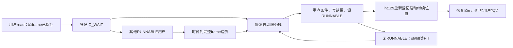

# K29 · 让原来的read停下来，事件发生后从同一次调用继续

从K28继续。非阻塞管道返回−11时，用户知道现在不能完成；阻塞模式需要让这个用户暂时失去运行资格，让其他用户产生字节或释放空间，再回到原调用之后。本节沿父读孩子写、父写孩子读、全部用户等待超时，以及另一个用户纯计算时超时四条路径完成这次改变。

<a id="wait-saved-request"></a>
## 保存的是请求与用户现场，不是内核局部数组

进程新增USER_IO_WAIT以及io操作、FD、用户地址、长度和截止tick。read/write先实际尝试一次；只有返回−11、不是显式定位、且打开对象没有NONBLOCK时才登记等待。已经完成的正前缀立即返回，不为凑足请求长度继续睡眠。非阻塞模式仍直接把−11交给用户，旧pipes程序行为不变。

登记前完整frame已经保存在本进程内核栈；登记用户地址与长度后再把状态改IO_WAIT，最后调度。不能把256字节内核buffer指针留下，因为当前C调用链会被切走，那个局部对象不再是长期请求所有者。用户页面则继续由阻塞进程持有，单线程期间它不会自己改变映射。重试时用其页表经HHDM复制，不要求该用户根正活动。

file_transfer把K24的有界副本逻辑提成按指定进程操作的函数。poll_waiters扫描八个进程槽，重试真正阻塞的read/write；仍−11就保留，正前缀、EOF或错误都写进保存frame的RAX，清掉请求地址，再设RUNNABLE。结果必须先写好，用户才可运行。状态变化后重查，时钟服务也周期重查；不是靠发一个容易丢失的“有事件”脉冲。

单CPU且内核不抢占，其他用户不能插入“检查条件→登记等待”的中间修改管道；普通内核边界还会在调度前重查一次。这个理由不适用于多CPU或多线程内核，那时需要锁与原子登记，不能直接照搬本节。

<a id="wait-ready-condition"></a>
## 就绪等待不提前替用户读走数据

编号22接FD、READ/WRITE条件和ticks。ticks=0只查询，1–500允许有限等待；立即满足时直接返回，不睡眠。等待期间重查ready，按请求筛选条件，同时总报告HUP和ERROR；截止到期且无条件成立返回0，负数仍表示接口错误。就绪等待不消费字节，返回后用户仍要处理另一进程先消费导致的EAGAIN。

这里是自有条件等待，不是Linux epoll的注册集合、ET边沿或兼容ABI。八个控制块直接构成当前有界等待集合，先把谓词、状态和返回现场交接做完整，再讨论更复杂的通知结构。

<a id="wait-kernel-continuation"></a>
## 没有用户可运行时，启动栈仍然能等待

原K22的int129把启动frame保存下来，直到所有用户退出才返回；现在这个继续位置也用于暂回内核服务。schedule区分session_active与session_idle：所有用户结束才清active；只是暂时服务时设idle并切长期内核根，汇编恢复启动frame。launch看到active仍真，就不回收用户资源，而是poll_waiters、选择下一个RUNNABLE，再通过int129登记新的启动继续位置并进入它。



如果仍有其他用户纯计算、一直不调用系统调用，单靠系统调用尾部检查会饿死超时与未来设备完成。每两个用户tick的调度边界只要发现IO_WAIT，就暂回启动服务栈；IRQ自身只保存现场、改状态、切根和选择继续frame，不在IRQ C链内复制用户数据、分配或串口打印。普通启动服务随后处理等待者，再公平轮转。计数只把真正来自IRQ的身份改变记作抢占。

所有用户都阻塞时，启动栈执行sti/hlt等PIT，醒后再重查。一个用户自己保留写端又永远阻塞读可能形成死锁，但这属于用户请求没有事件来源，内核不会因此PANIC或伪造EOF。有限wait_ready能由PIT超时；普通阻塞read/write没有暗中加超时。

返回启动栈后，旧int129frame所在栈空间可被当前C服务调用复用，所以恢复用户前必须再次int129更新kernel_return。用户运行期间启动栈停止使用，新的继续frame才稳定；不能保留一个已离开作用位置的旧栈指针。这和当前用户内核栈必须离开后才能释放一样，都是明确的寿命约束。

**按完整版本更新进程实现。** 新增等待状态、按进程传输、延后服务与launch循环；K28未变化部分保留，不要求重复敲写。

<!-- write: kernel/process/user.c -->
```c
#include <airi/storage.h> // 用户存储请求经过有界副本进入日志服务。
#include <airi/file.h> // 每进程FD表共享打开文件对象。
#include <airi/console.h> // 内核命令消费服务结果，不依赖主题和绘图。
#include <airi/elf.h> // 独立用户ELF检查器。
#include <airi/user.h> // 完整陷入与安全用户返回。
#include <airi/memory.h> // 页面、内核栈与长期根的所有权。
#include <airi/vm.h> // 每个进程有独立低半区。
#include <airi/timer.h> // 用户时间片依赖真实IRQ0。
#include <airi/kernel.h> // 有界串口输出与故障报告。
#define USER_CODE 0x400000ull // 旧受控映像的用户入口。
#define USER_STACK 0x70000000ull // 当前每进程一页初始用户栈。
#define STACK_BASE 0xffffe10000000000ull // 所有进程陷入栈位于同一长期内核分支。
#define USER_HEAP 0x10000000ull // ELF静态范围之外的用户页分配起点。
#define PROCESS_COUNT 8u // 有界进程表，不做动态扩容。
enum user_state { USER_UNUSED, USER_RUNNABLE, USER_RUNNING, USER_WAITING, USER_IO_WAIT, USER_ZOMBIE, USER_REAP_PENDING }; // 退出与回收是两个不同状态。
enum io_operation { IO_NONE, IO_READ, IO_WRITE, IO_READY }; // 等待保存操作条件，不保留内核局部buffer。
struct user_page { uint64_t address, physical; unsigned flags; }; // fork需要把同一VA映射到另一个物理页。
struct user_process { // 所有权和调度状态由内核持有，用户只能看到PID。
    struct airi_fd_table files; // exec转移表项，fork增加同一打开对象的引用。
    struct airi_address_space space; // 根和低半区表自有，高半区借用。
    struct airi_kernel_region stack; // 不能在仍使用它的C调用中释放。
    struct user_page owned[64]; // 所有用户数据页，含代码、静态数据、堆页和栈。
    unsigned count, pid, parent, user_ticks; // 资源数量、身份、父PID和本进程实际IRQ数。
    uint64_t fault_error, heap_next; // 用户故障证据与下一次有界用户页地址。
    int exit_code; // 自有wait接口返回普通退出码或负故障编码。
    enum user_state state; // 只有RUNNABLE可被调度器选中。
    int64_t wait_target; // 正PID表示指定孩子，-1表示任意孩子。
    uint64_t wait_status; // 已验证的父进程用户输出地址，阻塞期间父进程不会修改映射。
    enum io_operation io; // 只有USER_IO_WAIT消费下面的请求副本。
    unsigned io_fd, io_events; // FD属于本进程表，events只用于就绪等待。
    uint64_t io_address, io_bytes, io_deadline; // 用户页在阻塞期间仍由进程拥有，deadline按真实tick。
    struct airi_trap_frame initial; // 尚未运行时的寄存器值，不依赖临时C对象。
    struct airi_trap_frame *frame; // 运行后指向本进程内核栈的实际现场。
};
static struct user_process processes[PROCESS_COUNT]; // 槽可以复用，PID单调增长，不等于槽下标。
static struct user_process *current; // 只在完整陷入边界改变当前身份。
static unsigned next_pid = 1, root_pid, timer_switches, wait_blocks; // 每次运行会话的根身份和实际行为计数。
static unsigned io_block_count, io_wake_count, idle_halt_count; // 会话真实I/O阻塞与唤醒次数。
static bool session_idle, service_from_timer; // 是否暂回启动栈服务，和整个会话结束分开。
static bool session_active; // 只有用户会话活动时才接受用户IRQ或系统调用。
static int session_result; // 根用户退出结果，不用最后一个孩子的结果覆盖。
static struct airi_trap_frame *kernel_return; // 启动栈一直保留到整个用户会话结束。
extern const uint8_t airi_user_probe_start[], airi_user_probe_end[]; // 受控正常映像。
extern const uint8_t airi_user_bad_start[], airi_user_bad_end[]; // 用户cli故障。
extern const uint8_t airi_user_load_bad_start[], airi_user_load_bad_end[]; // 用户读supervisor页故障。
extern const uint8_t airi_user_rsp_bad_start[], airi_user_rsp_bad_end[]; // 不规范用户返回栈。
extern const uint8_t airi_hello_elf_start[], airi_hello_elf_end[]; // 既有独立用户C程序。
extern const uint8_t airi_process_elf_start[], airi_process_elf_end[]; // 新的fork/wait和抢占工作负载。
extern const uint8_t airi_waits_elf_start[], airi_waits_elf_end[]; // 真正阻塞与超时工作负载。
extern const uint8_t airi_pipes_elf_start[], airi_pipes_elf_end[]; // 非阻塞管道用户程序。
extern const uint8_t airi_storage_elf_start[], airi_storage_elf_end[]; // 写入和恢复共用一份明确分支的用户ELF。
extern const uint8_t airi_files_elf_start[], airi_files_elf_end[]; // 内存文件用户工作负载。
extern const uint8_t airi_worker_elf_start[], airi_worker_elf_end[]; // exec目标是另一个独立静态ELF。
extern const uint8_t airi_broken_elf_start[], airi_broken_elf_end[]; // 受控损坏输入，验证旧进程保持。
struct executable { const char *name; const uint8_t *start, *end; }; // 初始映像目录尚不是通用文件系统。
static const struct executable executables[] = { // 每份映像字节由内核只读段长期持有。
    {"hello", airi_hello_elf_start, airi_hello_elf_end}, // 独立C运行库与BSS观察。
    {"processes", airi_process_elf_start, airi_process_elf_end}, // fork/exec/wait实际工作负载。
    {"worker", airi_worker_elf_start, airi_worker_elf_end},
    {"waits", airi_waits_elf_start, airi_waits_elf_end}, // 阻塞流和就绪条件等待。
    {"pipes", airi_pipes_elf_start, airi_pipes_elf_end}, // 有界FIFO与关闭语义。
    {"storage", airi_storage_elf_start, airi_storage_elf_end}, // 显式提交记录。
    {"recover", airi_storage_elf_start, airi_storage_elf_end}, // 只读取已恢复记录。
    {"files", airi_files_elf_start, airi_files_elf_end}, // 真实用户FD演示。
    {"broken", airi_broken_elf_start, airi_broken_elf_end}, // 用于完整的坏ELF失败演示。
};
static const struct executable *find_program(const char *name) { // 输入是内核已复制的短NUL字符串。
    size_t bytes = airi_strlen(name); // 只读当前有效字符串，不保存其指针。
    for (unsigned i = 0; i < sizeof(executables) / sizeof(executables[0]); ++i) // 遍历固定目录。
        if (airi_strlen(executables[i].name) == bytes && !airi_memcmp(executables[i].name, name, bytes)) // 长度与全部名称字节都相同才匹配。
            return &executables[i]; // 只借长期静态目录项。
    return NULL; // 未知名称不触碰任何用户地址空间。
}
static unsigned slot(const struct user_process *p) { // 只接受processes中的真实槽，不接受临时复制对象。
    return (unsigned)(p - processes); // 同一数组内指针差得到稳定槽号。
}
static bool create_stack(struct user_process *p) { // 每槽前面留一页保护页，所有栈共享已存在高半区分支。
    uint64_t address = STACK_BASE + slot(p) * 5 * 4096ull + 4096; // 四页数据与一页保护，PID增长不扩散地址。
    return airi_memory_region_create(&p->stack, address, 4); // 完整成功后才借给用户根。
}
static bool user_access(const struct user_process *p, uint64_t address, size_t bytes, bool write) { // 检查完整用户范围，不直接解引用它。
    if (address >= AIRI_USER_LIMIT || bytes > AIRI_USER_LIMIT - address) // 排除内核地址与右端溢出。
        return false; // 零长度也保留本项目地址策略。
    for (size_t done = 0; done < bytes;) { // 跨越的每一页都必须满足权限。
        unsigned flags; // 当前叶子权限。
        if (!airi_vm_lookup(&p->space, address + done, NULL, &flags) || !(flags & AIRI_VM_USER) || (write && !(flags & AIRI_VM_WRITE))) // 输出指针还要求用户可写。
            return false; // 不先复制有效前缀。
        size_t part = 4096 - ((address + done) & 4095); // 当前页内剩余跨度。
        if (part > bytes - done) // 最后一段只到请求右端。
            part = bytes - done; // 不额外检查其他页。
        done += part; // 检查下一段。
    }
    return true; // 当前不可抢占内核中没有并发映射修改者。
}
static bool copy_user(struct user_process *p, void *buffer, uint64_t address, size_t bytes, bool to_user) { // 允许从非活动父根复制wait状态，但始终按其所有权查页。
    if (!user_access(p, address, bytes, to_user)) // 写用户缓冲必须检查WRITE，读只需要USER映射。
        return false; // 任何页失败都不复制。
    for (size_t done = 0; done < bytes;) { // 每次用HHDM别名处理一页中的有效段。
        uint64_t physical; // 翻译保留页内偏移。
        airi_vm_lookup(&p->space, address + done, &physical, NULL); // 完整检查后页表在本次内核操作中保持不变。
        size_t part = 4096 - ((address + done) & 4095); // 当前页边界。
        if (part > bytes - done) // 不超出剩余内容。
            part = bytes - done; // 缩到最后一段。
        if (to_user) // wait结果由内核写入父进程自己的页面。
            airi_memcpy(airi_memory_direct(physical), (uint8_t *)buffer + done, part); // 不切到父用户根也能访问其已拥有物理页。
        else // write系统调用把用户数据复制进内核副本。
            airi_memcpy((uint8_t *)buffer + done, airi_memory_direct(physical), part); // 不信任原始VA作为内核指针。
        done += part; // 推进下一段。
    }
    return true; // 同步结束，不借出buffer指针。
}
static long file_transfer(struct user_process *p, uint64_t fd, uint64_t address, size_t bytes, bool write, bool positioned, uint64_t offset) { // 允许在另一根的阻塞进程上重试，同步副本属于当前内核栈。
    char buffer[256]; // 一次有界副本，不跨调度保留。
    if (fd >= AIRI_FD_COUNT) // 完整64位编号先检查再转换。
        return -9; // -EBADF。
    if (bytes > sizeof(buffer)) // 不让用户长度覆盖内核栈。
        return -22; // -EINVAL。
    if (!user_access(p, address, bytes, !write)) // 输出在消费流或偏移之前完整验证。
        return -14; // -EFAULT。
    if (write) { // 用户内容在本次尝试内复制。
        copy_user(p, buffer, address, bytes, false); // 通过目标自己的页表，不解引用原始用户VA。
        if (!positioned && airi_fd_console(&p->files, (unsigned)fd)) { // 固定终端同步发送。
            airi_serial_write_bytes(buffer, bytes); // 不保存局部buffer给设备。
            return (long)bytes; // 返回逻辑进展。
        }
        return airi_fd_write(&p->files, (unsigned)fd, buffer, bytes, positioned, offset); // 满管道可返回EAGAIN。
    }
    long result = airi_fd_read(&p->files, (unsigned)fd, buffer, bytes, positioned, offset); // EOF和暂不可读分开。
    if (result > 0 && !copy_user(p, buffer, address, (size_t)result, true)) // 目标阻塞且单线程，已检查映射不应变化。
        airi_panic("validated file output mapping changed"); // 内部错误不丢字节后假装成功。
    return result; // 完成前缀或明确负错误。
}
static void poll_waiters(void) { // 仅普通内核上下文运行，IRQ本身不复制、分配或打印。
    for (unsigned i = 0; i < PROCESS_COUNT; ++i) { // 本阶段有界等待队列由进程槽直接表示。
        struct user_process *p = &processes[i]; // 控制块在等待期间不会回收。
        if (p->state != USER_IO_WAIT) // 不碰正在运行、wait孩子或已退出者。
            continue; // 检查下一个等待槽。
        long result; // 恢复到用户同一次调用的结果。
        if (p->io == IO_READY) { // 订阅的是条件，不是一次成功read的承诺。
            result = airi_fd_ready(&p->files, p->io_fd); // 当前条件可能被其他进程消费或改变。
            if (result >= 0) // 负错误必须原样唤醒，不能按位筛掉。
                result &= p->io_events | AIRI_READY_HUP | AIRI_READY_ERROR; // 对端关闭即使未显式请求也应可见。
            if (!result && airi_timer_ticks() < p->io_deadline) // 无条件成立且尚未超时。
                continue; // 保持等待，之后由状态变化或PIT服务重查。
        } else { // 阻塞read/write重新尝试同一个有界请求。
            result = file_transfer(p, p->io_fd, p->io_address, (size_t)p->io_bytes, p->io == IO_WRITE, false, 0); // 用户buffer仍由p持有。
            if (result == -11) // 暂时依旧没有进展。
                continue; // 不把原系统调用提前返回给用户忙等。
        }
        p->frame->rax = (uint64_t)result; // 用户返回位置仍在原调用之后。
        p->io = IO_NONE; // 这一次等待不再持有请求地址。
        p->io_address = p->io_bytes = p->io_deadline = 0; // 清过期的用户对象与截止值。
        p->state = USER_RUNNABLE; // 结果就绪之后才发布运行资格。
        ++io_wake_count; // 实际唤醒，不把查询次数计成完成。
        airi_log("[WAIT_WAKE] pid=%u result=%ld", p->pid, result); // 普通内核服务栈输出，不在IRQ里打印。
    }
}
static void cleanup(struct user_process *p) { // 目标根必须不活动，而且当前不能使用目标内核栈。
    airi_fd_close_all(&p->files, false); // 回滚或已退出空表均安全，不能遗留全局引用。
    if (p->space.root && !airi_vm_destroy(&p->space)) // 先解除并归还自有页表，不动借用的内核表。
        airi_panic("cannot destroy inactive user tables"); // 不能归还仍被活动根引用的数据页。
    while (p->count) // 用户代码与用户栈数据页分别归还。
        if (!airi_memory_return_page(p->owned[--p->count].physical)) // 先退到最后一个真正拥有的页。
            airi_panic("cannot return owned user page"); // 归属错误不继续复用内存。
    if (p->stack.count && !airi_memory_region_free(&p->stack)) // 调用者已经离开目标内核栈，才可销毁它。
        airi_panic("cannot reclaim user kernel stack"); // 不能在finish中提前做这一步。
    airi_memset(p, 0, sizeof(*p)); // 不留下可重复释放的根或句柄。
}
static void initial_frame(struct user_process *p, uint64_t entry, const char *name) { // 输入页已完整映射并清零，最后才发布首次返回现场。
    uint64_t stack_pointer = USER_STACK + 4096 - 16; // 旧受控汇编映像不读取argc，保持原布局。
    if (name) { // C程序使用本项目最小argc/argv栈协议。
        size_t bytes = airi_strlen(name) + 1; // 包含用户字符串的终止零。
        if (bytes > 64) // 当前程序名是固定短字面量，不支持无界参数。
            airi_panic("initial program name exceeds stack budget"); // 不覆盖用户启动布局。
        uint64_t physical; // 当前根未激活，通过软件翻译找到用户栈数据页。
        if (!airi_vm_lookup(&p->space, USER_STACK, &physical, NULL)) // 栈必须已建立。
            airi_panic("initial user stack mapping is missing"); // 不猜测owned数组中的位置。
        uint8_t *alias = airi_memory_direct(physical); // 通过内核HHDM填写尚未运行的用户栈。
        size_t name_offset = 4096 - bytes; // 字符串放在栈页高端。
        airi_memcpy(alias + name_offset, name, bytes); // 用户只得到自己的字符串副本。
        size_t words_offset = (name_offset & ~(size_t)15) - 4 * sizeof(uint64_t); // 四个64位槽，入口RSP仍16字节对齐。
        uint64_t *words = (uint64_t *)(alias + words_offset); // 已对齐的栈内数组。
        words[0] = 1; // argc目前固定一个程序名。
        words[1] = USER_STACK + name_offset; // argv[0]必须是用户VA，不是HHDM指针。
        words[2] = 0; // argv[1]结束指针数组。
        words[3] = 0; // 空环境，当前没有完整ELF辅助向量。
        stack_pointer = USER_STACK + words_offset; // CPU初始RSP指向argc槽。
    }
    p->frame = &p->initial; // 先保存独立寄存器值，place_frame稍后复制进实际内核栈。
    airi_memset(p->frame, 0, sizeof(*p->frame)); // 首次没有旧GPR。
    p->frame->rip = entry; // ELF入口或已知汇编入口。
    p->frame->cs = 27; // 用户代码段与RPL3。
    p->frame->ss = 35; // 用户数据段与RPL3。
    p->frame->rsp = stack_pointer; // 使用刚准备的用户布局。
    p->frame->rflags = 0x202; // 用户IF开启，IOPL为零。
}
static bool owned_page(struct user_process *p, uint64_t address, unsigned flags) { // 一次只建立一页，失败页面仍可由统一cleanup找到。
    if (p->count == 64) // 包括初始栈在内的全部数据页预算。
        return false; // 不越过所有权数组。
    uint64_t physical = airi_memory_take_page(); // 取得真正归本上下文持有的物理页。
    if (!physical) // 耗尽时没有需要登记的页。
        return false; // 调用方回滚已有部分。
    airi_memset(airi_memory_direct(physical), 0, 4096); // 文件尾部与BSS默认都从零开始。
    if (!airi_vm_map(&p->space, address, physical, flags | AIRI_VM_USER)) { // 单页映射失败还没有发布到所有权数组。
        airi_memory_return_page(physical); // 明确归还本次未接入数据页。
        return false; // 调用者回滚此前成功的部分。
    }
    p->owned[p->count++] = (struct user_page){address, physical, flags | AIRI_VM_USER}; // 保存VA/PA/权限供fork复制与精确回收。
    return true; // 每个已登记数据页都有对应映射。
}
static int prepare_elf(struct user_process *p, const uint8_t *image, size_t bytes, const char *name, bool make_stack) { // 空目标只拥有新用户资源；exec不另建正在使用的内核栈。
    struct airi_elf_view view; // 只借输入ELF直到复制结束。
    const char *error = airi_elf_inspect(image, bytes, &view); // 在任何资源分配前校验整个输入。
    if (error) { // 损坏格式不能触发后续内存写入。
        airi_log("[ELF_REJECTED] %s", error); // 给出精确范围/权限原因。
        return -8; // -ENOEXEC，旧输出和调用者原上下文都未改变。
    }
    if (make_stack && !create_stack(p)) // 内核陷入栈先完成，再借高半区。
        return -12; // -ENOMEM，区域接口已回滚失败。
    if (!airi_memory_user_space(&p->space)) // 创建独立低半区。
        goto failed; // 后续失败均收回所有已持有资源。
    for (unsigned i = 0; i < view.count; ++i) { // 每段独立赋予对应权限。
        const struct airi_elf_segment *segment = &view.segments[i]; // 元数据已经过统一校验。
        unsigned flags = ((segment->flags & 2) ? AIRI_VM_WRITE : 0) | ((segment->flags & 1) ? AIRI_VM_EXEC : 0); // ELF PF标志转换成本内核权限枚举。
        uint64_t first = segment->address & ~4095ull; // 覆盖段首所在页。
        uint64_t end = (segment->address + segment->memory_bytes + 4095) & ~4095ull; // 包含完整BSS跨度。
        for (uint64_t address = first; address < end; address += 4096) // 所有页面先清零再接入。
            if (!owned_page(p, address, flags)) // 物理耗尽或映射失败都终止本次装载。
                goto failed; // 清理根/表后再归还数据页。
        for (uint64_t done = 0; done < segment->file_bytes;) { // 只复制filesz字节，memsz剩余继续保持零。
            uint64_t physical; // lookup结果包含当前页内偏移。
            if (!airi_vm_lookup(&p->space, segment->address + done, &physical, NULL)) // 已映射跨度必须可查询。
                goto failed; // 内部装载状态不一致也不运行。
            uint64_t part = 4096 - ((segment->address + done) & 4095); // 当前页内可复制长度。
            if (part > segment->file_bytes - done) // 不从文件右端外复制字节。
                part = segment->file_bytes - done; // 最后一次缩到实际剩余。
            airi_memcpy(airi_memory_direct(physical), view.image + segment->offset + done, (size_t)part); // 内核控制的物理别名可初始化最终只读/可执行页。
            done += part; // 下一次继续剩余文件内容。
        }
    }
    if (!owned_page(p, USER_STACK, AIRI_VM_WRITE)) // 栈单独RW/NX，不采用ELF可执行栈请求。
        goto failed; // 失败仍统一回滚。
    initial_frame(p, view.entry, name); // 用户_start接收最小argc/argv协议。
    airi_log("[ELF_LOAD] entry=0x%llx segments=%u data_pages=%u argc=1", (unsigned long long)view.entry, view.count, p->count); // 不含页表与内核栈的用户数据页数量。
    return 0; // 只准备新空间，尚未切CR3或覆盖旧现场。
failed: // 长期根仍活动，用户空间从未开始执行。
    cleanup(p); // 页表、用户数据和内核栈全部回收。
    return -12; // -ENOMEM，不提供部分映像。
}
static void place_frame(struct user_process *p) { // 初始寄存器值完成后复制到自己拥有的内核栈。
    uint64_t top = p->stack.virtual_address + p->stack.count * 4096ull; // TSS以后从同一个栈顶压入真实现场。
    p->frame = (void *)(uintptr_t)(top - sizeof(*p->frame)); // 与公共入口的176字节布局一致。
    *p->frame = p->initial; // 不借用临时C结构或其他进程的内核栈。
}
static bool prepare_flat(struct user_process *p, const uint8_t *image, size_t bytes) { // 保留受控指令故障回归，不作为ELF加载接口。
    if (!bytes || bytes > 4096 || !create_stack(p)) // 本节旧映像最多一页。
        return false; // 栈创建失败已回滚。
    if (!airi_memory_user_space(&p->space) || !owned_page(p, USER_CODE, AIRI_VM_EXEC) || !owned_page(p, USER_STACK, AIRI_VM_WRITE)) // 分别拥有根、代码和栈。
        goto failed; // 所有权列表可清理全部已成功部分。
    airi_memcpy(airi_memory_direct(p->owned[0].physical), image, bytes); // 映像内引用保持旧固定布局。
    initial_frame(p, USER_CODE, NULL); // 受控汇编不读取argc/argv。
    return true; // 尚未设置可运行状态。
failed: // 目标从未被调度，当前根和栈均不属于它。
    cleanup(p); // 完整回滚。
    return false; // 不运行半个上下文。
}
static struct user_process *find_pid(unsigned pid) { // PID与数组槽分开，退出回收后不会匹配旧身份。
    for (unsigned i = 0; i < PROCESS_COUNT; ++i) // 遍历有界进程表。
        if (processes[i].state != USER_UNUSED && processes[i].pid == pid) // 只查仍存活或待回收的身份。
            return &processes[i]; // 内核内部借用，不向用户交指针。
    return NULL; // 未找到活身份。
}
static struct user_process *unused(void) { // 准备中的槽不会被发布为RUNNABLE。
    for (unsigned i = 0; i < PROCESS_COUNT; ++i) // 固定容量避免无界内核分配。
        if (processes[i].state == USER_UNUSED) // 调用者在不可抢占内核中独占准备。
            return &processes[i]; // 后续失败必须清掉全部所有权。
    return NULL; // 表满返回明确失败。
}
static void collect_pending(void) { // 只在新的用户陷入入口调用，不在旧进程退出的C调用中释放其栈。
    for (unsigned i = 0; i < PROCESS_COUNT; ++i) // 回收父进程已取得状态的孩子。
        if (&processes[i] != current && processes[i].state == USER_REAP_PENDING) // 当前真正运行的内核栈不能在此回收。
            cleanup(&processes[i]); // 非活动根和已离开的内核栈可安全解除。
}
enum schedule_reason { REASON_TIMER, REASON_YIELD, REASON_WAIT, REASON_EXIT, REASON_IO }; // 原因用于验证真实抢占，不混成主动yield。
static struct airi_trap_frame *select_user(struct user_process *p) { // 只在完整陷入现场边界切根和TSS。
    current = p; // 之后的IRQ和系统调用归属这个身份。
    p->state = USER_RUNNING; // 新用户即将获得CPU。
    airi_trap_set_stack(p->stack.virtual_address + p->stack.count * 4096ull); // 陷入时使用目标自己的内核栈。
    if (!airi_vm_activate(&p->space)) // 所有高半区内核映射在准备时已存在。
        airi_panic("cannot activate selected user root"); // 不返回到缺映射的调用链。
    return airi_user_resume(p->frame); // 用户返回地址与标志必须仍符合边界。
}
static struct airi_trap_frame *pause_for_service(bool from_timer) { // 完整用户frame已保存，暂回长期启动栈做可延后工作。
    session_idle = true; // 会话仍active，不是用户程序已经退出。
    service_from_timer = from_timer; // 真正IRQ导致的换身份计数另记。
    airi_memory_use_kernel(); // 启动服务不依赖某个用户根。
    kernel_return->rax = 0; // 暂停结果不当成应用最终退出值。
    return kernel_return; // 汇编离开当前进程栈，之后才能安全服务其他等待者。
}
static struct airi_trap_frame *schedule(enum schedule_reason reason) { // 当前完整frame边界可切换，但IRQ不直接执行复杂I/O。
    struct user_process *old = current; // 仍暂用old的内核栈。
    if (old->state == USER_RUNNING) // 等待或退出不能误改回可运行。
        old->state = USER_RUNNABLE; // 时间片结束仍可运行。
    if (reason != REASON_TIMER) // 普通内核边界可重试等待条件。
        poll_waiters(); // 已有字节、关闭或错误形成后再唤醒。
    else // IRQ只检查状态，并把可延后服务交给启动栈。
        for (unsigned i = 0; i < PROCESS_COUNT; ++i) // 即使另有纯计算用户，也不能饿死超时与未来设备完成。
            if (processes[i].state == USER_IO_WAIT) // 有等待源需要周期服务。
                return pause_for_service(true); // 不在IRQ C链里复制用户数据或输出。
    for (unsigned n = 1; n <= PROCESS_COUNT; ++n) { // 从old之后轮转一圈。
        struct user_process *next = &processes[(slot(old) + n) % PROCESS_COUNT]; // PID与槽仍分开。
        if (next->state == USER_RUNNABLE) { // 仅可运行者有可返回的用户现场。
            if (next != old && reason == REASON_TIMER) // 真IRQ切不同身份。
                ++timer_switches; // 主动阻塞不冒充抢占。
            return select_user(next); // 汇编恢复目标frame。
        }
    }
    for (unsigned i = 0; i < PROCESS_COUNT; ++i) // 没有可运行者时检查仍在等待的活进程。
        if (processes[i].state == USER_WAITING || processes[i].state == USER_IO_WAIT) // 可能正在等设备、超时或未来对端。
            return pause_for_service(false); // 允许启动栈hlt等待真实IRQ，不PANIC用户死锁。
    session_active = false; // 所有用户均结束，此时才算完整会话退出。
    session_idle = false; // 不再保留暂停身份。
    airi_memory_use_kernel(); // 最后一个用户根也变成不活动。
    kernel_return->rax = (uint64_t)(int64_t)session_result; // 根用户的真实退出结果。
    return kernel_return; // 回启动栈后统一回收残留资源。
}
static struct airi_trap_frame *exit_current(int code) { // CPU还在当前进程内核栈上，先结束身份而不释放栈。
    struct user_process *p = current; // 当前退出者的稳定控制块。
    airi_fd_close_all(&p->files, false); // exit立即释放文件，僵尸只保留等待状态与待回收内存。
    p->exit_code = code; // 保存给父进程wait读取。
    p->state = USER_ZOMBIE; // 不再运行，但资源和状态尚存在。
    if (p->pid == root_pid) // 整个会话的结果以最初根用户为准。
        session_result = code; // 孩子退出不改变根结果。
    struct user_process *parent = find_pid(p->parent); // 父身份可能已退出或不存在。
    if (parent && parent->state == USER_WAITING && (parent->wait_target == -1 || (uint64_t)parent->wait_target == p->pid)) { // 只有真正等待此孩子的父进程可以被唤醒。
        bool copied = !parent->wait_status || copy_user(parent, &code, parent->wait_status, sizeof(code), true); // 通过父进程自己的页表写结果。
        parent->frame->rax = copied ? p->pid : (uint64_t)-14ll; // 返回子PID或明确地址错误。
        parent->state = USER_RUNNABLE; // 结果形成后才公开可运行状态。
        parent->wait_target = 0; // 这一次等待已经结束。
        parent->wait_status = 0; // 不保留用户局部对象的过期地址。
        if (copied) // 地址错误时保留僵尸，让父进程能用有效指针重试。
            p->state = USER_REAP_PENDING; // 下一次别的用户陷入后才能释放本次仍在用的内核栈。
    }
    airi_log("[USER_EXIT] pid=%u code=%d user_ticks=%u", p->pid, code, p->user_ticks); // 正常系统调用上下文记录身份结果。
    return schedule(REASON_EXIT); // 子进程或父进程可继续，未必立刻回启动栈。
}
static long fork_current(struct airi_trap_frame *parent_frame) { // 首版逐页复制，不实现COW。
    struct user_process *parent = current; // 父的用户数据与完整返回现场。
    struct user_process *child = unused(); // 未发布的新槽。
    if (!child) // 表满没有可分配身份。
        return -11; // -EAGAIN。
    if (!create_stack(child) || !airi_memory_user_space(&child->space)) // 先创建独立内核栈和空低半区。
        goto failed; // 父状态从未改变。
    for (unsigned i = 0; i < parent->count; ++i) { // 包括用户栈和此前申请的堆页。
        const struct user_page *page = &parent->owned[i]; // 每页原VA、权限和物理地址。
        if (!owned_page(child, page->address, page->flags)) // 子页在相同VA，但物理所有权独立。
            goto failed; // 回滚全部子资源，不改变父页面。
        airi_memcpy(airi_memory_direct(child->owned[child->count - 1].physical), airi_memory_direct(page->physical), 4096); // 复制完整页内容，父子以后写入互不影响。
    }
    airi_fd_clone(&child->files, &parent->files); // 页复制全部成功后再取得FD引用，失败cleanup仍能撤销。
    child->initial = *parent_frame; // 用户RIP/RSP和寄存器从同一次fork返回点继续。
    child->initial.rax = 0; // 子分支看到fork返回0。
    child->pid = next_pid++; // 全部内存成功后才分配PID。
    child->parent = parent->pid; // 关系用身份而不是可能复用的槽指针表示。
    child->heap_next = parent->heap_next; // 复制后的用户页分配游标也属于子空间。
    place_frame(child); // 只把用户返回现场放入子内核栈，不复制父的内核C调用链。
    child->state = USER_RUNNABLE; // 准备完成后才让IRQ调度器看见它。
    airi_log("[FORK] parent=%u child=%u copied_pages=%u", parent->pid, child->pid, child->count); // 实际复制数量含用户栈与堆。
    return child->pid; // 父分支得到正子PID。
failed: // 还没有向调度器发布孩子，当前仍在父根和父内核栈上。
    cleanup(child); // 删除不活动子根和其独立栈，父继续原系统调用。
    return -12; // -ENOMEM，父的地址空间和返回点不变。
}
static struct airi_trap_frame *wait_current(struct airi_trap_frame *f) { // 自有wait ABI返回PID，status写普通int而非Linux编码。
    int64_t target = (int64_t)f->rdi; // -1表示任意孩子，其他必须为正PID。
    uint64_t status = f->rsi; // NULL允许只回收不读取退出码。
    if ((target < 1 && target != -1) || (status && !user_access(current, status, sizeof(int), true))) { // 输出范围在阻塞之前就核对。
        f->rax = (target < 1 && target != -1) ? (uint64_t)-22ll : (uint64_t)-14ll; // 参数错误不改变调度状态。
        return airi_user_resume(f); // 当前进程仍运行，可换参数重试。
    }
    bool found = false; // 区分没有孩子与孩子仍在运行。
    for (unsigned i = 0; i < PROCESS_COUNT; ++i) { // 只匹配当前PID的子关系。
        struct user_process *child = &processes[i]; // 槽可能已经回收或属于其他父进程。
        if (child->state == USER_UNUSED || child->state == USER_REAP_PENDING || child->parent != current->pid || (target != -1 && (uint64_t)target != child->pid)) // 不允许等待别人的子进程。
            continue; // 查找下一个可能孩子。
        found = true; // 至少有一个真实孩子。
        if (child->state == USER_ZOMBIE) { // 已结束孩子可以在父内核栈上立即回收。
            unsigned pid = child->pid; // 清理前保存返回身份。
            int code = child->exit_code; // 清理前保存退出状态。
            if (status && !copy_user(current, &code, status, sizeof(code), true)) // 即使前面检查过也保留明确复制结果。
                airi_panic("wait output mapping changed in nonpreemptible kernel"); // 内部不变量被破坏，不静默错写。
            cleanup(child); // 当前确实不在孩子栈上，其根也不活动。
            f->rax = pid; // 回收完成后返回已取得状态的孩子PID。
            return airi_user_resume(f); // 普通返回到父用户调用方。
        }
    }
    if (!found) { // 没有匹配孩子，不应永远等待。
        f->rax = (uint64_t)-10ll; // -ECHILD。
        return airi_user_resume(f); // 父可继续其他工作。
    }
    current->wait_target = target; // 保存要等待的身份条件。
    current->wait_status = status; // 父阻塞期间单线程不会修改这些用户映射。
    current->state = USER_WAITING; // 先记录条件与结果地址，再让调度器跳过父。
    ++wait_blocks; // 真实阻塞，而非轮询返回成功。
    return schedule(REASON_WAIT); // 孩子结束时填写此f->rax并唤醒父。
}
static long allocate_user(size_t bytes) { // 按页提供有界用户内存，不是完整malloc。
    if (!bytes || bytes > 16384) // 一次最多四页，防止无界请求。
        return -22; // -EINVAL。
    unsigned count = (unsigned)((bytes + 4095) / 4096); // 请求向上取整为完整页。
    if (count > 64 - current->count) // 保留所有权数组容量。
        return -12; // -ENOMEM。
    uint64_t address = current->heap_next; // 首次从ELF范围之外开始。
    unsigned before = current->count; // 失败只回滚本次新增映射。
    for (unsigned i = 0; i < count; ++i) // 页物理可以不连续，用户VA连续。
        if (!owned_page(current, address + i * 4096ull, AIRI_VM_WRITE)) // 成功页面已在owned中登记。
            goto rollback; // 游标尚未前移。
    current->heap_next += count * 4096ull; // 全部成功后再发布新的末端。
    return (long)address; // 当前没有逐对象free，进程结束统一回收。
rollback: // 已有用户页面不受本次耗尽影响。
    while (current->count > before) { // 只处理新增的成功项。
        const struct user_page *page = &current->owned[--current->count]; // 先退到最后一项。
        if (!airi_vm_unmap(&current->space, page->address) || !airi_memory_return_page(page->physical)) // 活动根必须先断映射并失效，再归还。
            airi_panic("cannot roll back user page allocation"); // 内部所有权错误不能被吞掉。
    }
    return -12; // 不返回半段用户范围。
}
static long exec_current(struct airi_trap_frame *f) { // 成功不返回旧用户调用，失败必须保持旧PID、空间和现场。
    char name[64]; // 先把用户名称复制到当前内核栈，后续不再借旧用户页。
    bool terminated = false; // 不能把未终止输入交给strlen。
    for (unsigned i = 0; i < sizeof(name); ++i) { // 有界逐字节读取，允许跨用户页但不越过上限。
        if (f->rdi > UINT64_MAX - i || !copy_user(current, &name[i], f->rdi + i, 1, false)) // 名称本身也可能是坏指针。
            return -14; // -EFAULT，旧用户继续。
        if (!name[i]) { // 取得完整NUL字符串后才查目录。
            terminated = true; // 后续strlen有明确终止界限。
            break; // 不读取字符串后无关字节。
        }
    }
    if (!terminated) // 超过本项目名称预算。
        return -36; // -ENAMETOOLONG。
    const struct executable *image = find_program(name); // 不存在目标不用分配新根。
    if (!image) // 和损坏格式是两种不同失败。
        return -2; // -ENOENT。
    struct user_process next = {0}; // 临时所有者不在进程表中，尚不能被调度。
    int error = prepare_elf(&next, image->start, (size_t)((uintptr_t)image->end - (uintptr_t)image->start), name, false); // 不创建第二条内核栈，先完整准备新用户空间。
    if (error) // 构造器已回滚next，current所有字段和旧f不变。
        return error; // -ENOEXEC或-ENOMEM。
    struct user_process old = *current; // 暂存旧用户资源，稍后在切离旧根之后归还。
    unsigned old_pages = old.count; // 归还前保留实际替换规模用于记录。
    next.pid = old.pid; // exec保持进程身份。
    next.parent = old.parent; // 父仍等待同一个孩子。
    next.user_ticks = old.user_ticks; // 同一身份的已运行计数不丢失。
    next.heap_next = USER_HEAP; // 新映像的动态用户页从空开始。
    next.stack = old.stack; // 明确转移正在使用的内核栈所有权，VA和物理内容都不变。
    airi_memset(&old.stack, 0, sizeof(old.stack)); // old清理者不再拥有这组栈，不能重复释放。
    next.frame = f; // 真实返回现场仍在同一内核栈上，不能留下指向next.initial局部对象的指针。
    *f = next.initial; // 事务提交时才覆盖旧用户RIP/RSP和寄存器。
    next.files = old.files; // 文件表所有权从旧映像转到新映像，偏移和普通FD继续存在。
    airi_memset(&old.files, 0, sizeof(old.files)); // cleanup旧映像不能重复关闭已转移引用。
    airi_fd_close_all(&next.files, true); // 只有成功提交才关闭CLOEXEC，失败exec不影响原表。
    next.state = USER_RUNNING; // 此身份继续运行，但从新_start开始。
    *current = next; // 把新所有权发布到原进程槽，PID不变。
    if (!airi_vm_activate(&current->space)) // 新根已借到当前内核栈及内核映射。
        airi_panic("cannot activate committed exec image"); // 硬件不变量失败不能回旧用户继续。
    cleanup(&old); // 旧根已经不活动，旧数据可回收；当前内核栈已转移所以不释放。
    airi_log("[EXEC_COMMIT] pid=%u program=%s old_pages=%u new_pages=%u", current->pid, name, old_pages, current->count); // 名称是内核副本，不引用刚释放用户页。
    return 0; // 调用者直接恢复新f，不把这个0写回旧用户调用。
}
struct airi_trap_frame *airi_user_resume(struct airi_trap_frame *f) { // 所有用户iretq路径使用同一规范地址和标志策略。
    if (f->cs != 27 || f->ss != 35 || f->rip >= AIRI_USER_LIMIT || f->rsp >= AIRI_USER_LIMIT) { // 坏返回不能变成内核GP。
        airi_log("[USER_RETURN_REJECTED] pid=%u rip=0x%llx rsp=0x%llx", current->pid, (unsigned long long)f->rip, (unsigned long long)f->rsp); // 不解引用错误地址。
        return exit_current(-22); // 只结束拥有这个现场的用户。
    }
    f->rflags &= ~((3ull << 12) | (1ull << 14) | (1ull << 17)); // 清IOPL、NT和VM。
    f->rflags |= 0x202; // 保留必需bit1并保持用户IF。
    return f; // 返回选中进程的完整现场。
}
struct airi_trap_frame *airi_user_timer(struct airi_trap_frame *f) { // IRQ路径不分配、不回收、不打印，只有状态与根选择。
    if (!session_active || !current || current->state != USER_RUNNING) // CS3的IRQ必须有明确用户所有者。
        airi_panic("user IRQ without a running process"); // 不把未知内核栈交给调度器。
    current->frame = f; // 保存真正被打断的位置，不只保存C ABI寄存器。
    ++current->user_ticks; // 实际CPU用户时间片事件数。
    if (current->user_ticks % 2 == 0) // 每两个实际IRQ尝试一次round-robin。
        return schedule(REASON_TIMER); // 没有其他可运行者时恢复同一个进程。
    return airi_user_resume(f); // 也不能跳过坏返回检查。
}
struct airi_trap_frame *airi_user_trap(struct airi_trap_frame *f) { // 内核仍不可抢占，只在完整用户陷入边界处理进程状态。
    if (f->vector == 129 && f->cs == 8 && (!session_active || session_idle) && current && current->state == USER_RUNNABLE) { // 内核启动一组已经准备好的用户。
        kernel_return = f; // 启动栈的继续位置一直保留。
        session_idle = false; // 当前int129重新登记了仍在启动栈上的继续位置。
        session_active = true; // 之后的CS3陷入有会话归属。
        return select_user(current); // 按目标根和TSS进入首个用户。
    }
    if (!session_active || !current || current->state != USER_RUNNING || (f->cs & 3) != 3) // 内核错误不能伪装为用户故障。
        airi_panic("user trap without a running process"); // 维持故障边界。
    collect_pending(); // 现在确实在另一条内核栈上，回收已经离开的孩子。
    current->frame = f; // 系统调用与故障都以当前实际现场为继续点。
    if (f->vector != 128) { // 用户CPU故障只结束拥有者。
        current->fault_error = f->error; // 保存权限故障证据。
        airi_log("[USER_FAULT] pid=%u vector=%llu error=0x%llx rip=0x%llx cr2=0x%llx", current->pid, (unsigned long long)f->vector, (unsigned long long)f->error, (unsigned long long)f->rip, (unsigned long long)(f->vector == 14 ? airi_trap_fault_address() : 0)); // PF才读取本次CR2。
        return exit_current(-(128 + (int)f->vector)); // 自有故障编码，不宣称Linux信号ABI。
    }
    if (f->rax == 1 || f->rax == 10 || f->rax == 15 || f->rax == 16) { // 同步文件与流的完整副本边界。
        bool write = f->rax == 1 || f->rax == 16; // 输出到流或文件。
        bool positioned = f->rax == 15 || f->rax == 16; // 显式偏移不支持阻塞流。
        long result = file_transfer(current, f->rdi, f->rsi, (size_t)f->rdx, write, positioned, f->r10); // 先实际尝试一次。
        if (result == -11 && !positioned && !airi_fd_nonblocking(&current->files, (unsigned)f->rdi)) { // 阻塞流暂不可完成，用户不能提前看到EAGAIN。
            current->io = write ? IO_WRITE : IO_READ; // 保存需要重试的操作种类。
            current->io_fd = (unsigned)f->rdi; // 此时FD已由file_transfer完整验证。
            current->io_address = f->rsi; // 用户页继续归此进程所有，不借内核局部buffer。
            current->io_bytes = f->rdx; // 一次最多256字节，已经验证跨度。
            current->state = USER_IO_WAIT; // 条件和数据先登记，再移出可运行集合。
            ++io_block_count; // 实际阻塞计数。
            airi_log("[WAIT_REGISTER] pid=%u operation=%s fd=%u", current->pid, write ? "write" : "read", current->io_fd); // 普通系统调用上下文记录。
            return schedule(REASON_IO); // 选择别的用户或进入真正内核空闲等待。
        }
        f->rax = (uint64_t)result; // 非阻塞仍把EAGAIN交给用户，其他结果直接返回。
    } else if (f->rax == 2) // 退出后不再恢复此用户指令。
        return exit_current((int)(f->rdi & 255)); // 普通退出码0–255。
    else if (f->rax == 3) // getpid查询当前身份。
        f->rax = current->pid; // 槽复用不改变已运行PID语义。
    else if (f->rax == 4) // 显式yield让出一次时间片。
        return schedule(REASON_YIELD); // 和真实timer抢占分开计数。
    else if (f->rax == 5) // 单调tick，不是墙钟。
        f->rax = airi_timer_ticks(); // IRQ在用户执行期间更新。
    else if (f->rax == 6) // fork复制所有用户页与返回现场。
        f->rax = (uint64_t)fork_current(f); // 父得到子PID，孩子自己的frame已经设为0。
    else if (f->rax == 7) { // exec失败保留旧现场，成功已把f替换成新入口。
        long result = exec_current(f); // 名称复制与新空间事务在不可抢占内核完成。
        if (result < 0) // 只有失败才向旧用户调用返回错误。
            f->rax = (uint64_t)result; // PID和旧地址空间仍保持。
        return airi_user_resume(f); // 成功恢复新_start，失败恢复旧调用下一条指令。
    } else if (f->rax == 8) // wait可直接回收或真的阻塞。
        return wait_current(f); // 结果恢复到父同一次调用之后。
    else if (f->rax == 9) // 申请零填充用户页。
        f->rax = (uint64_t)allocate_user((size_t)f->rdi); // 不成功不前移堆游标。
    else if (f->rax == 11) { // open只消费内核持有的短路径副本。
        char path[32]; // 与平坦目录名容量一致。
        bool copied = false; // 必须看到终止零才可交给文件层。
        for (size_t i = 0; i < sizeof(path); ++i) { // 逐字节检查，不能strlen用户指针。
            if (!copy_user(current, &path[i], f->rdi + i, 1, false)) // 未映射或内核地址拒绝。
                break; // 不发生创建或截断。
            if (!path[i]) { // 有界NUL字符串完成。
                copied = true; // 副本可在当前内核调用中使用。
                break; // 不额外读取终止零后面的用户页。
            }
        }
        f->rax = copied && f->rsi <= 31 ? (uint64_t)airi_fd_open(&current->files, path, (unsigned)f->rsi) : (uint64_t)-14ll; // 错误路径不变更文件。
    } else if (f->rax == 12) // close撤销当前表项引用。
        f->rax = (f->rdi < AIRI_FD_COUNT ? (uint64_t)airi_fd_close(&current->files, (unsigned)f->rdi) : (uint64_t)-9ll); // 不删除文件内容。
    else if (f->rax == 13) // dup共享打开对象，标志放在新表项。
        f->rax = (f->rdi < AIRI_FD_COUNT ? (uint64_t)airi_fd_dup(&current->files, (unsigned)f->rdi, f->rsi != 0) : (uint64_t)-9ll); // 单CPU内核中同步加引用。
    else if (f->rax == 14) // 仅绝对定位，不实现Linux全部whence。
        f->rax = (f->rdi < AIRI_FD_COUNT ? (uint64_t)airi_fd_seek(&current->files, (unsigned)f->rdi, f->rsi) : (uint64_t)-9ll); // 共享打开对象的偏移随之变化。
    else if (f->rax == 17 || f->rax == 18) { // 日志append与read不是通用文件ABI。
        uint8_t buffer[480]; // payload上限与磁盘格式一致，设备不直接访问用户页。
        long result; // 实际长度、sequence或负错误。
        if (f->rax == 17) { // RDI输入地址，RSI长度。
            if (!f->rsi || f->rsi > sizeof(buffer)) // 不创建空记录或无界内核副本。
                result = -22; // -EINVAL。
            else if (!copy_user(current, buffer, f->rdi, (size_t)f->rsi, false)) // 完整复制后才可能产生磁盘副作用。
                result = -14; // -EFAULT。
            else { // 设备同步等待临时开IRQ，但不会在CS0切用户。
                airi_log("[STORAGE_REQUEST] pid=%u operation=append bytes=%llu wait=kernel", current->pid, (unsigned long long)f->rsi); // 诚实区分同步内核等待与后续用户阻塞。
                result = airi_storage_append(buffer, (size_t)f->rsi); // 成功已完成数据和提交同步。
            }
        } else { // RDI索引，RSI用户输出，RDX容量。
            if (f->rdi >= 64 || f->rdx > sizeof(buffer)) // 完整64位索引不能截断成其他记录。
                result = -22; // -EINVAL。
            else if (!user_access(current, f->rsi, (size_t)f->rdx, true)) // 先验证完整用户输出范围。
                result = -14; // -EFAULT，不进行设备I/O。
            else { // 仅将校验通过的实际长度复制到用户。
                result = airi_storage_read((unsigned)f->rdi, buffer, (size_t)f->rdx); // 设备数据和commit重新核对。
                if (result > 0 && !copy_user(current, buffer, f->rsi, (size_t)result, true)) // 当前映射不应变化。
                    airi_panic("validated storage output mapping changed"); // 内部不变量破坏明确停止。
            }
        }
        f->rax = (uint64_t)result; // 同一次用户调用取得精确结果。
    } else if (f->rax == 19) // 已恢复前缀数值查询。
        f->rax = (uint64_t)airi_storage_count(); // 缺设备或不确定状态返回负数。
    else if (f->rax == 20) { // pipe原子创建并返回两个整数，不暴露内部环。
        unsigned ends[2]; // 内核副本，发布前用户输出已验证。
        long result; // 0或负错误。
        if (f->rsi > 1) // 明确接受阻塞0与非阻塞1，其他参数拒绝。
            result = -22; // -EINVAL。
        else if (!user_access(current, f->rdi, sizeof(ends), true)) // 坏输出不能创建无法交给用户的FD。
            result = -14; // -EFAULT。
        else { // 没有半次FD分配的用户可见状态。
            result = airi_fd_pipe(&current->files, ends, f->rsi != 0); // 两端和缓冲都齐后才成功。
            if (!result && !copy_user(current, ends, f->rdi, sizeof(ends), true)) // 映射在本次调用中不应变化。
                airi_panic("validated pipe output mapping changed"); // 明确内核不变量。
        }
        f->rax = (uint64_t)result; // 失败输出保持原值。
    } else if (f->rax == 21) // 当前就绪条件查询，不保存通知事件。
        f->rax = f->rdi < AIRI_FD_COUNT ? (uint64_t)airi_fd_ready(&current->files, (unsigned)f->rdi) : (uint64_t)-9ll; // 完整64位编号先限制。
    else if (f->rax == 22) { // 等待管道条件，有限tick超时，0表示只查询。
        long result; // 事件掩码、0超时或负错误。
        if (f->rdi >= AIRI_FD_COUNT || !f->rsi || (f->rsi & ~3ull) || f->rdx > 500) // 只接受READ/WRITE请求，最多五秒。
            result = -22; // -EINVAL。
        else { // 先看当前条件，避免已经满足还去睡眠。
            result = airi_fd_ready(&current->files, (unsigned)f->rdi); // FD错误原样返回。
            if (result >= 0) // 负错误不参与位运算。
                result &= (long)f->rsi | AIRI_READY_HUP | AIRI_READY_ERROR; // 关闭与错误始终报告。
            if (!result && f->rdx) { // 条件未满足且愿意有限等待。
                current->io = IO_READY; // 不读写任何字节，只重查条件。
                current->io_fd = (unsigned)f->rdi; // 属于此进程的稳定表项。
                current->io_events = (unsigned)f->rsi; // 保存订阅条件。
                current->io_deadline = airi_timer_ticks() + f->rdx; // 真实时钟截止，不靠循环次数。
                current->state = USER_IO_WAIT; // 原frame已保存在进程中。
                ++io_block_count; // 这次调用确实阻塞。
                airi_log("[WAIT_REGISTER] pid=%u operation=ready fd=%u", current->pid, current->io_fd); // 由普通内核上下文记录。
                return schedule(REASON_IO); // 返回到同一次wait调用之后。
            }
        }
        f->rax = (uint64_t)result; // 立即就绪、纯查询、错误统一返回。
    }
    else // 尚未提供的接口都明确拒绝。
        f->rax = (uint64_t)-38ll; // -ENOSYS。
    poll_waiters(); // 文件/流修改完成后立即重查其他等待者，不等用户轮询。
    return airi_user_resume(f); // 普通调用继续同一用户，仍检查RSP与标志。
}
struct user_result { int code; unsigned ticks, switches, blocks; uint64_t fault_error; unsigned io_blocks, io_wakes, idle_halts; }; // 启动任务只取得数值，不借已回收控制块。
static int launch(const uint8_t *image, size_t bytes, const char *name, bool elf, struct user_result *result) { // 可用于启动演示或串口命令，程序失败不等于内核失败。
    if (session_active) // 当前只有一个由启动栈收拢的用户会话。
        return -16; // -EBUSY，不能覆盖已有kernel_return。
    struct airi_memory_stats before, after; // 包含根、所有孩子和内核栈。
    airi_memory_snapshot(&before); // 在任何资源分配前取基准。
    struct user_process *root = unused(); // 上次会话已回收的空槽。
    if (!root) // 仍有未回收身份就明确失败。
        return -11; // -EAGAIN。
    int error = elf ? prepare_elf(root, image, bytes, name, true) : (prepare_flat(root, image, bytes) ? 0 : -12); // ELF保留格式与资源错误之别。
    if (error) { // 失败构造也必须完整恢复资源。
        airi_memory_snapshot(&after); // 不能只看错误码忽略泄漏。
        if (before.pages_free != after.pages_free || before.heap_free != after.heap_free || airi_files_open_count()) // 半份新映像不应改变空闲数量。
            airi_panic("failed user launch leaked resources"); // 内部错误与普通坏文件分开。
        return error; // 调用者可以继续命令，不停机。
    }
    airi_fd_init(&root->files); // 初始stdout/stderr归本次根进程持有。
    root->pid = next_pid++; // 完整准备后才取得运行身份。
    root->heap_next = USER_HEAP; // 动态用户页初始为空。
    place_frame(root); // 寄存器值进入本进程真实内核栈。
    root->state = USER_RUNNABLE; // 发布首次运行资格。
    root_pid = root->pid; // 会话根身份不会被孩子exit覆盖。
    session_result = 0; // 不继承上次结果。
    timer_switches = 0; // 这次会话实际抢占计数。
    wait_blocks = 0; // 这次会话实际阻塞计数。
    current = root; // 内核启动门选择此根。
    io_block_count = io_wake_count = idle_halt_count = 0; // 本次I/O阻塞统计独立于wait孩子。
    session_idle = false; // 首次int129创建新活动会话。
    long code; // 根结束结果由启动现场RAX交回。
    for (;;) { // 每次返回启动栈，先区分暂时服务和整个会话结束。
        __asm__ volatile("int $0x81" : "=a"(code) :: "memory", "cc"); // 用户运行期间启动栈与继续现场保持完整。
        if (!session_active) // 只有所有用户结束才离开launch。
            break; // code此时才是根用户真实退出值。
        collect_pending(); // 当前确在启动栈，仍保守跳过current槽。
        for (;;) { // 暂无可运行者时在长期内核根上服务等待条件。
            poll_waiters(); // 可复制用户结果和记录日志，不在IRQ C链里做。
            struct user_process *next = NULL; // 每次重查后重新选择。
            for (unsigned n = 1; n <= PROCESS_COUNT; ++n) // 轮转保持公平，不总挑槽0。
                if (processes[(slot(current) + n) % PROCESS_COUNT].state == USER_RUNNABLE) { // 等待者可能刚被唤醒。
                    next = &processes[(slot(current) + n) % PROCESS_COUNT]; // 保存控制块，不提前切根。
                    break; // 首个可运行者获得下一次int129。
                }
            if (next) { // 服务后已有用户可继续。
                if (service_from_timer && next != current) // 只有来自真实IRQ的身份改变才计抢占。
                    ++timer_switches; // 不把用户主动阻塞算成IRQ切换。
                current = next; // int129随后正式设置TSS与目标根。
                break; // 回外层重新登记新的启动继续现场。
            }
            ++idle_halt_count; // 统计真正没有可运行用户后执行的空闲等待。
            __asm__ volatile("sti; hlt" ::: "memory"); // CPU真正空闲等PIT，醒后仍在启动服务栈。
        }
    }
    *result = (struct user_result){(int)code, root->user_ticks, timer_switches, wait_blocks, root->fault_error, io_block_count, io_wake_count, idle_halt_count}; // 回收前复制必要数值。
    for (unsigned i = 0; i < PROCESS_COUNT; ++i) // 当前不在任何用户内核栈上。
        if (processes[i].state != USER_UNUSED) // wait已回收槽不重复处理。
            cleanup(&processes[i]); // 收拢剩余僵尸和未被父wait的资源。
    current = NULL; // 不保留已清掉的身份指针。
    kernel_return = NULL; // 下次会话重新登记。
    airi_memory_snapshot(&after); // 全部页和栈回收后验证。
    if (before.pages_free != after.pages_free || before.heap_free != after.heap_free || airi_files_open_count()) // 用户程序退出码可以任意，但内核资源必须恢复。
        airi_panic("user process session leaked memory"); // 不把泄漏当成应用错误跳过。
    return 0; // 表示已完整启动与收拢，程序结果另在result.code。
}
static void run_one(const uint8_t *image, size_t bytes, const char *name, int expected, bool elf, bool require_ticks, bool require_scheduler) { // 作者启动演示使用具体预期，不控制普通命令的合法退出码。
    struct user_result result; // 会话结束只消费数值副本。
    if (launch(image, bytes, name, elf, &result) || result.code != expected || (require_ticks && result.ticks < 2) || (expected == -142 && result.fault_error != 5) || (require_scheduler && (!result.switches || !result.blocks))) // 同时验证真正执行、故障、抢占和等待。
        airi_panic("user session ended without expected semantics"); // 固定演示有误才拒绝发布READY。
    if (require_scheduler) // 实际多用户会话单独报告行为证据。
        airi_log("[PROCESS_DEMO_OK] fork=copy exec=transaction wait=blocked timer_switches=%u wait_blocks=%u reclaimed=1", result.switches, result.blocks); // 计数来自真实IRQ与状态转换。
}
void airi_user_demo(void) { // 串口主线的真实用户边界与多进程回归。
    airi_files_init(); // 用户会话开始前创建只读seed与空RAM目录，仅启动一次。
    run_one(airi_user_probe_start, (size_t)((uintptr_t)airi_user_probe_end - (uintptr_t)airi_user_probe_start), NULL, 0, false, true, false); // 原有非法指针与用户IRQ验证。
    run_one(airi_user_bad_start, (size_t)((uintptr_t)airi_user_bad_end - (uintptr_t)airi_user_bad_start), NULL, -141, false, false, false); // 用户cli只杀当前身份。
    run_one(airi_user_load_bad_start, (size_t)((uintptr_t)airi_user_load_bad_end - (uintptr_t)airi_user_load_bad_start), NULL, -142, false, false, false); // USER保护PF。
    run_one(airi_user_rsp_bad_start, (size_t)((uintptr_t)airi_user_rsp_bad_end - (uintptr_t)airi_user_rsp_bad_start), NULL, -22, false, false, false); // 坏返回栈不击穿内核。
    run_one(airi_hello_elf_start, (size_t)((uintptr_t)airi_hello_elf_end - (uintptr_t)airi_hello_elf_start), "hello", 0, true, false, false); // 独立C和自有用户库。
    run_one(airi_process_elf_start, (size_t)((uintptr_t)airi_process_elf_end - (uintptr_t)airi_process_elf_start), "processes", 0, true, false, true); // 真实多进程复制、抢占、阻塞与回收。
    run_one(airi_files_elf_start, (size_t)((uintptr_t)airi_files_elf_end - (uintptr_t)airi_files_elf_start), "files", 0, true, false, false); // 文件内容、共享偏移与exec引用回收。
    run_one(airi_pipes_elf_start, (size_t)((uintptr_t)airi_pipes_elf_end - (uintptr_t)airi_pipes_elf_start), "pipes", 0, true, false, false); // 真实FIFO、背压、关闭和fork共享。
    struct user_result waits_result; // 数值证据不借已回收控制块。
    if (launch(airi_waits_elf_start, (size_t)((uintptr_t)airi_waits_elf_end - (uintptr_t)airi_waits_elf_start), "waits", true, &waits_result) || waits_result.code || waits_result.io_blocks < 4 || waits_result.io_wakes < 4 || !waits_result.idle_halts) // 读、写、空闲与纯计算并行超时四种实际等待均须发生。
        airi_panic("blocking I/O did not preserve waiting semantics"); // 不把用户循环重试当内核阻塞。
    airi_log("[WAIT_DEMO_OK] blocked=%u woken=%u idle_halts=%u", waits_result.io_blocks, waits_result.io_wakes, waits_result.idle_halts); // 统计来自真实状态变化。
    airi_log("[USER_DEMO_OK] ring=3 syscall=int80 bad_pointers=2 user_gp=13 user_pf=14 bad_rsp=rejected reclaimed=1"); // 完整会话结束，仍回串口命令。
}

bool airi_user_command(struct airi_console *console, const char *command) { // 系统命令消费者独立于图形主题扩展。
    size_t bytes = airi_strlen(command); // 先取得有效长度，固定前缀比较不能越过短字符串。
    if (bytes == 8 && !airi_memcmp(command, "programs", 8)) { // 显示当前初始ELF目录。
        airi_console_print(console, "programs: hello processes worker broken files storage recover pipes waits"); // broken是明确损坏的演示输入。
        return true; // 已处理，不再交给图形扩展。
    }
    if (bytes < 4 || airi_memcmp(command, "run ", 4)) // 只接受明确的run空格前缀。
        return false; // 其他命令继续原分派链。
    const char *name = command + 4; // 只在本次调用期借控制台的命令副本。
    const struct executable *image = find_program(name); // 目前目录名不是通用文件系统路径。
    if (!image) { // 错别字不影响内核继续输入。
        airi_console_print(console, "program not found: %s", name); // 给出当前名称。
        return true; // 请求已得到明确结果。
    }
    struct user_result result; // 子进程都结束后取得数值退出状态。
    int error = launch(image->start, (size_t)((uintptr_t)image->end - (uintptr_t)image->start), name, true, &result); // 同步执行并完整回收，不借回调局部对象给用户。
    if (error) // 例如坏ELF返回-8，不是PANIC。
        airi_console_print(console, "cannot load %s: error=%d", name, error); // 串口详细日志还给出解析原因。
    else // 程序可以合法返回非零，例如worker的23。
        airi_console_print(console, "program %s exited %d", name, result.code); // 不把应用结果当成内核停止。
    return true; // GUI是否存在都不影响服务执行。
}
```

**更新用户声明。** pipe现在接受阻塞0或非阻塞1，wait_ready有明确有限tick语义。

<!-- write: labs/airios/include/airi_libc.h -->
```c
#ifndef AIRI_USER_LIBC_H // 用户库头与内核基础库分开。
#define AIRI_USER_LIBC_H // 包含保护。
#include <stddef.h> // 用户对象字节长度。
#include <stdint.h> // 用户ABI的64位寄存器值。
void *memcpy(void *destination, const void *source, size_t bytes); // 双方不重叠的用户空间复制。
void *memmove(void *destination, const void *source, size_t bytes); // 允许同一用户数组内重叠移动。
void *memset(void *destination, int value, size_t bytes); // 按字节填充用户对象。
int memcmp(const void *left, const void *right, size_t bytes); // 首个不同无符号字节决定结果。
size_t strlen(const char *text); // 用户有效NUL字符串长度。
long airi_write(unsigned fd, const void *buffer, size_t bytes); // 自有int80 ABI，失败直接返回负数。
long airi_getpid(void); // 获取当前用户身份。
_Noreturn void airi_exit(unsigned code); // 退出不返回用户调用方。
long airi_puts(const char *text); // 有界串口write，不自动补换行。
long airi_fork(void); // 首版内核直接复制用户页，子返回0，父返回子PID。
long airi_waitpid(long pid, int *status); // pid=-1或指定孩子；status是普通退出值。
void *airi_alloc(size_t bytes); // 零填充页申请，失败NULL，进程结束统一回收。
uint64_t airi_ticks(void); // 实际时钟事件计数。
void airi_yield(void); // 主动交接，不等同于时钟抢占。
long airi_exec(const char *name); // 成功替换映像不返回；失败保留旧PID和调用链，返回负错误。
#define AIRI_READ 1u // 以下标志只属于自有open ABI。
#define AIRI_WRITE 2u // 写访问。
#define AIRI_CREATE 4u // 名字不存在时创建。
#define AIRI_TRUNCATE 8u // 清空可写文件。
#define AIRI_CLOEXEC 16u // 成功exec关闭此表项。
long airi_open(const char *path, unsigned flags); // 平坦绝对名字，返回FD或负错误。
long airi_close(unsigned fd); // 关闭不删除名字。
long airi_dup(unsigned fd, unsigned cloexec); // 与源共享偏移。
long airi_seek(unsigned fd, uint64_t offset); // 只支持绝对定位。
long airi_read(unsigned fd, void *buffer, size_t bytes); // EOF为0，短读是实际完成数。
long airi_pread(unsigned fd, void *buffer, size_t bytes, uint64_t offset); // 不移动共享偏移。
long airi_pwrite(unsigned fd, const void *buffer, size_t bytes, uint64_t offset); // 第四参数R10。
long airi_log_append(const void *data, size_t bytes); // 最多480字节，成功返回从1开始的sequence。
long airi_log_read(unsigned index, void *data, size_t capacity); // 索引从0，返回实际长度。
long airi_log_count(void); // 已恢复有效前缀，错误为负。
#define AIRI_READABLE 1u // 当前read可得到数据或EOF。
#define AIRI_WRITABLE 2u // 当前有读者和空位。
#define AIRI_HANGUP 4u // 最后写者关闭，仍应排空已有数据。
#define AIRI_ERROR 8u // 最后读者关闭，写将EPIPE。
long airi_pipe(unsigned ends[2], unsigned nonblocking); // nonblocking=0阻塞，1暂不可完成时返回-11。
long airi_ready(unsigned fd); // 管道当前条件查询，不是Linux epoll ABI。
long airi_wait_ready(unsigned fd, unsigned events, unsigned ticks); // READ/WRITE条件，0纯查询，最多500tick，超时返回0。
#endif // 结束包含保护。
```

**更新调用包装。** wait_ready仍使用自有RAX/RDI/RSI/RDX约定。

<!-- write: labs/airios/libc/syscall.c -->
```c
#include <airi_libc.h> // 自有用户接口，没有Linux系统调用编号。
static long call3(long number, uint64_t first, uint64_t second, uint64_t third) { // 统一约定RAX/RDI/RSI/RDX。
    __asm__ volatile("int $0x80" : "+a"(number) : "D"(first), "S"(second), "d"(third) : "memory", "cc"); // 内核恢复其他通用寄存器，RAX改为结果。
    return number; // +a表示同一个C对象既提供输入又接收输出。
}
long airi_write(unsigned fd, const void *buffer, size_t bytes) { // 用户指针由内核完整检查，库不伪造成功。
    return call3(1, fd, (uintptr_t)buffer, bytes); // 负值直接交给本节调用者，尚无errno变量。
}
long airi_getpid(void) { // 不需要参数的系统调用仍使用同一寄存器入口。
    return call3(3, 0, 0, 0); // 返回当前用户身份。
}
_Noreturn void airi_exit(unsigned code) { // 本函数成功时不返回。
    call3(2, code, 0, 0); // 内核选择启动任务现场继续。
    for (;;) // 若内核错误地返回这里，产生明确用户异常。
        __asm__ volatile("ud2"); // 不在未知退出状态下继续执行。
}
long airi_puts(const char *text) { // 文本长度先在当前用户地址空间计算。
    return airi_write(1, text, strlen(text)); // 当前内核最大256字节，过长会返回-EINVAL。
}
long airi_fork(void) { // 用户库不复制内存，交给内核建立子根和返回现场。
    return call3(6, 0, 0, 0); // 正PID/0/负错误保留原样。
}
long airi_waitpid(long pid, int *status) { // status为自有普通int退出码，不是Linux wait编码。
    return call3(8, (uint64_t)pid, (uintptr_t)status, 0); // 父进程可阻塞到这个调用的返回点。
}
void *airi_alloc(size_t bytes) { // 本节只按页申请，不提供逐对象free。
    long result = call3(9, bytes, 0, 0); // 内核完整成功后才前移用户VA游标。
    return result < 0 ? NULL : (void *)(uintptr_t)result; // 有界页接口以NULL表示申请失败，尚无errno。
}
uint64_t airi_ticks(void) { // 用来观察真实用户时间片。
    return (uint64_t)call3(5, 0, 0, 0); // 不把固定空循环步数当作时钟。
}
void airi_yield(void) { // 可主动让出，但抢占工作负载不使用它。
    call3(4, 0, 0, 0); // 由内核在完整陷入现场选择其他用户。
}
long airi_exec(const char *name) { // 成功进入新_start，只有失败才返回这条旧调用链。
    return call3(7, (uintptr_t)name, 0, 0); // 当前只传程序名，argv由内核建立单项。
}

static long call4(long number, uint64_t first, uint64_t second, uint64_t third, uint64_t fourth) { // 前三参数与call3相同，显式偏移需要第四槽。
    register uint64_t r10 __asm__("r10") = fourth; // C寄存器变量固定到自有ABI的R10。
    __asm__ volatile("int $0x80" : "+a"(number) : "D"(first), "S"(second), "d"(third), "r"(r10) : "memory", "cc"); // 陷入现场完整保存R10。
    return number; // 负错误保持原样。
}
long airi_open(const char *path, unsigned flags) { // 路径由内核有界复制。
    return call3(11, (uintptr_t)path, flags, 0); // FD是当前进程的编号。
}
long airi_close(unsigned fd) { // 释放一个表项引用。
    return call3(12, fd, 0, 0); // 已关闭再关闭为-9。
}
long airi_dup(unsigned fd, unsigned cloexec) { // 不重新open文件。
    return call3(13, fd, cloexec, 0); // 新表项的标志独立。
}
long airi_seek(unsigned fd, uint64_t offset) { // 自有接口没有whence参数。
    return call3(14, fd, offset, 0); // 返回绝对偏移。
}
long airi_read(unsigned fd, void *buffer, size_t bytes) { // 同步读至当前用户可写范围。
    return call3(10, fd, (uintptr_t)buffer, bytes); // 返回数不能直接假定等于bytes。
}
long airi_pread(unsigned fd, void *buffer, size_t bytes, uint64_t offset) { // 显式偏移不修改共享打开位置。
    return call4(15, fd, (uintptr_t)buffer, bytes, offset); // R10传偏移，不借用用户栈参数布局。
}
long airi_pwrite(unsigned fd, const void *buffer, size_t bytes, uint64_t offset) { // 与pread使用同一第四参数约定。
    return call4(16, fd, (uintptr_t)buffer, bytes, offset); // 写也可能短于请求。
}

long airi_log_append(const void *data, size_t bytes) { // 同步记录提交，不等同普通FD写。
    return call3(17, (uintptr_t)data, bytes, 0); // 数据和commit同步后才返回sequence。
}
long airi_log_read(unsigned index, void *data, size_t capacity) { // 内核验证完整输出范围。
    return call3(18, index, (uintptr_t)data, capacity); // 小容量返回错误，不部分截断记录。
}
long airi_log_count(void) { // 只返回数值，不借内核对象。
    return call3(19, 0, 0, 0); // 真实恢复失败保持负错误。
}

long airi_pipe(unsigned ends[2], unsigned nonblocking) { // 内核先验证输出再原子创建两个FD。
    return call3(20, (uintptr_t)ends, nonblocking, 0); // 成功后ends[0]读、ends[1]写。
}
long airi_ready(unsigned fd) { // 仅查询当前管道条件。
    return call3(21, fd, 0, 0); // 返回掩码或负错误，不能把负数当事件位。
}

long airi_wait_ready(unsigned fd, unsigned events, unsigned ticks) { // 条件满足返回事件位，超时0，负值是错误。
    return call3(22, fd, events, ticks); // 内核保存现场并在同一次调用后恢复。
}
```

<a id="wait-four-paths"></a>
## 四条实际路径分别证明什么

第一条，父亲关闭自己的写端后read10；孩子延迟五个实际tick，写awake五字节。父亲同一次read被唤醒返回5，不在用户循环重试−11。第二条，父先填满64字节，再写x会阻塞；孩子读32释放空间，内核完成父的那一个字节，孩子再读33得到余下32个a和x。

第三条没有任何孩子，唯一用户保留写端并wait_ready读三tick。没有可运行用户，启动服务真正hlt，由PIT醒来并返回超时0；idle_halts必须非零，不能只在日志固定写“进入过空闲”。第四条孩子用有界整数汇编持续计算，不调用ticks或yield；父亲wait_ready仍在三tick之后超时，并且非阻塞read还应为−11，说明孩子尚未提供字节。WAIT_TIMEOUT_OK必须在WAIT_BUSY_DONE之前。循环只提供计算负载，时间判断仍来自PIT，不把步数当时钟。

**新建 `labs/airios/waits.c`。** 四条路径和所有错误出口完整给出，不给读者留补实现。

<!-- write: labs/airios/waits.c -->
```c
#include <airi_libc.h> // 阻塞由内核登记，用户不循环重试EAGAIN。
static void delay(void) { // 前两条子路径等待真实PIT，留出父亲登记阻塞的时间。
    uint64_t until = airi_ticks() + 5; // 约50毫秒，不把固定循环叫时钟。
    while (airi_ticks() < until) // 这里仅是作者子任务准备时序，父亲的read/write真正阻塞。
        __asm__ volatile("pause"); // CPU提示不等于内核睡眠。
}
int main(void) { // 依次验证读等待、写等待和其他用户纯计算时的超时。
    unsigned ends[2]; // 稳定FD表项在阻塞期间由本进程持有。
    char data[64], output[64]; // 复制发生在各自用户地址空间。
    if (airi_pipe(ends, 0)) // 本阶段新增阻塞模式0。
        return 90; // 不用未初始化FD。
    long child = airi_fork(); // 子进程会为父读请求提供事件。
    if (child < 0) // 明确容量失败。
        return 91; // 不进入无事件的等待。
    if (!child) { // 孩子只保留写端。
        airi_close(ends[0]); // 父亲仍持读端，不会EPIPE。
        delay(); // 父亲应在此期间进入USER_IO_WAIT。
        if (airi_write(ends[1], "awake", 5) != 5) // 写入改变条件，内核随后重试父请求。
            return 92; // 父wait可见错误。
        airi_close(ends[1]); // 最后写者结束，读完后EOF。
        return 0; // 不保留进程引用。
    }
    int status = -1; // 自有wait状态。
    if (airi_close(ends[1]) || airi_read(ends[0], output, 10) != 5 || memcmp(output, "awake", 5) || airi_waitpid(child, &status) != child || status || airi_close(ends[0])) // 原read一次调用返回真实前缀，不是用户重试循环。
        return 93; // 任一边界失败都不发布成功。
    memset(data, 'a', sizeof(data)); // 第二条流先填满。
    if (airi_pipe(ends, 0) || airi_write(ends[1], data, sizeof(data)) != 64) // 父亲下一次写需要等读者释放空位。
        return 94; // 不能凭空成功。
    child = airi_fork(); // 孩子本次只保留读端。
    if (child < 0) // 同样处理资源错误。
        return 95; // 不等不存在消费者。
    if (!child) { // 延后读取，保证父在满流阻塞。
        airi_close(ends[1]); // 父仍有写端。
        delay(); // 留出父写请求登记时间。
        if (airi_read(ends[0], output, 32) != 32 || airi_read(ends[0], output, 33) != 33 || output[32] != 'x') // 第一读释放空位，唤醒父写x，再读到余下32个a和x。
            return 96; // 真正顺序取决于内核完成父请求，不是共享用户数组。
        airi_close(ends[0]); // 消费结束。
        return 0; // 父wait取得0。
    }
    if (airi_close(ends[0]) || airi_write(ends[1], "x", 1) != 1 || airi_waitpid(child, &status) != child || status || airi_close(ends[1])) // 单次满流write必须阻塞后完成，而非返回EAGAIN。
        return 97; // 调用顺序可连续追踪。
    if (airi_pipe(ends, 1)) // 此时没有孩子，空流等待将让全部用户都阻塞。
        return 103; // 保留写端避免EOF。
    uint64_t idle_before = airi_ticks(); // 真实PIT作为空闲唤醒来源。
    if (airi_wait_ready(ends[0], AIRI_READABLE, 3) != 0 || airi_ticks() - idle_before < 3 || airi_close(ends[0]) || airi_close(ends[1])) // 启动服务栈必须hlt并在PIT后重查截止。
        return 104; // 不能因没有其他用户就PANIC或伪完成。
    airi_puts("[WAIT_IDLE_OK] all_users=blocked ticks>=3\n"); // 来自只剩当前用户的真实等待。
    if (airi_pipe(ends, 1) || airi_wait_ready(ends[0], AIRI_READABLE, 0) != 0) // 就绪0tick只是查询，不阻塞。
        return 98; // 空流但有写端，条件不成立。
    child = airi_fork(); // 另一用户将长时间纯计算，不调用ticks或yield。
    if (child < 0) // 不丢容量错误。
        return 99; // 退出前由内核收拢FD。
    if (!child) { // 纯整数汇编不触碰未支持的SIMD现场。
        airi_close(ends[0]); // 只保留将来写入的端点。
        __asm__ volatile("mov $200000000, %%rcx; 1: dec %%rcx; jnz 1b" ::: "rcx", "cc"); // 有界计算用于让另一个用户持续占CPU，不当作时间测量。
        if (airi_write(ends[1], "z", 1) != 1) // 计算结束才提供数据。
            return 100; // 父亲随后验证结果。
        airi_puts("[WAIT_BUSY_DONE]\n"); // 应在父超时标记之后。
        airi_close(ends[1]); // 父排空后EOF。
        return 0; // 正常结束。
    }
    airi_close(ends[1]); // 空流唯一写者是忙算孩子。
    uint64_t before = airi_ticks(); // 计时来自PIT事件，不来自循环步数。
    if (airi_wait_ready(ends[0], AIRI_READABLE, 3) != 0 || airi_ticks() - before < 3 || airi_read(ends[0], output, 1) != -11) // 超时必须在孩子真正写入前发生，即使孩子不进系统调用。
        return 101; // 否则内核延后服务可能被纯计算用户饿死。
    airi_puts("[WAIT_TIMEOUT_OK] other_user=busy ticks>=3\n"); // 实际唤醒发生在同一次wait调用之后。
    if (airi_waitpid(child, &status) != child || status || airi_read(ends[0], output, 1) != 1 || output[0] != 'z' || airi_read(ends[0], output, 1) != 0 || airi_close(ends[0])) // 等忙算用户正常完成并排空真实字节。
        return 102; // 不因超时破坏管道或进程。
    airi_puts("[WAIT_USER_OK] read=blocked write=blocked readiness=timeout continuation=preserved\n"); // 全部等待与资源路径完成。
    return 0; // 会话统计还会核对实际阻塞/唤醒次数。
}
```

**更新只读映像包装。** waits独立链接，不改变旧pipes的非阻塞程序。

<!-- write: labs/airios/images.S -->
```asm
.section .rodata.user_elf,"a" /* 原始ELF作为内核只读输入，不在内核直接执行。 */
.balign 8 /* 输入开头至少按8字节对齐，解析仍使用memcpy。 */
.global airi_hello_elf_start, airi_hello_elf_end /* 编译期固定映像边界。 */
airi_hello_elf_start: /* 文件头也包含在输入字节中。 */
.incbin AIRI_HELLO_ELF /* Make传入当前配置自己的ELF路径，不复制另一配置旧产物。 */
airi_hello_elf_end: /* 解析器只允许读取边界之内。 */
.section .note.GNU-stack,"",@progbits /* 包装对象不需要可执行栈。 */
.section .rodata.user_elf,"a" /* 第二个独立ELF同样只是内核装载输入。 */
.balign 8 /* 边界按八字节对齐，解析器仍安全按字节复制。 */
.global airi_process_elf_start, airi_process_elf_end /* 多进程用户工作负载的完整文件边界。 */
airi_process_elf_start: /* 包含独立文件头与程序表。 */
.incbin AIRI_PROCESS_ELF /* 路径由本配置的Make依赖提供。 */
airi_process_elf_end: /* 内核不能读过此边界。 */
.section .rodata.user_elf,"a" /* 第三个独立ELF作为exec目标。 */
.balign 8 /* 原始输入边界固定。 */
.global airi_worker_elf_start, airi_worker_elf_end /* 新用户映像范围。 */
airi_worker_elf_start: /* 解析从文件头开始。 */
.incbin AIRI_WORKER_ELF /* Make提供同一配置刚生成的文件。 */
airi_worker_elf_end: /* 输入长度不包括后续损坏夹具。 */
.global airi_broken_elf_start, airi_broken_elf_end /* 受控截断ELF不需要外部文件。 */
airi_broken_elf_start: /* 只有魔数与少量标识，不足64字节头。 */
.byte 0x7f, 0x45, 0x4c, 0x46, 2, 1, 1, 0 /* 解析器必须拒绝，不能改掉旧进程。 */
airi_broken_elf_end: /* 失败输入恰好八字节。 */

.section .rodata /* 文件工作负载只在内核中保留映像字节。 */
.global airi_files_elf_start, airi_files_elf_end /* 用户空间由装载器另建。 */
airi_files_elf_start: /* 映像首地址。 */
.incbin AIRI_FILES_ELF /* 使用本配置实际链接的用户ELF。 */
airi_files_elf_end: /* 映像右端，不把后续字节算入文件。 */

.section .rodata /* 存储用户映像属于只读内核初始目录。 */
.global airi_storage_elf_start, airi_storage_elf_end /* 同一映像按argv选择storage或recover。 */
airi_storage_elf_start: /* 文件首。 */
.incbin AIRI_STORAGE_ELF /* 本配置真实链接的用户ELF。 */
airi_storage_elf_end: /* 文件半开右端。 */

.section .rodata /* 独立管道用户映像。 */
.global airi_pipes_elf_start, airi_pipes_elf_end /* 只发布文件边界。 */
airi_pipes_elf_start: /* 文件起点。 */
.incbin AIRI_PIPES_ELF /* 当前配置的真实ELF。 */
airi_pipes_elf_end: /* 文件右端。 */

.section .rodata /* 阻塞用户程序映像。 */
.global airi_waits_elf_start, airi_waits_elf_end /* 边界只供内核装载。 */
airi_waits_elf_start: /* 文件开始。 */
.incbin AIRI_WAITS_ELF /* 本配置独立ELF。 */
airi_waits_elf_end: /* 半开右端。 */
```

**更新用户目标。** 自有入口与库复用，CPU计算不使用未支持的SIMD。

<!-- write: Makefile -->
```make
# 用既有make_command取得交叉工具参数；统一airios入口在K13加入。
# 内核C编译器由调用参数覆盖；此处默认clang，不借宿主libc。
CC := clang
# ELF链接器默认LLD，调用参数可传入真实找到的路径。
LD := ld.lld
# 主机实验用宿主编译器，可以链接宿主libc。
HOST_CC := cc
# ?=仅在调用者未赋值时取normal，各测试配置独立构建。
PROFILE ?= normal
# $(PROFILE)展开当前配置名称，OUT指向这一配置的产物目录。
OUT := build/$(PROFILE)
# 基础目标只编译文本会话与设备；不读取 frontend 的目录或字体。
SOURCES := kernel/main.c kernel/boot/limine.c kernel/boot/info.c \
    kernel/lib/base.c kernel/lib/runtime.c kernel/arch/x86_64/serial.c \
    kernel/console/console.c kernel/arch/x86_64/input.c kernel/arch/x86_64/cpu.c kernel/arch/x86_64/trap.c kernel/mm/pages.c kernel/mm/memory.c kernel/arch/x86_64/paging.c kernel/mm/heap.c kernel/arch/x86_64/timer.c kernel/task/task.c kernel/process/user.c kernel/process/elf.c kernel/fs/file.c kernel/drivers/virtio_block.c kernel/storage/journal.c kernel/storage/demo.c kernel/storage/service.c
# 只有 desktop- 前缀目标才读取图形支线自己的构建片段。
ifneq ($(filter desktop-%,$(PROFILE)),)
include frontend/sources.mk # 本分支取得图形自己的源码清单。
# guest 图形适配与纯 C 前端进入同一内核，参考服务和 Cocoa 不进入。
SOURCES += kernel/console/display.c $(UI_SOURCES)
else # 没有desktop-前缀时只选择串口实现。
# 串口实现没有字体、绘图与桌面状态。
SOURCES += kernel/console/serial_display.c
endif # 结束当前可选图形分支。
# 去掉图形前缀后，两种呈现方式使用同一故障配置含义。
CASE := $(patsubst desktop-%,%,$(PROFILE))
# patsubst把每个.c相对路径改为当前OUT下的.o，汇编入口对象另加入。
OBJECTS := $(patsubst %.c,$(OUT)/%.o,$(SOURCES)) $(OUT)/kernel/arch/x86_64/entry.o $(OUT)/kernel/arch/x86_64/traps.o $(OUT)/kernel/arch/x86_64/switch.o $(OUT)/labs/airios/probe.o $(OUT)/labs/airios/images.o
# 交叉目标为无宿主ELF；C11/O2/调试信息/警告作为错误。freestanding与fno-builtin关闭宿主假设；禁栈保护和PIC/PIE；不使用red zone与浮点寄存器；kernel地址模型；MMD/MP生成头文件依赖。
CFLAGS := --target=x86_64-unknown-none-elf -std=c11 -O2 -g -Wall -Wextra -Werror \
          -ffreestanding -fno-builtin -fno-stack-protector -fno-pic -fno-pie \
          -mno-red-zone -mgeneral-regs-only -mcmodel=kernel -MMD -MP
# 预处理器从自有include、固定协议头third_party和前端include取得声明。
CPPFLAGS := -Iinclude -Ithird_party
# 只有显式图形配置需要前端头文件。
ifneq ($(filter desktop-%,$(PROFILE)),)
CPPFLAGS += -Ifrontend/include # 为已选择的图形实现提供头文件搜索位置。
endif # 结束当前可选图形分支。
# Make条件只在no-framebuffer配置加入下方测试宏。
ifeq ($(CASE),no-framebuffer)
# +=追加预处理选项，让启动适配模拟缺少图形响应。
CPPFLAGS += -DAIRI_TEST_NO_FRAMEBUFFER
endif # 结束 no-framebuffer 的编译条件
# 缺内存响应配置采用独立构建目录和下面宏。
ifeq ($(CASE),missing-memory)
# 模拟必需内存地图缺失，内核应打印具体PANIC。
CPPFLAGS += -DAIRI_TEST_NO_MEMMAP
endif # 结束 missing-memory 的编译条件
# 设备超时故障镜像故意不发布avail.idx，正常镜像不含注入。
ifeq ($(CASE),block-timeout)
CPPFLAGS += -DAIRI_TEST_BLOCK_TIMEOUT # 验证真实PIT截止与DMA隔离，不冒充设备断电。
endif # 结束块设备故障配置。
# 栈保护故障镜像让未映射栈触发DF，由IST1报告。
ifeq ($(CASE),stack-guard)
CPPFLAGS += -DAIRI_TEST_STACK_GUARD # 此镜像不能发布READY。
endif # 结束栈故障配置。
# 时钟故障镜像仅供K18作者演示超时，不进入正常启动配置集合。
ifeq ($(CASE),timer-masked)
CPPFLAGS += -DAIRI_TEST_TIMER_MASKED # PIT仍计数，但PIC阻止IRQ0到达CPU。
endif # 结束时钟故障条件。
# 作者故障配置不登记恢复，应报告真实异常后停止。
ifeq ($(CASE),trap-fatal)
CPPFLAGS += -DAIRI_TEST_FATAL_TRAP # 仅此构建目录触发未处理 UD2。
endif # 结束故障配置。
# 修改实验仅改变标题与输出文本，普通配置不继承这两个宏。
ifeq ($(CASE),edit-experiment)
# 单引号由shell保护内部双引号，编译器取得C字符串宏值；下一续行同时设置学习日志文字。
CPPFLAGS += -DAIRI_PANEL_TITLE='"LOCAL / MAINTENANCE CONSOLE"' \
            -DAIRI_DEMO_MESSAGE='"I changed the output and rebooted"'
endif # 结束 edit-experiment 的文字覆盖条件

# 这些名称是动作目标，即使同名文件存在也执行其规则。
.PHONY: all kernel image host-test clean
# 默认动作依赖镜像，触发内核编译、链接和镜像制作。
all: image
# 只构建独立内核ELF，不制作启动镜像。
kernel: $(OUT)/airios.elf
# 模式规则将相同相对路径的C源文件编成当前配置对象；%匹配路径主体。
$(OUT)/%.o: %.c
# @隐藏命令回显；$@是目标路径，dir取得其目录并确保存在。
	@mkdir -p $(dir $@)
# $<取第一项依赖即当前源文件，$@取输出对象；-c只编译不链接。
	$(CC) $(CPPFLAGS) $(CFLAGS) -c $< -o $@
# 同一对象布局下编译带预处理的汇编入口。
$(OUT)/%.o: %.S
# @隐藏命令回显；$@是目标路径，dir取得其目录并确保存在。
	@mkdir -p $(dir $@)
# $<取第一项依赖即当前源文件，$@取输出对象；-c只编译不链接。
	$(CC) $(CPPFLAGS) $(CFLAGS) -c $< -o $@
# ELF依赖全部对象与链接脚本，任一变化会重新链接。
$(OUT)/airios.elf: $(OBJECTS) kernel/linker.ld
# 这一完整续行命令用ELF x86-64、无标准库、静态链接、4KiB页对齐和不可执行栈；-T指定自有布局，最后-o写目标。
	$(LD) -m elf_x86_64 -nostdlib -static -z max-page-size=0x1000 \
	    -z noexecstack -T kernel/linker.ld $(OBJECTS) -o $@
# 镜像先要求独立ELF成功。
image: $(OUT)/airios.elf
# 把同一配置的ELF装入UEFI启动镜像。
	python3 scripts/image.py $(PROFILE)
# 主机字节算法、启动合同与命令状态检查，保留assert并启用ASan/UBSan。
host-test:
# 先建立主机检查产物目录。
	@mkdir -p build/tests
# 以下完整续行命令编译主机检查；fno-builtin避免优化绕过被测实现，sanitizer检查内存和未定义行为，AIRI_HOST_TEST避开真实端口指令。
	$(HOST_CC) -std=c11 -g -O1 -Wall -Wextra -Werror -fno-builtin \
	    -fsanitize=address,undefined -DAIRI_HOST_TEST -Iinclude tests/unit/base_test.c \
	    kernel/lib/base.c kernel/boot/info.c \
	    kernel/console/console.c kernel/arch/x86_64/input.c \
		    -o build/tests/base_test
# 只有全部assert成立才打印PASS，失败状态返回Make。
	./build/tests/base_test
# 独立编译同一物理页算法，主机不解引用 guest 地址。
	$(HOST_CC) -std=c11 -g -O1 -Wall -Wextra -Werror -fno-builtin \
	    -fsanitize=address,undefined -Iinclude tests/unit/pages_test.c \
	    kernel/mm/pages.c kernel/boot/info.c kernel/lib/base.c -o build/tests/pages_test
# 验证耗尽、保留范围、重复释放和舍入边界。
	./build/tests/pages_test
# 同一四级页表算法在受控arena里验证，绝不安装宿主页表。
	$(HOST_CC) -std=c11 -g -O1 -Wall -Wextra -Werror -fno-builtin \
	    -fsanitize=address,undefined -DAIRI_HOST_TEST -Iinclude tests/unit/vm_test.c \
	    kernel/arch/x86_64/paging.c kernel/mm/pages.c kernel/boot/info.c kernel/lib/base.c -o build/tests/vm_test
# 覆盖翻译、共享分支、空表回收和中途耗尽的所有权回滚。
	./build/tests/vm_test
# 在宿主受控backing上验证同一小对象实现，不借用guest地址。
	$(HOST_CC) -std=c11 -g -O1 -Wall -Wextra -Werror -fno-builtin \
	    -fsanitize=address,undefined -Iinclude tests/unit/heap_test.c \
	    kernel/mm/heap.c kernel/lib/base.c -o build/tests/heap_test
# 交错分配与归还时检查所有活对象内容和最终容量。
	./build/tests/heap_test
# 解析器在独立小端字节夹具中核对正常与损坏ELF，不执行输入指令。
	$(HOST_CC) -std=c11 -g -O1 -Wall -Wextra -Werror -fno-builtin \
	    -fsanitize=address,undefined -Iinclude tests/unit/elf_test.c \
	    kernel/process/elf.c kernel/lib/base.c -o build/tests/elf_test
# 失败不得写出半份view，也不得越界读取映像。
	./build/tests/elf_test
# 文件算法在主机使用同一实现，验证引用、偏移和容量回滚。
	$(HOST_CC) -std=c11 -g -O1 -Wall -Wextra -Werror -fno-builtin \
	    -fsanitize=address,undefined -Iinclude tests/unit/file_test.c \
	    kernel/fs/file.c kernel/lib/base.c -o build/tests/file_test
# 仅全部文件边界成立才继续启动检查。
	./build/tests/file_test
# 日志后端模型验证提交顺序、错误返回与掉电缓存边界。
	$(HOST_CC) -std=c11 -g -O1 -Wall -Wextra -Werror -fno-builtin \
	    -fsanitize=address,undefined -Iinclude tests/unit/journal_test.c \
	    kernel/storage/journal.c kernel/lib/base.c -o build/tests/journal_test
# 模型不声称真实主机掉电，真设备另由guest演示。
	./build/tests/journal_test
# 清理仅删除可重建产物，保留运行证据artifacts。
clean:
# 调用shutil删除build；ignore_errors允许尚不存在目录。
	python3 -c 'import shutil; shutil.rmtree("build", ignore_errors=True)'
# 后缀替换得到自动依赖文件；前缀-允许首次构建尚无.d。
-include $(OBJECTS:.o=.d)


# 手动选择图形动作时才读取支线目标；默认构建不检查该目录。
ifneq ($(filter ui-preview ui-test lab-editor,$(MAKECMDGOALS)),)
include frontend/targets.mk # 仅显式图形动作读取相应规则。
endif # 结束当前可选图形分支。

# 三个观察名称均是动作，即使有同名文件也运行。
.PHONY: lab-memmove lab-boot-info
# 重新构建重叠移动与截断输出观察。
lab-memmove:
# 建立观察程序目录，保持所有可重建产物在build。
	@mkdir -p build/labs
# 下面续行按O0保留便于调试的步骤，链接当前观察所需的同一自有实现。
	$(HOST_CC) -std=c11 -O0 -g -Wall -Wextra -Werror -Iinclude \
	    labs/host/base/memmove_trace.c kernel/lib/base.c -o build/labs/memmove
# 打印左/右重叠及截断结果。
	./build/labs/memmove
# 重新构建合法/损坏启动数据观察。
lab-boot-info:
# 建立观察程序目录，保持所有可重建产物在build。
	@mkdir -p build/labs
# 下面续行按O0保留便于调试的步骤，链接当前观察所需的同一自有实现。
	$(HOST_CC) -std=c11 -O0 -g -Wall -Wextra -Werror -Iinclude \
	    labs/host/boot/boot_info_probe.c kernel/boot/info.c -o build/labs/boot-info
# 打印启动合同的正常与独立失败原因。
	./build/labs/boot-info

# 用户C使用自己的低地址模型、入口和库；绝不沿用内核高地址链接脚本。
USER_FLAGS := --target=x86_64-unknown-none-elf -std=c11 -O1 -g -Wall -Wextra -Werror -ffreestanding -fno-builtin -fno-stack-protector -fno-pic -fno-pie -mno-red-zone -mgeneral-regs-only -mcmodel=small
# 每个配置拥有独立用户对象，避免跨配置复用旧二进制。
USER_OBJECTS := $(OUT)/user/start.o $(OUT)/user/hello.o $(OUT)/user/bytes.o $(OUT)/user/syscall.o
# 入口汇编与内核汇编分别形成对象，符号_start不在同一个链接目标中冲突。
$(OUT)/user/start.o: labs/airios/start.S
# 先建立独立用户产物目录。
	@mkdir -p $(dir $@)
# 当前交叉编译器不链接宿主运行时。
	$(CC) $(USER_FLAGS) -c $< -o $@
# 用户C程序只读取自有用户库声明。
$(OUT)/user/hello.o: labs/airios/hello.c labs/airios/include/airi_libc.h
# 先建立输出目录。
	@mkdir -p $(dir $@)
# 编译为用户模型对象。
	$(CC) $(USER_FLAGS) -Ilabs/airios/include -c $< -o $@
# 用户库的字节实现与系统调用实现共用这一规则。
$(OUT)/user/%.o: labs/airios/libc/%.c labs/airios/include/airi_libc.h
# 输出目录与当前配置绑定。
	@mkdir -p $(dir $@)
# 所有用户库均使用同样的freestanding约束。
	$(CC) $(USER_FLAGS) -Ilabs/airios/include -c $< -o $@
# 用户独立静态ELF是嵌入输入，不是内核的直接链接对象。
$(OUT)/user/hello.elf: $(USER_OBJECTS) labs/airios/program.ld
# 用户只链接自己的_start、main和libc子集，无宿主依赖。
	$(LD) -m elf_x86_64 -nostdlib -static -z max-page-size=0x1000 -z noexecstack -T labs/airios/program.ld $(USER_OBJECTS) -o $@
# 包装汇编明确依赖本配置用户ELF，文件变动就重新嵌入。
$(OUT)/labs/airios/images.o: labs/airios/images.S $(OUT)/user/hello.elf $(OUT)/user/processes.elf $(OUT)/user/worker.elf $(OUT)/user/files.elf $(OUT)/user/storage.elf $(OUT)/user/pipes.elf $(OUT)/user/waits.elf
# 建立包装对象目录。
	@mkdir -p $(dir $@)
# 单引号保护路径宏内部双引号，.incbin只读本配置生成文件。
	$(CC) $(CPPFLAGS) $(CFLAGS) -DAIRI_HELLO_ELF='"$(OUT)/user/hello.elf"' -DAIRI_PROCESS_ELF='"$(OUT)/user/processes.elf"' -DAIRI_WORKER_ELF='"$(OUT)/user/worker.elf"' -DAIRI_FILES_ELF='"$(OUT)/user/files.elf"' -DAIRI_STORAGE_ELF='"$(OUT)/user/storage.elf"' -DAIRI_PIPES_ELF='"$(OUT)/user/pipes.elf"' -DAIRI_WAITS_ELF='"$(OUT)/user/waits.elf"' -c $< -o $@

# 第二个用户程序只复用用户入口与库，不把hello的main再次链接进去。
USER_COMMON := $(filter-out $(OUT)/user/hello.o,$(USER_OBJECTS))
# 普通用户C工作负载仍使用相同低地址编译约束。
$(OUT)/user/processes.o: labs/airios/processes.c labs/airios/include/airi_libc.h
# 创建当前配置目录。
	@mkdir -p $(dir $@)
# 只读取用户库头，不引入内核实现。
	$(CC) $(USER_FLAGS) -Ilabs/airios/include -c $< -o $@
# 多进程工作负载有自己的独立静态ELF。
$(OUT)/user/processes.elf: $(USER_COMMON) $(OUT)/user/processes.o labs/airios/program.ld
# 入口与库复用，main只选择processes.o。
	$(LD) -m elf_x86_64 -nostdlib -static -z max-page-size=0x1000 -z noexecstack -T labs/airios/program.ld $(USER_COMMON) $(OUT)/user/processes.o -o $@

# exec目标独立编译，保持同一用户ABI与链接布局。
$(OUT)/user/worker.o: labs/airios/worker.c labs/airios/include/airi_libc.h
# 建立当前配置输出目录。
	@mkdir -p $(dir $@)
# 普通用户C仅链接自己的运行库。
	$(CC) $(USER_FLAGS) -Ilabs/airios/include -c $< -o $@
# worker也有自己的_start和main，原始ELF只在包装时进入内核。
$(OUT)/user/worker.elf: $(USER_COMMON) $(OUT)/user/worker.o labs/airios/program.ld
# 复用用户入口与库，不混合其他程序main。
	$(LD) -m elf_x86_64 -nostdlib -static -z max-page-size=0x1000 -z noexecstack -T labs/airios/program.ld $(USER_COMMON) $(OUT)/user/worker.o -o $@

# 文件演示有独立用户main，复用自有入口与库。
$(OUT)/user/files.o: labs/airios/files.c labs/airios/include/airi_libc.h
# 按配置建立目录。
	@mkdir -p $(dir $@)
# 同样禁止宿主库和浮点寄存器。
	$(CC) $(USER_FLAGS) -Ilabs/airios/include -c $< -o $@
# 只链接这份工作负载的main。
$(OUT)/user/files.elf: $(USER_COMMON) $(OUT)/user/files.o labs/airios/program.ld
# 独立低地址ELF由内核包装后装载。
	$(LD) -m elf_x86_64 -nostdlib -static -z max-page-size=0x1000 -z noexecstack -T labs/airios/program.ld $(USER_COMMON) $(OUT)/user/files.o -o $@

# 存储工作负载有独立用户main，普通启动不自动追加正式记录。
$(OUT)/user/storage.o: labs/airios/storage.c labs/airios/include/airi_libc.h
# 建立配置专属目录。
	@mkdir -p $(dir $@)
# 保持相同用户整数编译约束。
	$(CC) $(USER_FLAGS) -Ilabs/airios/include -c $< -o $@
# storage与recover由同一ELF按明确argv分支。
$(OUT)/user/storage.elf: $(USER_COMMON) $(OUT)/user/storage.o labs/airios/program.ld
# 用户库没有宿主libc依赖。
	$(LD) -m elf_x86_64 -nostdlib -static -z max-page-size=0x1000 -z noexecstack -T labs/airios/program.ld $(USER_COMMON) $(OUT)/user/storage.o -o $@

# 非阻塞管道有独立用户main，保持前面程序各自可运行。
$(OUT)/user/pipes.o: labs/airios/pipes.c labs/airios/include/airi_libc.h
# 当前配置目录单独建立。
	@mkdir -p $(dir $@)
# 不链接内核头或宿主运行时。
	$(CC) $(USER_FLAGS) -Ilabs/airios/include -c $< -o $@
# 管道程序只复用自有用户入口与库。
$(OUT)/user/pipes.elf: $(USER_COMMON) $(OUT)/user/pipes.o labs/airios/program.ld
# 保持相同低地址ELF布局。
	$(LD) -m elf_x86_64 -nostdlib -static -z max-page-size=0x1000 -z noexecstack -T labs/airios/program.ld $(USER_COMMON) $(OUT)/user/pipes.o -o $@

# 阻塞和就绪等待工作负载独立于非阻塞管道程序。
$(OUT)/user/waits.o: labs/airios/waits.c labs/airios/include/airi_libc.h
# 仍按配置隔离用户对象。
	@mkdir -p $(dir $@)
# 只使用自有用户库与整数寄存器。
	$(CC) $(USER_FLAGS) -Ilabs/airios/include -c $< -o $@
# ELF只选择waits的main。
$(OUT)/user/waits.elf: $(USER_COMMON) $(OUT)/user/waits.o labs/airios/program.ld
# 低地址静态链接，不借宿主入口。
	$(LD) -m elf_x86_64 -nostdlib -static -z max-page-size=0x1000 -z noexecstack -T labs/airios/program.ld $(USER_COMMON) $(OUT)/user/waits.o -o $@
```

**更新能力文字。** P4标记中的管道现为blocking，其他存储仍是同步内核等待；完整P5异步尚未发布。

<!-- write: kernel/main.c -->
```c
#include <airi/storage.h> // 正式日志区跨进程和QEMU重启保留。
#include <airi/journal.h> // 追加记录恢复演示独立于RAM文件。
#include <airi/block.h> // 设备适配在内存、时钟之后初始化。
#include <airi/user.h> // 验证ring3系统调用和故障隔离。
#include <airi/task.h> // 两个独立栈内核任务主动交接并回收。
#include <airi/timer.h> // 内存建立后开始真实设备中断。
#include <airi/memory.h> // 通过内存服务建立页池、页表、堆并查询快照。
#include <airi/trap.h> // 安装异常表并演示处理器现场。
#include <airi/arch.h>     // 通过架构边界使用忙等提示。
#include <airi/kernel.h>   // 取得启动信息、基础库与串口日志接口。
#include <airi/console.h>  // 取得命令环、按键与视图类型。

static struct airi_console console;  // 静态保存终端命令与日志，不在每次重画时重建。

#ifndef AIRI_DEMO_MESSAGE  // 允许修改实验在编译时替换输出文本。
#define AIRI_DEMO_MESSAGE "Hello from AiriOS P1"  // 普通配置默认输出的学习标记文字。
#endif  // 结束默认演示文字的条件定义
_Noreturn void airi_kernel_main(const AiriBootInfo *info) {  // 引导适配交入稳定启动描述；_Noreturn 声明内核不返回加载器。
    const char *error = airi_boot_validate(info);  // 校验必需启动字段，NULL 表示通过，字符串给出失败原因。
    if (error)  // 有具体原因则不能继续读取未经验证的数据。
        airi_panic(error);  // 输出失败原因并停止当前 CPU 执行。
    airi_trap_init(); // 通过启动校验后先接管异常，不启用设备中断。
    airi_trap_demo(); // 正常启动验证带与不带硬件错误码的返回路径。
#ifdef AIRI_TEST_FATAL_TRAP // 只在作者故障镜像中执行未处理异常。
    airi_trap_fatal_demo(); // 必须报告并停止，不能发布 READY。
#endif // 普通镜像继续初始化。
    airi_log("[BOOT_INFO] version=%u regions=%u loader=%s", info->version, info->region_count,  // 打印协议版本和有效内存区域数，%u 与无符号参数匹配。
             info->loader);  // 输出适配层复制且有 NUL 终止的加载器名称。
    airi_log("[KERNEL] physical=0x%llx virtual=0x%llx size=%llu",  // 串口分别记录内核物理位置、虚拟地址和字节长度。
             (unsigned long long)info->kernel_physical_base,  // 转换到 %llx 要求的无符号 long long。
             (unsigned long long)info->kernel_virtual_base, (unsigned long long)info->kernel_size);  // 虚拟地址采用十六进制，内核大小按字节十进制输出。
    airi_log("[HHDM] offset=0x%llx", (unsigned long long)info->direct_map_offset);  // 记录把物理地址换成直接映射虚拟地址的偏移量。
    for (uint32_t i = 0; i < info->region_count; ++i) {  // 只遍历启动描述声明的有效区域，不读取固定数组剩余项。
        const struct airi_memory_region *r = &info->regions[i];  // 借用第 i 条区域描述。
        airi_log("[MEMORY] index=%u base=0x%llx length=0x%llx kind=%s", i,  // 逐项输出下标、物理起点、长度及用途。
                 (unsigned long long)r->base, (unsigned long long)r->length,  // 地址和长度都是64位范围，按 long long 适配格式。
                 airi_memory_name(r->kind));  // 将区域种类转成可读名称，不改变区域数据。
    }
    uint64_t usable = airi_memory_bytes(info, AIRI_MEMORY_USABLE);  // 按实际种类累加可用区域字节数，不等同虚拟机总配置内存。
    airi_log("[MEMORY_SUMMARY] usable_bytes=%llu boot_reclaim_bytes=%llu",  // 输出可用内存与暂由加载器占用的可回收内存两个值。
             (unsigned long long)usable,  // 可用字节数转换匹配 %llu。
             (unsigned long long)airi_memory_bytes(info, AIRI_MEMORY_BOOT_RECLAIM));  // 另行累计加载器可回收区域，不混入 usable。
    airi_log("[LESSON] %s", AIRI_DEMO_MESSAGE);  // 发送当前配置的学习文本，修改实验可据此核对版本。
    airi_memory_init(info); // 只借出完整 usable 页，并在真实 RAM 演示写入与归还。
    airi_timer_demo(); // 从PIT/PIC收到真实IRQ0，hlt后恢复到正常上下文。
    airi_task_demo(); // 当前只在正常内核上下文主动切换，IRQ不抢占内核任务。
    int block_error = airi_block_init(info); // 固定单队列设备，未连接时明确停止当前存储阶段。
    if (block_error) { // 默认运行必须带独立实验盘。
        airi_log("[BLOCK_INIT_ERROR] error=%d", block_error); // 先记录具体设备错误。
        airi_panic("virtio block initialization failed"); // 不把缺设备当成功。
    }
    airi_block_demo(); // 真正DMA读写、FLUSH与范围拒绝。
    airi_journal_demo(); // 固定实验扇区上提交、校验、坏尾截断与恢复。
    int storage_error = airi_storage_init(); // 启动扫描，绝不自动追加正式记录。
    if (storage_error) { // I/O错误不能当作空盘。
        airi_log("[STORAGE_INIT_ERROR] error=%d", storage_error); // 保留具体失败。
        airi_panic("storage recovery failed"); // 不继续提供错误前缀。
    }
    airi_user_demo(); // 正常与非法用户程序结束后仍回到启动栈和串口。
    airi_console_init(&console, info);  // 初始化内核静态控制台，借用整个启动期间有效的 info。
    console.service = airi_user_command; // 系统程序服务独立于可选主题/窗口扩展。
    console.read_memory = airi_memory_snapshot; // 文本查询只读取数值，不持有分配器内部对象。
    bool graphics = airi_console_draw(&console);  // 实际完成首帧后取得布尔结果，不能仅凭描述存在认定成功。
    if (graphics) {  // 有效图形路径才输出图形参数。
        const struct airi_framebuffer *fb = &info->framebuffer;  // 借用刚用于绘图的同一份帧缓冲描述。
        airi_log("[FRAMEBUFFER] width=%llu height=%llu pitch=%llu bpp=%u",  // 记录尺寸、字节行距和每像素位数，供截图与日志比对。
                 (unsigned long long)fb->width, (unsigned long long)fb->height,  // 宽高转为与 %llu 相同的参数类型。
                 (unsigned long long)fb->pitch, (unsigned)fb->bpp);  // pitch 按字节输出，bpp 按位数输出。
    } else  // 未完成图形时仍发送串口原因并继续启动。
        airi_log("[DISPLAY_SERIAL] no frame produced; using serial output");  // 图形不适用时记录原因路径，后面仍进入串口命令循环。
    /* Written AFTER all drawing, so tests can take a completed screenshot. */
    airi_log("[AIRI_P1_READY] graphics=%u usable_bytes=%llu", graphics ? 1u : 0u,  // 首帧调用结束后才发布完成标记，布尔转换为明确的0/1无符号值。
             (unsigned long long)usable);  // 完成记录附同一实际可用字节数。
    airi_log("[AIRI_P2_READY] exceptions=1 pages=1 own_cr3=1 heap=1"); // 所有内存演示和控制台初始化结束后才发布阶段完成。
    airi_log("[AIRI_P3_READY] user=ring3 elf=static fork=copy exec=transaction wait=blocked"); // 完整内核进程路径结束并恢复后才发布。
    if (airi_storage_count() >= 0) // 超时隔离的故障镜像不宣称磁盘阶段可用。
        airi_log("[AIRI_P4_READY] files=ram pipes=blocking block=virtio journal=crc writable=%u", !airi_block_readonly()); // Linux实测状态另记，不由guest标记证明。
    airi_serial_write("airi> ");  // 输出首个串口提示符。
    for (;;) {  // 没有退出条件，内核持续轮询输入。
        int key = airi_input_poll();  // 从虚拟键盘或 UART 取得一个共享键值，0 表示暂无输入。
        if (!key) {  // 没有新键时不处理命令和重画。
            airi_arch_relax();  // 提示当前架构正在忙等；这不是睡眠或调度。
            continue;  // 跳过当前不适用项，继续检查下一项。
        }
        uint64_t before = console.total_lines;  // 记录输入前日志尾，回车后只回显本次产生的新行。
        bool changed = airi_console_key(&console, key);  // 按键改变命令或页面状态，返回是否需要刷新。
        if (!changed)  // 被忽略的按键不产生新帧。
            continue;  // 跳过当前不适用项，继续检查下一项。
        if (key == '\n' || key == '\r') {  // 回车完成命令，才把新增输出回显到 UART。
            uint64_t first = console.total_lines - console.line_count;  // 日志环只保留 line_count 行，first 是尚可读取的最早逻辑行。
            if (before < first)  // 若本次命令挤掉旧行，先把读取起点限到仍存在的区域。
                before = first;  // 不访问已经被覆盖的逻辑行。
            for (uint64_t i = before; i < console.total_lines; ++i) {  // 逐行回显本次命令产生且仍保留的内容。
                airi_serial_write(airi_console_line(&console, i));  // 逻辑行号由环接口转换为数组下标。
                airi_serial_write("\n");  // 为该行补串口行结束。
            }
            airi_serial_write("airi> ");  // 输出首个串口提示符。
        }
        if (graphics)  // 只在启动时建立了图形路径的情况下重画。
            airi_console_draw(&console);  // 把变更后的命令与页面状态写成完整画面。
        /* Published after rendering: interaction tests observe completed frames. */
        if (key == '\n' || key == '\r' || key >= AIRI_KEY_PAGE_UP)  // 命令提交与功能键在绘图后发布可观察完成记录。
            airi_log("[CONSOLE_UPDATE] view=%u commands=%u page=%u", (unsigned)console.view,  // 输出当前页面、累计命令和内存页号，观察程序据此等待具体状态。
                     console.commands, console.map_page);  // 这两个计数来自刚处理并重画的同一命令对象。
    }
}
```

**更新验收。** 四条真实用户路径、计数和纯计算情况下的超时顺序必须成立。

<!-- write: scripts/boot.py -->
```python
"""QEMU launch and bounded boot checks; success requires a kernel marker."""  # 固定虚拟机参数并按本轮内核标记判断启动结果
import json  # 在 Python 对象与 JSON 文本之间转换，不执行其中内容。
from pathlib import Path  # Path 表示主机路径对象，/ 在这里拼接路径片段。
import shutil      # 取得目录复制、文件复制与临时结果清理接口。
import socket      # 取得主机通信连接接口，QMP/调试器通过独立连接交接。
import subprocess  # 以参数列表启动已有外部程序，并读取输出或退出码。
import tempfile    # 创建互不冲突的临时路径，用完后显式回收。
import time  # 单调时钟计算截止时间，sleep 给设备与进程处理时间。
from tools import ROOT, tool  # ROOT 确定项目位置，tool 按已建立优先级寻找工具。

def command(profile, work, gui=False, debug=False, debug_port=1234):  # 返回 QEMU 参数列表；profile 选镜像，work 保存本轮可写固件与日志。
    work.mkdir(parents=True,exist_ok=True)  # 建立本轮输出目录，已有目录允许复用。
    firmware=ROOT/'third_party/firmware'    # 定位固定固件目录。
    variables=work/'ovmf-vars.fd'  # 本轮固件变量单独存放，避免改动锁定的原始模板。
    shutil.copyfile(firmware/'edk2-i386-vars.fd',variables)  # 复制变量模板，QEMU 可写副本而保持外部依赖原件。
    cmd=[tool('qemu-system-x86_64','qemu'),'-machine','q35','-accel','tcg',  # 先选 QEMU 路径与 q35/TCG，参数列表按元素边界传递。
         '-cpu','qemu64','-smp','1','-m','256M','-vga','std',  # 固定CPU型号、单核、256MiB及标准VGA。
         '-drive',f'if=pflash,format=raw,unit=0,readonly=on,file={firmware/"edk2-x86_64-code.fd"}',  # 只读代码固件是第0个 pflash 单元，f 字符串填入实际路径。
         '-drive',f'if=pflash,format=raw,unit=1,file={variables}',  # 第1个 pflash 单元使用本轮可写变量副本。
         '-monitor','none','-cdrom',str(ROOT/'build'/profile/'airios.iso'),'-boot','d','-no-reboot',  # 挂载对应配置镜像，从光盘启动，故障时不循环重启。
         '-serial',f'file:{work/"serial.log"}']  # 默认 UART 输出保存到本轮 serial.log。
    disk = work / 'disk.raw' # 每个运行目录只使用项目自己的独立实验盘。
    if disk.is_symlink(): # 拒绝把实验写入重定向到外部文件。
        raise RuntimeError('Experiment disk cannot be a symlink') # 不跟随未知目标。
    if not disk.exists(): # 保留已有实验盘用于后续重启恢复观察。
        with disk.open('xb') as stream: # 排他创建，不覆盖竞争产生的文件。
            stream.truncate(8 * 1024 * 1024) # 稀疏零文件，固定8MiB。
    if not disk.is_file() or disk.stat().st_size != 8 * 1024 * 1024: # 当前设备容量固定，未知文件不交给guest写。
        raise RuntimeError('Expected an 8 MiB project experiment disk') # 要求显式处理错误，不自动truncate旧文件。
    drive = f'if=none,id=airi-disk,format=raw,file={disk},cache=writeback' # QEMU后端可缓存，持久化需客体FLUSH。
    if profile.removeprefix('desktop-') == 'block-readonly': # 故障演示使用真实只读设备特征。
        drive += ',readonly=on' # 不修改宿主文件的权限设置。
    if profile.removeprefix('desktop-') != 'block-missing': # 缺设备配置故意不接实验盘。
        cmd += ['-drive', drive, '-device', 'virtio-blk-pci,drive=airi-disk,disable-modern=on,vectors=0'] # 固定legacy与无MSI-X布局，现代接口另行学习。
    if not gui: cmd+=['-display','none']  # 无人操作时隐藏显示窗口，guest 仍可绘图并经 QMP 截帧。
    if debug: cmd+=['-S','-gdb',f'tcp:127.0.0.1:{debug_port}']  # -S 暂停CPU，GDB只监听回环地址指定端口。
    return cmd  # 仅返回参数列表，调用者决定何时启动与回收进程。
def qmp_execute(sockpath, execute, arguments=None):  # 本机连接只执行本次指定的控制请求。
    with socket.socket(socket.AF_UNIX, socket.SOCK_STREAM) as sock:  # 外层拥有底层连接，最后关闭。
        sock.settimeout(5)  # 连接、发送和读取最多阻塞五秒。
        sock.connect(str(sockpath))  # 路径定位QEMU控制端点，不是普通输出文件。
        with sock.makefile('rb') as stream:  # 内层包装按行读取字节，先关闭包装再关闭连接。
            json.loads(stream.readline())  # 消费服务器问候，JSON库直接接受bytes。
            result = None  # 尚未收到动作结果，不与空字典混淆。
            request = {'execute': execute}  # 当前控制动作保存为请求字段。
            if arguments is not None:  # 空字典也是显式参数，只有None表示不提供。
                request['arguments'] = arguments  # 将本次参数加到同一请求。
            for req in ({'execute': 'qmp_capabilities'}, request):  # 先协商能力再发实际动作。
                sock.sendall((json.dumps(req) + '\n').encode())  # 直到全部消息字节交出或失败，不假设一次write写完。
                while True:  # 跳过异步事件，等待当前请求的结果。
                    reply = json.loads(stream.readline())  # 按消息换行取得完整JSON字节。
                    if 'error' in reply:  # QEMU拒绝了当前请求。
                        raise RuntimeError(str(reply['error']))  # 保留服务器的具体错误。
                    if 'return' in reply:  # event不满足完成条件。
                        result = reply['return']  # 取得当前请求结果。
                        break  # 此请求已完成，进入下一个或返回。
            return result  # 返回实际动作结果，两个with仍按由内到外关闭资源。

def qmp_screenshot(sockpath, output):  # 把本轮截图目标路径交给QEMU控制端点。
    qmp_execute(sockpath, 'screendump', {'filename': str(output)})  # 控制显示设备保存PPM，不向UART发送命令。
def check(profile='normal',timeout=35):  # 每次启动最多35秒，成功条件由配置对应完成标记决定。
    work=ROOT/'artifacts'/('boot-'+profile)  # 不同配置分开保存启动证据。
    work.mkdir(parents=True,exist_ok=True)   # 建立本轮输出目录，已有目录允许复用。
    (work/'result.json').unlink(missing_ok=True)  # 删除上次汇总，失败不能留下旧成功身份。
    serial=work/'serial.log'  # 当前检查只读取这次启动的串口文件。
    serial.unlink(missing_ok=True)  # 删去旧日志；不存在不报错，旧 READY 不会使新启动提前通过。
    # AF_UNIX paths are capped at 104 bytes on macOS. Source exports can be deep.
    endpoints=tempfile.TemporaryDirectory(prefix='airios-qmp-',dir='/tmp')  # 在短/tmp路径建立控制端点，避免 macOS UNIX socket 路径过长。
    sockpath=Path(endpoints.name)/'qmp.sock'  # 临时目录中的 qmp.sock 命名本次控制连接。
    cmd=command(profile,work)+['-qmp',f'unix:{sockpath},server=on,wait=off']  # 在固定启动参数后追加控制端点，QEMU不等待客户端才启动。
    (work/'command.json').write_text(json.dumps(cmd,indent=2))  # 保存实际参数列表供本轮复现。
    case = profile.removeprefix('desktop-')  # 图形前缀不改变故障注入含义。
    graphics = profile.startswith('desktop-') and case != 'no-framebuffer'  # 有绘图实现且设备存在才应生成画面。
    expected='[AIRI_PANIC] required Limine memory map is missing' if case=='missing-memory' else '[AIRI_P3_READY]' if case == 'block-timeout' else '[AIRI_P4_READY]' # 正常配置等完整存储阶段，隔离盘只保留进程可用标记。
    if case == 'block-missing': # 缺盘是明确设备初始化失败，不能继续宣称存储可用。
        expected = '[AIRI_PANIC] virtio block initialization failed' # 错误码另外核对。
    if case in ('trap-fatal', 'stack-guard'): # 未处理异常镜像必须进入具体停止路径。
        expected = '[AIRI_PANIC] unhandled CPU exception' # 不以 QEMU 存活推断故障已处理。
    started=time.monotonic()  # 单调秒数作为经过时间起点，不受系统时钟调整影响。
    with (work/'qemu.log').open('w') as errors:  # 主机 QEMU 输出单独存档，with 保证文件最终关闭。
        process=subprocess.Popen(cmd,stdout=errors,stderr=errors)  # 启动后立即取得进程句柄，轮询 guest 标记而非等待进程退出。
        try:  # 受保护区域失败也必须进入后面的资源回收。
            while time.monotonic()-started<timeout:  # 按实际经过秒数限制整次启动等待。
                text=serial.read_text(errors='replace') if serial.exists() else ''  # 日志尚未创建时取空串；暂时不完整的字节以替代字符读取。
                complete_lines = text.splitlines(keepends=True)  # 保留行结束符，完整记录与写到一半的标记可区分。
                if any(line.endswith('\n') and line.startswith(expected) for line in complete_lines):  # 生成器逐行检查，至少一个完整且以预期标记开头才成立。
                    if case in ('missing-memory', 'trap-fatal', 'stack-guard', 'block-missing'):  # 失败配置只允许具体拒绝记录，不能同时宣布启动完成。
                        if case == 'block-missing': # 必须确认真实枚举结果为缺设备。
                            assert '[BLOCK_INIT_ERROR] error=-19' in text # 不能用其他初始化失败充数。
                        if case == 'stack-guard': # 坏栈必须真的转到双重故障的独立栈。
                            assert '[STACK_GUARD_PROBE]' in text and '[EXCEPTION] vector=8 error=0x0 ' in text # 不能把任意PANIC冒充保护页演示。
                        assert '[AIRI_P1_READY]' not in text  # 错误路径不得出现成功标记。
                    else:  # 按当前profile的另一条完整验证路径处理。
                        assert '[EXEC_FAILURE_OK]' in text and '[EXEC_WORKER_OK]' in text and '[EXEC_COMMIT]' in text # 坏映像保持与成功替换都须实际运行。
                        block_marker = '[BLOCK_TIMEOUT_OK]' if case == 'block-timeout' else '[BLOCK_READONLY_OK]' if case == 'block-readonly' else '[BLOCK_DEMO_OK]' # 不同设备条件分别核对真实结果。
                        assert '[BLOCK_READY]' in text and block_marker in text # 完成、拒绝或超时必须符合本配置。
                        journal_marker = '[JOURNAL_SKIPPED]' if case in ('block-timeout', 'block-readonly') else '[JOURNAL_DEMO_OK]' # 没有可写设备时不冒充日志完成。
                        assert journal_marker in text # 正常配置必须真实恢复并替换坏尾。
                        storage_marker = '[STORAGE_SKIPPED]' if case == 'block-timeout' else '[STORAGE_RECOVERED]' # 只读仍可恢复，隔离盘不能提供空日志。
                        assert storage_marker in text # 正式区必须实际扫描或明确未提供。
                        assert '[WAIT_USER_OK]' in text and '[WAIT_IDLE_OK]' in text and '[WAIT_DEMO_OK]' in text # 真阻塞、超时与现场继续均已完成。
                        assert text.index('[WAIT_TIMEOUT_OK]') < text.index('[WAIT_BUSY_DONE]') # 纯计算用户不能饿死等待超时。
                        assert '[PIPE_USER_OK]' in text # 有界流、背压、关闭与fork共享均已实际运行。
                        assert '[FILES_USER_OK]' in text and '[FD_EXEC_OK]' in text # RAM文件和成功exec继承均完成。
                        assert '[PROCESS_FORK_WAIT_OK]' in text and '[PROCESS_DEMO_OK]' in text # 复制、真实阻塞、timer换身份和回收都须完成。
                        assert '[ELF_LOAD]' in text and '[ELF_USER_OK]' in text # 独立ELF段、BSS与用户libc必须真正运行。
                        assert '[USER_DEMO_OK]' in text # 用户输出、指针拒绝和用户故障后内核必须继续。
                        assert '[TASK_DEMO_OK]' in text # 两个独立栈必须交错并全部回收。
                        assert '[TIMER_DEMO_OK]' in text # 时钟必须在真实IRQ唤醒后完成。
                        assert '[AIRI_P2_READY]' in text # 当前主线还必须完成页池、自有页表和堆。
                        assert '[TRAP_DEMO_OK] ud=6 gp=13 resumed=2' in text # 正常启动必须真的从两种异常栈返回。
                        assert '[AIRI_PANIC]' not in text  # 正常完成路径不得混入内核停止记录。
                        assert f'graphics={int(graphics)}' in text  # 报告值须与本次选择的呈现实现一致。。
                        assert '[MEMORY_SUMMARY]' in text  # 完成之前应已记录实际内存总计。
                        if case=='edit-experiment':  # 修改实验额外核对替换后的文字。
                            assert 'I changed the output and rebooted' in text  # 确认运行的是实验配置的输出行为。
                        if graphics:  # 有图形的完成路径才请求显示面截图。
                            qmp_screenshot(sockpath,work/'screen.ppm')  # 在完整 READY 之后读取对应已完成画面。
                    result={'profile':profile,'passed':True,'expected_marker':expected,  # 记录配置、成功与本次实际等待的标记。
                            'seconds':round(time.monotonic()-started,2)}  # 记录经过秒数，round(...,2) 保留两位小数。
                    (work/'result.json').write_text(json.dumps(result,indent=2)+'\n')  # 结果编码为便于阅读的 JSON，并补文件末尾换行。
                    print(f'PASS boot/{profile} ({result["seconds"]}s)')  # 打印本次配置和耗时，而非以QEMU仍运行判定通过。
                    return result  # 当前配置标记与截图核对成功，返回这次启动记录。
                if process.poll() is not None:  # poll 非 None 表示主机 QEMU 已退出，不能继续等 guest 标记。
                    raise RuntimeError(f'QEMU exited before marker; see {work}')  # 提前退出时报告证据目录。
                time.sleep(0.1)  # 给虚拟CPU和日志写入100毫秒处理时间，再检查。
            raise RuntimeError(f'Boot timeout after {timeout}s; see {work}')  # 耗尽截止时间后明确失败，并保留该配置的日志。
        finally:  # 成功返回与异常离开都进入收尾。
            process.terminate()  # 先请求主机 QEMU 进程结束。
            try:  # terminate只是结束请求，随后仍需收回子进程。
                process.wait(timeout=5)  # 最多等待五秒，防止清理本身无限卡住。
            except subprocess.TimeoutExpired:  # QEMU没有在正常终止期限内退出。
                process.kill()  # 强制结束本轮仍存活的QEMU。
                process.wait()  # 收回已结束子进程的退出状态和资源。
            sockpath.unlink(missing_ok=True)  # 删除本轮控制端点，端点已消失时允许继续。
            endpoints.cleanup()  # 回收临时目录，不删除保留在 artifacts 的证据。
```

<a id="wait-observe"></a>
## 运行后跟着同一个PID看状态

```sh
./airios test # 所有旧路径继续，正常启动额外实际运行四种等待。
./airios run # 输入run waits，观察REGISTER、WAKE与用户继续。
```

正常会出现read的WAIT_REGISTER和result=5、write的result=1、两次ready的result=0。WAIT_IDLE_OK说明唯一用户确实等待，WAIT_TIMEOUT_OK先于WAIT_BUSY_DONE。WAIT_DEMO_OK的blocked与woken至少4，idle_halts非零，数字来自本次运行，不固定具体tick次数。

调试时先记录父frame地址、RIP和用户RSP，阻塞后观察state=IO_WAIT及io_address。另一个用户写入或读出后，父frame.RAX被写结果，状态再变RUNNABLE；恢复后的用户RIP仍是原int80后面。CPU空闲时当前CR3是长期内核根，用户数据复制通过目标页表和HHDM完成。

当前等待支持管道与有限就绪条件，磁盘调用仍同步占用内核；下一节引入明确提交/完成记录和固定缓冲区，让磁盘请求也能登记后让其他用户继续。Linux的pthread/futex、epoll与io_uring随后分别对照，不能把本节ready掩码叫Linux兼容。
