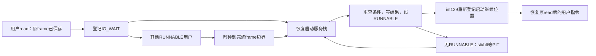

# K29 · 让原来的read停下来，事件发生后从同一次调用继续

K28 的父进程在空管道上读到 −11，只能以后再试。但父若在系统调用里一直等，孩子就没有机会写 awake；父若在用户中不停调用 read，也是在用 CPU 重复询问同一条件。现在阻塞模式需要让这个用户暂时失去运行资格，让其他用户产生字节或释放空间，再回到原调用之后。本节沿父读孩子写、父写孩子读、全部用户等待超时，以及另一个用户纯计算时超时四条路径完成这次改变。

<a id="wait-saved-request"></a>
## 保存的是请求与用户现场，不是内核局部数组

父 read10 时，先按 K28 实际尝试读取。如果已有五字节，就立即返回 5；阻塞不是承诺凑满十字节。只有暂时不能完成的 −11、普通 read/write、非 NONBLOCK 对象，才登记等待。非阻塞路径仍直接把 −11 交给用户。

登记需要保存这一次请求，而不是留住整条 C 调用链。进程新增 USER_IO_WAIT、io 操作、FD、用户地址、长度和截止 tick；完整 frame 已在本进程内核栈。先登记字段，再改 IO_WAIT，最后调度。256 字节内核局部 buffer 不成为长期请求所有者，不能只留它的地址；用户页则继续由阻塞进程持有，单线程等待期间不会自己拆映射。

孩子写入 awake 后，服务者用父的页表重试，当前活动根不必是父根。file_transfer 因此将 K24 的有界副本逻辑提为按指定进程操作，经 HHDM 访问目标物理页。poll_waiters 扫八个槽，仍为 −11 就留在等待；取得正前缀、EOF 或错误，就写父 frame.RAX、清请求地址，再设 RUNNABLE。结果先就绪，执行资格随后发布，父才从原 int80 后面继续。

唤醒依赖持久状态，不依赖一个可能错过的脉冲。管道状态变化后重查，时钟服务也周期重查。单 CPU 且内核不抢占，其他用户不能插入“检查→登记”中间改变管道，普通内核边界还在调度前重查一次。多 CPU 或多线程内核没有这个保证，需要锁与原子登记。

<a id="wait-ready-condition"></a>
## 就绪等待不提前替用户读走数据

阻塞 read 已经消费字节后才唤醒父，另一类调用只希望知道“可以尝试了”。这两种等待不能共用完成含义。编号 22 接 FD、READ/WRITE 条件和 ticks。ticks=0只查询，1–500允许有限等待；立即满足时直接返回，不睡眠。等待期间重查ready，按请求筛选条件，同时总报告HUP和ERROR；截止到期且无条件成立返回0，负数仍表示接口错误。就绪等待不消费字节，返回后用户仍要处理另一进程先消费导致的EAGAIN。

这里是自有条件等待，不是Linux epoll的注册集合、ET边沿或兼容ABI。八个控制块直接构成当前有界等待集合，先把谓词、状态和返回现场交接做完整，再讨论更复杂的通知结构。

<a id="wait-kernel-continuation"></a>
## 没有用户可运行时，启动栈仍然能等待

父已睡下，孩子尚未写入时也可能同样等待。没有 RUNNABLE 并不表示会话结束，因为 PIT 或后续设备仍可改变条件。schedule 因而分别保存 session_active 与 session_idle：所有用户结束才清 active，暂时需要服务则只设 idle，切回长期内核根，由汇编恢复启动 frame。

这个 frame 来自 launch 先前执行的 int129。启动栈恢复以后，launch 那次调用继续，看到 active 仍真就保留用户页和栈，转而 poll_waiters、选择新的 RUNNABLE。当前在普通启动栈做服务，不能把这些复制和重查塞进 IRQ 的 C 调用链。

准备重新进入用户时，还要重新登记一次启动继续位置。旧 int129 frame 已被恢复，它占过的栈空间现在可能被服务函数复用；原 kernel_return 指针不能继续当稳定现场。新的 int129 保存当前继续位置，再进入用户；用户运行期间启动栈暂停使用，这份新 frame 才保持有效。只有整个会话结束，launch 才收束用户资源。




只有“全员阻塞”时服务等待者仍不够。父等三 tick，孩子却只计算不进入系统调用，父的超时也必须获得处理机会。如果仍有其他用户纯计算、一直不调用系统调用，单靠系统调用尾部检查会饿死超时与未来设备完成。每两个用户tick的调度边界只要发现IO_WAIT，就暂回启动服务栈；IRQ自身只保存现场、改状态、切根和选择继续frame，不在IRQ C链内复制用户数据、分配或串口打印。普通启动服务随后处理等待者，再公平轮转。计数只把真正来自IRQ的身份改变记作抢占。

所有用户都阻塞时，启动栈执行sti/hlt等PIT，醒后再重查。一个用户自己保留写端又永远阻塞读可能形成死锁，但这属于用户请求没有事件来源，内核不会因此PANIC或伪造EOF。有限wait_ready能由PIT超时；普通阻塞read/write没有暗中加超时。

启动 frame 和用户内核栈遵守同一种寿命要求：指针指向的保存位置必须仍由那条暂停路径保留。恢复启动栈后要登记新 frame，回收用户栈前则必须已经离开它；更新指针或结束身份都不能单独代替这项条件。

**按以下旧/新窗口更新进程实现。** 新增等待状态、按进程传输、延后服务与launch循环；K28未变化部分保留，不要求重复敲写。

先增加 USER_IO_WAIT 和操作种类；等孩子退出的 USER_WAITING 仍有自己的条件。

<!-- replace: kernel/process/user.c -->
<!-- before -->
```c
#define STACK_BASE 0xffffe10000000000ull // 所有进程陷入栈位于同一长期内核分支。
#define USER_HEAP 0x10000000ull // ELF静态范围之外的用户页分配起点。
#define PROCESS_COUNT 8u // 有界进程表，不做动态扩容。
enum user_state { USER_UNUSED, USER_RUNNABLE, USER_RUNNING, USER_WAITING, USER_ZOMBIE, USER_REAP_PENDING }; // 退出与回收是两个不同状态。
struct user_page { uint64_t address, physical; unsigned flags; }; // fork需要把同一VA映射到另一个物理页。
struct user_process { // 所有权和调度状态由内核持有，用户只能看到PID。
    struct airi_fd_table files; // exec转移表项，fork增加同一打开对象的引用。
```
<!-- after -->
```c
#define STACK_BASE 0xffffe10000000000ull // 所有进程陷入栈位于同一长期内核分支。
#define USER_HEAP 0x10000000ull // ELF静态范围之外的用户页分配起点。
#define PROCESS_COUNT 8u // 有界进程表，不做动态扩容。
enum user_state { USER_UNUSED, USER_RUNNABLE, USER_RUNNING, USER_WAITING, USER_IO_WAIT, USER_ZOMBIE, USER_REAP_PENDING }; // 退出与回收是两个不同状态。
enum io_operation { IO_NONE, IO_READ, IO_WRITE, IO_READY }; // 等待保存操作条件，不保留内核局部buffer。
struct user_page { uint64_t address, physical; unsigned flags; }; // fork需要把同一VA映射到另一个物理页。
struct user_process { // 所有权和调度状态由内核持有，用户只能看到PID。
    struct airi_fd_table files; // exec转移表项，fork增加同一打开对象的引用。
```

在进程记录中保存这次操作、FD、用户地址、长度和截止；再加入会话 active/idle 与本轮计数。它们跨调度保存，不借内核局部数组。

<!-- replace: kernel/process/user.c -->
<!-- before -->
```c
    enum user_state state; // 只有RUNNABLE可被调度器选中。
    int64_t wait_target; // 正PID表示指定孩子，-1表示任意孩子。
    uint64_t wait_status; // 已验证的父进程用户输出地址，阻塞期间父进程不会修改映射。
    struct airi_trap_frame initial; // 尚未运行时的寄存器值，不依赖临时C对象。
    struct airi_trap_frame *frame; // 运行后指向本进程内核栈的实际现场。
};
static struct user_process processes[PROCESS_COUNT]; // 槽可以复用，PID单调增长，不等于槽下标。
static struct user_process *current; // 只在完整陷入边界改变当前身份。
static unsigned next_pid = 1, root_pid, timer_switches, wait_blocks; // 每次运行会话的根身份和实际行为计数。
static bool session_active; // 只有用户会话活动时才接受用户IRQ或系统调用。
static int session_result; // 根用户退出结果，不用最后一个孩子的结果覆盖。
static struct airi_trap_frame *kernel_return; // 启动栈一直保留到整个用户会话结束。
```
<!-- after -->
```c
    enum user_state state; // 只有RUNNABLE可被调度器选中。
    int64_t wait_target; // 正PID表示指定孩子，-1表示任意孩子。
    uint64_t wait_status; // 已验证的父进程用户输出地址，阻塞期间父进程不会修改映射。
    enum io_operation io; // 只有USER_IO_WAIT消费下面的请求副本。
    unsigned io_fd, io_events; // FD属于本进程表，events只用于就绪等待。
    uint64_t io_address, io_bytes, io_deadline; // 用户页在阻塞期间仍由进程拥有，deadline按真实tick。
    struct airi_trap_frame initial; // 尚未运行时的寄存器值，不依赖临时C对象。
    struct airi_trap_frame *frame; // 运行后指向本进程内核栈的实际现场。
};
static struct user_process processes[PROCESS_COUNT]; // 槽可以复用，PID单调增长，不等于槽下标。
static struct user_process *current; // 只在完整陷入边界改变当前身份。
static unsigned next_pid = 1, root_pid, timer_switches, wait_blocks; // 每次运行会话的根身份和实际行为计数。
static unsigned io_block_count, io_wake_count, idle_halt_count; // 会话真实I/O阻塞与唤醒次数。
static bool session_idle, service_from_timer; // 是否暂回启动栈服务，和整个会话结束分开。
static bool session_active; // 只有用户会话活动时才接受用户IRQ或系统调用。
static int session_result; // 根用户退出结果，不用最后一个孩子的结果覆盖。
static struct airi_trap_frame *kernel_return; // 指向本轮 int129 保存的继续 frame；每次进入用户时登记，恢复后不能继续借用旧 frame。
```

加入 waits ELF 的边界声明。

<!-- replace: kernel/process/user.c -->
<!-- before -->
```c
extern const uint8_t airi_user_rsp_bad_start[], airi_user_rsp_bad_end[]; // 不规范用户返回栈。
extern const uint8_t airi_hello_elf_start[], airi_hello_elf_end[]; // 既有独立用户C程序。
extern const uint8_t airi_process_elf_start[], airi_process_elf_end[]; // 新的fork/wait和抢占工作负载。
extern const uint8_t airi_pipes_elf_start[], airi_pipes_elf_end[]; // 非阻塞管道用户程序。
extern const uint8_t airi_storage_elf_start[], airi_storage_elf_end[]; // 写入和恢复共用一份明确分支的用户ELF。
extern const uint8_t airi_files_elf_start[], airi_files_elf_end[]; // 内存文件用户工作负载。
```
<!-- after -->
```c
extern const uint8_t airi_user_rsp_bad_start[], airi_user_rsp_bad_end[]; // 不规范用户返回栈。
extern const uint8_t airi_hello_elf_start[], airi_hello_elf_end[]; // 既有独立用户C程序。
extern const uint8_t airi_process_elf_start[], airi_process_elf_end[]; // 新的fork/wait和抢占工作负载。
extern const uint8_t airi_waits_elf_start[], airi_waits_elf_end[]; // 真正阻塞与超时工作负载。
extern const uint8_t airi_pipes_elf_start[], airi_pipes_elf_end[]; // 非阻塞管道用户程序。
extern const uint8_t airi_storage_elf_start[], airi_storage_elf_end[]; // 写入和恢复共用一份明确分支的用户ELF。
extern const uint8_t airi_files_elf_start[], airi_files_elf_end[]; // 内存文件用户工作负载。
```

在目录登记 waits 名字，原 pipes 非阻塞程序仍可独立运行。

<!-- replace: kernel/process/user.c -->
<!-- before -->
```c
    {"hello", airi_hello_elf_start, airi_hello_elf_end}, // 独立C运行库与BSS观察。
    {"processes", airi_process_elf_start, airi_process_elf_end}, // fork/exec/wait实际工作负载。
    {"worker", airi_worker_elf_start, airi_worker_elf_end},
    {"pipes", airi_pipes_elf_start, airi_pipes_elf_end}, // 有界FIFO与关闭语义。
    {"storage", airi_storage_elf_start, airi_storage_elf_end}, // 显式提交记录。
    {"recover", airi_storage_elf_start, airi_storage_elf_end}, // 只读取已恢复记录。
```
<!-- after -->
```c
    {"hello", airi_hello_elf_start, airi_hello_elf_end}, // 独立C运行库与BSS观察。
    {"processes", airi_process_elf_start, airi_process_elf_end}, // fork/exec/wait实际工作负载。
    {"worker", airi_worker_elf_start, airi_worker_elf_end},
    {"waits", airi_waits_elf_start, airi_waits_elf_end}, // 阻塞流和就绪条件等待。
    {"pipes", airi_pipes_elf_start, airi_pipes_elf_end}, // 有界FIFO与关闭语义。
    {"storage", airi_storage_elf_start, airi_storage_elf_end}, // 显式提交记录。
    {"recover", airi_storage_elf_start, airi_storage_elf_end}, // 只读取已恢复记录。
```

在用户复制助手之后加入 file_transfer 与 poll_waiters。前者按指定进程翻译地址，后者先给原 frame 写结果，再恢复 RUNNABLE；仍为 −11 的请求继续保留。

<!-- replace: kernel/process/user.c -->
<!-- before -->
```c
        done += part; // 推进下一段。
    }
    return true; // 同步结束，不借出buffer指针。
}
static void cleanup(struct user_process *p) { // 目标根必须不活动，而且当前不能使用目标内核栈。
    airi_fd_close_all(&p->files, false); // 回滚或已退出空表均安全，不能遗留全局引用。
```
<!-- after -->
```c
        done += part; // 推进下一段。
    }
    return true; // 同步结束，不借出buffer指针。
}
static long file_transfer(struct user_process *p, uint64_t fd, uint64_t address, size_t bytes, bool write, bool positioned, uint64_t offset) { // 允许在另一根的阻塞进程上重试，同步副本属于当前内核栈。
    char buffer[256]; // 一次有界副本，不跨调度保留。
    if (fd >= AIRI_FD_COUNT) // 完整64位编号先检查再转换。
        return -9; // -EBADF。
    if (bytes > sizeof(buffer)) // 不让用户长度覆盖内核栈。
        return -22; // -EINVAL。
    if (!user_access(p, address, bytes, !write)) // 输出在消费流或偏移之前完整验证。
        return -14; // -EFAULT。
    if (write) { // 用户内容在本次尝试内复制。
        copy_user(p, buffer, address, bytes, false); // 通过目标自己的页表，不解引用原始用户VA。
        if (!positioned && airi_fd_console(&p->files, (unsigned)fd)) { // 固定终端同步发送。
            airi_serial_write_bytes(buffer, bytes); // 不保存局部buffer给设备。
            return (long)bytes; // 返回逻辑进展。
        }
        return airi_fd_write(&p->files, (unsigned)fd, buffer, bytes, positioned, offset); // 满管道可返回EAGAIN。
    }
    long result = airi_fd_read(&p->files, (unsigned)fd, buffer, bytes, positioned, offset); // EOF和暂不可读分开。
    if (result > 0 && !copy_user(p, buffer, address, (size_t)result, true)) // 目标阻塞且单线程，已检查映射不应变化。
        airi_panic("validated file output mapping changed"); // 内部错误不丢字节后假装成功。
    return result; // 完成前缀或明确负错误。
}
static void poll_waiters(void) { // 仅普通内核上下文运行，IRQ本身不复制、分配或打印。
    for (unsigned i = 0; i < PROCESS_COUNT; ++i) { // 本阶段有界等待队列由进程槽直接表示。
        struct user_process *p = &processes[i]; // 控制块在等待期间不会回收。
        if (p->state != USER_IO_WAIT) // 不碰正在运行、wait孩子或已退出者。
            continue; // 检查下一个等待槽。
        long result; // 恢复到用户同一次调用的结果。
        if (p->io == IO_READY) { // 订阅的是条件，不是一次成功read的承诺。
            result = airi_fd_ready(&p->files, p->io_fd); // 当前条件可能被其他进程消费或改变。
            if (result >= 0) // 负错误必须原样唤醒，不能按位筛掉。
                result &= p->io_events | AIRI_READY_HUP | AIRI_READY_ERROR; // 对端关闭即使未显式请求也应可见。
            if (!result && airi_timer_ticks() < p->io_deadline) // 无条件成立且尚未超时。
                continue; // 保持等待，之后由状态变化或PIT服务重查。
        } else { // 阻塞read/write重新尝试同一个有界请求。
            result = file_transfer(p, p->io_fd, p->io_address, (size_t)p->io_bytes, p->io == IO_WRITE, false, 0); // 用户buffer仍由p持有。
            if (result == -11) // 暂时依旧没有进展。
                continue; // 不把原系统调用提前返回给用户忙等。
        }
        p->frame->rax = (uint64_t)result; // 用户返回位置仍在原调用之后。
        p->io = IO_NONE; // 这一次等待不再持有请求地址。
        p->io_address = p->io_bytes = p->io_deadline = 0; // 清过期的用户对象与截止值。
        p->state = USER_RUNNABLE; // 结果就绪之后才发布运行资格。
        ++io_wake_count; // 实际唤醒，不把查询次数计成完成。
        airi_log("[WAIT_WAKE] pid=%u result=%ld", p->pid, result); // 普通内核服务栈输出，不在IRQ里打印。
    }
}
static void cleanup(struct user_process *p) { // 目标根必须不活动，而且当前不能使用目标内核栈。
    airi_fd_close_all(&p->files, false); // 回滚或已退出空表均安全，不能遗留全局引用。
```

在调度原因中区分 IO。没有 RUNNABLE 时分别处理暂时服务与会话结束，不能仅由扫描不到候选就销毁进程资源。

<!-- replace: kernel/process/user.c -->
<!-- before -->
```c
        if (&processes[i] != current && processes[i].state == USER_REAP_PENDING) // 当前真正运行的内核栈不能在此回收。
            cleanup(&processes[i]); // 非活动根和已离开的内核栈可安全解除。
}
enum schedule_reason { REASON_TIMER, REASON_YIELD, REASON_WAIT, REASON_EXIT }; // 原因用于验证真实抢占，不混成主动yield。
static struct airi_trap_frame *select_user(struct user_process *p) { // 只在完整陷入现场边界切根和TSS。
    current = p; // 之后的IRQ和系统调用归属这个身份。
    p->state = USER_RUNNING; // 新用户即将获得CPU。
```
<!-- after -->
```c
        if (&processes[i] != current && processes[i].state == USER_REAP_PENDING) // 当前真正运行的内核栈不能在此回收。
            cleanup(&processes[i]); // 非活动根和已离开的内核栈可安全解除。
}
enum schedule_reason { REASON_TIMER, REASON_YIELD, REASON_WAIT, REASON_EXIT, REASON_IO }; // 原因用于验证真实抢占，不混成主动yield。
static struct airi_trap_frame *select_user(struct user_process *p) { // 只在完整陷入现场边界切根和TSS。
    current = p; // 之后的IRQ和系统调用归属这个身份。
    p->state = USER_RUNNING; // 新用户即将获得CPU。
```

接着加入 pause_for_service 并更新 schedule：当前块只负责回到服务栈或选择下一个用户。普通 I/O 与 wait_ready 的登记稍后分别接入系统调用分支。

<!-- replace: kernel/process/user.c -->
<!-- before -->
```c
        airi_panic("cannot activate selected user root"); // 不返回到缺映射的调用链。
    return airi_user_resume(p->frame); // 用户返回地址与标志必须仍符合边界。
}
static struct airi_trap_frame *schedule(enum schedule_reason reason) { // 内核中断门保持IF关闭，不在半次分配中切换。
    struct user_process *old = current; // 当前C函数还暂时使用old的内核栈。
    if (old->state == USER_RUNNING) // 等待和退出不能被这里误改回可运行。
        old->state = USER_RUNNABLE; // 普通时间片或yield结束后仍可再次获得CPU。
    for (unsigned n = 1; n <= PROCESS_COUNT; ++n) { // 轮流扫描一圈，必要时仍选择原任务。
        struct user_process *next = &processes[(slot(old) + n) % PROCESS_COUNT]; // 槽位轮转不改变PID。
        if (next->state == USER_RUNNABLE) { // WAITING/ZOMBIE均没有可直接恢复的运行资格。
            if (next != old && reason == REASON_TIMER) // 只有真实IRQ导致换身份才计入抢占证据。
                ++timer_switches; // 不在IRQ中分配、回收或输出串口。
            return select_user(next); // C返回后汇编才真正换到next现场。
        }
    }
    for (unsigned i = 0; i < PROCESS_COUNT; ++i) // 本阶段尚无设备等待源，全部阻塞表示内部死锁。
        if (processes[i].state == USER_WAITING) // 孩子链应有可运行叶子，不应全部只等待。
            airi_panic("all users blocked without an event source"); // 后续I/O阶段再加入真正空闲等待。
    session_active = false; // 没有可运行或等待的用户，整个会话结束。
    airi_memory_use_kernel(); // 回启动现场前切离最后一个用户根。
    kernel_return->rax = (uint64_t)(int64_t)session_result; // 保留根进程结果，不覆盖成最后一个孩子结果。
    return kernel_return; // 此处仍不释放old内核栈，回启动栈后统一回收。
}
static struct airi_trap_frame *exit_current(int code) { // CPU还在当前进程内核栈上，先结束身份而不释放栈。
    struct user_process *p = current; // 当前退出者的稳定控制块。
```
<!-- after -->
```c
        airi_panic("cannot activate selected user root"); // 不返回到缺映射的调用链。
    return airi_user_resume(p->frame); // 用户返回地址与标志必须仍符合边界。
}
static struct airi_trap_frame *pause_for_service(bool from_timer) { // 完整用户frame已保存，暂回长期启动栈做可延后工作。
    session_idle = true; // 会话仍active，不是用户程序已经退出。
    service_from_timer = from_timer; // 真正IRQ导致的换身份计数另记。
    airi_memory_use_kernel(); // 启动服务不依赖某个用户根。
    kernel_return->rax = 0; // 暂停结果不当成应用最终退出值。
    return kernel_return; // 汇编离开当前进程栈，之后才能安全服务其他等待者。
}
static struct airi_trap_frame *schedule(enum schedule_reason reason) { // 当前完整frame边界可切换，但IRQ不直接执行复杂I/O。
    struct user_process *old = current; // 仍暂用old的内核栈。
    if (old->state == USER_RUNNING) // 等待或退出不能误改回可运行。
        old->state = USER_RUNNABLE; // 时间片结束仍可运行。
    if (reason != REASON_TIMER) // 普通内核边界可重试等待条件。
        poll_waiters(); // 已有字节、关闭或错误形成后再唤醒。
    else // IRQ只检查状态，并把可延后服务交给启动栈。
        for (unsigned i = 0; i < PROCESS_COUNT; ++i) // 即使另有纯计算用户，也不能饿死超时与未来设备完成。
            if (processes[i].state == USER_IO_WAIT) // 有等待源需要周期服务。
                return pause_for_service(true); // 不在IRQ C链里复制用户数据或输出。
    for (unsigned n = 1; n <= PROCESS_COUNT; ++n) { // 从old之后轮转一圈。
        struct user_process *next = &processes[(slot(old) + n) % PROCESS_COUNT]; // PID与槽仍分开。
        if (next->state == USER_RUNNABLE) { // 仅可运行者有可返回的用户现场。
            if (next != old && reason == REASON_TIMER) // 真IRQ切不同身份。
                ++timer_switches; // 主动阻塞不冒充抢占。
            return select_user(next); // 汇编恢复目标frame。
        }
    }
    for (unsigned i = 0; i < PROCESS_COUNT; ++i) // 没有可运行者时检查仍在等待的活进程。
        if (processes[i].state == USER_WAITING || processes[i].state == USER_IO_WAIT) // 可能正在等设备、超时或未来对端。
            return pause_for_service(false); // 允许启动栈hlt等待真实IRQ，不PANIC用户死锁。
    session_active = false; // 所有用户均结束，此时才算完整会话退出。
    session_idle = false; // 不再保留暂停身份。
    airi_memory_use_kernel(); // 最后一个用户根也变成不活动。
    kernel_return->rax = (uint64_t)(int64_t)session_result; // 根用户的真实退出结果。
    return kernel_return; // 回启动栈后统一回收残留资源。
}
static struct airi_trap_frame *exit_current(int code) { // CPU还在当前进程内核栈上，先结束身份而不释放栈。
    struct user_process *p = current; // 当前退出者的稳定控制块。
```

更新 int129 与时钟入口。暂回服务仍使用已保存的完整用户现场，IRQ 不在自己的调用链上复制用户数据。

<!-- replace: kernel/process/user.c -->
<!-- before -->
```c
    return airi_user_resume(f); // 也不能跳过坏返回检查。
}
struct airi_trap_frame *airi_user_trap(struct airi_trap_frame *f) { // 内核仍不可抢占，只在完整用户陷入边界处理进程状态。
    if (f->vector == 129 && f->cs == 8 && !session_active && current && current->state == USER_RUNNABLE) { // 内核启动一组已经准备好的用户。
        kernel_return = f; // 启动栈的继续位置一直保留。
        session_active = true; // 之后的CS3陷入有会话归属。
        return select_user(current); // 按目标根和TSS进入首个用户。
    }
```
<!-- after -->
```c
    return airi_user_resume(f); // 也不能跳过坏返回检查。
}
struct airi_trap_frame *airi_user_trap(struct airi_trap_frame *f) { // 内核仍不可抢占，只在完整用户陷入边界处理进程状态。
    if (f->vector == 129 && f->cs == 8 && (!session_active || session_idle) && current && current->state == USER_RUNNABLE) { // 内核启动一组已经准备好的用户。
        kernel_return = f; // 启动栈的继续位置一直保留。
        session_idle = false; // 当前int129重新登记了仍在启动栈上的继续位置。
        session_active = true; // 之后的CS3陷入有会话归属。
        return select_user(current); // 按目标根和TSS进入首个用户。
    }
```

原文件调用改经 file_transfer；只有普通阻塞读写的 −11 登记请求，非阻塞和显式定位保持原返回。

<!-- replace: kernel/process/user.c -->
<!-- before -->
```c
        airi_log("[USER_FAULT] pid=%u vector=%llu error=0x%llx rip=0x%llx cr2=0x%llx", current->pid, (unsigned long long)f->vector, (unsigned long long)f->error, (unsigned long long)f->rip, (unsigned long long)(f->vector == 14 ? airi_trap_fault_address() : 0)); // PF才读取本次CR2。
        return exit_current(-(128 + (int)f->vector)); // 自有故障编码，不宣称Linux信号ABI。
    }
    if (f->rax == 1 || f->rax == 10 || f->rax == 15 || f->rax == 16) { // write/read/pread/pwrite共享检查与副本边界。
        char buffer[256]; // 内核只在本次同步调用持有副本。
        bool write = f->rax == 1 || f->rax == 16; // 用户到文件为写，文件到用户为读。
        bool positioned = f->rax == 15 || f->rax == 16; // 显式偏移来自第四参数R10。
        size_t bytes = (size_t)f->rdx; // 请求长度先有界再校验跨度。
        long result; // 自有ABI直接返回负错误或实际字节数。
        if (f->rdi >= AIRI_FD_COUNT) // 全64位FD必须先验证，不能截断高位后访问另一个编号。
            result = -9; // -EBADF。
        else if (bytes > sizeof(buffer)) // 不允许覆盖内核栈。
            result = -22; // -EINVAL。
        else if (!user_access(current, f->rsi, bytes, !write)) // read必须先验证整个输出区，失败不能消费偏移。
            result = -14; // -EFAULT。
        else if (write) { // 输入完整有效后才能发生文件或串口副作用。
            copy_user(current, buffer, f->rsi, bytes, false); // 复制当前进程的输入字节。
            if (!positioned && airi_fd_console(&current->files, (unsigned)f->rdi)) { // 被dup的终端FD也可发送。
                airi_serial_write_bytes(buffer, bytes); // 同步设备适配，不借出用户指针。
                result = (long)bytes; // 返回逻辑字节数。
            } else // RAM文件或不支持的定位设备操作。
                result = airi_fd_write(&current->files, (unsigned)f->rdi, buffer, bytes, positioned, f->r10); // 文件层维护共享偏移。
        } else { // 内核副本先承接实际读取结果。
            result = airi_fd_read(&current->files, (unsigned)f->rdi, buffer, bytes, positioned, f->r10); // EOF为0，错误为负。
            if (result > 0 && !copy_user(current, buffer, f->rsi, (size_t)result, true)) // 前置完整检查后映射不能变化。
                airi_panic("validated file output mapping changed"); // 不吞内部错误。
        }
        f->rax = (uint64_t)result; // 调用者必须按实际完成数推进。
    } else if (f->rax == 2) // 退出后不再恢复此用户指令。
        return exit_current((int)(f->rdi & 255)); // 普通退出码0–255。
    else if (f->rax == 3) // getpid查询当前身份。
```
<!-- after -->
```c
        airi_log("[USER_FAULT] pid=%u vector=%llu error=0x%llx rip=0x%llx cr2=0x%llx", current->pid, (unsigned long long)f->vector, (unsigned long long)f->error, (unsigned long long)f->rip, (unsigned long long)(f->vector == 14 ? airi_trap_fault_address() : 0)); // PF才读取本次CR2。
        return exit_current(-(128 + (int)f->vector)); // 自有故障编码，不宣称Linux信号ABI。
    }
    if (f->rax == 1 || f->rax == 10 || f->rax == 15 || f->rax == 16) { // 同步文件与流的完整副本边界。
        bool write = f->rax == 1 || f->rax == 16; // 输出到流或文件。
        bool positioned = f->rax == 15 || f->rax == 16; // 显式偏移不支持阻塞流。
        long result = file_transfer(current, f->rdi, f->rsi, (size_t)f->rdx, write, positioned, f->r10); // 先实际尝试一次。
        if (result == -11 && !positioned && !airi_fd_nonblocking(&current->files, (unsigned)f->rdi)) { // 阻塞流暂不可完成，用户不能提前看到EAGAIN。
            current->io = write ? IO_WRITE : IO_READ; // 保存需要重试的操作种类。
            current->io_fd = (unsigned)f->rdi; // 此时FD已由file_transfer完整验证。
            current->io_address = f->rsi; // 用户页继续归此进程所有，不借内核局部buffer。
            current->io_bytes = f->rdx; // 一次最多256字节，已经验证跨度。
            current->state = USER_IO_WAIT; // 条件和数据先登记，再移出可运行集合。
            ++io_block_count; // 实际阻塞计数。
            airi_log("[WAIT_REGISTER] pid=%u operation=%s fd=%u", current->pid, write ? "write" : "read", current->io_fd); // 普通系统调用上下文记录。
            return schedule(REASON_IO); // 选择别的用户或进入真正内核空闲等待。
        }
        f->rax = (uint64_t)result; // 非阻塞仍把EAGAIN交给用户，其他结果直接返回。
    } else if (f->rax == 2) // 退出后不再恢复此用户指令。
        return exit_current((int)(f->rdi & 255)); // 普通退出码0–255。
    else if (f->rax == 3) // getpid查询当前身份。
```

pipe 接受 0/1 两种模式，再接入 22 号有限条件等待；其余系统调用保持。

<!-- replace: kernel/process/user.c -->
<!-- before -->
```c
    else if (f->rax == 20) { // pipe原子创建并返回两个整数，不暴露内部环。
        unsigned ends[2]; // 内核副本，发布前用户输出已验证。
        long result; // 0或负错误。
        if (f->rsi != 1) // 本节只发布非阻塞模式，阻塞接下一阶段。
            result = -22; // -EINVAL。
        else if (!user_access(current, f->rdi, sizeof(ends), true)) // 坏输出不能创建无法交给用户的FD。
            result = -14; // -EFAULT。
        else { // 没有半次FD分配的用户可见状态。
            result = airi_fd_pipe(&current->files, ends, true); // 两端和缓冲都齐后才成功。
            if (!result && !copy_user(current, ends, f->rdi, sizeof(ends), true)) // 映射在本次调用中不应变化。
                airi_panic("validated pipe output mapping changed"); // 明确内核不变量。
        }
        f->rax = (uint64_t)result; // 失败输出保持原值。
    } else if (f->rax == 21) // 当前就绪条件查询，不保存通知事件。
        f->rax = f->rdi < AIRI_FD_COUNT ? (uint64_t)airi_fd_ready(&current->files, (unsigned)f->rdi) : (uint64_t)-9ll; // 完整64位编号先限制。
    else // 尚未提供的接口都明确拒绝。
        f->rax = (uint64_t)-38ll; // -ENOSYS。
    return airi_user_resume(f); // 普通调用继续同一用户，仍检查RSP与标志。
}
struct user_result { int code; unsigned ticks, switches, blocks; uint64_t fault_error; }; // 启动任务只取得数值，不借已回收控制块。
static int launch(const uint8_t *image, size_t bytes, const char *name, bool elf, struct user_result *result) { // 可用于启动演示或串口命令，程序失败不等于内核失败。
    if (session_active) // 当前只有一个由启动栈收拢的用户会话。
        return -16; // -EBUSY，不能覆盖已有kernel_return。
```
<!-- after -->
```c
    else if (f->rax == 20) { // pipe原子创建并返回两个整数，不暴露内部环。
        unsigned ends[2]; // 内核副本，发布前用户输出已验证。
        long result; // 0或负错误。
        if (f->rsi > 1) // 明确接受阻塞0与非阻塞1，其他参数拒绝。
            result = -22; // -EINVAL。
        else if (!user_access(current, f->rdi, sizeof(ends), true)) // 坏输出不能创建无法交给用户的FD。
            result = -14; // -EFAULT。
        else { // 没有半次FD分配的用户可见状态。
            result = airi_fd_pipe(&current->files, ends, f->rsi != 0); // 两端和缓冲都齐后才成功。
            if (!result && !copy_user(current, ends, f->rdi, sizeof(ends), true)) // 映射在本次调用中不应变化。
                airi_panic("validated pipe output mapping changed"); // 明确内核不变量。
        }
        f->rax = (uint64_t)result; // 失败输出保持原值。
    } else if (f->rax == 21) // 当前就绪条件查询，不保存通知事件。
        f->rax = f->rdi < AIRI_FD_COUNT ? (uint64_t)airi_fd_ready(&current->files, (unsigned)f->rdi) : (uint64_t)-9ll; // 完整64位编号先限制。
    else if (f->rax == 22) { // 等待管道条件，有限tick超时，0表示只查询。
        long result; // 事件掩码、0超时或负错误。
        if (f->rdi >= AIRI_FD_COUNT || !f->rsi || (f->rsi & ~3ull) || f->rdx > 500) // 只接受READ/WRITE请求，最多五秒。
            result = -22; // -EINVAL。
        else { // 先看当前条件，避免已经满足还去睡眠。
            result = airi_fd_ready(&current->files, (unsigned)f->rdi); // FD错误原样返回。
            if (result >= 0) // 负错误不参与位运算。
                result &= (long)f->rsi | AIRI_READY_HUP | AIRI_READY_ERROR; // 关闭与错误始终报告。
            if (!result && f->rdx) { // 条件未满足且愿意有限等待。
                current->io = IO_READY; // 不读写任何字节，只重查条件。
                current->io_fd = (unsigned)f->rdi; // 属于此进程的稳定表项。
                current->io_events = (unsigned)f->rsi; // 保存订阅条件。
                current->io_deadline = airi_timer_ticks() + f->rdx; // 真实时钟截止，不靠循环次数。
                current->state = USER_IO_WAIT; // 原frame已保存在进程中。
                ++io_block_count; // 这次调用确实阻塞。
                airi_log("[WAIT_REGISTER] pid=%u operation=ready fd=%u", current->pid, current->io_fd); // 由普通内核上下文记录。
                return schedule(REASON_IO); // 返回到同一次wait调用之后。
            }
        }
        f->rax = (uint64_t)result; // 立即就绪、纯查询、错误统一返回。
    }
    else // 尚未提供的接口都明确拒绝。
        f->rax = (uint64_t)-38ll; // -ENOSYS。
    poll_waiters(); // 文件/流修改完成后立即重查其他等待者，不等用户轮询。
    return airi_user_resume(f); // 普通调用继续同一用户，仍检查RSP与标志。
}
struct user_result { int code; unsigned ticks, switches, blocks; uint64_t fault_error; unsigned io_blocks, io_wakes, idle_halts; }; // 启动任务只取得数值，不借已回收控制块。
static int launch(const uint8_t *image, size_t bytes, const char *name, bool elf, struct user_result *result) { // 可用于启动演示或串口命令，程序失败不等于内核失败。
    if (session_active) // 当前只有一个由启动栈收拢的用户会话。
        return -16; // -EBUSY，不能覆盖已有kernel_return。
```

在 launch 中初始化本轮统计，增加 active/idle 服务循环。每次恢复用户前重新 int129 登记启动继续点，最终退出才清理。

<!-- replace: kernel/process/user.c -->
<!-- before -->
```c
    timer_switches = 0; // 这次会话实际抢占计数。
    wait_blocks = 0; // 这次会话实际阻塞计数。
    current = root; // 内核启动门选择此根。
    long code; // 根结束结果由启动现场RAX交回。
    __asm__ volatile("int $0x81" : "=a"(code) :: "memory", "cc"); // 全部用户结束后才真正回启动栈。
    *result = (struct user_result){(int)code, root->user_ticks, timer_switches, wait_blocks, root->fault_error}; // 回收前复制必要数值。
    for (unsigned i = 0; i < PROCESS_COUNT; ++i) // 当前不在任何用户内核栈上。
        if (processes[i].state != USER_UNUSED) // wait已回收槽不重复处理。
            cleanup(&processes[i]); // 收拢剩余僵尸和未被父wait的资源。
```
<!-- after -->
```c
    timer_switches = 0; // 这次会话实际抢占计数。
    wait_blocks = 0; // 这次会话实际阻塞计数。
    current = root; // 内核启动门选择此根。
    io_block_count = io_wake_count = idle_halt_count = 0; // 本次I/O阻塞统计独立于wait孩子。
    session_idle = false; // 首次int129创建新活动会话。
    long code; // 根结束结果由启动现场RAX交回。
    for (;;) { // 每次返回启动栈，先区分暂时服务和整个会话结束。
        __asm__ volatile("int $0x81" : "=a"(code) :: "memory", "cc"); // 用户运行期间启动栈与继续现场保持完整。
        if (!session_active) // 只有所有用户结束才离开launch。
            break; // code此时才是根用户真实退出值。
        collect_pending(); // 当前确在启动栈，仍保守跳过current槽。
        for (;;) { // 暂无可运行者时在长期内核根上服务等待条件。
            poll_waiters(); // 可复制用户结果和记录日志，不在IRQ C链里做。
            struct user_process *next = NULL; // 每次重查后重新选择。
            for (unsigned n = 1; n <= PROCESS_COUNT; ++n) // 轮转保持公平，不总挑槽0。
                if (processes[(slot(current) + n) % PROCESS_COUNT].state == USER_RUNNABLE) { // 等待者可能刚被唤醒。
                    next = &processes[(slot(current) + n) % PROCESS_COUNT]; // 保存控制块，不提前切根。
                    break; // 首个可运行者获得下一次int129。
                }
            if (next) { // 服务后已有用户可继续。
                if (service_from_timer && next != current) // 只有来自真实IRQ的身份改变才计抢占。
                    ++timer_switches; // 不把用户主动阻塞算成IRQ切换。
                current = next; // int129随后正式设置TSS与目标根。
                break; // 回外层重新登记新的启动继续现场。
            }
            ++idle_halt_count; // 统计真正没有可运行用户后执行的空闲等待。
            __asm__ volatile("sti; hlt" ::: "memory"); // CPU真正空闲等PIT，醒后仍在启动服务栈。
        }
    }
    *result = (struct user_result){(int)code, root->user_ticks, timer_switches, wait_blocks, root->fault_error, io_block_count, io_wake_count, idle_halt_count}; // 回收前复制必要数值。
    for (unsigned i = 0; i < PROCESS_COUNT; ++i) // 当前不在任何用户内核栈上。
        if (processes[i].state != USER_UNUSED) // wait已回收槽不重复处理。
            cleanup(&processes[i]); // 收拢剩余僵尸和未被父wait的资源。
```

最后接入四条用户观察与计数核对；单纯打印一行标记不能代替真实 idle_halts 与超时顺序。

<!-- replace: kernel/process/user.c -->
<!-- before -->
```c
    run_one(airi_process_elf_start, (size_t)((uintptr_t)airi_process_elf_end - (uintptr_t)airi_process_elf_start), "processes", 0, true, false, true); // 真实多进程复制、抢占、阻塞与回收。
    run_one(airi_files_elf_start, (size_t)((uintptr_t)airi_files_elf_end - (uintptr_t)airi_files_elf_start), "files", 0, true, false, false); // 文件内容、共享偏移与exec引用回收。
    run_one(airi_pipes_elf_start, (size_t)((uintptr_t)airi_pipes_elf_end - (uintptr_t)airi_pipes_elf_start), "pipes", 0, true, false, false); // 真实FIFO、背压、关闭和fork共享。
    airi_log("[USER_DEMO_OK] ring=3 syscall=int80 bad_pointers=2 user_gp=13 user_pf=14 bad_rsp=rejected reclaimed=1"); // 完整会话结束，仍回串口命令。
}

bool airi_user_command(struct airi_console *console, const char *command) { // 系统命令消费者独立于图形主题扩展。
    size_t bytes = airi_strlen(command); // 先取得有效长度，固定前缀比较不能越过短字符串。
    if (bytes == 8 && !airi_memcmp(command, "programs", 8)) { // 显示当前初始ELF目录。
        airi_console_print(console, "programs: hello processes worker broken files storage recover pipes"); // broken是明确损坏的演示输入。
        return true; // 已处理，不再交给图形扩展。
    }
    if (bytes < 4 || airi_memcmp(command, "run ", 4)) // 只接受明确的run空格前缀。
```
<!-- after -->
```c
    run_one(airi_process_elf_start, (size_t)((uintptr_t)airi_process_elf_end - (uintptr_t)airi_process_elf_start), "processes", 0, true, false, true); // 真实多进程复制、抢占、阻塞与回收。
    run_one(airi_files_elf_start, (size_t)((uintptr_t)airi_files_elf_end - (uintptr_t)airi_files_elf_start), "files", 0, true, false, false); // 文件内容、共享偏移与exec引用回收。
    run_one(airi_pipes_elf_start, (size_t)((uintptr_t)airi_pipes_elf_end - (uintptr_t)airi_pipes_elf_start), "pipes", 0, true, false, false); // 真实FIFO、背压、关闭和fork共享。
    struct user_result waits_result; // 数值证据不借已回收控制块。
    if (launch(airi_waits_elf_start, (size_t)((uintptr_t)airi_waits_elf_end - (uintptr_t)airi_waits_elf_start), "waits", true, &waits_result) || waits_result.code || waits_result.io_blocks < 4 || waits_result.io_wakes < 4 || !waits_result.idle_halts) // 读、写、空闲与纯计算并行超时四种实际等待均须发生。
        airi_panic("blocking I/O did not preserve waiting semantics"); // 不把用户循环重试当内核阻塞。
    airi_log("[WAIT_DEMO_OK] blocked=%u woken=%u idle_halts=%u", waits_result.io_blocks, waits_result.io_wakes, waits_result.idle_halts); // 统计来自真实状态变化。
    airi_log("[USER_DEMO_OK] ring=3 syscall=int80 bad_pointers=2 user_gp=13 user_pf=14 bad_rsp=rejected reclaimed=1"); // 完整会话结束，仍回串口命令。
}

bool airi_user_command(struct airi_console *console, const char *command) { // 系统命令消费者独立于图形主题扩展。
    size_t bytes = airi_strlen(command); // 先取得有效长度，固定前缀比较不能越过短字符串。
    if (bytes == 8 && !airi_memcmp(command, "programs", 8)) { // 显示当前初始ELF目录。
        airi_console_print(console, "programs: hello processes worker broken files storage recover pipes waits"); // broken是明确损坏的演示输入。
        return true; // 已处理，不再交给图形扩展。
    }
    if (bytes < 4 || airi_memcmp(command, "run ", 4)) // 只接受明确的run空格前缀。
```

在 `kernel/process/user.c` 中同步本阶段已变化的条件说明；执行语句保留。旧块用于定位，只写回对应新块。

<!-- replace: kernel/process/user.c -->
<!-- before -->
```c
            return &processes[i]; // 后续失败必须清掉全部所有权。
    return NULL; // 表满返回明确失败。
}
static void collect_pending(void) { // 只在新的用户陷入入口调用，不在旧进程退出的C调用中释放其栈。
    for (unsigned i = 0; i < PROCESS_COUNT; ++i) // 回收父进程已取得状态的孩子。
        if (&processes[i] != current && processes[i].state == USER_REAP_PENDING) // 当前真正运行的内核栈不能在此回收。
            cleanup(&processes[i]); // 非活动根和已离开的内核栈可安全解除。
```
<!-- after -->
```c
            return &processes[i]; // 后续失败必须清掉全部所有权。
    return NULL; // 表满返回明确失败。
}
static void collect_pending(void) { // 在其他用户陷入栈或启动服务栈上回收，跳过仍在使用的当前进程栈。
    for (unsigned i = 0; i < PROCESS_COUNT; ++i) // 回收父进程已取得状态的孩子。
        if (&processes[i] != current && processes[i].state == USER_REAP_PENDING) // 当前真正运行的内核栈不能在此回收。
            cleanup(&processes[i]); // 非活动根和已离开的内核栈可安全解除。
```

**更新用户声明。** pipe现在接受阻塞0或非阻塞1，wait_ready有明确有限tick语义。

<!-- write: labs/airios/include/airi_libc.h -->
```c
#ifndef AIRI_USER_LIBC_H // 用户库头与内核基础库分开。
#define AIRI_USER_LIBC_H // 包含保护。
#include <stddef.h> // 用户对象字节长度。
#include <stdint.h> // 用户ABI的64位寄存器值。
void *memcpy(void *destination, const void *source, size_t bytes); // 双方不重叠的用户空间复制。
void *memmove(void *destination, const void *source, size_t bytes); // 允许同一用户数组内重叠移动。
void *memset(void *destination, int value, size_t bytes); // 按字节填充用户对象。
int memcmp(const void *left, const void *right, size_t bytes); // 首个不同无符号字节决定结果。
size_t strlen(const char *text); // 用户有效NUL字符串长度。
long airi_write(unsigned fd, const void *buffer, size_t bytes); // 自有int80 ABI，失败直接返回负数。
long airi_getpid(void); // 获取当前用户身份。
_Noreturn void airi_exit(unsigned code); // 退出不返回用户调用方。
long airi_puts(const char *text); // 有界 FD 写入，不自动补换行。
long airi_fork(void); // 首版内核直接复制用户页，子返回0，父返回子PID。
long airi_waitpid(long pid, int *status); // pid=-1或指定孩子；status是普通退出值。
void *airi_alloc(size_t bytes); // 零填充页申请，失败NULL，进程结束统一回收。
uint64_t airi_ticks(void); // 实际时钟事件计数。
void airi_yield(void); // 主动交接，不等同于时钟抢占。
long airi_exec(const char *name); // 成功替换映像不返回；失败保留旧PID和调用链，返回负错误。
#define AIRI_READ 1u // 以下标志只属于自有open ABI。
#define AIRI_WRITE 2u // 写访问。
#define AIRI_CREATE 4u // 名字不存在时创建。
#define AIRI_TRUNCATE 8u // 清空可写文件。
#define AIRI_CLOEXEC 16u // 成功exec关闭此表项。
long airi_open(const char *path, unsigned flags); // 平坦绝对名字，返回FD或负错误。
long airi_close(unsigned fd); // 关闭不删除名字。
long airi_dup(unsigned fd, unsigned cloexec); // 与源共享偏移。
long airi_seek(unsigned fd, uint64_t offset); // 只支持绝对定位。
long airi_read(unsigned fd, void *buffer, size_t bytes); // EOF为0，短读是实际完成数。
long airi_pread(unsigned fd, void *buffer, size_t bytes, uint64_t offset); // 不移动共享偏移。
long airi_pwrite(unsigned fd, const void *buffer, size_t bytes, uint64_t offset); // 第四参数R10。
long airi_log_append(const void *data, size_t bytes); // 最多480字节，成功返回从1开始的sequence。
long airi_log_read(unsigned index, void *data, size_t capacity); // 索引从0，返回实际长度。
long airi_log_count(void); // 已恢复有效前缀，错误为负。
#define AIRI_READABLE 1u // 当前read可得到数据或EOF。
#define AIRI_WRITABLE 2u // 当前有读者和空位。
#define AIRI_HANGUP 4u // 最后写者关闭，仍应排空已有数据。
#define AIRI_ERROR 8u // 最后读者关闭，写将EPIPE。
long airi_pipe(unsigned ends[2], unsigned nonblocking); // nonblocking=0阻塞，1暂不可完成时返回-11。
long airi_ready(unsigned fd); // 管道当前条件查询，不是Linux epoll ABI。
long airi_wait_ready(unsigned fd, unsigned events, unsigned ticks); // READ/WRITE条件，0纯查询，最多500tick，超时返回0。
#endif // 结束包含保护。
```

**更新调用包装。** wait_ready仍使用自有RAX/RDI/RSI/RDX约定。

在末尾加入 wait_ready 包装；超时 0、条件掩码和负错误保持区别。

<!-- replace: labs/airios/libc/syscall.c -->
<!-- before -->
```c
long airi_ready(unsigned fd) { // 仅查询当前管道条件。
    return call3(21, fd, 0, 0); // 返回掩码或负错误，不能把负数当事件位。
}
```
<!-- after -->
```c
long airi_ready(unsigned fd) { // 仅查询当前管道条件。
    return call3(21, fd, 0, 0); // 返回掩码或负错误，不能把负数当事件位。
}

long airi_wait_ready(unsigned fd, unsigned events, unsigned ticks) { // 条件满足返回事件位，超时0，负值是错误。
    return call3(22, fd, events, ticks); // 内核保存现场并在同一次调用后恢复。
}
```

<a id="wait-four-paths"></a>
## 四条实际路径分别证明什么

先用前面的 awake 请求核对“同一次调用继续”，再分别制造空间不足、全员等待和计算者不合作。第一条，父亲关闭自己的写端后 read10；孩子延迟五个实际tick，写awake五字节。父亲同一次read被唤醒返回5，不在用户循环重试−11。第二条，父先填满64字节，再写x会阻塞；孩子读32释放空间，内核完成父的那一个字节，孩子再读33得到余下32个a和x。

第三条没有任何孩子，唯一用户保留写端并wait_ready读三tick。没有可运行用户，启动服务真正hlt，由PIT醒来并返回超时0；idle_halts必须非零，不能只在日志固定写“进入过空闲”。第四条孩子用有界整数汇编持续计算，不调用ticks或yield；父亲wait_ready仍在三tick之后超时，并且非阻塞read还应为−11，说明孩子尚未提供字节。WAIT_TIMEOUT_OK必须在WAIT_BUSY_DONE之前。循环只提供计算负载，时间判断仍来自PIT，不把步数当时钟。

**新建 `labs/airios/waits.c`。** 四条路径和所有错误出口完整给出，不给读者留补实现。

<!-- write: labs/airios/waits.c -->
```c
#include <airi_libc.h> // 阻塞由内核登记，用户不循环重试EAGAIN。
static void delay(void) { // 前两条子路径等待真实PIT，留出父亲登记阻塞的时间。
    uint64_t until = airi_ticks() + 5; // 约50毫秒，不把固定循环叫时钟。
    while (airi_ticks() < until) // 这里仅是作者子任务准备时序，父亲的read/write真正阻塞。
        __asm__ volatile("pause"); // CPU提示不等于内核睡眠。
}
int main(void) { // 依次验证读等待、写等待和其他用户纯计算时的超时。
    unsigned ends[2]; // 稳定FD表项在阻塞期间由本进程持有。
    char data[64], output[64]; // 复制发生在各自用户地址空间。
    if (airi_pipe(ends, 0)) // 本阶段新增阻塞模式0。
        return 90; // 不用未初始化FD。
    long child = airi_fork(); // 子进程会为父读请求提供事件。
    if (child < 0) // 明确容量失败。
        return 91; // 不进入无事件的等待。
    if (!child) { // 孩子只保留写端。
        airi_close(ends[0]); // 父亲仍持读端，不会EPIPE。
        delay(); // 父亲应在此期间进入USER_IO_WAIT。
        if (airi_write(ends[1], "awake", 5) != 5) // 写入改变条件，内核随后重试父请求。
            return 92; // 父wait可见错误。
        airi_close(ends[1]); // 最后写者结束，读完后EOF。
        return 0; // 不保留进程引用。
    }
    int status = -1; // 自有wait状态。
    if (airi_close(ends[1]) || airi_read(ends[0], output, 10) != 5 || memcmp(output, "awake", 5) || airi_waitpid(child, &status) != child || status || airi_close(ends[0])) // 原read一次调用返回真实前缀，不是用户重试循环。
        return 93; // 任一边界失败都不发布成功。
    memset(data, 'a', sizeof(data)); // 第二条流先填满。
    if (airi_pipe(ends, 0) || airi_write(ends[1], data, sizeof(data)) != 64) // 父亲下一次写需要等读者释放空位。
        return 94; // 不能凭空成功。
    child = airi_fork(); // 孩子本次只保留读端。
    if (child < 0) // 同样处理资源错误。
        return 95; // 不等不存在消费者。
    if (!child) { // 延后读取，保证父在满流阻塞。
        airi_close(ends[1]); // 父仍有写端。
        delay(); // 留出父写请求登记时间。
        if (airi_read(ends[0], output, 32) != 32 || airi_read(ends[0], output, 33) != 33 || output[32] != 'x') // 第一读释放空位，唤醒父写x，再读到余下32个a和x。
            return 96; // 真正顺序取决于内核完成父请求，不是共享用户数组。
        airi_close(ends[0]); // 消费结束。
        return 0; // 父wait取得0。
    }
    if (airi_close(ends[0]) || airi_write(ends[1], "x", 1) != 1 || airi_waitpid(child, &status) != child || status || airi_close(ends[1])) // 单次满流write必须阻塞后完成，而非返回EAGAIN。
        return 97; // 调用顺序可连续追踪。
    if (airi_pipe(ends, 1)) // 此时没有孩子，空流等待将让全部用户都阻塞。
        return 103; // 保留写端避免EOF。
    uint64_t idle_before = airi_ticks(); // 真实PIT作为空闲唤醒来源。
    if (airi_wait_ready(ends[0], AIRI_READABLE, 3) != 0 || airi_ticks() - idle_before < 3 || airi_close(ends[0]) || airi_close(ends[1])) // 启动服务栈必须hlt并在PIT后重查截止。
        return 104; // 不能因没有其他用户就PANIC或伪完成。
    airi_puts("[WAIT_IDLE_OK] all_users=blocked ticks>=3\n"); // 来自只剩当前用户的真实等待。
    if (airi_pipe(ends, 1) || airi_wait_ready(ends[0], AIRI_READABLE, 0) != 0) // 就绪0tick只是查询，不阻塞。
        return 98; // 空流但有写端，条件不成立。
    child = airi_fork(); // 另一用户将长时间纯计算，不调用ticks或yield。
    if (child < 0) // 不丢容量错误。
        return 99; // 退出前由内核收拢FD。
    if (!child) { // 纯整数汇编不触碰未支持的SIMD现场。
        airi_close(ends[0]); // 只保留将来写入的端点。
        __asm__ volatile("mov $200000000, %%rcx; 1: dec %%rcx; jnz 1b" ::: "rcx", "cc"); // 有界计算用于让另一个用户持续占CPU，不当作时间测量。
        if (airi_write(ends[1], "z", 1) != 1) // 计算结束才提供数据。
            return 100; // 父亲随后验证结果。
        airi_puts("[WAIT_BUSY_DONE]\n"); // 应在父超时标记之后。
        airi_close(ends[1]); // 父排空后EOF。
        return 0; // 正常结束。
    }
    airi_close(ends[1]); // 空流唯一写者是忙算孩子。
    uint64_t before = airi_ticks(); // 计时来自PIT事件，不来自循环步数。
    if (airi_wait_ready(ends[0], AIRI_READABLE, 3) != 0 || airi_ticks() - before < 3 || airi_read(ends[0], output, 1) != -11) // 超时必须在孩子真正写入前发生，即使孩子不进系统调用。
        return 101; // 否则内核延后服务可能被纯计算用户饿死。
    airi_puts("[WAIT_TIMEOUT_OK] other_user=busy ticks>=3\n"); // 实际唤醒发生在同一次wait调用之后。
    if (airi_waitpid(child, &status) != child || status || airi_read(ends[0], output, 1) != 1 || output[0] != 'z' || airi_read(ends[0], output, 1) != 0 || airi_close(ends[0])) // 等忙算用户正常完成并排空真实字节。
        return 102; // 不因超时破坏管道或进程。
    airi_puts("[WAIT_USER_OK] read=blocked write=blocked readiness=timeout continuation=preserved\n"); // 全部等待与资源路径完成。
    return 0; // 会话统计还会核对实际阻塞/唤醒次数。
}
```

**更新只读映像包装。** waits独立链接，不改变旧pipes的非阻塞程序。

<!-- write: labs/airios/images.S -->
```asm
.section .rodata.user_elf,"a" /* 原始ELF作为内核只读输入，不在内核直接执行。 */
.balign 8 /* 输入开头至少按8字节对齐，解析仍使用memcpy。 */
.global airi_hello_elf_start, airi_hello_elf_end /* 编译期固定映像边界。 */
airi_hello_elf_start: /* 文件头也包含在输入字节中。 */
.incbin AIRI_HELLO_ELF /* Make传入当前配置自己的ELF路径，不复制另一配置旧产物。 */
airi_hello_elf_end: /* 解析器只允许读取边界之内。 */
.section .note.GNU-stack,"",@progbits /* 包装对象不需要可执行栈。 */
.section .rodata.user_elf,"a" /* 第二个独立ELF同样只是内核装载输入。 */
.balign 8 /* 边界按八字节对齐，解析器仍安全按字节复制。 */
.global airi_process_elf_start, airi_process_elf_end /* 多进程用户工作负载的完整文件边界。 */
airi_process_elf_start: /* 包含独立文件头与程序表。 */
.incbin AIRI_PROCESS_ELF /* 路径由本配置的Make依赖提供。 */
airi_process_elf_end: /* 内核不能读过此边界。 */
.section .rodata.user_elf,"a" /* 第三个独立ELF作为exec目标。 */
.balign 8 /* 原始输入边界固定。 */
.global airi_worker_elf_start, airi_worker_elf_end /* 新用户映像范围。 */
airi_worker_elf_start: /* 解析从文件头开始。 */
.incbin AIRI_WORKER_ELF /* Make提供同一配置刚生成的文件。 */
airi_worker_elf_end: /* 输入长度不包括后续损坏夹具。 */
.global airi_broken_elf_start, airi_broken_elf_end /* 受控截断ELF不需要外部文件。 */
airi_broken_elf_start: /* 只有魔数与少量标识，不足64字节头。 */
.byte 0x7f, 0x45, 0x4c, 0x46, 2, 1, 1, 0 /* 解析器必须拒绝，不能改掉旧进程。 */
airi_broken_elf_end: /* 失败输入恰好八字节。 */

.section .rodata /* 文件工作负载只在内核中保留映像字节。 */
.global airi_files_elf_start, airi_files_elf_end /* 用户空间由装载器另建。 */
airi_files_elf_start: /* 映像首地址。 */
.incbin AIRI_FILES_ELF /* 使用本配置实际链接的用户ELF。 */
airi_files_elf_end: /* 映像右端，不把后续字节算入文件。 */

.section .rodata /* 存储用户映像属于只读内核初始目录。 */
.global airi_storage_elf_start, airi_storage_elf_end /* 同一映像按argv选择storage或recover。 */
airi_storage_elf_start: /* 文件首。 */
.incbin AIRI_STORAGE_ELF /* 本配置真实链接的用户ELF。 */
airi_storage_elf_end: /* 文件半开右端。 */

.section .rodata /* 独立管道用户映像。 */
.global airi_pipes_elf_start, airi_pipes_elf_end /* 只发布文件边界。 */
airi_pipes_elf_start: /* 文件起点。 */
.incbin AIRI_PIPES_ELF /* 当前配置的真实ELF。 */
airi_pipes_elf_end: /* 文件右端。 */

.section .rodata /* 阻塞用户程序映像。 */
.global airi_waits_elf_start, airi_waits_elf_end /* 边界只供内核装载。 */
airi_waits_elf_start: /* 文件开始。 */
.incbin AIRI_WAITS_ELF /* 本配置独立ELF。 */
airi_waits_elf_end: /* 半开右端。 */
```

**更新用户目标。** 自有入口与库复用，CPU计算不使用未支持的SIMD。

包装依赖加入 waits.elf。

<!-- replace: Makefile -->
<!-- before -->
```make
# 用户只链接自己的_start、main和libc子集，无宿主依赖。
	$(LD) -m elf_x86_64 -nostdlib -static -z max-page-size=0x1000 -z noexecstack -T labs/airios/program.ld $(USER_OBJECTS) -o $@
# 包装汇编明确依赖本配置用户ELF，文件变动就重新嵌入。
$(OUT)/labs/airios/images.o: labs/airios/images.S $(OUT)/user/hello.elf $(OUT)/user/processes.elf $(OUT)/user/worker.elf $(OUT)/user/files.elf $(OUT)/user/storage.elf $(OUT)/user/pipes.elf
# 建立包装对象目录。
	@mkdir -p $(dir $@)
# 单引号保护路径宏内部双引号，.incbin只读本配置生成文件。
	$(CC) $(CPPFLAGS) $(CFLAGS) -DAIRI_HELLO_ELF='"$(OUT)/user/hello.elf"' -DAIRI_PROCESS_ELF='"$(OUT)/user/processes.elf"' -DAIRI_WORKER_ELF='"$(OUT)/user/worker.elf"' -DAIRI_FILES_ELF='"$(OUT)/user/files.elf"' -DAIRI_STORAGE_ELF='"$(OUT)/user/storage.elf"' -DAIRI_PIPES_ELF='"$(OUT)/user/pipes.elf"' -c $< -o $@

# 第二个用户程序只复用用户入口与库，不把hello的main再次链接进去。
USER_COMMON := $(filter-out $(OUT)/user/hello.o,$(USER_OBJECTS))
```
<!-- after -->
```make
# 用户只链接自己的_start、main和libc子集，无宿主依赖。
	$(LD) -m elf_x86_64 -nostdlib -static -z max-page-size=0x1000 -z noexecstack -T labs/airios/program.ld $(USER_OBJECTS) -o $@
# 包装汇编明确依赖本配置用户ELF，文件变动就重新嵌入。
$(OUT)/labs/airios/images.o: labs/airios/images.S $(OUT)/user/hello.elf $(OUT)/user/processes.elf $(OUT)/user/worker.elf $(OUT)/user/files.elf $(OUT)/user/storage.elf $(OUT)/user/pipes.elf $(OUT)/user/waits.elf
# 建立包装对象目录。
	@mkdir -p $(dir $@)
# 单引号保护路径宏内部双引号，.incbin只读本配置生成文件。
	$(CC) $(CPPFLAGS) $(CFLAGS) -DAIRI_HELLO_ELF='"$(OUT)/user/hello.elf"' -DAIRI_PROCESS_ELF='"$(OUT)/user/processes.elf"' -DAIRI_WORKER_ELF='"$(OUT)/user/worker.elf"' -DAIRI_FILES_ELF='"$(OUT)/user/files.elf"' -DAIRI_STORAGE_ELF='"$(OUT)/user/storage.elf"' -DAIRI_PIPES_ELF='"$(OUT)/user/pipes.elf"' -DAIRI_WAITS_ELF='"$(OUT)/user/waits.elf"' -c $< -o $@

# 第二个用户程序只复用用户入口与库，不把hello的main再次链接进去。
USER_COMMON := $(filter-out $(OUT)/user/hello.o,$(USER_OBJECTS))
```

在尾部加入 waits 的独立编译链接目标。

<!-- replace: Makefile -->
<!-- before -->
```make
$(OUT)/user/pipes.elf: $(USER_COMMON) $(OUT)/user/pipes.o labs/airios/program.ld
# 保持相同低地址ELF布局。
	$(LD) -m elf_x86_64 -nostdlib -static -z max-page-size=0x1000 -z noexecstack -T labs/airios/program.ld $(USER_COMMON) $(OUT)/user/pipes.o -o $@
```
<!-- after -->
```make
$(OUT)/user/pipes.elf: $(USER_COMMON) $(OUT)/user/pipes.o labs/airios/program.ld
# 保持相同低地址ELF布局。
	$(LD) -m elf_x86_64 -nostdlib -static -z max-page-size=0x1000 -z noexecstack -T labs/airios/program.ld $(USER_COMMON) $(OUT)/user/pipes.o -o $@

# 阻塞和就绪等待工作负载独立于非阻塞管道程序。
$(OUT)/user/waits.o: labs/airios/waits.c labs/airios/include/airi_libc.h
# 仍按配置隔离用户对象。
	@mkdir -p $(dir $@)
# 只使用自有用户库与整数寄存器。
	$(CC) $(USER_FLAGS) -Ilabs/airios/include -c $< -o $@
# ELF只选择waits的main。
$(OUT)/user/waits.elf: $(USER_COMMON) $(OUT)/user/waits.o labs/airios/program.ld
# 低地址静态链接，不借宿主入口。
	$(LD) -m elf_x86_64 -nostdlib -static -z max-page-size=0x1000 -z noexecstack -T labs/airios/program.ld $(USER_COMMON) $(OUT)/user/waits.o -o $@
```

**更新能力文字。** P4标记中的管道现为blocking，其他存储仍是同步内核等待；完整P5异步尚未发布。

P4 能力文字改成 blocking 管道，磁盘同步语义保持。

<!-- replace: kernel/main.c -->
<!-- before -->
```c
    airi_log("[AIRI_P2_READY] exceptions=1 pages=1 own_cr3=1 heap=1"); // 所有内存演示和控制台初始化结束后才发布阶段完成。
    airi_log("[AIRI_P3_READY] user=ring3 elf=static fork=copy exec=transaction wait=blocked"); // 完整内核进程路径结束并恢复后才发布。
    if (airi_storage_count() >= 0) // 超时隔离的故障镜像不宣称磁盘阶段可用。
        airi_log("[AIRI_P4_READY] files=ram pipes=nonblocking block=virtio journal=crc writable=%u", !airi_block_readonly()); // Linux实测状态另记，不由guest标记证明。
    airi_serial_write("airi> ");  // 输出首个串口提示符。
    for (;;) {  // 没有退出条件，内核持续轮询输入。
        int key = airi_input_poll();  // 从虚拟键盘或 UART 取得一个共享键值，0 表示暂无输入。
```
<!-- after -->
```c
    airi_log("[AIRI_P2_READY] exceptions=1 pages=1 own_cr3=1 heap=1"); // 所有内存演示和控制台初始化结束后才发布阶段完成。
    airi_log("[AIRI_P3_READY] user=ring3 elf=static fork=copy exec=transaction wait=blocked"); // 完整内核进程路径结束并恢复后才发布。
    if (airi_storage_count() >= 0) // 超时隔离的故障镜像不宣称磁盘阶段可用。
        airi_log("[AIRI_P4_READY] files=ram pipes=blocking block=virtio journal=crc writable=%u", !airi_block_readonly()); // Linux实测状态另记，不由guest标记证明。
    airi_serial_write("airi> ");  // 输出首个串口提示符。
    for (;;) {  // 没有退出条件，内核持续轮询输入。
        int key = airi_input_poll();  // 从虚拟键盘或 UART 取得一个共享键值，0 表示暂无输入。
```

**更新验收。** 四条真实用户路径、计数和纯计算情况下的超时顺序必须成立。

加入真实阻塞、空闲和超时顺序核对，原启动条件继续保留。

<!-- replace: scripts/boot.py -->
<!-- before -->
```python
                        assert journal_marker in text # 正常配置必须真实恢复并替换坏尾。
                        storage_marker = '[STORAGE_SKIPPED]' if case == 'block-timeout' else '[STORAGE_RECOVERED]' # 只读仍可恢复，隔离盘不能提供空日志。
                        assert storage_marker in text # 正式区必须实际扫描或明确未提供。
                        assert '[PIPE_USER_OK]' in text # 有界流、背压、关闭与fork共享均已实际运行。
                        assert '[FILES_USER_OK]' in text and '[FD_EXEC_OK]' in text # RAM文件和成功exec继承均完成。
                        assert '[PROCESS_FORK_WAIT_OK]' in text and '[PROCESS_DEMO_OK]' in text # 复制、真实阻塞、timer换身份和回收都须完成。
```
<!-- after -->
```python
                        assert journal_marker in text # 正常配置必须真实恢复并替换坏尾。
                        storage_marker = '[STORAGE_SKIPPED]' if case == 'block-timeout' else '[STORAGE_RECOVERED]' # 只读仍可恢复，隔离盘不能提供空日志。
                        assert storage_marker in text # 正式区必须实际扫描或明确未提供。
                        assert '[WAIT_USER_OK]' in text and '[WAIT_IDLE_OK]' in text and '[WAIT_DEMO_OK]' in text # 真阻塞、超时与现场继续均已完成。
                        assert text.index('[WAIT_TIMEOUT_OK]') < text.index('[WAIT_BUSY_DONE]') # 纯计算用户不能饿死等待超时。
                        assert '[PIPE_USER_OK]' in text # 有界流、背压、关闭与fork共享均已实际运行。
                        assert '[FILES_USER_OK]' in text and '[FD_EXEC_OK]' in text # RAM文件和成功exec继承均完成。
                        assert '[PROCESS_FORK_WAIT_OK]' in text and '[PROCESS_DEMO_OK]' in text # 复制、真实阻塞、timer换身份和回收都须完成。
```

<a id="wait-observe"></a>
## 运行后跟着同一个PID看状态

```sh
./airios test # 所有旧路径继续，正常启动额外实际运行四种等待。
./airios run # 输入run waits，观察REGISTER、WAKE与用户继续。
```

按当前观察条件，正常应出现read的WAIT_REGISTER和result=5、write的result=1、两次ready的result=0。WAIT_IDLE_OK说明唯一用户确实等待，WAIT_TIMEOUT_OK先于WAIT_BUSY_DONE。WAIT_DEMO_OK的blocked与woken至少4，idle_halts非零，数字来自本次运行，不固定具体tick次数。

调试时先记录父frame地址、RIP和用户RSP，阻塞后观察state=IO_WAIT及io_address。另一个用户写入或读出后，父frame.RAX被写结果，状态再变RUNNABLE；恢复后的用户RIP仍是原int80后面。CPU空闲时当前CR3是长期内核根，用户数据复制通过目标页表和HHDM完成。

当前等待支持管道与有限就绪条件，磁盘调用仍同步占用内核；下一节引入明确提交/完成记录和固定缓冲区，让磁盘请求也能登记后让其他用户继续。Linux的pthread/futex、epoll与io_uring随后分别对照，不能把本节ready掩码叫Linux兼容。
