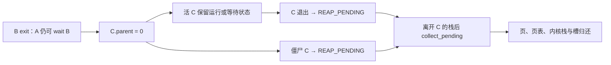

# K34 · 父进程退出后，继续运行并回收它的孩子

从 K33 继续，保留同一个带敲目录。此前 `run sh` 能一直等串口输入，但用户进程的最后一道清理由 `launch` 在整次会话结束时完成。若某个程序 fork 后先退出，孩子还记着原来的父 PID；孩子随后退出，没有父进程 wait，它的页面和进程槽便会一直留到 shell 退出。八个槽很快就会用完，长驻服务不能依赖重启来清空它们。

本节让内核托管失去父进程的孩子。活孩子保留自己的地址空间、FD 和等待条件，继续执行；已退出的孩子不再保留无人领取的状态，交给安全位置回收。我们增加 `orphans` 用户程序，在一次 shell 会话内连续运行二十四轮，检查进程槽和管道引用可以持续复用。当前还没有用户态 init、服务重启策略或永久调度入口；这些在后续升级中接入。

<a id="orphan-handoff"></a>
## 退出父进程时，把孩子交给谁

K22 已将退出与资源释放分开：ZOMBIE 保留退出状态，REAP_PENDING 表示状态已不需要保留，但仍须等执行离开该进程的内核栈。K29 的启动服务栈提供另一个安全执行位置。本节沿用这套时序，只补上“谁还会取退出状态”的判断。

设用户 shell 是 S，它启动的程序是 A，A 再创建 B，B 创建 C。A 等待 B，但 B 没有等待 C 就退出。B 的退出码仍属于 A，不能丢弃；C 的原父已经无法 wait，内核将 C 的 `parent` 改为 0。这里的 0 是“由内核负责回收”的身份标记，进程表里没有一个 PID 为 0 的用户进程。C 不会变成 A 的可 wait 孩子，A 对直接孩子的语义保持原样。

父退出时分别处理孩子的状态：

- C 仍在运行、可运行或等待 I/O：只改变父身份，保留页面、FD 和等待请求；条件满足后按原现场继续。
- C 已经是 ZOMBIE：再没有用户会读取它的退出状态，改为 REAP_PENDING。
- C 已经是 REAP_PENDING：保留延后回收资格，不在父退出的调用链中另做一遍释放。

C 将来自己退出时，若查不到活父进程，也直接登记 REAP_PENDING。此时 CPU 仍在 C 的内核栈上，`exit_current` 只能登记；`collect_pending` 之后在别的进程陷入栈或长期启动服务栈上清理它。这个函数原来已经跳过 `current`，所以不会把正在执行的调用链归还页池。当前会话根仍由 `launch` 保留至会话末尾，以取得它的统计；本节没有把它改成永久 init。



**在现有 `kernel/process/user.c` 中完成下面四组局部修改。** 每组第一块是旧文本，第二块是替换内容；只敲第二块，不把两块同时加入文件。未列出的函数保持 K33 的内容。先加入映像声明和目录项，让内核稍后能按 `orphans` 找到同一份用户 ELF。

<!-- replace: kernel/process/user.c -->
<!-- before -->
```c
extern const uint8_t airi_process_elf_start[], airi_process_elf_end[]; // 新的fork/wait和抢占工作负载。
```
<!-- after -->
```c
extern const uint8_t airi_process_elf_start[], airi_process_elf_end[]; // 新的fork/wait和抢占工作负载。
extern const uint8_t airi_orphans_elf_start[], airi_orphans_elf_end[]; // 持续会话中的孤儿回收与槽复用演示。
```

<!-- replace: kernel/process/user.c -->
<!-- before -->
```c
    {"sh", airi_shell_elf_start, airi_shell_elf_end}, // 独占串口输入的可选用户程序。
```
<!-- after -->
```c
    {"sh", airi_shell_elf_start, airi_shell_elf_end}, // 独占串口输入的可选用户程序。
    {"orphans", airi_orphans_elf_start, airi_orphans_elf_end}, // 不结束根会话也能回收退出的孤儿。
```

接着完整替换 `collect_pending`。回收条件仍是 REAP_PENDING 且不是当前进程；新增的局部 `pid` 和 `orphan` 在 cleanup 清空控制块之前保存。只有实际清理完成，才为托管对象发布 `[ORPHAN_REAP]`，普通父进程 wait 的回收不进入这项计数。

<!-- replace: kernel/process/user.c -->
<!-- before -->
```c
static void collect_pending(void) { // 在其他用户陷入栈或启动服务栈上回收，跳过仍在使用的当前进程栈。
    for (unsigned i = 0; i < PROCESS_COUNT; ++i) // 回收父进程已取得状态的孩子。
        if (&processes[i] != current && processes[i].state == USER_REAP_PENDING) // 当前真正运行的内核栈不能在此回收。
            cleanup(&processes[i]); // 非活动根和已离开的内核栈可安全解除。
}
```
<!-- after -->
```c
static void collect_pending(void) { // 在其他用户陷入栈或启动服务栈上回收，跳过仍在使用的当前进程栈。
    for (unsigned i = 0; i < PROCESS_COUNT; ++i) // 遍历已取得延后回收资格的进程，包括用户 wait 后的孩子与内核托管孤儿。
        if (&processes[i] != current && processes[i].state == USER_REAP_PENDING) { // 当前真正运行的内核栈不能在此回收。
            unsigned pid = processes[i].pid; // cleanup清零控制块前保存诊断身份。
            bool orphan = processes[i].parent == 0; // 用户wait回收与内核托管回收分开观察。
            cleanup(&processes[i]); // 非活动根和已离开的内核栈可安全解除。
            if (orphan) // 不把普通父wait冒充自动托管。
                airi_log("[ORPHAN_REAP] pid=%u released=1", pid); // 只在内存和FD资源实际释放后发布。
        }
}
```

最后完整替换 `exit_current`。退出者先关闭自己的文件和异步身份，再把直接孩子的父身份改为 0；活孩子的运行或等待状态保留，已经退出的孩子才取得延后回收资格。随后再判断退出者自己是否还有活父进程，并沿原来的 wait 唤醒与调度路径离开当前栈。会话根仍保留到 launch 收尾，新增分支不提前清掉它的统计。

<!-- replace: kernel/process/user.c -->
<!-- before -->
```c
static struct airi_trap_frame *exit_current(int code) { // CPU还在当前进程内核栈上，先结束身份而不释放栈。
    struct user_process *p = current; // 当前退出者的稳定控制块。
    if (p->async_owned) { // 用户身份结束，不能把旧CQ交给之后复用的进程槽。
        airi_async_close(p->pid); // QUEUED撤销，ACTIVE内核副本保持到收集。
        p->async_owned = false; // cleanup不重复关闭未来的新epoch。
    }
    airi_fd_close_all(&p->files, false); // exit立即释放文件，僵尸只保留等待状态与待回收内存。
    p->exit_code = code; // 保存给父进程wait读取。
    p->state = USER_ZOMBIE; // 不再运行，但资源和状态尚存在。
    if (p->pid == root_pid) // 整个会话的结果以最初根用户为准。
        session_result = code; // 孩子退出不改变根结果。
    struct user_process *parent = find_pid(p->parent); // 父身份可能已退出或不存在。
    if (parent && parent->state == USER_WAITING && (parent->wait_target == -1 || (uint64_t)parent->wait_target == p->pid)) { // 只有真正等待此孩子的父进程可以被唤醒。
        bool copied = !parent->wait_status || copy_user(parent, &code, parent->wait_status, sizeof(code), true); // 通过父进程自己的页表写结果。
        parent->frame->rax = copied ? p->pid : (uint64_t)-14ll; // 返回子PID或明确地址错误。
        parent->state = USER_RUNNABLE; // 结果形成后才公开可运行状态。
        parent->wait_target = 0; // 这一次等待已经结束。
        parent->wait_status = 0; // 不保留用户局部对象的过期地址。
        if (copied) // 地址错误时保留僵尸，让父进程能用有效指针重试。
            p->state = USER_REAP_PENDING; // 下一次别的用户陷入后才能释放本次仍在用的内核栈。
    }
    airi_log("[USER_EXIT] pid=%u code=%d user_ticks=%u", p->pid, code, p->user_ticks); // 正常系统调用上下文记录身份结果。
    return schedule(REASON_EXIT); // 子进程或父进程可继续，未必立刻回启动栈。
}
```
<!-- after -->
```c
static struct airi_trap_frame *exit_current(int code) { // CPU还在当前进程内核栈上，先结束身份而不释放栈。
    struct user_process *p = current; // 当前退出者的稳定控制块。
    if (p->async_owned) { // 用户身份结束，不能把旧CQ交给之后复用的进程槽。
        airi_async_close(p->pid); // QUEUED撤销，ACTIVE内核副本保持到收集。
        p->async_owned = false; // cleanup不重复关闭未来的新epoch。
    }
    airi_fd_close_all(&p->files, false); // exit立即释放文件，僵尸只保留等待状态与待回收内存。
    p->exit_code = code; // 保存给父进程wait读取。
    p->state = USER_ZOMBIE; // 不再运行，但资源和状态尚存在。
    if (p->pid == root_pid) // 整个会话的结果以最初根用户为准。
        session_result = code; // 孩子退出不改变根结果。
    for (unsigned i = 0; i < PROCESS_COUNT; ++i) { // 父退出时交接全部直接孩子，不等待整次会话收拢。
        struct user_process *child = &processes[i]; // 活孩子和未收的僵尸都可能仍引用此父PID。
        if (child->state == USER_UNUSED || child->parent != p->pid) // 只接管本次退出者真正拥有的孩子。
            continue; // 不改其他父子关系。
        child->parent = 0; // PID0表示内核托管者，不是可运行的用户进程。
        if (child->state == USER_ZOMBIE) // 父已无法取得这份退出状态。
            child->state = USER_REAP_PENDING; // 下一条安全内核栈回收，不让僵尸永久占槽。
        airi_log("[ORPHAN_ADOPT] pid=%u former_parent=%u finished=%u", child->pid, p->pid, child->state == USER_REAP_PENDING); // 活孩子仍正常调度或等待。
    }
    struct user_process *parent = find_pid(p->parent); // 父身份可能已退出或不存在。
    if (p->pid != root_pid && (!parent || parent->state == USER_ZOMBIE || parent->state == USER_REAP_PENDING)) { // 会话根的统计保留到launch结束；普通孤儿无需用户wait。
        p->parent = 0; // 不再保留已失效的用户父PID。
        p->state = USER_REAP_PENDING; // 当前栈仍在使用，只登记延后回收资格。
        airi_log("[ORPHAN_EXIT] pid=%u code=%d deferred=1", p->pid, code); // 真正释放发生在离开此栈后。
    }
    if (parent && parent->state == USER_WAITING && (parent->wait_target == -1 || (uint64_t)parent->wait_target == p->pid)) { // 只有真正等待此孩子的父进程可以被唤醒。
        bool copied = !parent->wait_status || copy_user(parent, &code, parent->wait_status, sizeof(code), true); // 通过父进程自己的页表写结果。
        parent->frame->rax = copied ? p->pid : (uint64_t)-14ll; // 返回子PID或明确地址错误。
        parent->state = USER_RUNNABLE; // 结果形成后才公开可运行状态。
        parent->wait_target = 0; // 这一次等待已经结束。
        parent->wait_status = 0; // 不保留用户局部对象的过期地址。
        if (copied) // 地址错误时保留僵尸，让父进程能用有效指针重试。
            p->state = USER_REAP_PENDING; // 下一次别的用户陷入后才能释放本次仍在用的内核栈。
    }
    airi_log("[USER_EXIT] pid=%u code=%d user_ticks=%u", p->pid, code, p->user_ticks); // 正常系统调用上下文记录身份结果。
    return schedule(REASON_EXIT); // 子进程或父进程可继续，未必立刻回启动栈。
}
```

这四组修改只接入托管与目录。`airi_orphans_elf_start/end` 还没有由包装汇编提供，先完成下面的用户程序、ELF 构建与映像接入，再编译运行。

`[ORPHAN_ADOPT]` 在父退出时发布，`finished=1` 表示孩子已经具备回收资格；`finished=0` 表示它还要继续运行。`[ORPHAN_EXIT]` 表示活孤儿后来退出。只有 `cleanup` 完成后才出现 `[ORPHAN_REAP] released=1`，因此三个记录分别对应身份交接、停止执行和资源释放，不能互相代替。用户 wait 取走状态的普通孩子不计入孤儿回收记录。

<a id="orphan-pipes"></a>
## 在同一会话中反复制造两种退出顺序

新建 `labs/airios/orphans.c`。程序 A 每轮建立两根阻塞管道，再 fork 中间父 B，由 B fork 孙 C。`gate` 由 A 写一个放行字节，`report` 由 C 写一个报告字节；关闭各进程不用的端点，使真正的引用关系决定 EOF 和 EPIPE。B 退出只关闭 B 的表项，C 自己继承的引用仍然有效。

偶数轮中，读 gate 的是 C。B 创建它以后直接退出，A 先 wait 取得 B 的退出码 31，才向 gate 写放行字节。因此 B 退出时，C 仍停在自己的 read 中；父身份交接不能撤销这次等待。放行以后，C 从原调用继续，向 report 写 L，再退出 17。

奇数轮把 gate 交给 B 等待，让 C 先向 report 写 Z 并退出。A 收到 Z 后让出四个 PIT tick，再放行 B；B 随后退出，内核应将已经是僵尸的 C 改为 REAP_PENDING。Z 只证明报告已写出，四个 tick 也只是给予执行机会，实际顺序还要由 `[ORPHAN_ADOPT] finished=1` 确认。

`pass_ticks` 复用已经介绍的 tick 与 yield，不增加睡眠系统调用。每轮取得报告和 B 的退出状态后，A 再让出四个 tick；这些系统调用也为内核提供离开 C 栈后的安全回收机会。A 随后用 wait(-1) 检查自己没有直接孩子；孙的退出由内核处理，不交给 A。二十四轮远超过八槽表的一次性容量；最后一轮结束时 A 和 shell 仍活着，尚未发生整次 `launch` 收尾。

<!-- write: labs/airios/orphans.c -->
```c
#include <airi_libc.h> // 用户只能通过既有进程、管道和时钟ABI观察托管。
static void pass_ticks(unsigned count) { // 给其他用户真实时间片，不拿主机sleep冒充guest执行。
    uint64_t start = airi_ticks(); // PIT提供单调事件基准。
    while (airi_ticks() - start < count) // 等待本轮有界时间，不依赖CPU执行速度。
        airi_yield(); // 让已就绪的孙进程完成退出与延后清理。
}
static int round_trip(unsigned finished) { // 两条路径分别覆盖先退出的僵尸和仍在等待的孤儿。
    unsigned gate[2], report[2]; // gate控制放行，report只传本轮一个完成字符。
    if (airi_pipe(gate, 0) || airi_pipe(report, 0)) // 一次最多四个额外FD，所有失败都以退出收拢。
        return 101; // 不用未初始化端点继续fork。
    long middle = airi_fork(); // 根持久运行，中间父进程将在本轮提前退出。
    if (middle < 0) // 槽泄漏会使后续轮次在此失败。
        return 102; // 不重试掩盖资源耗尽。
    if (!middle) { // 中间父进程拥有独立页，管道对象仍共享。
        airi_close(gate[1]); // 只有根负责放行。
        airi_close(report[0]); // 只有根读取报告。
        long leaf = airi_fork(); // 真正需要托管的孙进程。
        if (leaf < 0) // 上一轮没回收将逐渐耗尽八槽表。
            airi_exit(103); // 根wait取得明确错误。
        if (!leaf) { // 孙进程不会被根的waitpid直接回收。
            char value = 'L'; // 活孤儿得到放行后报告。
            if (!finished && airi_read(gate[0], &value, 1) != 1) // 等根已经wait中间父后才继续，确保发生活孤儿交接。
                airi_exit(104); // 不能把管道错误当放行。
            value = finished ? 'Z' : 'L'; // 区分两种实际运行路径。
            if (airi_write(report[1], &value, 1) != 1) // 一字节报告，不假设父退出会杀孩子。
                airi_exit(105); // 短写或错误明确失败。
            airi_exit(17); // 故意不由中间父wait，测试内核托管。
        }
        if (finished) { // 让孙先退出为僵尸，中间父再退出。
            char release; // 根先观察报告与时间片，再写放行字符。
            if (airi_read(gate[0], &release, 1) != 1) // 真阻塞，不能在孙之前抢先结束。
                airi_exit(106); // 错误不继续发布正常退出码。
        }
        airi_exit(31); // 不wait孙，FD由exit关闭，孙的引用仍有效。
    }
    airi_close(gate[0]); // 根不读取放行管道。
    airi_close(report[1]); // 根不持有报告写端，能正确看到异常EOF。
    char value = 0; // 只接受本轮实际报告。
    if (finished) { // 先确保孙已运行，再让中间父退出。
        if (airi_read(report[0], &value, 1) != 1 || value != 'Z') // 报告来自孙的用户代码。
            return 107; // 不能用旧字节满足本轮。
        pass_ticks(4); // 让出四个 PIT tick 供孙继续执行 exit，实际僵尸状态由 finished=1 核对。
        if (airi_write(gate[1], "!", 1) != 1) // 放行中间父，不影响已经结束的孙。
            return 108; // 无读者等错误不能忽略。
    }
    int status = -1; // 中间父自己的退出结果。
    if (airi_waitpid(middle, &status) != middle || status != 31) // 根只能wait直接孩子，不知道孙的PID也能继续。
        return 109; // 子孙错误和槽耗尽使本轮明确失败。
    if (!finished) { // 中间父确认退出后，孙必须仍可继续执行。
        if (airi_write(gate[1], "!", 1) != 1 || airi_read(report[0], &value, 1) != 1 || value != 'L') // 管道引用跨父退出保持。
            return 110; // 活孤儿未正确保留运行或等待状态。
    }
    airi_close(gate[1]); // 根不保留跨轮引用。
    airi_close(report[0]); // 所有报告字节已消费。
    pass_ticks(4); // 孤儿退出后给内核下一条安全栈回收机会。
    if (airi_waitpid(-1, &status) != -10) // 托管者是内核PID0，不偷偷把孙变成根的可wait孩子。
        return 111; // 根的普通父子语义必须保持。
    return 0; // 此时根会话仍存活，尚未触发launch末尾的统一回收。
}
int main(void) { // 不依赖新系统调用，复用K33前已经实现的用户库。
    for (unsigned i = 0; i < 24; ++i) { // 共二十四轮，远超过八槽表能靠一次性分配承受的数量。
        int error = round_trip(i & 1u); // 交替验证活孤儿与已结束僵尸。
        if (error) // 第一次失败立即给shell完整退出码。
            return error; // 不用重启清空资源后假装持续运行。
    }
    airi_puts("[ORPHAN_USER_OK] rounds=24 live=12 zombie=12 session=alive\n"); // 只有同一根会话连续完成才出现。
    return 0; // launch最后再核对全部页面、FD与异步静态池归还。
}
```

返回 101–111 都是本程序对具体失败位置的报告，源码旁注给出了对应操作。遇到失败会结束这次用户程序并回到 shell，管道和页面仍由既有退出路径收拢。正常路径只在全部二十四轮结束后输出 `[ORPHAN_USER_OK]`。

## 把新用户程序放入初始 ELF 目录

在 `Makefile` 末尾追加下面规则。已有通用用户 `.o` 规则会编译 `orphans.c`，这里将其与 `USER_COMMON` 中的用户入口和库链接成独立 ELF。`images.o` 的额外依赖保证先链接完成，再让 `.incbin` 读取该配置文件；目标专属 `CPPFLAGS` 只为包装对象补上文件名宏。

<!-- append: Makefile -->
```make

# 孤儿工作负载复用用户入口和库，保持独立main。
$(OUT)/user/orphans.elf: $(USER_COMMON) $(OUT)/user/orphans.o labs/airios/program.ld
# 独立静态ELF不链接宿主libc。
	$(LD) -m elf_x86_64 -nostdlib -static -z max-page-size=0x1000 -z noexecstack -T labs/airios/program.ld $(USER_COMMON) $(OUT)/user/orphans.o -o $@
# 包装必须等待此配置自己的ELF完成。
$(OUT)/labs/airios/images.o: $(OUT)/user/orphans.elf
# 汇编只读当前文件路径，不能复用另一配置产物。
$(OUT)/labs/airios/images.o: CPPFLAGS += -DAIRI_ORPHANS_ELF='"$(OUT)/user/orphans.elf"'
```

在 `labs/airios/images.S` 末尾追加文件边界。它们和开头登记的 `airi_orphans_elf_start/end` 对应：内核持有原始 ELF 字节，装载器将段复制到用户页面，CPU 随后在 ring3 执行，不把这份映像当内核函数调用。

<!-- append: labs/airios/images.S -->
```asm

.section .rodata /* 孤儿回收使用真正用户ELF，不在内核中直接执行。 */
.global airi_orphans_elf_start, airi_orphans_elf_end /* 初始目录只持有完整输入字节。 */
airi_orphans_elf_start: /* 文件头起点。 */
.incbin AIRI_ORPHANS_ELF /* 当前配置的独立ELF。 */
airi_orphans_elf_end: /* 文件半开右端。 */
```

<a id="orphan-observation"></a>
## 从 UART 运行并核对真正的回收位置

先构建并运行默认串口目标，在 `airi>` 输入 `run sh`，进入用户 shell 后输入 `orphans`。可以在同一个 shell 中再次输入 `orphans`，再运行 `hello`，最后 `exit` 回监控台。父进程退出后的 C 仍应能报告，未收的僵尸也应被清掉。

```sh
./airios build # 构建当前配置的新用户ELF与内核镜像。
./airios run # 在UART输入run sh，再输入orphans、hello、exit；Ctrl-A X结束QEMU。
```

正常命令的结束记录为：

```text
[ORPHAN_USER_OK] rounds=24 live=12 zombie=12 session=alive
[SHELL_COMMAND_DONE] name=orphans code=0
```

具体 PID 随此前运行次数增长，不固定抄写。二十四条 `[ORPHAN_REAP]` 必须在本条 shell 命令完成前出现，不能等 `exit` 回监控台后才出现。活孤儿路径应有十二条 `[ORPHAN_EXIT]`，另十二条交接记录带 `finished=1`。已有 `launch` 收尾还会核对物理页、堆、FD 和异步资源池全部归还。

`scripts/shell_test.py` 从主机沿 UART 发送 `orphans`，仍由真实用户 shell 解析并启动程序。保留此前 QMP 限速、坏 exec、长行和返回监控台检查，在存储程序之后加入本次命令及上述三组计数；下面是完整版本。正则只看本条命令之后的日志，旧启动内容无法满足新请求。超时仍为每个操作 35 秒，失败保存当前串口字节并回收本次 QEMU。

<!-- write: scripts/shell_test.py -->
```python
"""Drive the actual ring-3 shell through UART and observe a complete I/O path.""" # 不把宿主脚本当用户shell。
import json # 记录本轮真实结果。
from pathlib import Path # 短控制端点。
import re # 按实际PID关联等待和进展。
import socket # QEMU的UART双向字节流。
import subprocess # 只管理本测试子进程。
import tempfile # 避免UNIX路径长度上限。
import time # 单调总截止。
from boot import command, qmp_execute # 固定硬件与真实限速。
from tools import ROOT # 不依赖调用目录。
def check_shell(): # 默认串口主线，不读取frontend或字体。
    work=ROOT/'artifacts/shell-normal'; work.mkdir(parents=True,exist_ok=True) # 本测试独占目录。
    result_path=work/'result.json'; result_path.write_text('{"passed":false}\n') # 旧成功立即撤销。
    disk=work/'disk.raw' # 仅测试盘可重置，不动交互run的正式实验盘。
    if disk.is_symlink() or (disk.exists() and (not disk.is_file() or disk.stat().st_size!=8*1024*1024)): # 未知对象不替换。
        raise RuntimeError('Invalid shell-test disk') # 保留异常路径供检查。
    disk.unlink(missing_ok=True) # 下一command排他创建空盘。
    with tempfile.TemporaryDirectory(prefix='airios-sh-',dir='/tmp') as directory: # 本次端点随测试销毁。
        qmp=Path(directory)/'qmp.sock'; uart=Path(directory)/'uart.sock' # 控制与设备分开。
        cmd=command('normal',work); cmd[cmd.index('-serial')+1]=f'unix:{uart},server=on,wait=off' # 实际UART而非内存注入。
        cmd+=['-S','-qmp',f'unix:{qmp},server=on,wait=off'] # 连接UART后才继续CPU。
        (work/'command.json').write_text(json.dumps(cmd,indent=2)+'\n') # 固定本次QEMU参数。
        with (work/'qemu.log').open('w') as errors: # QEMU诊断单独保存。
            process=subprocess.Popen(cmd,stdout=errors,stderr=errors); wire=None; data=bytearray() # 保留真实累积字节。
            try: # 任何失败都回收自己的QEMU。
                deadline=time.monotonic()+10 # 等待端点不能无限。
                while not uart.exists(): # CPU还未开始启动。
                    if process.poll() is not None or time.monotonic()>deadline: raise RuntimeError('Shell UART unavailable') # 明确失败。
                    time.sleep(.05) # 给QEMU建立端点的机会。
                wire=socket.socket(socket.AF_UNIX,socket.SOCK_STREAM); wire.connect(str(uart)); wire.setblocking(False) # 接收端在CPU之前准备好。
                qmp_execute(qmp,'cont') # 真实继续CPU。
                def output(): # 即使失败也保留已到达的日志。
                    while True: # 取到本轮暂时没有更多字节。
                        try: chunk=wire.recv(4096) # 流不保证一行一次到齐。
                        except BlockingIOError: break # 没字节不是EOF。
                        if not chunk: break # 进程状态由wait检查。
                        data.extend(chunk) # 保持串口真实顺序。
                    (work/'serial.log').write_bytes(data) # 及时落证据。
                    return data.decode(errors='replace') # 诊断不因单个字节丢失。
                def wait(marker,offset=0): # 只接受当前请求后已完整结束的记录。
                    end=time.monotonic()+35 # 每个操作有界。
                    while time.monotonic()<end: # 不重置超时预算。
                        text=output(); tail=text[offset:] # 旧启动输出不能满足新请求。
                        for line in tail.splitlines(keepends=True): # 半行不能被当成功。
                            record=line.removeprefix('airi> ').removesuffix('\n').removesuffix('\r') # 只移除已知提示符。
                            if line.endswith('\n') and (record==marker or (marker.endswith(' ') and record.startswith(marker))): return text # 明确完整记录。
                        if '[AIRI_PANIC]' in tail or process.poll() is not None: raise RuntimeError(f'Shell failed before {marker}') # 不把QEMU存活当成功。
                        time.sleep(.02) # 给真实设备与CPU推进。
                    raise RuntimeError(f'Shell timeout: {marker}; see {work}/serial.log') # 可定位失败证据。
                text=wait('[AIRI_P5_READY] ') # 完整内核启动后再进入用户shell。
                wire.sendall(b'run sh\n'); text=wait('[USER_SHELL_PROMPT]',len(text)) # 真正进入用户态shell。
                limits={'device':'airi-disk','bps':0,'bps_rd':0,'bps_wr':0,'iops':1,'iops_rd':0,'iops_wr':0} # 让物理完成晚于父等待。
                qmp_execute(qmp,'block_set_io_throttle',limits); (work/'throttle.json').write_text(json.dumps(limits)+'\n') # QMP接受后才记录。
                offset=len(text); wire.sendall(b'demo\n'); text=wait('[SHELL_COMMAND_DONE] name=demo code=0',offset) # 命令由shell解析、fork/exec/wait。
                tail=text[offset:]; match=re.search(r'\[USER_ALLOC\] pid=(\d+) ',tail) # 从实际新程序分配记录取得PID。
                assert match and '[PIPELINE_USER_OK]' in tail and '[EXEC_COMMIT]' in tail # 不用宿主复制或预期字符串替代运行。
                pid=match.group(1); progress=tail.index('[PIPELINE_OTHER_PROGRESS]'); blocked=False # 验证另一个用户在同一次CQ等待期间推进。
                for registered in re.finditer(r'\[WAIT_REGISTER\] pid='+pid+r' operation=cq\r?\n',tail): # 只匹配演示父进程。
                    wake=tail.find('[WAIT_WAKE] pid='+pid+' result=0\r\n',registered.end()) # 同PID真实结果交付。
                    blocked|=registered.start()<progress<wake # 不固定猜用户PID或时序。
                assert blocked and 'phase=start' in tail and 'phase=complete' in tail # 实际设备请求和完成均可见。
                qmp_execute(qmp,'block_set_io_throttle',dict(limits,iops=0)) # 后续同步日志不继承慢设备测试预算。
                for request,marker in [('storage','[STORAGE_USER_OK]'),('recover','[RECOVERY_USER_OK]'),('files','[FILES_USER_OK]'),('missing','exec failed: -2'),('broken','exec failed: -8'),('hello','[ELF_USER_OK]')]: # 正常、坏名字、坏ELF后仍可运行。
                    offset=len(text); wire.sendall((request+'\n').encode()); text=wait('[SHELL_COMMAND_DONE] name='+request+' ',offset) # 完整孩子退出才开始下一条。
                    assert marker in text[offset:] # 必须来自本条命令。
                offset=len(text); wire.sendall(b'orphans\n'); text=wait('[SHELL_COMMAND_DONE] name=orphans code=0',offset) # 同一用户shell持续服务，不靠返回monitor收拢孙进程。
                orphan_output=text[offset:] # 只核对本条命令的身份记录。
                assert '[ORPHAN_USER_OK] rounds=24 live=12 zombie=12 session=alive' in orphan_output # 超过八槽容量仍能连续fork。
                assert len(re.findall(r'\[ORPHAN_REAP\] pid=\d+ released=1',orphan_output))==24 # 不是launch收尾清空表冒充托管。
                assert len(re.findall(r'\[ORPHAN_ADOPT\].*finished=1',orphan_output))==12 # 先成为僵尸再失去父的路径实际运行。
                assert len(re.findall(r'\[ORPHAN_EXIT\]',orphan_output))==12 # 活孤儿放行后正常退出。
                offset=len(text); wire.sendall(b'programs\n'); text=wait('[USER_SHELL_PROMPT]',offset) # 用户查询来自真实注册目录。
                assert 'demo\r\n' in text[offset:] and 'async-reset\r\n' in text[offset:] # 不是内核监控台的静态帮助。
                offset=len(text); wire.sendall(b'x'*80+b'\n'); text=wait('[USER_SHELL_PROMPT]',offset) # 过长行必须整体丢弃。
                assert 'line too long; discarded' in text[offset:] and '[FORK]' not in text[offset:] # 不执行截断前缀。
                offset=len(text); wire.sendall(b'hellx\x7fo\r\n'); text=wait('[SHELL_COMMAND_DONE] name=hello code=0',offset) # 退格修正与CRLF真正走用户输入。
                offset=len(text); wire.sendall(b'exit\n'); text=wait('[CONSOLE_UPDATE] view=0 commands=1 page=0',offset) # shell退出后内核监控台才返回。
                assert '[USER_SHELL_EXIT]' in text[offset:] and 'program sh exited 0' in text[offset:] # 真实收拢页/FD/静态池由launch核对。
                offset=len(text); wire.sendall(b'echo after-shell\n'); text=wait('[CONSOLE_UPDATE] view=0 commands=2 page=0',offset) # 回到内核后输入仍完整。
                assert 'after-shell' in text[offset:] # 不只是退出而丢了后续UART。
                result={'passed':True,'ring3_shell':True,'ram_file_and_device_readback':True,'other_user_during_cq_wait':True,'qmp_iops':1,'error_exec_survived':True,'returned_to_monitor':True,'orphan_rounds':24} # 只发布已观察事实。
                result_path.write_text(json.dumps(result,indent=2)+'\n'); print('PASS user shell: alloc/file/async wait/other task/CQ/readback, failed exec, return to monitor') # 阶段演示实际完成。
                return result # 总入口可收集。
            finally: # 包括断言、超时和QEMU错误。
                if wire is not None: wire.close() # 只关闭自己的设备连接。
                process.terminate() # 正常终止测试CPU，不称掉电。
                try: process.wait(timeout=5) # 清理也有期限。
                except subprocess.TimeoutExpired: process.kill(); process.wait() # 不遗留测试进程。
```

<!-- run -->
```sh
./airios test # 完整启动与输入回归；真实shell中另核对二十四轮孤儿回收。
```

本节的 Linux 对照先回到 L03：父等待退出状态与进程内存的释放是不同动作。本实现的托管者是内核 PID0 标记；Linux 的孤儿接管还涉及 init、subreaper 与命名空间，不能把这里的规则当成它们的完整语义。P7 后续将建立自己的常驻 init，并让服务生命周期脱离演示会话；网络、线程和 C++ runtime 仍未由本节提供。
