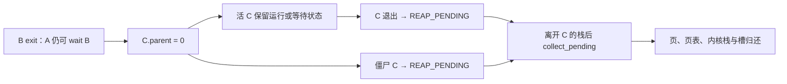

# K34 · 父进程退出后，继续运行并回收它的孩子

从 K33 继续，保留同一个带敲目录。此前 `run sh` 能一直等串口输入，但用户进程的最后一道清理由 `launch` 在整次会话结束时完成。若某个程序 fork 后先退出，孩子还记着原来的父 PID；孩子随后退出，没有父进程 wait，它的页面和进程槽便会一直留到 shell 退出。八个槽很快就会用完，长驻服务不能依赖重启来清空它们。

本节让内核托管失去父进程的孩子。活孩子保留自己的地址空间、FD 和等待条件，继续执行；已退出的孩子不再保留无人领取的状态，交给安全位置回收。我们增加 `orphans` 用户程序，在一次 shell 会话内连续运行二十四轮，检查进程槽和管道引用可以持续复用。当前还没有用户态 init、服务重启策略或永久调度入口；这些在后续升级中接入。

<a id="orphan-handoff"></a>
## 退出父进程时，把孩子交给谁

K22 已将退出与资源释放分开：ZOMBIE 保留退出状态，REAP_PENDING 表示状态已不需要保留，但仍须等执行离开该进程的内核栈。K29 的启动服务栈提供另一个安全执行位置。本节沿用这套时序，只补上“谁还会取退出状态”的判断。

设用户 shell 是 S，它启动的程序是 A，A 再创建 B，B 创建 C。A 等待 B，但 B 没有等待 C 就退出。B 的退出码仍属于 A，不能丢弃；C 的原父已经无法 wait，内核将 C 的 `parent` 改为 0。这里的 0 是“由内核负责回收”的身份标记，进程表里没有一个 PID 为 0 的用户进程。C 不会变成 A 的可 wait 孩子，A 对直接孩子的语义保持原样。

父退出时分别处理孩子的状态：

- C 仍在运行、可运行或等待 I/O：只改变父身份，保留页面、FD 和等待请求；条件满足后按原现场继续。
- C 已经是 ZOMBIE：再没有用户会读取它的退出状态，改为 REAP_PENDING。
- C 已经是 REAP_PENDING：保留延后回收资格，不在父退出的调用链中另做一遍释放。

C 将来自己退出时，若查不到活父进程，也直接登记 REAP_PENDING。此时 CPU 仍在 C 的内核栈上，`exit_current` 只能登记；`collect_pending` 之后在别的进程陷入栈上清理它。这个函数原来已经跳过 `current`，所以不会把正在执行的调用链归还页池。当前会话根仍由 `launch` 保留至会话末尾，以取得它的统计；本节没有把它改成永久 init。



**更新 `kernel/process/user.c`。** 新内容位于映像声明与目录、`collect_pending` 的回收日志，以及 `exit_current` 的孩子交接和孤儿退出。其余函数沿 K33 保留；下面提供完整终点供对照，不要求把未变部分重敲。先完成本节的 ELF 构建接入再运行，当前新增的映像边界尚未由汇编提供。

<!-- write: kernel/process/user.c -->
```c
#include <airi/async.h> // 进程轮次与固定缓冲资源的生命周期。
#include <airi/arch.h> // CPU空闲与用户调度门留在架构适配。
#include <airi/storage.h> // 用户存储请求经过有界副本进入日志服务。
#include <airi/file.h> // 每进程FD表共享打开文件对象。
#include <airi/console.h> // 内核命令消费服务结果，不依赖主题和绘图。
#include <airi/elf.h> // 独立用户ELF检查器。
#include <airi/user.h> // 完整陷入与安全用户返回。
#include <airi/memory.h> // 页面、内核栈与长期根的所有权。
#include <airi/vm.h> // 每个进程有独立低半区。
#include <airi/timer.h> // 用户时间片依赖真实IRQ0。
#include <airi/kernel.h> // 有界串口输出与故障报告。
#define USER_CODE 0x400000ull // 旧受控映像的用户入口。
#define USER_STACK 0x70000000ull // 当前每进程一页初始用户栈。
#define STACK_BASE 0xffffe10000000000ull // 所有进程陷入栈位于同一长期内核分支。
#define USER_HEAP 0x10000000ull // ELF静态范围之外的用户页分配起点。
#define PROCESS_COUNT 8u // 有界进程表，不做动态扩容。
enum user_state { USER_UNUSED, USER_RUNNABLE, USER_RUNNING, USER_WAITING, USER_IO_WAIT, USER_ZOMBIE, USER_REAP_PENDING }; // 退出与回收是两个不同状态。
enum io_operation { IO_NONE, IO_READ, IO_WRITE, IO_READY, IO_ASYNC }; // 等待保存操作条件，不保留内核局部buffer。
struct user_page { uint64_t address, physical; unsigned flags; }; // fork需要把同一VA映射到另一个物理页。
struct user_process { // 所有权和调度状态由内核持有，用户只能看到PID。
    bool async_owned; // 本控制块是否持有当前PID的异步owner，局部旧exec副本必须清除此所有权。
    struct airi_fd_table files; // exec转移表项，fork增加同一打开对象的引用。
    struct airi_address_space space; // 根和低半区表自有，高半区借用。
    struct airi_kernel_region stack; // 不能在仍使用它的C调用中释放。
    struct user_page owned[64]; // 所有用户数据页，含代码、静态数据、堆页和栈。
    unsigned count, pid, parent, user_ticks; // 资源数量、身份、父PID和本进程实际IRQ数。
    uint64_t fault_error, heap_next; // 用户故障证据与下一次有界用户页地址。
    int exit_code; // 自有wait接口返回普通退出码或负故障编码。
    enum user_state state; // 只有RUNNABLE可被调度器选中。
    int64_t wait_target; // 正PID表示指定孩子，-1表示任意孩子。
    uint64_t wait_status; // 已验证的父进程用户输出地址，阻塞期间父进程不会修改映射。
    enum io_operation io; // 只有USER_IO_WAIT消费下面的请求副本。
    unsigned io_fd, io_events; // FD属于本进程表，events只用于就绪等待。
    uint64_t io_address, io_bytes, io_deadline; // 用户页在阻塞期间仍由进程拥有，deadline按真实tick。
    struct airi_trap_frame initial; // 尚未运行时的寄存器值，不依赖临时C对象。
    struct airi_trap_frame *frame; // 运行后指向本进程内核栈的实际现场。
};
static struct user_process processes[PROCESS_COUNT]; // 槽可以复用，PID单调增长，不等于槽下标。
static struct user_process *current; // 只在完整陷入边界改变当前身份。
static unsigned next_pid = 1, root_pid, timer_switches, wait_blocks; // 每次运行会话的根身份和实际行为计数。
static unsigned io_block_count, io_wake_count, idle_halt_count; // 会话真实I/O阻塞与唤醒次数。
static bool session_idle, service_from_timer; // 是否暂回启动栈服务，和整个会话结束分开。
static bool session_active; // 只有用户会话活动时才接受用户IRQ或系统调用。
static int session_result; // 根用户退出结果，不用最后一个孩子的结果覆盖。
static struct airi_trap_frame *kernel_return; // 启动栈一直保留到整个用户会话结束。
extern const uint8_t airi_user_probe_start[], airi_user_probe_end[]; // 受控正常映像。
extern const uint8_t airi_user_bad_start[], airi_user_bad_end[]; // 用户cli故障。
extern const uint8_t airi_user_load_bad_start[], airi_user_load_bad_end[]; // 用户读supervisor页故障。
extern const uint8_t airi_user_rsp_bad_start[], airi_user_rsp_bad_end[]; // 不规范用户返回栈。
extern const uint8_t airi_hello_elf_start[], airi_hello_elf_end[]; // 既有独立用户C程序。
extern const uint8_t airi_process_elf_start[], airi_process_elf_end[]; // 新的fork/wait和抢占工作负载。
extern const uint8_t airi_orphans_elf_start[], airi_orphans_elf_end[]; // 持续会话中的孤儿回收与槽复用演示。
extern const uint8_t airi_shell_elf_start[], airi_shell_elf_end[]; // 真正用户shell，不是内核命令别名。
extern const uint8_t airi_demo_elf_start[], airi_demo_elf_end[]; // 用户页分配与异步存储贯通演示。
extern const uint8_t airi_async_elf_start[], airi_async_elf_end[]; // 用户注册、CQ等待与exec资源轮次。
extern const uint8_t airi_waits_elf_start[], airi_waits_elf_end[]; // 真正阻塞与超时工作负载。
extern const uint8_t airi_pipes_elf_start[], airi_pipes_elf_end[]; // 非阻塞管道用户程序。
extern const uint8_t airi_storage_elf_start[], airi_storage_elf_end[]; // 写入和恢复共用一份明确分支的用户ELF。
extern const uint8_t airi_files_elf_start[], airi_files_elf_end[]; // 内存文件用户工作负载。
extern const uint8_t airi_worker_elf_start[], airi_worker_elf_end[]; // exec目标是另一个独立静态ELF。
extern const uint8_t airi_broken_elf_start[], airi_broken_elf_end[]; // 受控损坏输入，验证旧进程保持。
struct executable { const char *name; const uint8_t *start, *end; }; // 初始映像目录尚不是通用文件系统。
static const struct executable executables[] = { // 每份映像字节由内核只读段长期持有。
    {"sh", airi_shell_elf_start, airi_shell_elf_end}, // 独占串口输入的可选用户程序。
    {"orphans", airi_orphans_elf_start, airi_orphans_elf_end}, // 不结束根会话也能回收退出的孤儿。
    {"demo", airi_demo_elf_start, airi_demo_elf_end}, // 页、任务和设备完成串联。
    {"hello", airi_hello_elf_start, airi_hello_elf_end}, // 独立C运行库与BSS观察。
    {"processes", airi_process_elf_start, airi_process_elf_end}, // fork/exec/wait实际工作负载。
    {"worker", airi_worker_elf_start, airi_worker_elf_end},
    {"async", airi_async_elf_start, airi_async_elf_end}, // 完整用户提交/完成路径。
    {"async-reset", airi_async_elf_start, airi_async_elf_end}, // 同一PID新epoch的验证入口。
    {"waits", airi_waits_elf_start, airi_waits_elf_end}, // 阻塞流和就绪条件等待。
    {"pipes", airi_pipes_elf_start, airi_pipes_elf_end}, // 有界FIFO与关闭语义。
    {"storage", airi_storage_elf_start, airi_storage_elf_end}, // 显式提交记录。
    {"recover", airi_storage_elf_start, airi_storage_elf_end}, // 只读取已恢复记录。
    {"files", airi_files_elf_start, airi_files_elf_end}, // 真实用户FD演示。
    {"broken", airi_broken_elf_start, airi_broken_elf_end}, // 用于完整的坏ELF失败演示。
};
static const struct executable *find_program(const char *name) { // 输入是内核已复制的短NUL字符串。
    size_t bytes = airi_strlen(name); // 只读当前有效字符串，不保存其指针。
    for (unsigned i = 0; i < sizeof(executables) / sizeof(executables[0]); ++i) // 遍历固定目录。
        if (airi_strlen(executables[i].name) == bytes && !airi_memcmp(executables[i].name, name, bytes)) // 长度与全部名称字节都相同才匹配。
            return &executables[i]; // 只借长期静态目录项。
    return NULL; // 未知名称不触碰任何用户地址空间。
}
static unsigned slot(const struct user_process *p) { // 只接受processes中的真实槽，不接受临时复制对象。
    return (unsigned)(p - processes); // 同一数组内指针差得到稳定槽号。
}
static bool create_stack(struct user_process *p) { // 每槽前面留一页保护页，所有栈共享已存在高半区分支。
    uint64_t address = STACK_BASE + slot(p) * 5 * 4096ull + 4096; // 四页数据与一页保护，PID增长不扩散地址。
    return airi_memory_region_create(&p->stack, address, 4); // 完整成功后才借给用户根。
}
static bool user_access(const struct user_process *p, uint64_t address, size_t bytes, bool write) { // 检查完整用户范围，不直接解引用它。
    if (address >= AIRI_USER_LIMIT || bytes > AIRI_USER_LIMIT - address) // 排除内核地址与右端溢出。
        return false; // 零长度也保留本项目地址策略。
    for (size_t done = 0; done < bytes;) { // 跨越的每一页都必须满足权限。
        unsigned flags; // 当前叶子权限。
        if (!airi_vm_lookup(&p->space, address + done, NULL, &flags) || !(flags & AIRI_VM_USER) || (write && !(flags & AIRI_VM_WRITE))) // 输出指针还要求用户可写。
            return false; // 不先复制有效前缀。
        size_t part = 4096 - ((address + done) & 4095); // 当前页内剩余跨度。
        if (part > bytes - done) // 最后一段只到请求右端。
            part = bytes - done; // 不额外检查其他页。
        done += part; // 检查下一段。
    }
    return true; // 当前不可抢占内核中没有并发映射修改者。
}
static bool copy_user(struct user_process *p, void *buffer, uint64_t address, size_t bytes, bool to_user) { // 允许从非活动父根复制wait状态，但始终按其所有权查页。
    if (!user_access(p, address, bytes, to_user)) // 写用户缓冲必须检查WRITE，读只需要USER映射。
        return false; // 任何页失败都不复制。
    for (size_t done = 0; done < bytes;) { // 每次用HHDM别名处理一页中的有效段。
        uint64_t physical; // 翻译保留页内偏移。
        airi_vm_lookup(&p->space, address + done, &physical, NULL); // 完整检查后页表在本次内核操作中保持不变。
        size_t part = 4096 - ((address + done) & 4095); // 当前页边界。
        if (part > bytes - done) // 不超出剩余内容。
            part = bytes - done; // 缩到最后一段。
        if (to_user) // wait结果由内核写入父进程自己的页面。
            airi_memcpy(airi_memory_direct(physical), (uint8_t *)buffer + done, part); // 不切到父用户根也能访问其已拥有物理页。
        else // write系统调用把用户数据复制进内核副本。
            airi_memcpy((uint8_t *)buffer + done, airi_memory_direct(physical), part); // 不信任原始VA作为内核指针。
        done += part; // 推进下一段。
    }
    return true; // 同步结束，不借出buffer指针。
}
static long file_transfer(struct user_process *p, uint64_t fd, uint64_t address, size_t bytes, bool write, bool positioned, uint64_t offset) { // 允许在另一根的阻塞进程上重试，同步副本属于当前内核栈。
    char buffer[256]; // 一次有界副本，不跨调度保留。
    if (fd >= AIRI_FD_COUNT) // 完整64位编号先检查再转换。
        return -9; // -EBADF。
    if (bytes > sizeof(buffer)) // 不让用户长度覆盖内核栈。
        return -22; // -EINVAL。
    if (!user_access(p, address, bytes, !write)) // 输出在消费流或偏移之前完整验证。
        return -14; // -EFAULT。
    if (write) { // 用户内容在本次尝试内复制。
        copy_user(p, buffer, address, bytes, false); // 通过目标自己的页表，不解引用原始用户VA。
        if (!positioned && airi_fd_console(&p->files, (unsigned)fd)) { // 固定终端同步发送。
            airi_serial_write_bytes(buffer, bytes); // 不保存局部buffer给设备。
            return (long)bytes; // 返回逻辑进展。
        }
        return airi_fd_write(&p->files, (unsigned)fd, buffer, bytes, positioned, offset); // 满管道可返回EAGAIN。
    }
    if (airi_fd_input(&p->files, (unsigned)fd)) { // 只有shell拥有，内核监控台在launch返回前不再轮询UART。
        if (positioned) // 字节流没有文件偏移。
            return -29; // -ESPIPE，不消费字节。
        if (!bytes) // 零长度读取不能登记永久等待，也不消费UART。
            return 0; // 有效输入FD的空操作。
        size_t received = 0; // 返回当前可取得的前缀，不等待填满用户请求。
        while (received < bytes) { // bytes与整个用户输出范围已在上方验证。
            int c = airi_arch_serial_read(); // 设备寄存器只在架构层。
            if (c < 0) // 暂无字节和字符NUL不同。
                break; // 让已有前缀先交给用户。
            buffer[received++] = (uint8_t)c; // 固定内核副本不会越过256字节。
        }
        if (!received) // 空输入走同一个IO_READ持久等待机制。
            return -11; // 由陷入分派登记等待，不让shell忙轮询。
        if (!copy_user(p, buffer, address, received, true)) // 消费UART前已经完整验证用户范围。
            airi_panic("validated UART output mapping changed"); // 内部错误不能静默丢字节。
        return (long)received; // 实际取得的字节数。
    }
    long result = airi_fd_read(&p->files, (unsigned)fd, buffer, bytes, positioned, offset); // EOF和暂不可读分开。
    if (result > 0 && !copy_user(p, buffer, address, (size_t)result, true)) // 目标阻塞且单线程，已检查映射不应变化。
        airi_panic("validated file output mapping changed"); // 内部错误不丢字节后假装成功。
    return result; // 完成前缀或明确负错误。
}
static void poll_waiters(void) { // 仅普通内核上下文运行，IRQ本身不复制、分配或打印。
    for (unsigned i = 0; i < PROCESS_COUNT; ++i) { // 本阶段有界等待队列由进程槽直接表示。
        struct user_process *p = &processes[i]; // 控制块在等待期间不会回收。
        if (p->state != USER_IO_WAIT) // 不碰正在运行、wait孩子或已退出者。
            continue; // 检查下一个等待槽。
        long result; // 恢复到用户同一次调用的结果。
        if (p->io == IO_ASYNC) { // 原CQ等待仍保留同一个用户输出地址。
            struct airi_io_completion completion; // 先取得内核数值副本，不借用户指针给引擎。
            result = airi_async_pop(p->pid, &completion); // 空CQ为-11，不代表I/O结果。
            if (result == -11) // 尚未形成可收集结果。
                continue; // 设备由启动服务栈推进，不在这里忙等。
            if (!result && !copy_user(p, &completion, p->io_address, sizeof(completion), true)) // 等待前已验证，单线程阻塞期间映射不能改变。
                airi_panic("validated completion output mapping changed"); // 不能消费CQ后静默丢结果。
        } else if (p->io == IO_READY) { // 订阅的是条件，不是一次成功read的承诺。
            result = airi_fd_ready(&p->files, p->io_fd); // 当前条件可能被其他进程消费或改变。
            if (result >= 0) // 负错误必须原样唤醒，不能按位筛掉。
                result &= p->io_events | AIRI_READY_HUP | AIRI_READY_ERROR; // 对端关闭即使未显式请求也应可见。
            if (!result && airi_timer_ticks() < p->io_deadline) // 无条件成立且尚未超时。
                continue; // 保持等待，之后由状态变化或PIT服务重查。
        } else { // 阻塞read/write重新尝试同一个有界请求。
            result = file_transfer(p, p->io_fd, p->io_address, (size_t)p->io_bytes, p->io == IO_WRITE, false, 0); // 用户buffer仍由p持有。
            if (result == -11) // 暂时依旧没有进展。
                continue; // 不把原系统调用提前返回给用户忙等。
        }
        p->frame->rax = (uint64_t)result; // 用户返回位置仍在原调用之后。
        p->io = IO_NONE; // 这一次等待不再持有请求地址。
        p->io_address = p->io_bytes = p->io_deadline = 0; // 清过期的用户对象与截止值。
        p->state = USER_RUNNABLE; // 结果就绪之后才发布运行资格。
        ++io_wake_count; // 实际唤醒，不把查询次数计成完成。
        airi_log("[WAIT_WAKE] pid=%u result=%ld", p->pid, result); // 普通内核服务栈输出，不在IRQ里打印。
    }
}
static void cleanup(struct user_process *p) { // 目标根必须不活动，而且当前不能使用目标内核栈。
    if (p->async_owned) { // 失败构造或最终收拢都只关闭真正拥有的owner。
        airi_async_close(p->pid); // ACTIVE副本归内核，取消不释放其后端目标。
        p->async_owned = false; // 局部副本与重复清理不能再关同一轮次。
    }
    airi_fd_close_all(&p->files, false); // 回滚或已退出空表均安全，不能遗留全局引用。
    if (p->space.root && !airi_vm_destroy(&p->space)) // 先解除并归还自有页表，不动借用的内核表。
        airi_panic("cannot destroy inactive user tables"); // 不能归还仍被活动根引用的数据页。
    while (p->count) // 用户代码与用户栈数据页分别归还。
        if (!airi_memory_return_page(p->owned[--p->count].physical)) // 先退到最后一个真正拥有的页。
            airi_panic("cannot return owned user page"); // 归属错误不继续复用内存。
    if (p->stack.count && !airi_memory_region_free(&p->stack)) // 调用者已经离开目标内核栈，才可销毁它。
        airi_panic("cannot reclaim user kernel stack"); // 不能在finish中提前做这一步。
    airi_memset(p, 0, sizeof(*p)); // 不留下可重复释放的根或句柄。
}
static void initial_frame(struct user_process *p, uint64_t entry, const char *name) { // 输入页已完整映射并清零，最后才发布首次返回现场。
    uint64_t stack_pointer = USER_STACK + 4096 - 16; // 旧受控汇编映像不读取argc，保持原布局。
    if (name) { // C程序使用本项目最小argc/argv栈协议。
        size_t bytes = airi_strlen(name) + 1; // 包含用户字符串的终止零。
        if (bytes > 64) // 当前程序名是固定短字面量，不支持无界参数。
            airi_panic("initial program name exceeds stack budget"); // 不覆盖用户启动布局。
        uint64_t physical; // 当前根未激活，通过软件翻译找到用户栈数据页。
        if (!airi_vm_lookup(&p->space, USER_STACK, &physical, NULL)) // 栈必须已建立。
            airi_panic("initial user stack mapping is missing"); // 不猜测owned数组中的位置。
        uint8_t *alias = airi_memory_direct(physical); // 通过内核HHDM填写尚未运行的用户栈。
        size_t name_offset = 4096 - bytes; // 字符串放在栈页高端。
        airi_memcpy(alias + name_offset, name, bytes); // 用户只得到自己的字符串副本。
        size_t words_offset = (name_offset & ~(size_t)15) - 4 * sizeof(uint64_t); // 四个64位槽，入口RSP仍16字节对齐。
        uint64_t *words = (uint64_t *)(alias + words_offset); // 已对齐的栈内数组。
        words[0] = 1; // argc目前固定一个程序名。
        words[1] = USER_STACK + name_offset; // argv[0]必须是用户VA，不是HHDM指针。
        words[2] = 0; // argv[1]结束指针数组。
        words[3] = 0; // 空环境，当前没有完整ELF辅助向量。
        stack_pointer = USER_STACK + words_offset; // CPU初始RSP指向argc槽。
    }
    p->frame = &p->initial; // 先保存独立寄存器值，place_frame稍后复制进实际内核栈。
    airi_memset(p->frame, 0, sizeof(*p->frame)); // 首次没有旧GPR。
    p->frame->rip = entry; // ELF入口或已知汇编入口。
    p->frame->cs = 27; // 用户代码段与RPL3。
    p->frame->ss = 35; // 用户数据段与RPL3。
    p->frame->rsp = stack_pointer; // 使用刚准备的用户布局。
    p->frame->rflags = 0x202; // 用户IF开启，IOPL为零。
}
static bool owned_page(struct user_process *p, uint64_t address, unsigned flags) { // 一次只建立一页，失败页面仍可由统一cleanup找到。
    if (p->count == 64) // 包括初始栈在内的全部数据页预算。
        return false; // 不越过所有权数组。
    uint64_t physical = airi_memory_take_page(); // 取得真正归本上下文持有的物理页。
    if (!physical) // 耗尽时没有需要登记的页。
        return false; // 调用方回滚已有部分。
    airi_memset(airi_memory_direct(physical), 0, 4096); // 文件尾部与BSS默认都从零开始。
    if (!airi_vm_map(&p->space, address, physical, flags | AIRI_VM_USER)) { // 单页映射失败还没有发布到所有权数组。
        airi_memory_return_page(physical); // 明确归还本次未接入数据页。
        return false; // 调用者回滚此前成功的部分。
    }
    p->owned[p->count++] = (struct user_page){address, physical, flags | AIRI_VM_USER}; // 保存VA/PA/权限供fork复制与精确回收。
    return true; // 每个已登记数据页都有对应映射。
}
static int prepare_elf(struct user_process *p, const uint8_t *image, size_t bytes, const char *name, bool make_stack) { // 空目标只拥有新用户资源；exec不另建正在使用的内核栈。
    struct airi_elf_view view; // 只借输入ELF直到复制结束。
    const char *error = airi_elf_inspect(image, bytes, &view); // 在任何资源分配前校验整个输入。
    if (error) { // 损坏格式不能触发后续内存写入。
        airi_log("[ELF_REJECTED] %s", error); // 给出精确范围/权限原因。
        return -8; // -ENOEXEC，旧输出和调用者原上下文都未改变。
    }
    if (make_stack && !create_stack(p)) // 内核陷入栈先完成，再借高半区。
        return -12; // -ENOMEM，区域接口已回滚失败。
    if (!airi_memory_user_space(&p->space)) // 创建独立低半区。
        goto failed; // 后续失败均收回所有已持有资源。
    for (unsigned i = 0; i < view.count; ++i) { // 每段独立赋予对应权限。
        const struct airi_elf_segment *segment = &view.segments[i]; // 元数据已经过统一校验。
        unsigned flags = ((segment->flags & 2) ? AIRI_VM_WRITE : 0) | ((segment->flags & 1) ? AIRI_VM_EXEC : 0); // ELF PF标志转换成本内核权限枚举。
        uint64_t first = segment->address & ~4095ull; // 覆盖段首所在页。
        uint64_t end = (segment->address + segment->memory_bytes + 4095) & ~4095ull; // 包含完整BSS跨度。
        for (uint64_t address = first; address < end; address += 4096) // 所有页面先清零再接入。
            if (!owned_page(p, address, flags)) // 物理耗尽或映射失败都终止本次装载。
                goto failed; // 清理根/表后再归还数据页。
        for (uint64_t done = 0; done < segment->file_bytes;) { // 只复制filesz字节，memsz剩余继续保持零。
            uint64_t physical; // lookup结果包含当前页内偏移。
            if (!airi_vm_lookup(&p->space, segment->address + done, &physical, NULL)) // 已映射跨度必须可查询。
                goto failed; // 内部装载状态不一致也不运行。
            uint64_t part = 4096 - ((segment->address + done) & 4095); // 当前页内可复制长度。
            if (part > segment->file_bytes - done) // 不从文件右端外复制字节。
                part = segment->file_bytes - done; // 最后一次缩到实际剩余。
            airi_memcpy(airi_memory_direct(physical), view.image + segment->offset + done, (size_t)part); // 内核控制的物理别名可初始化最终只读/可执行页。
            done += part; // 下一次继续剩余文件内容。
        }
    }
    if (!owned_page(p, USER_STACK, AIRI_VM_WRITE)) // 栈单独RW/NX，不采用ELF可执行栈请求。
        goto failed; // 失败仍统一回滚。
    initial_frame(p, view.entry, name); // 用户_start接收最小argc/argv协议。
    airi_log("[ELF_LOAD] entry=0x%llx segments=%u data_pages=%u argc=1", (unsigned long long)view.entry, view.count, p->count); // 不含页表与内核栈的用户数据页数量。
    return 0; // 只准备新空间，尚未切CR3或覆盖旧现场。
failed: // 长期根仍活动，用户空间从未开始执行。
    cleanup(p); // 页表、用户数据和内核栈全部回收。
    return -12; // -ENOMEM，不提供部分映像。
}
static void place_frame(struct user_process *p) { // 初始寄存器值完成后复制到自己拥有的内核栈。
    uint64_t top = p->stack.virtual_address + p->stack.count * 4096ull; // TSS以后从同一个栈顶压入真实现场。
    p->frame = (void *)(uintptr_t)(top - sizeof(*p->frame)); // 与公共入口的176字节布局一致。
    *p->frame = p->initial; // 不借用临时C结构或其他进程的内核栈。
}
static bool prepare_flat(struct user_process *p, const uint8_t *image, size_t bytes) { // 保留受控指令故障回归，不作为ELF加载接口。
    if (!bytes || bytes > 4096 || !create_stack(p)) // 本节旧映像最多一页。
        return false; // 栈创建失败已回滚。
    if (!airi_memory_user_space(&p->space) || !owned_page(p, USER_CODE, AIRI_VM_EXEC) || !owned_page(p, USER_STACK, AIRI_VM_WRITE)) // 分别拥有根、代码和栈。
        goto failed; // 所有权列表可清理全部已成功部分。
    airi_memcpy(airi_memory_direct(p->owned[0].physical), image, bytes); // 映像内引用保持旧固定布局。
    initial_frame(p, USER_CODE, NULL); // 受控汇编不读取argc/argv。
    return true; // 尚未设置可运行状态。
failed: // 目标从未被调度，当前根和栈均不属于它。
    cleanup(p); // 完整回滚。
    return false; // 不运行半个上下文。
}
static struct user_process *find_pid(unsigned pid) { // PID与数组槽分开，退出回收后不会匹配旧身份。
    for (unsigned i = 0; i < PROCESS_COUNT; ++i) // 遍历有界进程表。
        if (processes[i].state != USER_UNUSED && processes[i].pid == pid) // 只查仍存活或待回收的身份。
            return &processes[i]; // 内核内部借用，不向用户交指针。
    return NULL; // 未找到活身份。
}
static struct user_process *unused(void) { // 准备中的槽不会被发布为RUNNABLE。
    for (unsigned i = 0; i < PROCESS_COUNT; ++i) // 固定容量避免无界内核分配。
        if (processes[i].state == USER_UNUSED) // 调用者在不可抢占内核中独占准备。
            return &processes[i]; // 后续失败必须清掉全部所有权。
    return NULL; // 表满返回明确失败。
}
static void collect_pending(void) { // 只在新的用户陷入入口调用，不在旧进程退出的C调用中释放其栈。
    for (unsigned i = 0; i < PROCESS_COUNT; ++i) // 回收父进程已取得状态的孩子。
        if (&processes[i] != current && processes[i].state == USER_REAP_PENDING) { // 当前真正运行的内核栈不能在此回收。
            unsigned pid = processes[i].pid; // cleanup清零控制块前保存诊断身份。
            bool orphan = processes[i].parent == 0; // 用户wait回收与内核托管回收分开观察。
            cleanup(&processes[i]); // 非活动根和已离开的内核栈可安全解除。
            if (orphan) // 不把普通父wait冒充自动托管。
                airi_log("[ORPHAN_REAP] pid=%u released=1", pid); // 只在内存和FD资源实际释放后发布。
        }
}
enum schedule_reason { REASON_TIMER, REASON_YIELD, REASON_WAIT, REASON_EXIT, REASON_IO }; // 原因用于验证真实抢占，不混成主动yield。
static struct airi_trap_frame *select_user(struct user_process *p) { // 只在完整陷入现场边界切根和TSS。
    current = p; // 之后的IRQ和系统调用归属这个身份。
    p->state = USER_RUNNING; // 新用户即将获得CPU。
    airi_trap_set_stack(p->stack.virtual_address + p->stack.count * 4096ull); // 陷入时使用目标自己的内核栈。
    if (!airi_vm_activate(&p->space)) // 所有高半区内核映射在准备时已存在。
        airi_panic("cannot activate selected user root"); // 不返回到缺映射的调用链。
    return airi_user_resume(p->frame); // 用户返回地址与标志必须仍符合边界。
}
static struct airi_trap_frame *pause_for_service(bool from_timer) { // 完整用户frame已保存，暂回长期启动栈做可延后工作。
    session_idle = true; // 会话仍active，不是用户程序已经退出。
    service_from_timer = from_timer; // 真正IRQ导致的换身份计数另记。
    airi_memory_use_kernel(); // 启动服务不依赖某个用户根。
    kernel_return->rax = 0; // 暂停结果不当成应用最终退出值。
    return kernel_return; // 汇编离开当前进程栈，之后才能安全服务其他等待者。
}
static struct airi_trap_frame *schedule(enum schedule_reason reason) { // 当前完整frame边界可切换，但IRQ不直接执行复杂I/O。
    struct user_process *old = current; // 仍暂用old的内核栈。
    if (old->state == USER_RUNNING) // 等待或退出不能误改回可运行。
        old->state = USER_RUNNABLE; // 时间片结束仍可运行。
    if (reason != REASON_TIMER) // 普通内核边界可重试等待条件。
        poll_waiters(); // 已有字节、关闭或错误形成后再唤醒。
    else { // IRQ只检查状态，并把设备推进交给启动服务栈。
        bool service = airi_async_work(); // 即使无人等待，已接收请求也不能被纯计算用户饿死。
        for (unsigned i = 0; i < PROCESS_COUNT; ++i) // 管道、有限条件与CQ等待都需要普通服务。
            service |= processes[i].state == USER_IO_WAIT; // 不在IRQ里复制、分配或打印。
        if (service) // 完整用户frame已经保存。
            return pause_for_service(true); // 由启动栈pump与重查，再进入下一个用户。
    }
    for (unsigned n = 1; n <= PROCESS_COUNT; ++n) { // 从old之后轮转一圈。
        struct user_process *next = &processes[(slot(old) + n) % PROCESS_COUNT]; // PID与槽仍分开。
        if (next->state == USER_RUNNABLE) { // 仅可运行者有可返回的用户现场。
            if (next != old && reason == REASON_TIMER) // 真IRQ切不同身份。
                ++timer_switches; // 主动阻塞不冒充抢占。
            return select_user(next); // 汇编恢复目标frame。
        }
    }
    for (unsigned i = 0; i < PROCESS_COUNT; ++i) // 没有可运行者时检查仍在等待的活进程。
        if (processes[i].state == USER_WAITING || processes[i].state == USER_IO_WAIT) // 可能正在等设备、超时或未来对端。
            return pause_for_service(false); // 允许启动栈hlt等待真实IRQ，不PANIC用户死锁。
    session_active = false; // 所有用户均结束，此时才算完整会话退出。
    session_idle = false; // 不再保留暂停身份。
    airi_memory_use_kernel(); // 最后一个用户根也变成不活动。
    kernel_return->rax = (uint64_t)(int64_t)session_result; // 根用户的真实退出结果。
    return kernel_return; // 回启动栈后统一回收残留资源。
}
static struct airi_trap_frame *exit_current(int code) { // CPU还在当前进程内核栈上，先结束身份而不释放栈。
    struct user_process *p = current; // 当前退出者的稳定控制块。
    if (p->async_owned) { // 用户身份结束，不能把旧CQ交给之后复用的进程槽。
        airi_async_close(p->pid); // QUEUED撤销，ACTIVE内核副本保持到收集。
        p->async_owned = false; // cleanup不重复关闭未来的新epoch。
    }
    airi_fd_close_all(&p->files, false); // exit立即释放文件，僵尸只保留等待状态与待回收内存。
    p->exit_code = code; // 保存给父进程wait读取。
    p->state = USER_ZOMBIE; // 不再运行，但资源和状态尚存在。
    if (p->pid == root_pid) // 整个会话的结果以最初根用户为准。
        session_result = code; // 孩子退出不改变根结果。
    for (unsigned i = 0; i < PROCESS_COUNT; ++i) { // 父退出时交接全部直接孩子，不等待整次会话收拢。
        struct user_process *child = &processes[i]; // 活孩子和未收的僵尸都可能仍引用此父PID。
        if (child->state == USER_UNUSED || child->parent != p->pid) // 只接管本次退出者真正拥有的孩子。
            continue; // 不改其他父子关系。
        child->parent = 0; // PID0表示内核托管者，不是可运行的用户进程。
        if (child->state == USER_ZOMBIE) // 父已无法取得这份退出状态。
            child->state = USER_REAP_PENDING; // 下一条安全内核栈回收，不让僵尸永久占槽。
        airi_log("[ORPHAN_ADOPT] pid=%u former_parent=%u finished=%u", child->pid, p->pid, child->state == USER_REAP_PENDING); // 活孩子仍正常调度或等待。
    }
    struct user_process *parent = find_pid(p->parent); // 父身份可能已退出或不存在。
    if (p->pid != root_pid && (!parent || parent->state == USER_ZOMBIE || parent->state == USER_REAP_PENDING)) { // 会话根的统计保留到launch结束；普通孤儿无需用户wait。
        p->parent = 0; // 不再保留已失效的用户父PID。
        p->state = USER_REAP_PENDING; // 当前栈仍在使用，只登记延后回收资格。
        airi_log("[ORPHAN_EXIT] pid=%u code=%d deferred=1", p->pid, code); // 真正释放发生在离开此栈后。
    }
    if (parent && parent->state == USER_WAITING && (parent->wait_target == -1 || (uint64_t)parent->wait_target == p->pid)) { // 只有真正等待此孩子的父进程可以被唤醒。
        bool copied = !parent->wait_status || copy_user(parent, &code, parent->wait_status, sizeof(code), true); // 通过父进程自己的页表写结果。
        parent->frame->rax = copied ? p->pid : (uint64_t)-14ll; // 返回子PID或明确地址错误。
        parent->state = USER_RUNNABLE; // 结果形成后才公开可运行状态。
        parent->wait_target = 0; // 这一次等待已经结束。
        parent->wait_status = 0; // 不保留用户局部对象的过期地址。
        if (copied) // 地址错误时保留僵尸，让父进程能用有效指针重试。
            p->state = USER_REAP_PENDING; // 下一次别的用户陷入后才能释放本次仍在用的内核栈。
    }
    airi_log("[USER_EXIT] pid=%u code=%d user_ticks=%u", p->pid, code, p->user_ticks); // 正常系统调用上下文记录身份结果。
    return schedule(REASON_EXIT); // 子进程或父进程可继续，未必立刻回启动栈。
}
static long fork_current(struct airi_trap_frame *parent_frame) { // 首版逐页复制，不实现COW。
    if (next_pid == UINT32_MAX) // 固定32位正PID不允许回绕命中旧身份。
        return -75; // -EOVERFLOW。
    struct user_process *parent = current; // 父的用户数据与完整返回现场。
    struct user_process *child = unused(); // 未发布的新槽。
    if (!child) // 表满没有可分配身份。
        return -11; // -EAGAIN。
    if (!create_stack(child) || !airi_memory_user_space(&child->space)) // 先创建独立内核栈和空低半区。
        goto failed; // 父状态从未改变。
    for (unsigned i = 0; i < parent->count; ++i) { // 包括用户栈和此前申请的堆页。
        const struct user_page *page = &parent->owned[i]; // 每页原VA、权限和物理地址。
        if (!owned_page(child, page->address, page->flags)) // 子页在相同VA，但物理所有权独立。
            goto failed; // 回滚全部子资源，不改变父页面。
        airi_memcpy(airi_memory_direct(child->owned[child->count - 1].physical), airi_memory_direct(page->physical), 4096); // 复制完整页内容，父子以后写入互不影响。
    }
    airi_fd_clone(&child->files, &parent->files); // 页复制全部成功后再取得FD引用，失败cleanup仍能撤销。
    child->initial = *parent_frame; // 用户RIP/RSP和寄存器从同一次fork返回点继续。
    child->initial.rax = 0; // 子分支看到fork返回0。
    child->pid = next_pid++; // 全部内存成功后才分配PID。
    child->parent = parent->pid; // 关系用身份而不是可能复用的槽指针表示。
    child->heap_next = parent->heap_next; // 复制后的用户页分配游标也属于子空间。
    if (airi_async_open(child->pid)) // fork创建空上下文，用户内存里的父handle整数并不授权子访问。
        goto failed; // 其余子资源统一回滚，父不变。
    child->async_owned = true; // 成功后才记资源所有权。
    place_frame(child); // 只把用户返回现场放入子内核栈，不复制父的内核C调用链。
    child->state = USER_RUNNABLE; // 准备完成后才让IRQ调度器看见它。
    airi_log("[FORK] parent=%u child=%u copied_pages=%u", parent->pid, child->pid, child->count); // 实际复制数量含用户栈与堆。
    return child->pid; // 父分支得到正子PID。
failed: // 还没有向调度器发布孩子，当前仍在父根和父内核栈上。
    cleanup(child); // 删除不活动子根和其独立栈，父继续原系统调用。
    return -12; // -ENOMEM，父的地址空间和返回点不变。
}
static struct airi_trap_frame *wait_current(struct airi_trap_frame *f) { // 自有wait ABI返回PID，status写普通int而非Linux编码。
    int64_t target = (int64_t)f->rdi; // -1表示任意孩子，其他必须为正PID。
    uint64_t status = f->rsi; // NULL允许只回收不读取退出码。
    if ((target < 1 && target != -1) || (status && !user_access(current, status, sizeof(int), true))) { // 输出范围在阻塞之前就核对。
        f->rax = (target < 1 && target != -1) ? (uint64_t)-22ll : (uint64_t)-14ll; // 参数错误不改变调度状态。
        return airi_user_resume(f); // 当前进程仍运行，可换参数重试。
    }
    bool found = false; // 区分没有孩子与孩子仍在运行。
    for (unsigned i = 0; i < PROCESS_COUNT; ++i) { // 只匹配当前PID的子关系。
        struct user_process *child = &processes[i]; // 槽可能已经回收或属于其他父进程。
        if (child->state == USER_UNUSED || child->state == USER_REAP_PENDING || child->parent != current->pid || (target != -1 && (uint64_t)target != child->pid)) // 不允许等待别人的子进程。
            continue; // 查找下一个可能孩子。
        found = true; // 至少有一个真实孩子。
        if (child->state == USER_ZOMBIE) { // 已结束孩子可以在父内核栈上立即回收。
            unsigned pid = child->pid; // 清理前保存返回身份。
            int code = child->exit_code; // 清理前保存退出状态。
            if (status && !copy_user(current, &code, status, sizeof(code), true)) // 即使前面检查过也保留明确复制结果。
                airi_panic("wait output mapping changed in nonpreemptible kernel"); // 内部不变量被破坏，不静默错写。
            cleanup(child); // 当前确实不在孩子栈上，其根也不活动。
            f->rax = pid; // 回收完成后返回已取得状态的孩子PID。
            return airi_user_resume(f); // 普通返回到父用户调用方。
        }
    }
    if (!found) { // 没有匹配孩子，不应永远等待。
        f->rax = (uint64_t)-10ll; // -ECHILD。
        return airi_user_resume(f); // 父可继续其他工作。
    }
    current->wait_target = target; // 保存要等待的身份条件。
    current->wait_status = status; // 父阻塞期间单线程不会修改这些用户映射。
    current->state = USER_WAITING; // 先记录条件与结果地址，再让调度器跳过父。
    ++wait_blocks; // 真实阻塞，而非轮询返回成功。
    return schedule(REASON_WAIT); // 孩子结束时填写此f->rax并唤醒父。
}
static long allocate_user(size_t bytes) { // 按页提供有界用户内存，不是完整malloc。
    if (!bytes || bytes > 16384) // 一次最多四页，防止无界请求。
        return -22; // -EINVAL。
    unsigned count = (unsigned)((bytes + 4095) / 4096); // 请求向上取整为完整页。
    if (count > 64 - current->count) // 保留所有权数组容量。
        return -12; // -ENOMEM。
    uint64_t address = current->heap_next; // 首次从ELF范围之外开始。
    unsigned before = current->count; // 失败只回滚本次新增映射。
    for (unsigned i = 0; i < count; ++i) // 页物理可以不连续，用户VA连续。
        if (!owned_page(current, address + i * 4096ull, AIRI_VM_WRITE)) // 成功页面已在owned中登记。
            goto rollback; // 游标尚未前移。
    current->heap_next += count * 4096ull; // 全部成功后再发布新的末端。
    airi_log("[USER_ALLOC] pid=%u address=0x%llx pages=%u zeroed=1", current->pid, (unsigned long long)address, count); // 只记录已完整提交的用户映射。
    return (long)address; // 当前没有逐对象free，进程结束统一回收。
rollback: // 已有用户页面不受本次耗尽影响。
    while (current->count > before) { // 只处理新增的成功项。
        const struct user_page *page = &current->owned[--current->count]; // 先退到最后一项。
        if (!airi_vm_unmap(&current->space, page->address) || !airi_memory_return_page(page->physical)) // 活动根必须先断映射并失效，再归还。
            airi_panic("cannot roll back user page allocation"); // 内部所有权错误不能被吞掉。
    }
    return -12; // 不返回半段用户范围。
}
static long exec_current(struct airi_trap_frame *f) { // 成功不返回旧用户调用，失败必须保持旧PID、空间和现场。
    char name[64]; // 先把用户名称复制到当前内核栈，后续不再借旧用户页。
    bool terminated = false; // 不能把未终止输入交给strlen。
    for (unsigned i = 0; i < sizeof(name); ++i) { // 有界逐字节读取，允许跨用户页但不越过上限。
        if (f->rdi > UINT64_MAX - i || !copy_user(current, &name[i], f->rdi + i, 1, false)) // 名称本身也可能是坏指针。
            return -14; // -EFAULT，旧用户继续。
        if (!name[i]) { // 取得完整NUL字符串后才查目录。
            terminated = true; // 后续strlen有明确终止界限。
            break; // 不读取字符串后无关字节。
        }
    }
    if (!terminated) // 超过本项目名称预算。
        return -36; // -ENAMETOOLONG。
    const struct executable *image = find_program(name); // 不存在目标不用分配新根。
    if (!image) // 和损坏格式是两种不同失败。
        return -2; // -ENOENT。
    struct user_process next = {0}; // 临时所有者不在进程表中，尚不能被调度。
    int error = prepare_elf(&next, image->start, (size_t)((uintptr_t)image->end - (uintptr_t)image->start), name, false); // 不创建第二条内核栈，先完整准备新用户空间。
    if (error) // 构造器已回滚next，current所有字段和旧f不变。
        return error; // -ENOEXEC或-ENOMEM。
    int async_error = airi_async_reset(current->pid); // 新ELF完整后，提交前确认可以进入新资源epoch。
    if (async_error) { // reset失败发生在撤销前，旧映像与旧I/O资源仍有效。
        cleanup(&next); // next尚未拥有当前PID的owner。
        return async_error; // 原用户调用可继续处理失败。
    }
    struct user_process old = *current; // 暂存旧用户资源，切离旧根之后归还。
    old.async_owned = false; // reset已撤销旧轮次，cleanup旧映像不能关闭新的owner。
    next.async_owned = true; // 同一PID的新epoch由提交后的控制块拥有。
    unsigned old_pages = old.count; // 归还前保留实际替换规模用于记录。
    next.pid = old.pid; // exec保持进程身份。
    next.parent = old.parent; // 父仍等待同一个孩子。
    next.user_ticks = old.user_ticks; // 同一身份的已运行计数不丢失。
    next.heap_next = USER_HEAP; // 新映像的动态用户页从空开始。
    next.stack = old.stack; // 明确转移正在使用的内核栈所有权，VA和物理内容都不变。
    airi_memset(&old.stack, 0, sizeof(old.stack)); // old清理者不再拥有这组栈，不能重复释放。
    next.frame = f; // 真实返回现场仍在同一内核栈上，不能留下指向next.initial局部对象的指针。
    *f = next.initial; // 事务提交时才覆盖旧用户RIP/RSP和寄存器。
    next.files = old.files; // 文件表所有权从旧映像转到新映像，偏移和普通FD继续存在。
    airi_memset(&old.files, 0, sizeof(old.files)); // cleanup旧映像不能重复关闭已转移引用。
    airi_fd_close_all(&next.files, true); // 只有成功提交才关闭CLOEXEC，失败exec不影响原表。
    next.state = USER_RUNNING; // 此身份继续运行，但从新_start开始。
    *current = next; // 把新所有权发布到原进程槽，PID不变。
    if (!airi_vm_activate(&current->space)) // 新根已借到当前内核栈及内核映射。
        airi_panic("cannot activate committed exec image"); // 硬件不变量失败不能回旧用户继续。
    cleanup(&old); // 旧根已经不活动，旧数据可回收；当前内核栈已转移所以不释放。
    airi_log("[EXEC_COMMIT] pid=%u program=%s old_pages=%u new_pages=%u", current->pid, name, old_pages, current->count); // 名称是内核副本，不引用刚释放用户页。
    return 0; // 调用者直接恢复新f，不把这个0写回旧用户调用。
}
struct airi_trap_frame *airi_user_resume(struct airi_trap_frame *f) { // 所有用户iretq路径使用同一规范地址和标志策略。
    if (f->cs != 27 || f->ss != 35 || f->rip >= AIRI_USER_LIMIT || f->rsp >= AIRI_USER_LIMIT) { // 坏返回不能变成内核GP。
        airi_log("[USER_RETURN_REJECTED] pid=%u rip=0x%llx rsp=0x%llx", current->pid, (unsigned long long)f->rip, (unsigned long long)f->rsp); // 不解引用错误地址。
        return exit_current(-22); // 只结束拥有这个现场的用户。
    }
    f->rflags &= ~((3ull << 12) | (1ull << 14) | (1ull << 17)); // 清IOPL、NT和VM。
    f->rflags |= 0x202; // 保留必需bit1并保持用户IF。
    return f; // 返回选中进程的完整现场。
}
struct airi_trap_frame *airi_user_timer(struct airi_trap_frame *f) { // IRQ路径不分配、不回收、不打印，只有状态与根选择。
    if (!session_active || !current || current->state != USER_RUNNING) // CS3的IRQ必须有明确用户所有者。
        airi_panic("user IRQ without a running process"); // 不把未知内核栈交给调度器。
    current->frame = f; // 保存真正被打断的位置，不只保存C ABI寄存器。
    ++current->user_ticks; // 实际CPU用户时间片事件数。
    if (current->user_ticks % 2 == 0) // 每两个实际IRQ尝试一次round-robin。
        return schedule(REASON_TIMER); // 没有其他可运行者时恢复同一个进程。
    return airi_user_resume(f); // 也不能跳过坏返回检查。
}
struct airi_trap_frame *airi_user_trap(struct airi_trap_frame *f) { // 内核仍不可抢占，只在完整用户陷入边界处理进程状态。
    if (f->vector == 129 && f->cs == 8 && (!session_active || session_idle) && current && current->state == USER_RUNNABLE) { // 内核启动一组已经准备好的用户。
        kernel_return = f; // 启动栈的继续位置一直保留。
        session_idle = false; // 当前int129重新登记了仍在启动栈上的继续位置。
        session_active = true; // 之后的CS3陷入有会话归属。
        return select_user(current); // 按目标根和TSS进入首个用户。
    }
    if (!session_active || !current || current->state != USER_RUNNING || (f->cs & 3) != 3) // 内核错误不能伪装为用户故障。
        airi_panic("user trap without a running process"); // 维持故障边界。
    collect_pending(); // 现在确实在另一条内核栈上，回收已经离开的孩子。
    current->frame = f; // 系统调用与故障都以当前实际现场为继续点。
    if (f->vector != 128) { // 用户CPU故障只结束拥有者。
        current->fault_error = f->error; // 保存权限故障证据。
        airi_log("[USER_FAULT] pid=%u vector=%llu error=0x%llx rip=0x%llx cr2=0x%llx", current->pid, (unsigned long long)f->vector, (unsigned long long)f->error, (unsigned long long)f->rip, (unsigned long long)(f->vector == 14 ? airi_trap_fault_address() : 0)); // PF才读取本次CR2。
        return exit_current(-(128 + (int)f->vector)); // 自有故障编码，不宣称Linux信号ABI。
    }
    if (f->rax == 1 || f->rax == 10 || f->rax == 15 || f->rax == 16) { // 同步文件与流的完整副本边界。
        bool write = f->rax == 1 || f->rax == 16; // 输出到流或文件。
        bool positioned = f->rax == 15 || f->rax == 16; // 显式偏移不支持阻塞流。
        long result = file_transfer(current, f->rdi, f->rsi, (size_t)f->rdx, write, positioned, f->r10); // 先实际尝试一次。
        if (result == -11 && !positioned && !airi_fd_nonblocking(&current->files, (unsigned)f->rdi)) { // 阻塞流暂不可完成，用户不能提前看到EAGAIN。
            current->io = write ? IO_WRITE : IO_READ; // 保存需要重试的操作种类。
            current->io_fd = (unsigned)f->rdi; // 此时FD已由file_transfer完整验证。
            current->io_address = f->rsi; // 用户页继续归此进程所有，不借内核局部buffer。
            current->io_bytes = f->rdx; // 一次最多256字节，已经验证跨度。
            current->state = USER_IO_WAIT; // 条件和数据先登记，再移出可运行集合。
            ++io_block_count; // 实际阻塞计数。
            airi_log("[WAIT_REGISTER] pid=%u operation=%s fd=%u", current->pid, write ? "write" : "read", current->io_fd); // 普通系统调用上下文记录。
            return schedule(REASON_IO); // 选择别的用户或进入真正内核空闲等待。
        }
        f->rax = (uint64_t)result; // 非阻塞仍把EAGAIN交给用户，其他结果直接返回。
    } else if (f->rax == 2) // 退出后不再恢复此用户指令。
        return exit_current((int)(f->rdi & 255)); // 普通退出码0–255。
    else if (f->rax == 3) // getpid查询当前身份。
        f->rax = current->pid; // 槽复用不改变已运行PID语义。
    else if (f->rax == 4) // 显式yield让出一次时间片。
        return schedule(REASON_YIELD); // 和真实timer抢占分开计数。
    else if (f->rax == 5) // 单调tick，不是墙钟。
        f->rax = airi_timer_ticks(); // IRQ在用户执行期间更新。
    else if (f->rax == 6) // fork复制所有用户页与返回现场。
        f->rax = (uint64_t)fork_current(f); // 父得到子PID，孩子自己的frame已经设为0。
    else if (f->rax == 7) { // exec失败保留旧现场，成功已把f替换成新入口。
        long result = exec_current(f); // 名称复制与新空间事务在不可抢占内核完成。
        if (result < 0) // 只有失败才向旧用户调用返回错误。
            f->rax = (uint64_t)result; // PID和旧地址空间仍保持。
        return airi_user_resume(f); // 成功恢复新_start，失败恢复旧调用下一条指令。
    } else if (f->rax == 8) // wait可直接回收或真的阻塞。
        return wait_current(f); // 结果恢复到父同一次调用之后。
    else if (f->rax == 9) // 申请零填充用户页。
        f->rax = (uint64_t)allocate_user((size_t)f->rdi); // 不成功不前移堆游标。
    else if (f->rax == 11) { // open只消费内核持有的短路径副本。
        char path[32]; // 与平坦目录名容量一致。
        bool copied = false; // 必须看到终止零才可交给文件层。
        for (size_t i = 0; i < sizeof(path); ++i) { // 逐字节检查，不能strlen用户指针。
            if (!copy_user(current, &path[i], f->rdi + i, 1, false)) // 未映射或内核地址拒绝。
                break; // 不发生创建或截断。
            if (!path[i]) { // 有界NUL字符串完成。
                copied = true; // 副本可在当前内核调用中使用。
                break; // 不额外读取终止零后面的用户页。
            }
        }
        f->rax = copied && f->rsi <= 31 ? (uint64_t)airi_fd_open(&current->files, path, (unsigned)f->rsi) : (uint64_t)-14ll; // 错误路径不变更文件。
    } else if (f->rax == 12) // close撤销当前表项引用。
        f->rax = (f->rdi < AIRI_FD_COUNT ? (uint64_t)airi_fd_close(&current->files, (unsigned)f->rdi) : (uint64_t)-9ll); // 不删除文件内容。
    else if (f->rax == 13) // dup共享打开对象，标志放在新表项。
        f->rax = (f->rdi < AIRI_FD_COUNT ? (uint64_t)airi_fd_dup(&current->files, (unsigned)f->rdi, f->rsi != 0) : (uint64_t)-9ll); // 单CPU内核中同步加引用。
    else if (f->rax == 14) // 仅绝对定位，不实现Linux全部whence。
        f->rax = (f->rdi < AIRI_FD_COUNT ? (uint64_t)airi_fd_seek(&current->files, (unsigned)f->rdi, f->rsi) : (uint64_t)-9ll); // 共享打开对象的偏移随之变化。
    else if (f->rax == 17 || f->rax == 18) { // 日志append与read不是通用文件ABI。
        uint8_t buffer[480]; // payload上限与磁盘格式一致，设备不直接访问用户页。
        long result; // 实际长度、sequence或负错误。
        if (f->rax == 17) { // RDI输入地址，RSI长度。
            if (!f->rsi || f->rsi > sizeof(buffer)) // 不创建空记录或无界内核副本。
                result = -22; // -EINVAL。
            else if (!copy_user(current, buffer, f->rdi, (size_t)f->rsi, false)) // 完整复制后才可能产生磁盘副作用。
                result = -14; // -EFAULT。
            else { // 设备同步等待临时开IRQ，但不会在CS0切用户。
                airi_log("[STORAGE_REQUEST] pid=%u operation=append bytes=%llu wait=kernel", current->pid, (unsigned long long)f->rsi); // 诚实区分同步内核等待与后续用户阻塞。
                result = airi_storage_append(buffer, (size_t)f->rsi); // 成功已完成数据和提交同步。
            }
        } else { // RDI索引，RSI用户输出，RDX容量。
            if (f->rdi >= 64 || f->rdx > sizeof(buffer)) // 完整64位索引不能截断成其他记录。
                result = -22; // -EINVAL。
            else if (!user_access(current, f->rsi, (size_t)f->rdx, true)) // 先验证完整用户输出范围。
                result = -14; // -EFAULT，不进行设备I/O。
            else { // 仅将校验通过的实际长度复制到用户。
                result = airi_storage_read((unsigned)f->rdi, buffer, (size_t)f->rdx); // 设备数据和commit重新核对。
                if (result > 0 && !copy_user(current, buffer, f->rsi, (size_t)result, true)) // 当前映射不应变化。
                    airi_panic("validated storage output mapping changed"); // 内部不变量破坏明确停止。
            }
        }
        f->rax = (uint64_t)result; // 同一次用户调用取得精确结果。
    } else if (f->rax == 19) // 已恢复前缀数值查询。
        f->rax = (uint64_t)airi_storage_count(); // 缺设备或不确定状态返回负数。
    else if (f->rax == 20) { // pipe原子创建并返回两个整数，不暴露内部环。
        unsigned ends[2]; // 内核副本，发布前用户输出已验证。
        long result; // 0或负错误。
        if (f->rsi > 1) // 明确接受阻塞0与非阻塞1，其他参数拒绝。
            result = -22; // -EINVAL。
        else if (!user_access(current, f->rdi, sizeof(ends), true)) // 坏输出不能创建无法交给用户的FD。
            result = -14; // -EFAULT。
        else { // 没有半次FD分配的用户可见状态。
            result = airi_fd_pipe(&current->files, ends, f->rsi != 0); // 两端和缓冲都齐后才成功。
            if (!result && !copy_user(current, ends, f->rdi, sizeof(ends), true)) // 映射在本次调用中不应变化。
                airi_panic("validated pipe output mapping changed"); // 明确内核不变量。
        }
        f->rax = (uint64_t)result; // 失败输出保持原值。
    } else if (f->rax == 21) // 当前就绪条件查询，不保存通知事件。
        f->rax = f->rdi < AIRI_FD_COUNT ? (uint64_t)airi_fd_ready(&current->files, (unsigned)f->rdi) : (uint64_t)-9ll; // 完整64位编号先限制。
    else if (f->rax == 22) { // 等待管道条件，有限tick超时，0表示只查询。
        long result; // 事件掩码、0超时或负错误。
        if (f->rdi >= AIRI_FD_COUNT || !f->rsi || (f->rsi & ~3ull) || f->rdx > 500) // 只接受READ/WRITE请求，最多五秒。
            result = -22; // -EINVAL。
        else { // 先看当前条件，避免已经满足还去睡眠。
            result = airi_fd_ready(&current->files, (unsigned)f->rdi); // FD错误原样返回。
            if (result >= 0) // 负错误不参与位运算。
                result &= (long)f->rsi | AIRI_READY_HUP | AIRI_READY_ERROR; // 关闭与错误始终报告。
            if (!result && f->rdx) { // 条件未满足且愿意有限等待。
                current->io = IO_READY; // 不读写任何字节，只重查条件。
                current->io_fd = (unsigned)f->rdi; // 属于此进程的稳定表项。
                current->io_events = (unsigned)f->rsi; // 保存订阅条件。
                current->io_deadline = airi_timer_ticks() + f->rdx; // 真实时钟截止，不靠循环次数。
                current->state = USER_IO_WAIT; // 原frame已保存在进程中。
                ++io_block_count; // 这次调用确实阻塞。
                airi_log("[WAIT_REGISTER] pid=%u operation=ready fd=%u", current->pid, current->io_fd); // 由普通内核上下文记录。
                return schedule(REASON_IO); // 返回到同一次wait调用之后。
            }
        }
        f->rax = (uint64_t)result; // 立即就绪、纯查询、错误统一返回。
    }
    else if (f->rax == 23) // 固定注册缓冲申请，不返回内核地址。
        f->rax = (uint64_t)airi_async_buffer_alloc(current->pid); // 正handle或负错误。
    else if (f->rax == 24 || f->rax == 25) { // 注册缓冲与用户范围之间同步复制。
        uint8_t buffer[512]; // 设备不访问这个内核栈副本，之后另由请求单元持有。
        bool put = f->rax == 24; // put用户输入，get用户输出。
        long result; // 0或明确错误，字节数由已验证请求长度决定。
        if (f->rdx > sizeof(buffer)) // 完整64位长度先限制。
            result = -22; // -EINVAL。
        else if (!user_access(current, f->rsi, (size_t)f->rdx, !put)) // 输出必须可写，输入只需可读。
            result = -14; // -EFAULT，没有引擎副作用。
        else if (put) { // 输入先复制完再可能覆盖注册对象。
            copy_user(current, buffer, f->rsi, (size_t)f->rdx, false); // 不把用户VA交给资源引擎。
            result = airi_async_buffer_put(current->pid, f->rdi, buffer, (size_t)f->rdx); // BUSY拒绝，尾部清零。
        } else { // get先检查owner、handle和IDLE。
            result = airi_async_buffer_get(current->pid, f->rdi, buffer, (size_t)f->rdx); // 不收集CQ不能读取BUSY。
            if (!result && !copy_user(current, buffer, f->rsi, (size_t)f->rdx, true)) // 映射已完整验证且当前不可抢占。
                airi_panic("validated registered-buffer output changed"); // 内部错误不能静默复制。
        }
        f->rax = (uint64_t)result; // 用户自己判断资源状态。
    } else if (f->rax == 26) // 注册buffer释放不等同用户堆free。
        f->rax = (uint64_t)airi_async_buffer_free(current->pid, f->rdi); // 完整代数句柄不截断。
    else if (f->rax == 27) { // 提交描述全部复制后才接受进SQ。
        struct airi_io_submission submission; // 固定16字节无指针记录。
        if (f->rdi != AIRI_IO_READ && f->rdi != AIRI_IO_WRITE && f->rdi != AIRI_IO_FLUSH) // 完整64位操作先验证，不能截断成合法编号。
            f->rax = (uint64_t)-22ll; // 格式错误无CQ。
        else if (!copy_user(current, &submission, f->rdx, sizeof(submission), false)) // sector和cookie都由当前用户副本给出。
            f->rax = (uint64_t)-14ll; // 未接受，没有缓冲所有权变化。
        else // 已复制的数值交给资源引擎，不借用户提交结构。
            f->rax = (uint64_t)airi_async_submit(current->pid, (unsigned)f->rdi, f->rsi, &submission); // 0仅接收，I/O结果以后由CQ给。
    } else if (f->rax == 28) { // CQ收集可以非阻塞或保持原调用等待。
        struct airi_io_completion completion; // 先到内核数值副本。
        long result; // 0交出一条CQ，-11空，其他负错误。
        if (f->rsi > 1) // 只接受0不等、1阻塞。
            result = -22; // -EINVAL。
        else if (!user_access(current, f->rdi, sizeof(completion), true)) // 必须在消费CQ之前验证完整用户输出。
            result = -14; // 不丢完成、信用与buffer状态。
        else { // 当前owner的CQ与user输出身份明确。
            result = airi_async_pop(current->pid, &completion); // 可能设备很快，已有CQ直接返回。
            if (!result && !copy_user(current, &completion, f->rdi, sizeof(completion), true)) // 单线程映射稳定。
                airi_panic("validated completion output changed"); // 不能消费后隐瞒复制失败。
            if (result == -11 && f->rsi) { // 空CQ且选择阻塞，保留这同一次调用。
                current->io = IO_ASYNC; // poll_waiters只收集，设备推进在启动栈。
                current->io_address = f->rdi; // 用户输出页仍由进程拥有。
                current->io_bytes = sizeof(completion); // 固定ABI长度，不借C局部对象。
                current->state = USER_IO_WAIT; // 先保存条件和输出，再撤销运行资格。
                ++io_block_count; // 记录真实CQ等待，不强迫快设备也假装阻塞。
                airi_log("[WAIT_REGISTER] pid=%u operation=cq", current->pid); // 等设备完成后原调用继续。
                return schedule(REASON_IO); // 可切其他用户或进入启动服务空闲。
            }
        }
        f->rax = (uint64_t)result; // 具体I/O错误在completion.result，不是这层0。
    } else if (f->rax == 29) { // 有界只读状态供用户与未来呈现消费者观察。
        struct airi_io_state state; // 不含内核地址或用户buffer指针。
        long result; // 当前轮次状态或负错误。
        if (!user_access(current, f->rdi, sizeof(state), true)) // 输出先验证，快照不会消耗资源。
            result = -14; // -EFAULT。
        else { // 当前PID由内核决定，用户不能查询或修改另一个owner。
            result = airi_async_state(current->pid, &state); // 包括同PID旧轮次待收集的ACTIVE数量。
            if (!result && !copy_user(current, &state, f->rdi, sizeof(state), true)) // 当前映射应保持稳定。
                airi_panic("validated I/O state output changed"); // 明确内部失败。
        }
        f->rax = (uint64_t)result; // 用户看到的只是本次时刻数值。
    }
    else if (f->rax == 30) { // 目录只返回有界文本，不暴露ELF或内核对象地址。
        char names[256]; size_t used = 0; // 当前固定目录完整小于此上限。
        for (unsigned i=0; i<sizeof(executables)/sizeof(executables[0]); ++i) { // 结果与exec使用同一真实注册表。
            size_t n=airi_strlen(executables[i].name); // 名称包含内部演示目标，用户仍可选择尝试。
            if (used+n+2>sizeof(names)) // 防止以后目录增长造成栈覆盖。
                airi_panic("program catalog exceeds bounded ABI"); // 维护者必须扩大显式上限。
            airi_memcpy(names+used,executables[i].name,n); used+=n; // 复制有效名称前缀。
            names[used++]='\n'; // 每行一个名字，界面自己呈现。
        }
        names[used]=0; // 查询返回含NUL的完整文本，不返回截断目录。
        if (f->rsi < used+1) // 小容量不能写一半。
            f->rax=(uint64_t)-28ll; // -ENOSPC。
        else if (!copy_user(current,names,f->rdi,used+1,true)) // 验证实际输出跨度。
            f->rax=(uint64_t)-14ll; // -EFAULT。
        else // 完整复制后才发布有效长度。
            f->rax=used; // 不含末尾NUL，与strlen一致。
    }
    else // 尚未提供的接口都明确拒绝。
        f->rax = (uint64_t)-38ll; // -ENOSYS。
    poll_waiters(); // 文件/流修改完成后立即重查其他等待者，不等用户轮询。
    return airi_user_resume(f); // 普通调用继续同一用户，仍检查RSP与标志。
}
struct user_result { int code; unsigned ticks, switches, blocks; uint64_t fault_error; unsigned io_blocks, io_wakes, idle_halts; }; // 启动任务只取得数值，不借已回收控制块。
static int launch(const uint8_t *image, size_t bytes, const char *name, bool elf, struct user_result *result) { // 可用于启动演示或串口命令，程序失败不等于内核失败。
    if (session_active) // 当前只有一个由启动栈收拢的用户会话。
        return -16; // -EBUSY，不能覆盖已有kernel_return。
    if (next_pid == UINT32_MAX) // 不能把回绕后的0当合法新owner。
        return -75; // -EOVERFLOW，尚未分配任何资源。
    struct airi_memory_stats before, after; // 包含根、所有孩子和内核栈。
    airi_memory_snapshot(&before); // 在任何资源分配前取基准。
    struct user_process *root = unused(); // 上次会话已回收的空槽。
    if (!root) // 仍有未回收身份就明确失败。
        return -11; // -EAGAIN。
    int error = elf ? prepare_elf(root, image, bytes, name, true) : (prepare_flat(root, image, bytes) ? 0 : -12); // ELF保留格式与资源错误之别。
    if (error) { // 失败构造也必须完整恢复资源。
        airi_memory_snapshot(&after); // 不能只看错误码忽略泄漏。
        if (before.pages_free != after.pages_free || before.heap_free != after.heap_free || airi_files_open_count()) // 半份新映像不应改变空闲数量。
            airi_panic("failed user launch leaked resources"); // 内部错误与普通坏文件分开。
        return error; // 调用者可以继续命令，不停机。
    }
    airi_fd_init(&root->files); // 初始stdout/stderr归本次根进程持有。
    if (name && airi_strlen(name)==2 && !airi_memcmp(name,"sh",2)) // 只有直接启动shell时接入UART输入。
        airi_fd_attach_input(&root->files); // CLOEXEC使既有子程序FD0继续可用于普通文件。
    root->pid = next_pid++; // 完整准备后才取得运行身份。
    root->heap_next = USER_HEAP; // 动态用户页初始为空。
    int async_error = airi_async_open(root->pid); // 完整映像准备后才登记新进程资源上下文。
    if (async_error) { // 未向用户发布，此时根与栈不活动。
        cleanup(root); // 回滚页面、FD与内核栈，尚未拥有异步owner。
        airi_memory_snapshot(&after); // 失败不能留下普通内存泄漏。
        if (before.pages_free != after.pages_free || before.heap_free != after.heap_free) // 静态池外的资源同样核对。
            airi_panic("failed async owner launch leaked memory"); // 内部不变量明确停止。
        return async_error; // 应用可见普通资源失败。
    }
    root->async_owned = true; // cleanup和exit之后负责释放。
    place_frame(root); // 寄存器值进入本进程真实内核栈。
    root->state = USER_RUNNABLE; // 发布首次运行资格。
    root_pid = root->pid; // 会话根身份不会被孩子exit覆盖。
    session_result = 0; // 不继承上次结果。
    timer_switches = 0; // 这次会话实际抢占计数。
    wait_blocks = 0; // 这次会话实际阻塞计数。
    current = root; // 内核启动门选择此根。
    io_block_count = io_wake_count = idle_halt_count = 0; // 本次I/O阻塞统计独立于wait孩子。
    session_idle = false; // 首次int129创建新活动会话。
    long code; // 根结束结果由启动现场RAX交回。
    for (;;) { // 每次返回启动栈，先区分暂时服务和整个会话结束。
        code = airi_arch_user_gate(); // 当前架构登记继续现场，返回可能暂服务或整个会话结束。
        if (!session_active) // 只有所有用户结束才离开launch。
            break; // code此时才是根用户真实退出值。
        collect_pending(); // 当前确在启动栈，仍保守跳过current槽。
        for (;;) { // 暂无可运行者时在长期内核根上服务等待条件。
            if (airi_async_work()) // 硬件完成只在长期普通服务栈推进。
                airi_async_pump(); // 一次有界服务，不在IRQ C链内运行。
            poll_waiters(); // 可复制用户结果和记录日志，不在IRQ C链里做。
            struct user_process *next = NULL; // 每次重查后重新选择。
            for (unsigned n = 1; n <= PROCESS_COUNT; ++n) // 轮转保持公平，不总挑槽0。
                if (processes[(slot(current) + n) % PROCESS_COUNT].state == USER_RUNNABLE) { // 等待者可能刚被唤醒。
                    next = &processes[(slot(current) + n) % PROCESS_COUNT]; // 保存控制块，不提前切根。
                    break; // 首个可运行者获得下一次int129。
                }
            if (next) { // 服务后已有用户可继续。
                if (service_from_timer && next != current) // 只有来自真实IRQ的身份改变才计抢占。
                    ++timer_switches; // 不把用户主动阻塞算成IRQ切换。
                current = next; // int129随后正式设置TSS与目标根。
                break; // 回外层重新登记新的启动继续现场。
            }
            ++idle_halt_count; // 统计真正没有可运行用户后执行的空闲等待。
            airi_arch_idle(); // CPU真正空闲等PIT，醒后仍在启动服务栈。
        }
    }
    *result = (struct user_result){(int)code, root->user_ticks, timer_switches, wait_blocks, root->fault_error, io_block_count, io_wake_count, idle_halt_count}; // 回收前复制必要数值。
    for (unsigned i = 0; i < PROCESS_COUNT; ++i) // 当前不在任何用户内核栈上。
        if (processes[i].state != USER_UNUSED) // wait已回收槽不重复处理。
            cleanup(&processes[i]); // 收拢剩余僵尸和未被父wait的资源。
    current = NULL; // 不保留已清掉的身份指针。
    kernel_return = NULL; // 下次会话重新登记。
    airi_async_drain(); // 所有owner已关闭，内核仍须结束无主ACTIVE并核对静态池完全回收。
    airi_memory_snapshot(&after); // 全部页和栈回收后验证。
    if (before.pages_free != after.pages_free || before.heap_free != after.heap_free || airi_files_open_count()) // 用户程序退出码可以任意，但内核资源必须恢复。
        airi_panic("user process session leaked memory"); // 不把泄漏当成应用错误跳过。
    return 0; // 表示已完整启动与收拢，程序结果另在result.code。
}
static void run_one(const uint8_t *image, size_t bytes, const char *name, int expected, bool elf, bool require_ticks, bool require_scheduler) { // 作者启动演示使用具体预期，不控制普通命令的合法退出码。
    struct user_result result; // 会话结束只消费数值副本。
    if (launch(image, bytes, name, elf, &result) || result.code != expected || (require_ticks && result.ticks < 2) || (expected == -142 && result.fault_error != 5) || (require_scheduler && (!result.switches || !result.blocks))) // 同时验证真正执行、故障、抢占和等待。
        airi_panic("user session ended without expected semantics"); // 固定演示有误才拒绝发布READY。
    if (require_scheduler) // 实际多用户会话单独报告行为证据。
        airi_log("[PROCESS_DEMO_OK] fork=copy exec=transaction wait=blocked timer_switches=%u wait_blocks=%u reclaimed=1", result.switches, result.blocks); // 计数来自真实IRQ与状态转换。
}
void airi_user_demo(void) { // 串口主线的真实用户边界与多进程回归。
    airi_files_init(); // 用户会话开始前创建只读seed与空RAM目录，仅启动一次。
    run_one(airi_user_probe_start, (size_t)((uintptr_t)airi_user_probe_end - (uintptr_t)airi_user_probe_start), NULL, 0, false, true, false); // 原有非法指针与用户IRQ验证。
    run_one(airi_user_bad_start, (size_t)((uintptr_t)airi_user_bad_end - (uintptr_t)airi_user_bad_start), NULL, -141, false, false, false); // 用户cli只杀当前身份。
    run_one(airi_user_load_bad_start, (size_t)((uintptr_t)airi_user_load_bad_end - (uintptr_t)airi_user_load_bad_start), NULL, -142, false, false, false); // USER保护PF。
    run_one(airi_user_rsp_bad_start, (size_t)((uintptr_t)airi_user_rsp_bad_end - (uintptr_t)airi_user_rsp_bad_start), NULL, -22, false, false, false); // 坏返回栈不击穿内核。
    run_one(airi_hello_elf_start, (size_t)((uintptr_t)airi_hello_elf_end - (uintptr_t)airi_hello_elf_start), "hello", 0, true, false, false); // 独立C和自有用户库。
    run_one(airi_process_elf_start, (size_t)((uintptr_t)airi_process_elf_end - (uintptr_t)airi_process_elf_start), "processes", 0, true, false, true); // 真实多进程复制、抢占、阻塞与回收。
    run_one(airi_files_elf_start, (size_t)((uintptr_t)airi_files_elf_end - (uintptr_t)airi_files_elf_start), "files", 0, true, false, false); // 文件内容、共享偏移与exec引用回收。
    run_one(airi_pipes_elf_start, (size_t)((uintptr_t)airi_pipes_elf_end - (uintptr_t)airi_pipes_elf_start), "pipes", 0, true, false, false); // 真实FIFO、背压、关闭和fork共享。
    struct user_result waits_result; // 数值证据不借已回收控制块。
    if (launch(airi_waits_elf_start, (size_t)((uintptr_t)airi_waits_elf_end - (uintptr_t)airi_waits_elf_start), "waits", true, &waits_result) || waits_result.code || waits_result.io_blocks < 4 || waits_result.io_wakes < 4 || !waits_result.idle_halts) // 读、写、空闲与纯计算并行超时四种实际等待均须发生。
        airi_panic("blocking I/O did not preserve waiting semantics"); // 不把用户循环重试当内核阻塞。
    airi_log("[WAIT_DEMO_OK] blocked=%u woken=%u idle_halts=%u", waits_result.io_blocks, waits_result.io_wakes, waits_result.idle_halts); // 统计来自真实状态变化。
    struct user_result async_result; // 快设备可能立即有CQ，真实阻塞次数按观察记录。
    if (launch(airi_async_elf_start, (size_t)((uintptr_t)airi_async_elf_end - (uintptr_t)airi_async_elf_start), "async", true, &async_result) || async_result.code) // 正常和受限设备由用户程序明确分支。
        airi_panic("user asynchronous lifecycle demo failed"); // 不拿submit0冒充I/O成功。
    airi_log("[ASYNC_USER_DEMO_OK] blocked=%u woken=%u switches=%u pools=reclaimed", async_result.io_blocks, async_result.io_wakes, async_result.switches); // 静态池已由launch排空并核对。
    airi_log("[USER_DEMO_OK] ring=3 syscall=int80 bad_pointers=2 user_gp=13 user_pf=14 bad_rsp=rejected reclaimed=1"); // 完整会话结束，仍回串口命令。
}

bool airi_user_command(struct airi_console *console, const char *command) { // 系统命令消费者独立于图形主题扩展。
    size_t bytes = airi_strlen(command); // 先取得有效长度，固定前缀比较不能越过短字符串。
    if (bytes == 8 && !airi_memcmp(command, "programs", 8)) { // 显示当前初始ELF目录。
        airi_console_print(console,"programs: registered ELF images"); // 表头不硬编码另一套程序名。
        for (unsigned i=0; i<sizeof(executables)/sizeof(executables[0]); ++i) // 与exec共享真实目录，不维护第二份静态名称。
            airi_console_print(console, "%s", executables[i].name); // broken是明确损坏的演示输入。
        return true; // 已处理，不再交给图形扩展。
    }
    if (bytes < 4 || airi_memcmp(command, "run ", 4)) // 只接受明确的run空格前缀。
        return false; // 其他命令继续原分派链。
    const char *name = command + 4; // 只在本次调用期借控制台的命令副本。
    const struct executable *image = find_program(name); // 目前目录名不是通用文件系统路径。
    if (!image) { // 错别字不影响内核继续输入。
        airi_console_print(console, "program not found: %s", name); // 给出当前名称。
        return true; // 请求已得到明确结果。
    }
#ifdef AIRI_GRAPHICAL_CONSOLE // 当前图形终端尚未接入用户TTY，不能让窗口命令陷入不可见输入等待。
    if (bytes==6 && !airi_memcmp(name,"sh",2)) { // 只限制需要交互输入的shell，其他程序仍可运行。
        airi_console_print(console,"User shell uses UART: start ./airios run, then run sh."); // 给出实际可操作入口。
        return true; // 图形桌面立即继续接收输入。
    }
#endif // 纯串口主线没有此限制。
    struct user_result result; // 子进程都结束后取得数值退出状态。
    int error = launch(image->start, (size_t)((uintptr_t)image->end - (uintptr_t)image->start), name, true, &result); // 同步执行并完整回收，不借回调局部对象给用户。
    if (error) // 例如坏ELF返回-8，不是PANIC。
        airi_console_print(console, "cannot load %s: error=%d", name, error); // 串口详细日志还给出解析原因。
    else // 程序可以合法返回非零，例如worker的23。
        airi_console_print(console, "program %s exited %d", name, result.code); // 不把应用结果当成内核停止。
    return true; // GUI是否存在都不影响服务执行。
}
```

`[ORPHAN_ADOPT]` 在父退出时发布，`finished=1` 表示孩子已经具备回收资格；`finished=0` 表示它还要继续运行。`[ORPHAN_EXIT]` 表示活孤儿后来退出。只有 `cleanup` 完成后才出现 `[ORPHAN_REAP] released=1`，因此三个记录分别对应身份交接、停止执行和资源释放，不能互相代替。用户 wait 取走状态的普通孩子不计入孤儿回收记录。

<a id="orphan-pipes"></a>
## 在同一会话中反复制造两种退出顺序

新建 `labs/airios/orphans.c`。程序 A 每轮建立两根阻塞管道，再 fork 中间父 B，由 B fork 孙 C。`gate` 由 A 写一个放行字节，`report` 由 C 写一个报告字节；关闭各进程不用的端点，使真正的引用关系决定 EOF 和 EPIPE。B 退出只关闭 B 的表项，C 自己继承的引用仍然有效。

偶数轮先让 B 退出。A 成功 wait 到 B 的 31 后才写 gate，C 此前阻塞在 read 中，所以父退出时 C 必然还活着。C 获得字节后报告 L 并退出 17。奇数轮先让 C 报告 Z，A 给它四个 PIT tick 继续执行 exit，再放行正在等 gate 的 B。这条路径的实际退出顺序还由作者检查 `[ORPHAN_ADOPT] finished=1`；等待了若干 tick 本身不能替代状态记录。

`pass_ticks` 复用已经介绍的 tick 与 yield，不增加睡眠系统调用。每轮等待 C 退出后，再调用内核产生安全回收机会。A 随后用 wait(-1) 检查自己没有直接孩子；孙的退出由内核处理，不交给 A。二十四轮远超过八槽表的一次性容量；最后一轮结束时 A 和 shell 仍活着，尚未发生整次 `launch` 收尾。

<!-- write: labs/airios/orphans.c -->
```c
#include <airi_libc.h> // 用户只能通过既有进程、管道和时钟ABI观察托管。
static void pass_ticks(unsigned count) { // 给其他用户真实时间片，不拿主机sleep冒充guest执行。
    uint64_t start = airi_ticks(); // PIT提供单调事件基准。
    while (airi_ticks() - start < count) // 等待本轮有界时间，不依赖CPU执行速度。
        airi_yield(); // 让已就绪的孙进程完成退出与延后清理。
}
static int round_trip(unsigned finished) { // 两条路径分别覆盖先退出的僵尸和仍在等待的孤儿。
    unsigned gate[2], report[2]; // gate控制放行，report只传本轮一个完成字符。
    if (airi_pipe(gate, 0) || airi_pipe(report, 0)) // 一次最多四个额外FD，所有失败都以退出收拢。
        return 101; // 不用未初始化端点继续fork。
    long middle = airi_fork(); // 根持久运行，中间父进程将在本轮提前退出。
    if (middle < 0) // 槽泄漏会使后续轮次在此失败。
        return 102; // 不重试掩盖资源耗尽。
    if (!middle) { // 中间父进程拥有独立页，管道对象仍共享。
        airi_close(gate[1]); // 只有根负责放行。
        airi_close(report[0]); // 只有根读取报告。
        long leaf = airi_fork(); // 真正需要托管的孙进程。
        if (leaf < 0) // 上一轮没回收将逐渐耗尽八槽表。
            airi_exit(103); // 根wait取得明确错误。
        if (!leaf) { // 孙进程不会被根的waitpid直接回收。
            char value = 'L'; // 活孤儿得到放行后报告。
            if (!finished && airi_read(gate[0], &value, 1) != 1) // 等根已经wait中间父后才继续，确保发生活孤儿交接。
                airi_exit(104); // 不能把管道错误当放行。
            value = finished ? 'Z' : 'L'; // 区分两种实际运行路径。
            if (airi_write(report[1], &value, 1) != 1) // 一字节报告，不假设父退出会杀孩子。
                airi_exit(105); // 短写或错误明确失败。
            airi_exit(17); // 故意不由中间父wait，测试内核托管。
        }
        if (finished) { // 让孙先退出为僵尸，中间父再退出。
            char release; // 根先观察报告与时间片，再写放行字符。
            if (airi_read(gate[0], &release, 1) != 1) // 真阻塞，不能在孙之前抢先结束。
                airi_exit(106); // 错误不继续发布正常退出码。
        }
        airi_exit(31); // 不wait孙，FD由exit关闭，孙的引用仍有效。
    }
    airi_close(gate[0]); // 根不读取放行管道。
    airi_close(report[1]); // 根不持有报告写端，能正确看到异常EOF。
    char value = 0; // 只接受本轮实际报告。
    if (finished) { // 先确保孙已运行，再让中间父退出。
        if (airi_read(report[0], &value, 1) != 1 || value != 'Z') // 报告来自孙的用户代码。
            return 107; // 不能用旧字节满足本轮。
        pass_ticks(4); // 两个时间片让报告后的exit实际执行，作者同时核对finished=1记录。
        if (airi_write(gate[1], "!", 1) != 1) // 放行中间父，不影响已经结束的孙。
            return 108; // 无读者等错误不能忽略。
    }
    int status = -1; // 中间父自己的退出结果。
    if (airi_waitpid(middle, &status) != middle || status != 31) // 根只能wait直接孩子，不知道孙的PID也能继续。
        return 109; // 子孙错误和槽耗尽使本轮明确失败。
    if (!finished) { // 中间父确认退出后，孙必须仍可继续执行。
        if (airi_write(gate[1], "!", 1) != 1 || airi_read(report[0], &value, 1) != 1 || value != 'L') // 管道引用跨父退出保持。
            return 110; // 活孤儿未正确保留运行或等待状态。
    }
    airi_close(gate[1]); // 根不保留跨轮引用。
    airi_close(report[0]); // 所有报告字节已消费。
    pass_ticks(4); // 孤儿退出后给内核下一条安全栈回收机会。
    if (airi_waitpid(-1, &status) != -10) // 托管者是内核PID0，不偷偷把孙变成根的可wait孩子。
        return 111; // 根的普通父子语义必须保持。
    return 0; // 此时根会话仍存活，尚未触发launch末尾的统一回收。
}
int main(void) { // 不依赖新系统调用，复用K33前已经实现的用户库。
    for (unsigned i = 0; i < 24; ++i) { // 共二十四轮，远超过八槽表能靠一次性分配承受的数量。
        int error = round_trip(i & 1u); // 交替验证活孤儿与已结束僵尸。
        if (error) // 第一次失败立即给shell完整退出码。
            return error; // 不用重启清空资源后假装持续运行。
    }
    airi_puts("[ORPHAN_USER_OK] rounds=24 live=12 zombie=12 session=alive\n"); // 只有同一根会话连续完成才出现。
    return 0; // launch最后再核对全部页面、FD与异步静态池归还。
}
```

返回 101–111 都是本程序对具体失败位置的报告，源码旁注给出了对应操作。遇到失败会结束这次用户程序并回到 shell，管道和页面仍由既有退出路径收拢。正常路径只在全部二十四轮结束后输出 `[ORPHAN_USER_OK]`。

## 把新用户程序放入初始 ELF 目录

在 `Makefile` 末尾追加下面规则。已有通用用户 `.o` 规则会编译 `orphans.c`，这里将其与 `USER_COMMON` 中的用户入口和库链接成独立 ELF。`images.o` 的额外依赖保证先链接完成，再让 `.incbin` 读取该配置文件；目标专属 `CPPFLAGS` 只为包装对象补上文件名宏。

<!-- append: Makefile -->
```make

# 孤儿工作负载复用用户入口和库，保持独立main。
$(OUT)/user/orphans.elf: $(USER_COMMON) $(OUT)/user/orphans.o labs/airios/program.ld
# 独立静态ELF不链接宿主libc。
	$(LD) -m elf_x86_64 -nostdlib -static -z max-page-size=0x1000 -z noexecstack -T labs/airios/program.ld $(USER_COMMON) $(OUT)/user/orphans.o -o $@
# 包装必须等待此配置自己的ELF完成。
$(OUT)/labs/airios/images.o: $(OUT)/user/orphans.elf
# 汇编只读当前文件路径，不能复用另一配置产物。
$(OUT)/labs/airios/images.o: CPPFLAGS += -DAIRI_ORPHANS_ELF='"$(OUT)/user/orphans.elf"'
```

在 `labs/airios/images.S` 末尾追加文件边界。它们和开头登记的 `airi_orphans_elf_start/end` 对应：内核持有原始 ELF 字节，装载器将段复制到用户页面，CPU 随后在 ring3 执行，不把这份映像当内核函数调用。

<!-- append: labs/airios/images.S -->
```asm

.section .rodata /* 孤儿回收使用真正用户ELF，不在内核中直接执行。 */
.global airi_orphans_elf_start, airi_orphans_elf_end /* 初始目录只持有完整输入字节。 */
airi_orphans_elf_start: /* 文件头起点。 */
.incbin AIRI_ORPHANS_ELF /* 当前配置的独立ELF。 */
airi_orphans_elf_end: /* 文件半开右端。 */
```

<a id="orphan-observation"></a>
## 从 UART 运行并核对真正的回收位置

先构建并运行默认串口目标，在 `airi>` 输入 `run sh`，进入用户 shell 后输入 `orphans`。可以在同一个 shell 中再次输入 `orphans`，再运行 `hello`，最后 `exit` 回监控台。父进程退出后的 C 仍应能报告，未收的僵尸也应被清掉。

```sh
./airios build # 构建当前配置的新用户ELF与内核镜像。
./airios run # 在UART输入run sh，再输入orphans、hello、exit；Ctrl-A X结束QEMU。
```

正常命令的结束记录为：

```text
[ORPHAN_USER_OK] rounds=24 live=12 zombie=12 session=alive
[SHELL_COMMAND_DONE] name=orphans code=0
```

具体 PID 随此前运行次数增长，不固定抄写。二十四条 `[ORPHAN_REAP]` 必须在本条 shell 命令完成前出现，不能等 `exit` 回监控台后才出现。活孤儿路径应有十二条 `[ORPHAN_EXIT]`，另十二条交接记录带 `finished=1`。已有 `launch` 收尾还会核对物理页、堆、FD 和异步资源池全部归还。

作者的 UART 驱动放在 `scripts/shell_test.py`。保持此前真实 QMP 限速、坏 exec、长行和返回监控台检查，在存储程序之后增加 `orphans` 命令及上述三组计数；下面是完整版本。正则只看本条命令之后的日志，旧启动内容无法满足新请求。超时仍为每个操作 35 秒，失败保存当前串口字节并回收本次 QEMU。

<!-- write: scripts/shell_test.py -->
```python
"""Drive the actual ring-3 shell through UART and observe a complete I/O path.""" # 不把宿主脚本当用户shell。
import json # 记录本轮真实结果。
from pathlib import Path # 短控制端点。
import re # 按实际PID关联等待和进展。
import socket # QEMU的UART双向字节流。
import subprocess # 只管理本测试子进程。
import tempfile # 避免UNIX路径长度上限。
import time # 单调总截止。
from boot import command, qmp_execute # 固定硬件与真实限速。
from tools import ROOT # 不依赖调用目录。
def check_shell(): # 默认串口主线，不读取frontend或字体。
    work=ROOT/'artifacts/shell-normal'; work.mkdir(parents=True,exist_ok=True) # 本测试独占目录。
    result_path=work/'result.json'; result_path.write_text('{"passed":false}\n') # 旧成功立即撤销。
    disk=work/'disk.raw' # 仅测试盘可重置，不动交互run的正式实验盘。
    if disk.is_symlink() or (disk.exists() and (not disk.is_file() or disk.stat().st_size!=8*1024*1024)): # 未知对象不替换。
        raise RuntimeError('Invalid shell-test disk') # 保留异常路径供检查。
    disk.unlink(missing_ok=True) # 下一command排他创建空盘。
    with tempfile.TemporaryDirectory(prefix='airios-sh-',dir='/tmp') as directory: # 本次端点随测试销毁。
        qmp=Path(directory)/'qmp.sock'; uart=Path(directory)/'uart.sock' # 控制与设备分开。
        cmd=command('normal',work); cmd[cmd.index('-serial')+1]=f'unix:{uart},server=on,wait=off' # 实际UART而非内存注入。
        cmd+=['-S','-qmp',f'unix:{qmp},server=on,wait=off'] # 连接UART后才继续CPU。
        (work/'command.json').write_text(json.dumps(cmd,indent=2)+'\n') # 固定本次QEMU参数。
        with (work/'qemu.log').open('w') as errors: # QEMU诊断单独保存。
            process=subprocess.Popen(cmd,stdout=errors,stderr=errors); wire=None; data=bytearray() # 保留真实累积字节。
            try: # 任何失败都回收自己的QEMU。
                deadline=time.monotonic()+10 # 等待端点不能无限。
                while not uart.exists(): # CPU还未开始启动。
                    if process.poll() is not None or time.monotonic()>deadline: raise RuntimeError('Shell UART unavailable') # 明确失败。
                    time.sleep(.05) # 给QEMU建立端点的机会。
                wire=socket.socket(socket.AF_UNIX,socket.SOCK_STREAM); wire.connect(str(uart)); wire.setblocking(False) # 接收端在CPU之前准备好。
                qmp_execute(qmp,'cont') # 真实继续CPU。
                def output(): # 即使失败也保留已到达的日志。
                    while True: # 取到本轮暂时没有更多字节。
                        try: chunk=wire.recv(4096) # 流不保证一行一次到齐。
                        except BlockingIOError: break # 没字节不是EOF。
                        if not chunk: break # 进程状态由wait检查。
                        data.extend(chunk) # 保持串口真实顺序。
                    (work/'serial.log').write_bytes(data) # 及时落证据。
                    return data.decode(errors='replace') # 诊断不因单个字节丢失。
                def wait(marker,offset=0): # 只接受当前请求后已完整结束的记录。
                    end=time.monotonic()+35 # 每个操作有界。
                    while time.monotonic()<end: # 不重置超时预算。
                        text=output(); tail=text[offset:] # 旧启动输出不能满足新请求。
                        for line in tail.splitlines(keepends=True): # 半行不能被当成功。
                            record=line.removeprefix('airi> ').removesuffix('\n').removesuffix('\r') # 只移除已知提示符。
                            if line.endswith('\n') and (record==marker or (marker.endswith(' ') and record.startswith(marker))): return text # 明确完整记录。
                        if '[AIRI_PANIC]' in tail or process.poll() is not None: raise RuntimeError(f'Shell failed before {marker}') # 不把QEMU存活当成功。
                        time.sleep(.02) # 给真实设备与CPU推进。
                    raise RuntimeError(f'Shell timeout: {marker}; see {work}/serial.log') # 可定位失败证据。
                text=wait('[AIRI_P5_READY] ') # 完整内核启动后再进入用户shell。
                wire.sendall(b'run sh\n'); text=wait('[USER_SHELL_PROMPT]',len(text)) # 真正进入用户态shell。
                limits={'device':'airi-disk','bps':0,'bps_rd':0,'bps_wr':0,'iops':1,'iops_rd':0,'iops_wr':0} # 让物理完成晚于父等待。
                qmp_execute(qmp,'block_set_io_throttle',limits); (work/'throttle.json').write_text(json.dumps(limits)+'\n') # QMP接受后才记录。
                offset=len(text); wire.sendall(b'demo\n'); text=wait('[SHELL_COMMAND_DONE] name=demo code=0',offset) # 命令由shell解析、fork/exec/wait。
                tail=text[offset:]; match=re.search(r'\[USER_ALLOC\] pid=(\d+) ',tail) # 从实际新程序分配记录取得PID。
                assert match and '[PIPELINE_USER_OK]' in tail and '[EXEC_COMMIT]' in tail # 不用宿主复制或预期字符串替代运行。
                pid=match.group(1); progress=tail.index('[PIPELINE_OTHER_PROGRESS]'); blocked=False # 验证另一个用户在同一次CQ等待期间推进。
                for registered in re.finditer(r'\[WAIT_REGISTER\] pid='+pid+r' operation=cq\r?\n',tail): # 只匹配演示父进程。
                    wake=tail.find('[WAIT_WAKE] pid='+pid+' result=0\r\n',registered.end()) # 同PID真实结果交付。
                    blocked|=registered.start()<progress<wake # 不固定猜用户PID或时序。
                assert blocked and 'phase=start' in tail and 'phase=complete' in tail # 实际设备请求和完成均可见。
                qmp_execute(qmp,'block_set_io_throttle',dict(limits,iops=0)) # 后续同步日志不继承慢设备测试预算。
                for request,marker in [('storage','[STORAGE_USER_OK]'),('recover','[RECOVERY_USER_OK]'),('files','[FILES_USER_OK]'),('missing','exec failed: -2'),('broken','exec failed: -8'),('hello','[ELF_USER_OK]')]: # 正常、坏名字、坏ELF后仍可运行。
                    offset=len(text); wire.sendall((request+'\n').encode()); text=wait('[SHELL_COMMAND_DONE] name='+request+' ',offset) # 完整孩子退出才开始下一条。
                    assert marker in text[offset:] # 必须来自本条命令。
                offset=len(text); wire.sendall(b'orphans\n'); text=wait('[SHELL_COMMAND_DONE] name=orphans code=0',offset) # 同一用户shell持续服务，不靠返回monitor收拢孙进程。
                orphan_output=text[offset:] # 只核对本条命令的身份记录。
                assert '[ORPHAN_USER_OK] rounds=24 live=12 zombie=12 session=alive' in orphan_output # 超过八槽容量仍能连续fork。
                assert len(re.findall(r'\[ORPHAN_REAP\] pid=\d+ released=1',orphan_output))==24 # 不是launch收尾清空表冒充托管。
                assert len(re.findall(r'\[ORPHAN_ADOPT\].*finished=1',orphan_output))==12 # 先成为僵尸再失去父的路径实际运行。
                assert len(re.findall(r'\[ORPHAN_EXIT\]',orphan_output))==12 # 活孤儿放行后正常退出。
                offset=len(text); wire.sendall(b'programs\n'); text=wait('[USER_SHELL_PROMPT]',offset) # 用户查询来自真实注册目录。
                assert 'demo\r\n' in text[offset:] and 'async-reset\r\n' in text[offset:] # 不是内核监控台的静态帮助。
                offset=len(text); wire.sendall(b'x'*80+b'\n'); text=wait('[USER_SHELL_PROMPT]',offset) # 过长行必须整体丢弃。
                assert 'line too long; discarded' in text[offset:] and '[FORK]' not in text[offset:] # 不执行截断前缀。
                offset=len(text); wire.sendall(b'hellx\x7fo\r\n'); text=wait('[SHELL_COMMAND_DONE] name=hello code=0',offset) # 退格修正与CRLF真正走用户输入。
                offset=len(text); wire.sendall(b'exit\n'); text=wait('[CONSOLE_UPDATE] view=0 commands=1 page=0',offset) # shell退出后内核监控台才返回。
                assert '[USER_SHELL_EXIT]' in text[offset:] and 'program sh exited 0' in text[offset:] # 真实收拢页/FD/静态池由launch核对。
                offset=len(text); wire.sendall(b'echo after-shell\n'); text=wait('[CONSOLE_UPDATE] view=0 commands=2 page=0',offset) # 回到内核后输入仍完整。
                assert 'after-shell' in text[offset:] # 不只是退出而丢了后续UART。
                result={'passed':True,'ring3_shell':True,'ram_file_and_device_readback':True,'other_user_during_cq_wait':True,'qmp_iops':1,'error_exec_survived':True,'returned_to_monitor':True,'orphan_rounds':24} # 只发布已观察事实。
                result_path.write_text(json.dumps(result,indent=2)+'\n'); print('PASS user shell: alloc/file/async wait/other task/CQ/readback, failed exec, return to monitor') # 阶段演示实际完成。
                return result # 总入口可收集。
            finally: # 包括断言、超时和QEMU错误。
                if wire is not None: wire.close() # 只关闭自己的设备连接。
                process.terminate() # 正常终止测试CPU，不称掉电。
                try: process.wait(timeout=5) # 清理也有期限。
                except subprocess.TimeoutExpired: process.kill(); process.wait() # 不遗留测试进程。
```

<!-- run -->
```sh
./airios test # 完整启动与输入回归；真实shell中另核对二十四轮孤儿回收。
```

本节的 Linux 对照先回到 L03：父等待退出状态与进程内存的释放是不同动作。本实现的托管者是内核 PID0 标记；Linux 的孤儿接管还涉及 init、subreaper 与命名空间，不能把这里的规则当成它们的完整语义。P7 后续将建立自己的常驻 init，并让服务生命周期脱离演示会话；网络、线程和 C++ runtime 仍未由本节提供。
