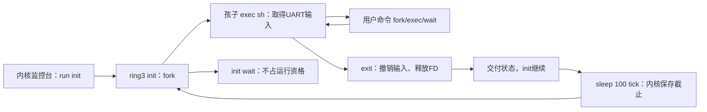

# K36 · 让用户 init 持续监督串口 shell

从 K35 继续。现在用户页可以主动归还，失去父进程的孩子也能回收，但 `run sh` 的 shell 一旦退出，整次用户会话仍会收拢并返回内核监控台。本节增加独立的用户 init：它反复 fork、让孩子 exec 成 sh、wait 取得退出状态，再阻塞等待一段时间后重启 shell。监督策略运行在 ring3；内核继续负责进程资源、等待和串口输入的唯一使用者。

启动后仍先进入熟悉的 `airi>`。输入 `run init` 才进入常驻模式，已有 `run sh` 的退出行为保留。init 管理的 shell 输入 `exit` 后，init 仍活着，下一代 shell 获得新 PID，继续接收命令。本节的 init 只监督一个前台服务，尚无配置化守护进程管理、POSIX 信号或自动开机进入 init。QEMU 的 Ctrl-A X 仍由宿主管理退出，不经过 guest 的按键服务或掉电模型。

<a id="init-roles"></a>
## 三个执行位置各自负责什么

内核启动服务栈原来就能保持一组用户长期运行：有 RUNNABLE 用户时进入其完整现场；有人等待时推进设备、重查条件；所有用户都在等待时执行 hlt 等真实 PIT 事件。K29 的 `session_active` 与 `session_idle` 已将“临时回服务栈”和“整次结束”分开。这里保留这个调度基础，让 init 始终持有一个活用户身份，shell 的一次退出便不再结束整次会话。

init 不读取 UART。它的直接孩子成功 exec 成 sh 后才取得前台输入；shell 再 fork/exec hello 等程序，运行结束后回到 shell，init 仍阻塞在 wait。shell logout 时，内核释放它的输入身份并交付退出状态；init 醒来、等待退避截止，再创建下一代 shell。



这里的 init 是角色名，不硬编码 PID1。启动回归此前已消耗过许多 PID，本次 `run init` 取到的身份由 `[INIT_SESSION]` 记录；所有重启的 shell 都必须指向同一个父 PID。K34 的无父孩子仍交内核托管，不在本节改成完整 Linux init/subreaper 语义。

<a id="init-input"></a>
## FD 引用不等于前台输入资格

K33 给直接启动的 sh 接入 CLOEXEC FD0。fork 会复制这个引用，成功 exec 普通程序会关闭它。现在还需要让 init 在每次 shell 成功装载后重新接入 UART，同时避免两个进程竞争消费同一字节。

内核增加 `input_pid` 保存当前唯一读取者，`supervisor_pid` 保存此次明确 `run init` 的监督者。只有该监督者的直接孩子 exec 名为 sh 的映像时，才可取得前台输入；若已有另一个读取者，exec 在准备新映像前返回 −16，旧进程保持。exec 成功提交时关闭旧 CLOEXEC 表项，再为新 shell 接入空 FD0 并发布 input_pid；失败 exec 不撤销旧权限。即使 fork 留有固定输入对象的引用，`file_transfer` 也要求调用者 PID 与 input_pid 相同，否则返回 −13 且不消费 UART。

这是一条固定前台服务启动策略，还不是通用 TTY 或权限系统。图形 Terminal 尚无用户 TTY，因此 `run init` 与 `run sh` 在图形入口都给出 UART 指引，避免进入不可见的输入等待。

先更新 `include/airi/file.h` 与 `kernel/fs/file.c` 的输入接入函数：它返回 bool，遇到已占用的 FD0 保持原引用并拒绝。监督 shell 成功 exec 时，调用者按启动策略先关闭其原 FD0，再接入固定输入；直接 sh 则使用全新表。其余文件算法保留。

<!-- write: include/airi/file.h -->
```c
#ifndef AIRI_FILE_H // 内核FD对象与用户整数句柄分开。
#define AIRI_FILE_H // 包含保护。
#include <airi/base.h> // 长度、固定宽度和基础复制。
#include <stdbool.h> // 显式状态。
#define AIRI_FD_COUNT 16u // 每进程最多十六个表项。
#define AIRI_OPEN_READ 1u // 自有ABI标志，不沿用Linux数字。
#define AIRI_OPEN_WRITE 2u // 写访问。
#define AIRI_OPEN_CREATE 4u // 名称不存在时创建。
#define AIRI_OPEN_TRUNCATE 8u // 有写权限才可清空。
#define AIRI_OPEN_CLOEXEC 16u // 成功替换时关闭此表项。
#define AIRI_OPEN_NONBLOCK 32u // 管道可显式选择非阻塞，不支持普通文件open这个标志。
#define AIRI_READY_READ 1u // 管道读不会等待，可能得到数据或EOF。
#define AIRI_READY_WRITE 2u // 当前有读者且有缓冲空间。
#define AIRI_READY_HUP 4u // 读端已无写者，仍须先消费已有数据。
#define AIRI_READY_ERROR 8u // 写端已无读者，下一次写得到EPIPE。
struct airi_open_file; // 全局打开对象由实现拥有。
struct airi_fd_entry { struct airi_open_file *file; bool cloexec; }; // 偏移不放在进程表项中。
struct airi_fd_table { struct airi_fd_entry entries[AIRI_FD_COUNT]; }; // fork逐项增加引用。
void airi_files_init(void); // 仅启动时初始化内存文件系统。
void airi_fd_init(struct airi_fd_table *table); // 初始stdout/stderr指向串口对象。
void airi_fd_clone(struct airi_fd_table *destination, const struct airi_fd_table *source); // 目标必须为空。
void airi_fd_close_all(struct airi_fd_table *table, bool exec_only); // exit关闭全部，exec只关闭标志项。
long airi_fd_open(struct airi_fd_table *table, const char *path, unsigned flags); // 接收已复制的内核路径。
long airi_fd_close(struct airi_fd_table *table, unsigned fd); // 释放表项与其引用。
long airi_fd_dup(struct airi_fd_table *table, unsigned fd, bool cloexec); // 新表项共享偏移。
long airi_fd_seek(struct airi_fd_table *table, unsigned fd, uint64_t offset); // 首版只支持绝对偏移。
long airi_fd_read(struct airi_fd_table *table, unsigned fd, void *buffer, size_t bytes, bool positioned, uint64_t offset); // 输出是内核副本。
long airi_fd_write(struct airi_fd_table *table, unsigned fd, const void *buffer, size_t bytes, bool positioned, uint64_t offset); // 输入不被异步保留。
bool airi_fd_console(const struct airi_fd_table *table, unsigned fd); // 终端发送由设备适配完成。
long airi_fd_pipe(struct airi_fd_table *table, unsigned ends[2], bool nonblocking); // 原子创建两个FD和有界共享缓冲，失败不改输出。
long airi_fd_ready(const struct airi_fd_table *table, unsigned fd); // 本阶段只查询管道当前条件，不订阅事件。
bool airi_fd_nonblocking(const struct airi_fd_table *table, unsigned fd); // 后续等待层据此决定是否可阻塞。
unsigned airi_files_open_count(void); // 不含固定终端对象，用于会话回收检查。
bool airi_fd_input(const struct airi_fd_table *table, unsigned fd); // 判断固定终端输入，设备读取在陷入层。
bool airi_fd_attach_input(struct airi_fd_table *table); // 仅空FD0可接入CLOEXEC输入；已有表项时不改变引用。
#endif // 结束保护。
```
<!-- write: kernel/fs/file.c -->
```c
#include <airi/file.h> // 自有路径、打开对象与进程FD表。
#define NODE_COUNT 8u // 固定名字数量，不实现目录树和unlink。
#define OPEN_COUNT 24u // 全局打开对象容量与每进程FD容量不同。
#define FILE_BYTES 1024u // 每个可写文件的固定字节上限。
struct memory_file { char name[32]; uint8_t data[FILE_BYTES]; size_t size; bool readonly; }; // 名字和内容跨程序会话存活，重启丢失。
struct memory_pipe { uint8_t data[64]; unsigned head, size, readers, writers; }; // 四个固定环，端点最终引用消失才回收。
struct airi_open_file { struct memory_file *node; struct memory_pipe *pipe; uint64_t offset; unsigned flags, references; }; // 多个表项可共享同一个偏移。
static struct memory_file nodes[NODE_COUNT]; // 初值零表示空目录槽。
static struct airi_open_file opened[OPEN_COUNT]; // 引用数零表示空打开槽。
static struct memory_pipe pipes[4]; // readers与writers都零表示未使用的管道。
static struct airi_open_file terminal_input; // 与输出不同的固定对象，最后关闭也不清对象配置。
static struct airi_open_file terminal; // 固定串口对象，不含RAM文件内容。
static struct airi_open_file *get(const struct airi_fd_table *table, unsigned fd) { // 用户整数必须先做范围检查。
    return fd < AIRI_FD_COUNT ? table->entries[fd].file : NULL; // 不把FD转成内核指针。
}
static int empty_fd(const struct airi_fd_table *table) { // 低编号优先，关闭后允许复用。
    for (unsigned i = 0; i < AIRI_FD_COUNT; ++i) // 有界扫描。
        if (!table->entries[i].file) // 无引用就是空表项。
            return (int)i; // 编号只在当前进程有意义。
    return -24; // -EMFILE，当前进程表满。
}
void airi_files_init(void) { // 启动一次，不能在仍有FD时重置。
    airi_memset(nodes, 0, sizeof(nodes)); // 清空名字、内容和长度。
    airi_memset(pipes, 0, sizeof(pipes)); // 启动前没有端点或在途字节。
    airi_memset(opened, 0, sizeof(opened)); // 清空全局打开对象。
    airi_memset(&terminal, 0, sizeof(terminal)); // 固定对象没有自有节点。
    airi_memset(&terminal_input, 0, sizeof(terminal_input)); // 启动时无输入引用。
    terminal_input.flags = AIRI_OPEN_READ; // 只读，不能被当成stdout。
    terminal.flags = AIRI_OPEN_WRITE; // 当前只提供stdout/stderr。
    airi_memcpy(nodes[0].name, "/seed", 6); // 只读初始文件，字符串含终止零。
    airi_memcpy(nodes[0].data, "abcdef", 6); // 文件字节无需NUL。
    nodes[0].size = 6; // 读到末尾返回0。
    nodes[0].readonly = true; // 模式请求不能让只读节点可写。
}
void airi_fd_init(struct airi_fd_table *table) { // 新会话的独立表，不复制旧进程编号。
    airi_memset(table, 0, sizeof(*table)); // 普通根的槽0默认空，shell随后显式接入输入。
    table->entries[1].file = &terminal; // stdout引用固定设备对象。
    table->entries[2].file = &terminal; // stderr是另一个表项。
    terminal.references += 2; // 两个表项各持有一次引用。
}
void airi_fd_clone(struct airi_fd_table *destination, const struct airi_fd_table *source) { // 内核不可抢占，复制和加引用作为同一次操作。
    *destination = *source; // 复制表项，不复制打开对象和偏移。
    for (unsigned i = 0; i < AIRI_FD_COUNT; ++i) // 每个表项代表独立引用。
        if (destination->entries[i].file) // 空项无资源。
            ++destination->entries[i].file->references; // 父关闭不会提前销毁孩子仍在用的对象。
}
long airi_fd_close(struct airi_fd_table *table, unsigned fd) { // 关闭表项，不删除文件名字。
    struct airi_open_file *file = get(table, fd); // 安全查找。
    if (!file) // 无效或已关闭。
        return -9; // -EBADF。
    table->entries[fd] = (struct airi_fd_entry){0}; // 先撤掉进程引用。
    if (--file->references == 0 && file != &terminal && file != &terminal_input) { // 最后表项引用消失才关闭真实端点。
        if (file->pipe) { // 普通RAM文件没有管道对端状态。
            if (file->flags & AIRI_OPEN_READ) // 当前是只读端点打开对象。
                --file->pipe->readers; // dup/fork共享对象，不能每关一个FD都减端点数。
            else // pipe创建的另一个打开对象是写端。
                --file->pipe->writers; // 最后写端消失后，读者排空再EOF。
            if (!file->pipe->readers && !file->pipe->writers) // 所有端点引用真正结束。
                airi_memset(file->pipe, 0, sizeof(*file->pipe)); // 未读内容丢弃，槽可供新管道使用。
        }
        airi_memset(file, 0, sizeof(*file)); // 回收全局打开对象，不误清别人的共享偏移。
    }
    return 0; // 节点内容保留到重启或truncate。
}
void airi_fd_close_all(struct airi_fd_table *table, bool exec_only) { // 多次清理空表安全。
    for (unsigned i = 0; i < AIRI_FD_COUNT; ++i) // 不依赖用户提供清单。
        if (table->entries[i].file && (!exec_only || table->entries[i].cloexec)) // exec保留未标记项。
            airi_fd_close(table, i); // 复用统一引用释放路径。
}
long airi_fd_open(struct airi_fd_table *table, const char *path, unsigned flags) { // 路径已由陷入层复制到内核。
    size_t length = airi_strlen(path); // 调用者保证有界NUL。
    if (length < 2 || length >= sizeof(nodes[0].name) || path[0] != '/' || (flags & ~31u) || !(flags & 3u) || ((flags & AIRI_OPEN_TRUNCATE) && !(flags & AIRI_OPEN_WRITE))) // 名字和标志全部先校验。
        return -22; // -EINVAL，不修改名字或长度。
    for (size_t i = 1; i < length; ++i) // 首版只允许平坦绝对名字。
        if (path[i] == '/' || path[i] == '.') // 不解释目录、相对路径和点段。
            return -22; // 范围限制明确拒绝。
    struct memory_file *node = NULL, *free_node = NULL; // 命中节点与潜在空槽分开。
    for (unsigned i = 0; i < NODE_COUNT; ++i) { // 同一节点的不同open应共享内容。
        if (!nodes[i].name[0]) // 空槽可用于创建。
            free_node = &nodes[i]; // 尚未发布名字。
        else if (!airi_memcmp(path, nodes[i].name, length + 1)) // 长度包含NUL，排除前缀匹配。
            node = &nodes[i]; // 目录持有真实内容。
    }
    if (!node && !(flags & AIRI_OPEN_CREATE)) // 缺名字且不允许创建。
        return -2; // -ENOENT。
    if (!node && !free_node) // 节点容量耗尽。
        return -28; // -ENOSPC。
    if (node && node->readonly && (flags & AIRI_OPEN_WRITE)) // 文件自身只读。
        return -13; // -EACCES。
    int fd = empty_fd(table); // 名字尚未创建或截断，先保证表项。
    if (fd < 0) // 进程表满。
        return fd; // 原文件不变。
    struct airi_open_file *file = NULL; // 再找系统级打开对象。
    for (unsigned i = 0; i < OPEN_COUNT; ++i) // 引用零代表未使用。
        if (!opened[i].references) { // 选择第一个空槽。
            file = &opened[i]; // 尚未发布。
            break; // 不重复分配。
        }
    if (!file) // 全局对象不足不同于进程表满。
        return -23; // -ENFILE，文件仍不变。
    if (!node) { // 所有资源就绪后才创建名字。
        node = free_node; // 目标是确定的空目录槽。
        airi_memset(node, 0, sizeof(*node)); // 不保留旧字节。
        airi_memcpy(node->name, path, length + 1); // 名字复制归文件系统所有。
    }
    if (flags & AIRI_OPEN_TRUNCATE) // 有写权限且不会因表满再失败。
        node->size = 0; // 后续扩洞时再显式清零，旧尾不对读者可见。
    *file = (struct airi_open_file){.node = node, .flags = flags & 3u, .references = 1}; // 独立open得到新偏移0。
    table->entries[fd] = (struct airi_fd_entry){file, (flags & AIRI_OPEN_CLOEXEC) != 0}; // 标志按表项保存。
    return fd; // 用户只拿整数。
}
long airi_fd_dup(struct airi_fd_table *table, unsigned fd, bool cloexec) { // 不创建新的打开对象。
    struct airi_open_file *file = get(table, fd); // 验证源FD。
    if (!file) // 源已关闭。
        return -9; // -EBADF。
    int next = empty_fd(table); // 新表项仍可能不足。
    if (next < 0) // 不改变源引用。
        return next; // -EMFILE。
    ++file->references; // 新表项正式取得共享对象。
    table->entries[next] = (struct airi_fd_entry){file, cloexec}; // 偏移不复制，标志独立。
    return next; // 新整数与旧整数指向同一对象。
}
bool airi_fd_console(const struct airi_fd_table *table, unsigned fd) { // 终端特殊后端由陷入层发送。
    return get(table, fd) == &terminal; // 无效FD得到NULL，不会命中。
}
long airi_fd_seek(struct airi_fd_table *table, unsigned fd, uint64_t offset) { // 本项目只接受SEEK_SET语义。
    struct airi_open_file *file = get(table, fd); // 先验证表项。
    if (!file) // 无效句柄。
        return -9; // -EBADF。
    if (!file->node) // 固定终端不是可定位文件。
        return -29; // -ESPIPE。
    if (offset > FILE_BYTES) // 限定可表达的文件范围。
        return -22; // -EINVAL。
    file->offset = offset; // 所有dup/fork引用一起观察新偏移。
    return (long)offset; // 返回定位后的偏移。
}
static long transfer(struct airi_fd_table *table, unsigned fd, void *buffer, size_t bytes, bool write, bool positioned, uint64_t offset) { // 这里只操作内核缓冲，不验证用户指针。
    struct airi_open_file *file = get(table, fd); // 当前表里的整数转内部对象。
    if (!file || !(file->flags & (write ? AIRI_OPEN_WRITE : AIRI_OPEN_READ))) // 错误访问模式也返回EBADF。
        return -9; // 无副作用。
    if (file->pipe) { // 端点使用FIFO字节流，不使用文件偏移。
        struct memory_pipe *pipe = file->pipe; // 内核共享缓冲，不直接借用户地址。
        if (positioned) // pread/pwrite不能定位流。
            return -29; // -ESPIPE。
        if (!bytes) // 零长度不消费或等待，不检查对端存在。
            return 0; // 访问模式已经核对。
        if (write && !pipe->readers) // 没有任何读端，数据永远无人接收。
            return -32; // 自有EPIPE，不发Linux SIGPIPE。
        unsigned available = write ? (unsigned)sizeof(pipe->data) - pipe->size : pipe->size; // 写看空位，读看已占字节。
        if (!available) // 暂无进展不等于永久结束。
            return !write && !pipe->writers ? 0 : -11; // 读端无写者为EOF，其余EAGAIN。
        if (bytes > available) // 本项目允许有界短写，不宣称Linux PIPE_BUF原子性。
            bytes = available; // 只处理当前可完成前缀。
        for (size_t i = 0; i < bytes; ++i) // 最多64字节，直接按环下标复制。
            if (write) // 写入当前尾部，不覆盖未读数据。
                pipe->data[(pipe->head + pipe->size + i) % sizeof(pipe->data)] = ((const uint8_t *)buffer)[i]; // 尾部越界时回到0。
            else // 读取最老的未消费字节。
                ((uint8_t *)buffer)[i] = pipe->data[(pipe->head + i) % sizeof(pipe->data)]; // 按FIFO顺序交回。
        if (write) // 完成数据复制后再发布可读数量。
            pipe->size += (unsigned)bytes; // 后续就绪查询才能看到新字节。
        else { // 读后释放环空间。
            pipe->head = (pipe->head + (unsigned)bytes) % (unsigned)sizeof(pipe->data); // 推进读头。
            pipe->size -= (unsigned)bytes; // 写者随后可继续。
        }
        return (long)bytes; // 实际前缀长度，不保留本次buffer。
    }
    struct memory_file *node = file->node; // 终端不在此处直接访问端口。
    if (!node) // 不支持的设备操作。
        return -29; // -ESPIPE。
    if (!positioned) // 普通read/write消费共享偏移。
        offset = file->offset; // pread/pwrite只消费显式偏移。
    if (offset > FILE_BYTES) // 在加法之前限制右端。
        return -22; // -EINVAL。
    if (!bytes) // 零长度不扩文件，不改变偏移。
        return 0; // buffer可为空，因为不会解引用。
    size_t limit = write ? FILE_BYTES : node->size; // 读受EOF限制，写受容量限制。
    if (offset >= limit) // 到末尾读返回EOF，满容量写返回错误。
        return write ? -28 : 0; // 区分无进展写与正常EOF。
    if (bytes > limit - offset) // 单次可能短于请求，调用者必须消费返回值。
        bytes = limit - offset; // 不读写数组之外。
    if (write) { // 所有模式检查已经完成。
        if (offset > node->size) // 定位到末尾之外形成的洞必须读为零。
            airi_memset(node->data + node->size, 0, (size_t)offset - node->size); // 不泄漏truncate前的尾字节。
        airi_memcpy(node->data + offset, buffer, bytes); // 同步复制，返回后不再借buffer。
        if (offset + bytes > node->size) // 覆盖中间不缩短文件。
            node->size = offset + bytes; // 发布实际长度。
    } else // 普通读和pread复制相同文件内容。
        airi_memcpy(buffer, node->data + offset, bytes); // 请求已缩到EOF之内。
    if (!positioned) // 显式偏移操作不能移动共享位置。
        file->offset = offset + bytes; // 只推进实际完成数。
    return (long)bytes; // 可小于请求，零只代表读EOF或零长度。
}
long airi_fd_read(struct airi_fd_table *table, unsigned fd, void *buffer, size_t bytes, bool positioned, uint64_t offset) { // 所有读取共用一个偏移实现。
    return transfer(table, fd, buffer, bytes, false, positioned, offset); // 内核缓冲由调用者持有。
}
long airi_fd_write(struct airi_fd_table *table, unsigned fd, const void *buffer, size_t bytes, bool positioned, uint64_t offset) { // 同步写不修改输入。
    return transfer(table, fd, (void *)buffer, bytes, true, positioned, offset); // 内部仅在read分支写buffer，当前固定为write。
}
unsigned airi_files_open_count(void) { // 验证退出与exec没有遗留打开对象。
    unsigned count = 0; // 不统计引用为零的槽。
    for (unsigned i = 0; i < OPEN_COUNT; ++i) // 固定全局容量。
        count += opened[i].references != 0; // 返回对象数量，不是表项数量。
    return count; // 终端固定对象单独管理，不占此表。
}

long airi_fd_pipe(struct airi_fd_table *table, unsigned ends[2], bool nonblocking) { // 所有容量检查完成前不发布任何端点。
    unsigned fds[2], count = 0; // 两个最低空编号，不先占一个再回滚。
    for (unsigned i = 0; i < AIRI_FD_COUNT && count < 2; ++i) // 有界寻找两个空表项。
        if (!table->entries[i].file) // 不碰已有文件和终端。
            fds[count++] = i; // 只保存在内核局部数组。
    if (count != 2) // 不能留下半个管道。
        return -24; // -EMFILE。
    struct airi_open_file *files[2]; // 两个独立端点打开对象。
    count = 0; // 复用计数只找本类资源。
    for (unsigned i = 0; i < OPEN_COUNT && count < 2; ++i) // 全局容量独立检查。
        if (!opened[i].references) // 未发布槽。
            files[count++] = &opened[i]; // 尚未加引用。
    if (count != 2) // 有FD不代表有内核打开槽。
        return -23; // -ENFILE。
    struct memory_pipe *pipe = NULL; // 只有两个端点都消失才可复用缓冲。
    for (unsigned i = 0; i < 4; ++i) // 固定四个环。
        if (!pipes[i].readers && !pipes[i].writers) { // 未使用，不会匹配仍有一端的流。
            pipe = &pipes[i]; // 取得整个环的所有权。
            break; // 不重复占用。
        }
    if (!pipe) // 全局流数量达到上限。
        return -28; // -ENOSPC，输出与表都仍未改。
    airi_memset(pipe, 0, sizeof(*pipe)); // 新流不含上一流未读字节。
    pipe->readers = pipe->writers = 1; // 每端一个打开对象，引用数由FD再管理。
    for (unsigned i = 0; i < 2; ++i) { // 分别发布只读端和只写端。
        *files[i] = (struct airi_open_file){.pipe = pipe, .flags = (i ? AIRI_OPEN_WRITE : AIRI_OPEN_READ) | (nonblocking ? AIRI_OPEN_NONBLOCK : 0), .references = 1}; // 两端共享同一个环。
        table->entries[fds[i]] = (struct airi_fd_entry){.file = files[i]}; // 初始不设CLOEXEC，dup可另选。
        ends[i] = fds[i]; // 所有资源都齐后才写输出编号。
    }
    return 0; // 不把内部指针交给用户。
}
long airi_fd_ready(const struct airi_fd_table *table, unsigned fd) { // 查询当前条件，不保存边沿事件。
    struct airi_open_file *file = get(table, fd); // 完整编号由陷入层校验。
    if (!file) // 已关闭不该继续使用旧就绪状态。
        return -9; // -EBADF。
    if (!file->pipe) // 不把RAM文件或终端冒充已支持的事件源。
        return -95; // -EOPNOTSUPP。
    const struct memory_pipe *pipe = file->pipe; // 同一不可抢占调用内状态稳定。
    if (file->flags & AIRI_OPEN_READ) // 读端可读包括EOF。
        return (pipe->size || !pipe->writers ? AIRI_READY_READ : 0) | (!pipe->writers ? AIRI_READY_HUP : 0); // HUP不丢弃仍可读取数据。
    return (pipe->readers && pipe->size < sizeof(pipe->data) ? AIRI_READY_WRITE : 0) | (!pipe->readers ? AIRI_READY_ERROR : 0); // 就绪描述条件，不保证下次操作一定成功。
}
bool airi_fd_nonblocking(const struct airi_fd_table *table, unsigned fd) { // 后续系统调用层决定遇EAGAIN如何处理。
    struct airi_open_file *file = get(table, fd); // 不直接解用户值。
    return file && (file->flags & AIRI_OPEN_NONBLOCK); // 不支持或无效对象不会被当成非阻塞流。
}

bool airi_fd_attach_input(struct airi_fd_table *table) { // 首次shell与init重启shell都明确要求空FD0。
    if (table->entries[0].file) // 不覆盖已有引用，否则会泄漏并改变调用者文件。
        return false; // 完全保持原表。
    table->entries[0] = (struct airi_fd_entry){.file=&terminal_input, .cloexec=true}; // exec子程序不能继承shell独占的UART输入。
    ++terminal_input.references; // fork/close使用已有共享引用协议。
    return true; // 引用和表项都完成后报告成功。
}
bool airi_fd_input(const struct airi_fd_table *table, unsigned fd) { // 只比较内核已验证表项身份。
    return get(table, fd) == &terminal_input; // 不把用户整数当硬件地址。
}
```

更新文件检查 `tests/unit/file_test.c`。先在 FD0 打开 /seed，尝试接入输入必须失败，而原文件仍能读到 a；清表后接入成功，重复接入拒绝；原来的 fork、CLOEXEC 和最后引用释放检查继续保留。这样检查的是被拒绝操作是否保住原文件，而不只看一个布尔值。

<!-- write: tests/unit/file_test.c -->
```c
#include <airi/file.h> // 与guest相同的文件算法，宿主不访问UART。
#include <assert.h> // 每条断言验证具体所有权或边界。
#include <stdio.h> // 宿主只输出最终结果。
int main(void) { // 独立进程，每次建立干净RAM目录。
    airi_files_init(); // 与启动一致的只读seed。
    struct airi_fd_table parent, child; // 两份进程表引用同一全局对象。
    airi_fd_init(&parent); // stdout/stderr占1和2，槽0可用。
    assert(airi_fd_open(&parent, "/seed", AIRI_OPEN_WRITE) == -13); // 只读节点不能绕过。
    assert(airi_fd_open(&parent, "/bad/path", AIRI_OPEN_READ) == -22); // 不假装有目录遍历。
    long fd = airi_fd_open(&parent, "/seed", AIRI_OPEN_READ); // 第一份独立打开对象。
    assert(fd == 0); // 最小空编号。
    long dupped = airi_fd_dup(&parent, (unsigned)fd, true); // 同一对象的第二表项。
    assert(dupped == 3 && airi_files_open_count() == 1); // dup不新建全局对象。
    airi_fd_clone(&child, &parent); // fork复制表项、增加引用。
    char data[16] = {0}; // 核对实际返回的文件字节。
    assert(airi_fd_read(&child, 0, data, 2, false, 0) == 2 && !airi_memcmp(data, "ab", 2)); // 子先消费ab。
    airi_fd_close_all(&child, true); // 成功exec只关其CLOEXEC项。
    assert(airi_fd_read(&child, 3, data, 1, false, 0) == -9); // 关闭不影响父同号。
    assert(airi_fd_read(&parent, 3, data, 2, false, 0) == 2 && !airi_memcmp(data, "cd", 2)); // 父dup看到共享偏移。
    assert(airi_fd_read(&child, 0, data, 8, true, 0) == 6); // pread读6字节，不改变偏移4。
    assert(airi_fd_read(&child, 0, data, 2, false, 0) == 2 && !airi_memcmp(data, "ef", 2)); // 普通读继续4。
    airi_fd_close_all(&child, false); // 子退出释放其余引用。
    airi_fd_close_all(&parent, false); // 最后引用归还全局对象。
    assert(!airi_files_open_count()); // 不遗留只增不减的引用。
    airi_fd_init(&parent); // 新会话不清除文件内容。
    fd = airi_fd_open(&parent, "/notes", 15); // 读写+创建+清空。
    assert(fd == 0); // 编号复用。
    assert(airi_fd_write(&parent, 0, "abcdef", 6, false, 0) == 6); // 初始内容。
    assert(airi_fd_write(&parent, 0, "X", 1, true, 1023) == 1); // 显式定位使中间成为洞。
    assert(airi_fd_write(&parent, 0, "Z", 1, true, 1024) == -28); // 容量满错误。
    assert(airi_fd_read(&parent, 0, data, 16, true, 10) == 16); // 洞可见为零。
    for (unsigned i = 0; i < sizeof(data); ++i) // 所有字节必须被明确初始化。
        assert(data[i] == 0); // 不泄漏旧内容。
    while (airi_fd_dup(&parent, 0, false) >= 0) {} // 填满进程表，多个表项仍只用一个对象。
    assert(airi_fd_open(&parent, "/notes", 11) == -24); // 表满时TRUNCATE必须尚未执行。
    assert(airi_fd_read(&parent, 0, data, 6, true, 0) == 6 && !airi_memcmp(data, "abcdef", 6)); // 失败open未清旧内容。
    airi_fd_close_all(&parent, false); // 释放所有共享引用。
    assert(!airi_files_open_count()); // 同一对象不会被过早或重复回收。
    struct airi_fd_table tables[2]; // 两个进程可耗尽全局24个对象。
    airi_fd_init(&tables[0]); // 每个进程还有十四个空FD。
    airi_fd_init(&tables[1]); // 全局容量与单进程上限不同。
    for (unsigned i = 0; i < 24; ++i) // 第一表开14份，第二表开10份。
        assert(airi_fd_open(&tables[i < 14 ? 0 : 1], "/seed", AIRI_OPEN_READ) >= 0); // 每次open得到独立对象。
    assert(airi_fd_open(&tables[1], "/notes", 11) == -23); // 还有FD但没有打开对象，不能truncate。
    airi_fd_close_all(&tables[0], false); // 清全局引用的一部分。
    airi_fd_close_all(&tables[1], false); // 清剩余部分。
    assert(!airi_files_open_count()); // 所有槽均可再次复用。
    airi_fd_init(&parent); // 继续用同一文件系统测试管道资源，不重置已有状态。
    unsigned ends[2] = {77, 88}; // 创建失败必须保留输出身份。
    assert(!airi_fd_pipe(&parent, ends, true) && ends[0] == 0 && ends[1] == 3); // 两个最低空FD。
    assert(airi_fd_ready(&parent, 0) == 0 && airi_fd_ready(&parent, 3) == AIRI_READY_WRITE); // 空管道的双端条件不同。
    assert(airi_fd_read(&parent, 0, data, 1, false, 0) == -11); // 有写者时空读不是EOF。
    char input[100], output[100]; // 模式覆盖整个环并越过容量。
    for (unsigned i = 0; i < sizeof(input); ++i) // 每个位置有明确值。
        input[i] = (char)i; // 可检查FIFO和回绕。
    assert(airi_fd_write(&parent, 3, input, 100, false, 0) == 64); // 容量边界产生短写。
    assert(airi_fd_write(&parent, 3, input, 1, false, 0) == -11 && airi_fd_ready(&parent, 3) == 0); // 满流形成背压。
    assert(airi_fd_read(&parent, 0, output, 10, false, 0) == 10 && !airi_memcmp(output, input, 10)); // 先释放一段空间。
    assert(airi_fd_write(&parent, 3, input, 10, false, 0) == 10); // 新数据跨环尾。
    assert(airi_fd_read(&parent, 0, output, 100, false, 0) == 64 && !airi_memcmp(output, input + 10, 54) && !airi_memcmp(output + 54, input, 10)); // 完整FIFO次序不被回绕改变。
    airi_fd_clone(&child, &parent); // fork后端点存在直到最后共享引用消失。
    assert(!airi_fd_close(&parent, 3) && airi_fd_read(&parent, 0, data, 1, false, 0) == -11); // 子仍持写端，不能提前EOF。
    assert(!airi_fd_close(&child, 3) && airi_fd_ready(&parent, 0) == (AIRI_READY_READ | AIRI_READY_HUP)); // 最后写引用消失才HUP。
    assert(airi_fd_read(&parent, 0, data, 1, false, 0) == 0); // 排空后真正EOF。
    airi_fd_close_all(&child, false); // 关闭子读端引用，不破坏父。
    airi_fd_close_all(&parent, false); // 最后读端结束，缓冲可复用。
    assert(!airi_files_open_count()); // 两端对象全部归还。
    airi_fd_init(&parent); // 新会话再建新管道。
    assert(!airi_fd_pipe(&parent, ends, true)); // 旧流字节必须清零丢弃。
    assert(!airi_fd_close(&parent, ends[0])); // 不再存在任何读者。
    assert(airi_fd_write(&parent, ends[1], input, 1, false, 0) == -32 && airi_fd_ready(&parent, ends[1]) == AIRI_READY_ERROR); // 写端收到EPIPE和错误就绪。
    assert(airi_fd_write(&parent, ends[1], NULL, 0, false, 0) == 0); // 零长度不访问buffer，也不等待对端。
    airi_fd_close_all(&parent, false); // 回收断流。
    airi_fd_init(&parent); // 四个流总共八个端点，小于本进程FD容量。
    for (unsigned i = 0; i < 4; ++i) // 填满独立管道池。
        assert(!airi_fd_pipe(&parent, ends, true)); // 每次两个端点完整成功。
    ends[0] = 77; ends[1] = 88; // 失败输出哨兵。
    assert(airi_fd_pipe(&parent, ends, true) == -28 && ends[0] == 77 && ends[1] == 88 && airi_files_open_count() == 8); // 第五条失败不泄漏半个FD或对象。
    airi_fd_close_all(&parent, false); // 扫描全部表项，端点池也全部回收。
    assert(!airi_files_open_count()); // 后续程序可继续创建流。
    airi_fd_init(&parent); // 新表的FD0可先被普通文件占用。
    assert(airi_fd_open(&parent, "/seed", AIRI_OPEN_READ) == 0); // 明确占住FD0，不改变其他表项。
    assert(!airi_fd_attach_input(&parent) && !airi_fd_input(&parent, 0)); // 失败不得覆盖文件或泄漏其引用。
    assert(airi_fd_read(&parent, 0, data, 1, false, 0) == 1 && data[0] == 'a'); // 原文件与偏移仍能正常使用。
    airi_fd_close_all(&parent, false); // 清理原文件后才能接入输入。
    airi_fd_init(&parent); // 重新建立空输入表。
    assert(airi_fd_attach_input(&parent)); // 只给空FD0接入固定输入。
    assert(!airi_fd_attach_input(&parent)); // 第二次接入被拒绝，不重复增加固定对象引用。
    assert(airi_fd_input(&parent,0) && parent.entries[0].cloexec); // FD0与输出对象身份不同，exec时必须撤销。
    airi_fd_clone(&child,&parent); // fork增加输入对象引用，但不复制设备。
    airi_fd_close_all(&child,true); // 成功exec只关闭CLOEXEC输入，保留stdout/stderr。
    assert(!airi_fd_input(&child,0) && airi_fd_input(&parent,0)); // 子撤销不影响父shell继续读。
    airi_fd_close_all(&child,false); airi_fd_close_all(&parent,false); // 最后输入引用释放不能清空固定对象配置。
    airi_fd_init(&parent); assert(airi_fd_attach_input(&parent)); // 再次启动shell可重新使用相同输入对象。
    assert(airi_fd_input(&parent,0)); airi_fd_close_all(&parent,false); // 重复会话完整回收。
    puts("PASS RAM files/pipes: offsets, fork/exec references, sparse zero, short I/O, FIFO wrap, endpoint lifetime, exhaustion"); // 全部边界通过才发布。
    return 0; // 宿主测试成功。
}
```

<a id="init-sleep"></a>
## 保存截止，让重启等待不占用用户 CPU

init 遇到 shell 退出或 fork 资源失败时都等待 100 个 PIT tick，再尝试创建新 shell。100Hz 配置下这是名义一秒；QEMU 暂停、调试与调度可能改变墙钟观察，不用它充当真实时间服务。一次睡眠只接受 0–6000 tick：0 立即成功，超过范围返回 −22；截止加法还需拒绝 uint64 回绕。

新的 IO_SLEEP 复用 USER_IO_WAIT，但不保存 FD 或用户缓冲。系统调用 32 保存绝对截止和已有完整 frame，再离开可运行集合；`poll_waiters` 只有到期才把同一次调用的 RAX 写为 0，并改回 RUNNABLE。每次重查不延长截止。即使别的用户持续计算，原有 timer 服务路径也会回到普通服务栈推进等待；IRQ 本身仍不打印、分配或复制用户对象。

**更新 `kernel/process/user.c`。** 改动集中在输入 PID 的授予/撤销、exec 提交、IO_SLEEP 的保存与完成、launch 的 init 身份，以及图形入口的 UART 限制。其余页面、文件和设备接口沿 K35 保留。此时新增 init 的映像边界还需下面的构建接入，所有文件完成后再运行。

<!-- write: kernel/process/user.c -->
```c
#include <airi/async.h> // 进程轮次与固定缓冲资源的生命周期。
#include <airi/arch.h> // CPU空闲与用户调度门留在架构适配。
#include <airi/storage.h> // 用户存储请求经过有界副本进入日志服务。
#include <airi/file.h> // 每进程FD表共享打开文件对象。
#include <airi/console.h> // 内核命令消费服务结果，不依赖主题和绘图。
#include <airi/elf.h> // 独立用户ELF检查器。
#include <airi/user.h> // 完整陷入与安全用户返回。
#include <airi/memory.h> // 页面、内核栈与长期根的所有权。
#include <airi/vm.h> // 每个进程有独立低半区。
#include <airi/timer.h> // 用户时间片依赖真实IRQ0。
#include <airi/kernel.h> // 有界串口输出与故障报告。
#define USER_CODE 0x400000ull // 旧受控映像的用户入口。
#define USER_STACK 0x70000000ull // 当前每进程一页初始用户栈。
#define STACK_BASE 0xffffe10000000000ull // 所有进程陷入栈位于同一长期内核分支。
#define USER_HEAP 0x10000000ull // ELF静态范围之外的用户页分配起点。
#define USER_HEAP_END 0x20000000ull // 动态用户页只占这段独立范围，不接近初始用户栈。
#define PROCESS_COUNT 8u // 有界进程表，不做动态扩容。
enum user_state { USER_UNUSED, USER_RUNNABLE, USER_RUNNING, USER_WAITING, USER_IO_WAIT, USER_ZOMBIE, USER_REAP_PENDING }; // 退出与回收是两个不同状态。
enum io_operation { IO_NONE, IO_READ, IO_WRITE, IO_READY, IO_ASYNC, IO_SLEEP }; // 等待保存操作条件，不保留内核局部buffer。
struct user_page { uint64_t address, physical; unsigned flags; }; // fork需要把同一VA映射到另一个物理页。
struct user_process { // 所有权和调度状态由内核持有，用户只能看到PID。
    bool async_owned; // 本控制块是否持有当前PID的异步owner，局部旧exec副本必须清除此所有权。
    struct airi_fd_table files; // exec转移表项，fork增加同一打开对象的引用。
    struct airi_address_space space; // 根和低半区表自有，高半区借用。
    struct airi_kernel_region stack; // 不能在仍使用它的C调用中释放。
    struct user_page owned[64]; // 所有用户数据页，含代码、静态数据、堆页和栈。
    unsigned count, pid, parent, user_ticks; // 资源数量、身份、父PID和本进程实际IRQ数。
    uint64_t fault_error; // 用户故障证据；动态页位置由现有映射寻找，不再使用单向游标。
    int exit_code; // 自有wait接口返回普通退出码或负故障编码。
    enum user_state state; // 只有RUNNABLE可被调度器选中。
    int64_t wait_target; // 正PID表示指定孩子，-1表示任意孩子。
    uint64_t wait_status; // 已验证的父进程用户输出地址，阻塞期间父进程不会修改映射。
    enum io_operation io; // 只有USER_IO_WAIT消费下面的请求副本。
    unsigned io_fd, io_events; // FD属于本进程表，events只用于就绪等待。
    uint64_t io_address, io_bytes, io_deadline; // 用户页在阻塞期间仍由进程拥有，deadline按真实tick。
    struct airi_trap_frame initial; // 尚未运行时的寄存器值，不依赖临时C对象。
    struct airi_trap_frame *frame; // 运行后指向本进程内核栈的实际现场。
};
static struct user_process processes[PROCESS_COUNT]; // 槽可以复用，PID单调增长，不等于槽下标。
static struct user_process *current; // 只在完整陷入边界改变当前身份。
static unsigned next_pid = 1, root_pid, timer_switches, wait_blocks; // 每次运行会话的根身份和实际行为计数。
static unsigned io_block_count, io_wake_count, idle_halt_count; // 会话真实I/O阻塞与唤醒次数。
static bool session_idle, service_from_timer; // 是否暂回启动栈服务，和整个会话结束分开。
static unsigned supervisor_pid, input_pid; // 可选init身份与当前唯一UART输入身份，不是进程槽。
static bool session_active; // 只有用户会话活动时才接受用户IRQ或系统调用。
static int session_result; // 根用户退出结果，不用最后一个孩子的结果覆盖。
static struct airi_trap_frame *kernel_return; // 启动栈一直保留到整个用户会话结束。
extern const uint8_t airi_user_probe_start[], airi_user_probe_end[]; // 受控正常映像。
extern const uint8_t airi_user_bad_start[], airi_user_bad_end[]; // 用户cli故障。
extern const uint8_t airi_user_load_bad_start[], airi_user_load_bad_end[]; // 用户读supervisor页故障。
extern const uint8_t airi_user_rsp_bad_start[], airi_user_rsp_bad_end[]; // 不规范用户返回栈。
extern const uint8_t airi_hello_elf_start[], airi_hello_elf_end[]; // 既有独立用户C程序。
extern const uint8_t airi_process_elf_start[], airi_process_elf_end[]; // 新的fork/wait和抢占工作负载。
extern const uint8_t airi_init_elf_start[], airi_init_elf_end[]; // 用户态常驻监督程序。
extern const uint8_t airi_memory_elf_start[], airi_memory_elf_end[]; // 用户页面归还与空洞复用工作负载。
extern const uint8_t airi_orphans_elf_start[], airi_orphans_elf_end[]; // 持续会话中的孤儿回收与槽复用演示。
extern const uint8_t airi_shell_elf_start[], airi_shell_elf_end[]; // 真正用户shell，不是内核命令别名。
extern const uint8_t airi_demo_elf_start[], airi_demo_elf_end[]; // 用户页分配与异步存储贯通演示。
extern const uint8_t airi_async_elf_start[], airi_async_elf_end[]; // 用户注册、CQ等待与exec资源轮次。
extern const uint8_t airi_waits_elf_start[], airi_waits_elf_end[]; // 真正阻塞与超时工作负载。
extern const uint8_t airi_pipes_elf_start[], airi_pipes_elf_end[]; // 非阻塞管道用户程序。
extern const uint8_t airi_storage_elf_start[], airi_storage_elf_end[]; // 写入和恢复共用一份明确分支的用户ELF。
extern const uint8_t airi_files_elf_start[], airi_files_elf_end[]; // 内存文件用户工作负载。
extern const uint8_t airi_worker_elf_start[], airi_worker_elf_end[]; // exec目标是另一个独立静态ELF。
extern const uint8_t airi_broken_elf_start[], airi_broken_elf_end[]; // 受控损坏输入，验证旧进程保持。
struct executable { const char *name; const uint8_t *start, *end; }; // 初始映像目录尚不是通用文件系统。
static const struct executable executables[] = { // 每份映像字节由内核只读段长期持有。
    {"sh", airi_shell_elf_start, airi_shell_elf_end}, // 独占串口输入的可选用户程序。
    {"init", airi_init_elf_start, airi_init_elf_end}, // 管理前台shell的常驻用户进程。
    {"memory", airi_memory_elf_start, airi_memory_elf_end}, // 同一地址空间内释放与重新申请。
    {"orphans", airi_orphans_elf_start, airi_orphans_elf_end}, // 不结束根会话也能回收退出的孤儿。
    {"demo", airi_demo_elf_start, airi_demo_elf_end}, // 页、任务和设备完成串联。
    {"hello", airi_hello_elf_start, airi_hello_elf_end}, // 独立C运行库与BSS观察。
    {"processes", airi_process_elf_start, airi_process_elf_end}, // fork/exec/wait实际工作负载。
    {"worker", airi_worker_elf_start, airi_worker_elf_end},
    {"async", airi_async_elf_start, airi_async_elf_end}, // 完整用户提交/完成路径。
    {"async-reset", airi_async_elf_start, airi_async_elf_end}, // 同一PID新epoch的验证入口。
    {"waits", airi_waits_elf_start, airi_waits_elf_end}, // 阻塞流和就绪条件等待。
    {"pipes", airi_pipes_elf_start, airi_pipes_elf_end}, // 有界FIFO与关闭语义。
    {"storage", airi_storage_elf_start, airi_storage_elf_end}, // 显式提交记录。
    {"recover", airi_storage_elf_start, airi_storage_elf_end}, // 只读取已恢复记录。
    {"files", airi_files_elf_start, airi_files_elf_end}, // 真实用户FD演示。
    {"broken", airi_broken_elf_start, airi_broken_elf_end}, // 用于完整的坏ELF失败演示。
};
static const struct executable *find_program(const char *name) { // 输入是内核已复制的短NUL字符串。
    size_t bytes = airi_strlen(name); // 只读当前有效字符串，不保存其指针。
    for (unsigned i = 0; i < sizeof(executables) / sizeof(executables[0]); ++i) // 遍历固定目录。
        if (airi_strlen(executables[i].name) == bytes && !airi_memcmp(executables[i].name, name, bytes)) // 长度与全部名称字节都相同才匹配。
            return &executables[i]; // 只借长期静态目录项。
    return NULL; // 未知名称不触碰任何用户地址空间。
}
static unsigned slot(const struct user_process *p) { // 只接受processes中的真实槽，不接受临时复制对象。
    return (unsigned)(p - processes); // 同一数组内指针差得到稳定槽号。
}
static bool create_stack(struct user_process *p) { // 每槽前面留一页保护页，所有栈共享已存在高半区分支。
    uint64_t address = STACK_BASE + slot(p) * 5 * 4096ull + 4096; // 四页数据与一页保护，PID增长不扩散地址。
    return airi_memory_region_create(&p->stack, address, 4); // 完整成功后才借给用户根。
}
static bool user_access(const struct user_process *p, uint64_t address, size_t bytes, bool write) { // 检查完整用户范围，不直接解引用它。
    if (address >= AIRI_USER_LIMIT || bytes > AIRI_USER_LIMIT - address) // 排除内核地址与右端溢出。
        return false; // 零长度也保留本项目地址策略。
    for (size_t done = 0; done < bytes;) { // 跨越的每一页都必须满足权限。
        unsigned flags; // 当前叶子权限。
        if (!airi_vm_lookup(&p->space, address + done, NULL, &flags) || !(flags & AIRI_VM_USER) || (write && !(flags & AIRI_VM_WRITE))) // 输出指针还要求用户可写。
            return false; // 不先复制有效前缀。
        size_t part = 4096 - ((address + done) & 4095); // 当前页内剩余跨度。
        if (part > bytes - done) // 最后一段只到请求右端。
            part = bytes - done; // 不额外检查其他页。
        done += part; // 检查下一段。
    }
    return true; // 当前不可抢占内核中没有并发映射修改者。
}
static bool copy_user(struct user_process *p, void *buffer, uint64_t address, size_t bytes, bool to_user) { // 允许从非活动父根复制wait状态，但始终按其所有权查页。
    if (!user_access(p, address, bytes, to_user)) // 写用户缓冲必须检查WRITE，读只需要USER映射。
        return false; // 任何页失败都不复制。
    for (size_t done = 0; done < bytes;) { // 每次用HHDM别名处理一页中的有效段。
        uint64_t physical; // 翻译保留页内偏移。
        airi_vm_lookup(&p->space, address + done, &physical, NULL); // 完整检查后页表在本次内核操作中保持不变。
        size_t part = 4096 - ((address + done) & 4095); // 当前页边界。
        if (part > bytes - done) // 不超出剩余内容。
            part = bytes - done; // 缩到最后一段。
        if (to_user) // wait结果由内核写入父进程自己的页面。
            airi_memcpy(airi_memory_direct(physical), (uint8_t *)buffer + done, part); // 不切到父用户根也能访问其已拥有物理页。
        else // write系统调用把用户数据复制进内核副本。
            airi_memcpy((uint8_t *)buffer + done, airi_memory_direct(physical), part); // 不信任原始VA作为内核指针。
        done += part; // 推进下一段。
    }
    return true; // 同步结束，不借出buffer指针。
}
static long file_transfer(struct user_process *p, uint64_t fd, uint64_t address, size_t bytes, bool write, bool positioned, uint64_t offset) { // 允许在另一根的阻塞进程上重试，同步副本属于当前内核栈。
    char buffer[256]; // 一次有界副本，不跨调度保留。
    if (fd >= AIRI_FD_COUNT) // 完整64位编号先检查再转换。
        return -9; // -EBADF。
    if (bytes > sizeof(buffer)) // 不让用户长度覆盖内核栈。
        return -22; // -EINVAL。
    if (!user_access(p, address, bytes, !write)) // 输出在消费流或偏移之前完整验证。
        return -14; // -EFAULT。
    if (write) { // 用户内容在本次尝试内复制。
        copy_user(p, buffer, address, bytes, false); // 通过目标自己的页表，不解引用原始用户VA。
        if (!positioned && airi_fd_console(&p->files, (unsigned)fd)) { // 固定终端同步发送。
            airi_serial_write_bytes(buffer, bytes); // 不保存局部buffer给设备。
            return (long)bytes; // 返回逻辑进展。
        }
        return airi_fd_write(&p->files, (unsigned)fd, buffer, bytes, positioned, offset); // 满管道可返回EAGAIN。
    }
    if (airi_fd_input(&p->files, (unsigned)fd)) { // 固定输入对象的引用与当前前台读取资格分别检查。
        if (p->pid != input_pid) // fork复制的FD引用本身不转移UART消费权。
            return -13; // -EACCES；不消费设备字节。
        if (positioned) // 字节流没有文件偏移。
            return -29; // -ESPIPE，不消费字节。
        if (!bytes) // 零长度读取不能登记永久等待，也不消费UART。
            return 0; // 有效输入FD的空操作。
        size_t received = 0; // 返回当前可取得的前缀，不等待填满用户请求。
        while (received < bytes) { // bytes与整个用户输出范围已在上方验证。
            int c = airi_arch_serial_read(); // 设备寄存器只在架构层。
            if (c < 0) // 暂无字节和字符NUL不同。
                break; // 让已有前缀先交给用户。
            buffer[received++] = (uint8_t)c; // 固定内核副本不会越过256字节。
        }
        if (!received) // 空输入走同一个IO_READ持久等待机制。
            return -11; // 由陷入分派登记等待，不让shell忙轮询。
        if (!copy_user(p, buffer, address, received, true)) // 消费UART前已经完整验证用户范围。
            airi_panic("validated UART output mapping changed"); // 内部错误不能静默丢字节。
        return (long)received; // 实际取得的字节数。
    }
    long result = airi_fd_read(&p->files, (unsigned)fd, buffer, bytes, positioned, offset); // EOF和暂不可读分开。
    if (result > 0 && !copy_user(p, buffer, address, (size_t)result, true)) // 目标阻塞且单线程，已检查映射不应变化。
        airi_panic("validated file output mapping changed"); // 内部错误不丢字节后假装成功。
    return result; // 完成前缀或明确负错误。
}
static void poll_waiters(void) { // 仅普通内核上下文运行，IRQ本身不复制、分配或打印。
    for (unsigned i = 0; i < PROCESS_COUNT; ++i) { // 本阶段有界等待队列由进程槽直接表示。
        struct user_process *p = &processes[i]; // 控制块在等待期间不会回收。
        if (p->state != USER_IO_WAIT) // 不碰正在运行、wait孩子或已退出者。
            continue; // 检查下一个等待槽。
        long result; // 恢复到用户同一次调用的结果。
        if (p->io == IO_SLEEP) { // 只有截止tick，没有用户缓冲或设备FD。
            if (airi_timer_ticks() < p->io_deadline) // 时钟尚未到期，保留原现场等待。
                continue; // 不恢复用户忙轮询。
            result = 0; // 到期后同一次sleep系统调用成功返回。
        } else if (p->io == IO_ASYNC) { // 原CQ等待仍保留同一个用户输出地址。
            struct airi_io_completion completion; // 先取得内核数值副本，不借用户指针给引擎。
            result = airi_async_pop(p->pid, &completion); // 空CQ为-11，不代表I/O结果。
            if (result == -11) // 尚未形成可收集结果。
                continue; // 设备由启动服务栈推进，不在这里忙等。
            if (!result && !copy_user(p, &completion, p->io_address, sizeof(completion), true)) // 等待前已验证，单线程阻塞期间映射不能改变。
                airi_panic("validated completion output mapping changed"); // 不能消费CQ后静默丢结果。
        } else if (p->io == IO_READY) { // 订阅的是条件，不是一次成功read的承诺。
            result = airi_fd_ready(&p->files, p->io_fd); // 当前条件可能被其他进程消费或改变。
            if (result >= 0) // 负错误必须原样唤醒，不能按位筛掉。
                result &= p->io_events | AIRI_READY_HUP | AIRI_READY_ERROR; // 对端关闭即使未显式请求也应可见。
            if (!result && airi_timer_ticks() < p->io_deadline) // 无条件成立且尚未超时。
                continue; // 保持等待，之后由状态变化或PIT服务重查。
        } else { // 阻塞read/write重新尝试同一个有界请求。
            result = file_transfer(p, p->io_fd, p->io_address, (size_t)p->io_bytes, p->io == IO_WRITE, false, 0); // 用户buffer仍由p持有。
            if (result == -11) // 暂时依旧没有进展。
                continue; // 不把原系统调用提前返回给用户忙等。
        }
        p->frame->rax = (uint64_t)result; // 用户返回位置仍在原调用之后。
        p->io = IO_NONE; // 这一次等待不再持有请求地址。
        p->io_address = p->io_bytes = p->io_deadline = 0; // 清过期的用户对象与截止值。
        p->state = USER_RUNNABLE; // 结果就绪之后才发布运行资格。
        ++io_wake_count; // 实际唤醒，不把查询次数计成完成。
        airi_log("[WAIT_WAKE] pid=%u result=%ld", p->pid, result); // 普通内核服务栈输出，不在IRQ里打印。
    }
}
static void cleanup(struct user_process *p) { // 目标根必须不活动，而且当前不能使用目标内核栈。
    if (p->async_owned) { // 失败构造或最终收拢都只关闭真正拥有的owner。
        airi_async_close(p->pid); // ACTIVE副本归内核，取消不释放其后端目标。
        p->async_owned = false; // 局部副本与重复清理不能再关同一轮次。
    }
    airi_fd_close_all(&p->files, false); // 回滚或已退出空表均安全，不能遗留全局引用。
    if (p->space.root && !airi_vm_destroy(&p->space)) // 先解除并归还自有页表，不动借用的内核表。
        airi_panic("cannot destroy inactive user tables"); // 不能归还仍被活动根引用的数据页。
    while (p->count) // 用户代码与用户栈数据页分别归还。
        if (!airi_memory_return_page(p->owned[--p->count].physical)) // 先退到最后一个真正拥有的页。
            airi_panic("cannot return owned user page"); // 归属错误不继续复用内存。
    if (p->stack.count && !airi_memory_region_free(&p->stack)) // 调用者已经离开目标内核栈，才可销毁它。
        airi_panic("cannot reclaim user kernel stack"); // 不能在finish中提前做这一步。
    airi_memset(p, 0, sizeof(*p)); // 不留下可重复释放的根或句柄。
}
static void initial_frame(struct user_process *p, uint64_t entry, const char *name) { // 输入页已完整映射并清零，最后才发布首次返回现场。
    uint64_t stack_pointer = USER_STACK + 4096 - 16; // 旧受控汇编映像不读取argc，保持原布局。
    if (name) { // C程序使用本项目最小argc/argv栈协议。
        size_t bytes = airi_strlen(name) + 1; // 包含用户字符串的终止零。
        if (bytes > 64) // 当前程序名是固定短字面量，不支持无界参数。
            airi_panic("initial program name exceeds stack budget"); // 不覆盖用户启动布局。
        uint64_t physical; // 当前根未激活，通过软件翻译找到用户栈数据页。
        if (!airi_vm_lookup(&p->space, USER_STACK, &physical, NULL)) // 栈必须已建立。
            airi_panic("initial user stack mapping is missing"); // 不猜测owned数组中的位置。
        uint8_t *alias = airi_memory_direct(physical); // 通过内核HHDM填写尚未运行的用户栈。
        size_t name_offset = 4096 - bytes; // 字符串放在栈页高端。
        airi_memcpy(alias + name_offset, name, bytes); // 用户只得到自己的字符串副本。
        size_t words_offset = (name_offset & ~(size_t)15) - 4 * sizeof(uint64_t); // 四个64位槽，入口RSP仍16字节对齐。
        uint64_t *words = (uint64_t *)(alias + words_offset); // 已对齐的栈内数组。
        words[0] = 1; // argc目前固定一个程序名。
        words[1] = USER_STACK + name_offset; // argv[0]必须是用户VA，不是HHDM指针。
        words[2] = 0; // argv[1]结束指针数组。
        words[3] = 0; // 空环境，当前没有完整ELF辅助向量。
        stack_pointer = USER_STACK + words_offset; // CPU初始RSP指向argc槽。
    }
    p->frame = &p->initial; // 先保存独立寄存器值，place_frame稍后复制进实际内核栈。
    airi_memset(p->frame, 0, sizeof(*p->frame)); // 首次没有旧GPR。
    p->frame->rip = entry; // ELF入口或已知汇编入口。
    p->frame->cs = 27; // 用户代码段与RPL3。
    p->frame->ss = 35; // 用户数据段与RPL3。
    p->frame->rsp = stack_pointer; // 使用刚准备的用户布局。
    p->frame->rflags = 0x202; // 用户IF开启，IOPL为零。
}
static bool owned_page(struct user_process *p, uint64_t address, unsigned flags) { // 一次只建立一页，失败页面仍可由统一cleanup找到。
    if (p->count == 64) // 包括初始栈在内的全部数据页预算。
        return false; // 不越过所有权数组。
    uint64_t physical = airi_memory_take_page(); // 取得真正归本上下文持有的物理页。
    if (!physical) // 耗尽时没有需要登记的页。
        return false; // 调用方回滚已有部分。
    airi_memset(airi_memory_direct(physical), 0, 4096); // 文件尾部与BSS默认都从零开始。
    if (!airi_vm_map(&p->space, address, physical, flags | AIRI_VM_USER)) { // 单页映射失败还没有发布到所有权数组。
        airi_memory_return_page(physical); // 明确归还本次未接入数据页。
        return false; // 调用者回滚此前成功的部分。
    }
    p->owned[p->count++] = (struct user_page){address, physical, flags | AIRI_VM_USER}; // 保存VA/PA/权限供fork复制与精确回收。
    return true; // 每个已登记数据页都有对应映射。
}
static int prepare_elf(struct user_process *p, const uint8_t *image, size_t bytes, const char *name, bool make_stack) { // 空目标只拥有新用户资源；exec不另建正在使用的内核栈。
    struct airi_elf_view view; // 只借输入ELF直到复制结束。
    const char *error = airi_elf_inspect(image, bytes, &view); // 在任何资源分配前校验整个输入。
    if (error) { // 损坏格式不能触发后续内存写入。
        airi_log("[ELF_REJECTED] %s", error); // 给出精确范围/权限原因。
        return -8; // -ENOEXEC，旧输出和调用者原上下文都未改变。
    }
    if (make_stack && !create_stack(p)) // 内核陷入栈先完成，再借高半区。
        return -12; // -ENOMEM，区域接口已回滚失败。
    if (!airi_memory_user_space(&p->space)) // 创建独立低半区。
        goto failed; // 后续失败均收回所有已持有资源。
    for (unsigned i = 0; i < view.count; ++i) { // 每段独立赋予对应权限。
        const struct airi_elf_segment *segment = &view.segments[i]; // 元数据已经过统一校验。
        unsigned flags = ((segment->flags & 2) ? AIRI_VM_WRITE : 0) | ((segment->flags & 1) ? AIRI_VM_EXEC : 0); // ELF PF标志转换成本内核权限枚举。
        uint64_t first = segment->address & ~4095ull; // 覆盖段首所在页。
        uint64_t end = (segment->address + segment->memory_bytes + 4095) & ~4095ull; // 包含完整BSS跨度。
        for (uint64_t address = first; address < end; address += 4096) // 所有页面先清零再接入。
            if (!owned_page(p, address, flags)) // 物理耗尽或映射失败都终止本次装载。
                goto failed; // 清理根/表后再归还数据页。
        for (uint64_t done = 0; done < segment->file_bytes;) { // 只复制filesz字节，memsz剩余继续保持零。
            uint64_t physical; // lookup结果包含当前页内偏移。
            if (!airi_vm_lookup(&p->space, segment->address + done, &physical, NULL)) // 已映射跨度必须可查询。
                goto failed; // 内部装载状态不一致也不运行。
            uint64_t part = 4096 - ((segment->address + done) & 4095); // 当前页内可复制长度。
            if (part > segment->file_bytes - done) // 不从文件右端外复制字节。
                part = segment->file_bytes - done; // 最后一次缩到实际剩余。
            airi_memcpy(airi_memory_direct(physical), view.image + segment->offset + done, (size_t)part); // 内核控制的物理别名可初始化最终只读/可执行页。
            done += part; // 下一次继续剩余文件内容。
        }
    }
    if (!owned_page(p, USER_STACK, AIRI_VM_WRITE)) // 栈单独RW/NX，不采用ELF可执行栈请求。
        goto failed; // 失败仍统一回滚。
    initial_frame(p, view.entry, name); // 用户_start接收最小argc/argv协议。
    airi_log("[ELF_LOAD] entry=0x%llx segments=%u data_pages=%u argc=1", (unsigned long long)view.entry, view.count, p->count); // 不含页表与内核栈的用户数据页数量。
    return 0; // 只准备新空间，尚未切CR3或覆盖旧现场。
failed: // 长期根仍活动，用户空间从未开始执行。
    cleanup(p); // 页表、用户数据和内核栈全部回收。
    return -12; // -ENOMEM，不提供部分映像。
}
static void place_frame(struct user_process *p) { // 初始寄存器值完成后复制到自己拥有的内核栈。
    uint64_t top = p->stack.virtual_address + p->stack.count * 4096ull; // TSS以后从同一个栈顶压入真实现场。
    p->frame = (void *)(uintptr_t)(top - sizeof(*p->frame)); // 与公共入口的176字节布局一致。
    *p->frame = p->initial; // 不借用临时C结构或其他进程的内核栈。
}
static bool prepare_flat(struct user_process *p, const uint8_t *image, size_t bytes) { // 保留受控指令故障回归，不作为ELF加载接口。
    if (!bytes || bytes > 4096 || !create_stack(p)) // 本节旧映像最多一页。
        return false; // 栈创建失败已回滚。
    if (!airi_memory_user_space(&p->space) || !owned_page(p, USER_CODE, AIRI_VM_EXEC) || !owned_page(p, USER_STACK, AIRI_VM_WRITE)) // 分别拥有根、代码和栈。
        goto failed; // 所有权列表可清理全部已成功部分。
    airi_memcpy(airi_memory_direct(p->owned[0].physical), image, bytes); // 映像内引用保持旧固定布局。
    initial_frame(p, USER_CODE, NULL); // 受控汇编不读取argc/argv。
    return true; // 尚未设置可运行状态。
failed: // 目标从未被调度，当前根和栈均不属于它。
    cleanup(p); // 完整回滚。
    return false; // 不运行半个上下文。
}
static struct user_process *find_pid(unsigned pid) { // PID与数组槽分开，退出回收后不会匹配旧身份。
    for (unsigned i = 0; i < PROCESS_COUNT; ++i) // 遍历有界进程表。
        if (processes[i].state != USER_UNUSED && processes[i].pid == pid) // 只查仍存活或待回收的身份。
            return &processes[i]; // 内核内部借用，不向用户交指针。
    return NULL; // 未找到活身份。
}
static struct user_process *unused(void) { // 准备中的槽不会被发布为RUNNABLE。
    for (unsigned i = 0; i < PROCESS_COUNT; ++i) // 固定容量避免无界内核分配。
        if (processes[i].state == USER_UNUSED) // 调用者在不可抢占内核中独占准备。
            return &processes[i]; // 后续失败必须清掉全部所有权。
    return NULL; // 表满返回明确失败。
}
static void collect_pending(void) { // 只在新的用户陷入入口调用，不在旧进程退出的C调用中释放其栈。
    for (unsigned i = 0; i < PROCESS_COUNT; ++i) // 回收父进程已取得状态的孩子。
        if (&processes[i] != current && processes[i].state == USER_REAP_PENDING) { // 当前真正运行的内核栈不能在此回收。
            unsigned pid = processes[i].pid; // cleanup清零控制块前保存诊断身份。
            bool orphan = processes[i].parent == 0; // 用户wait回收与内核托管回收分开观察。
            cleanup(&processes[i]); // 非活动根和已离开的内核栈可安全解除。
            if (orphan) // 不把普通父wait冒充自动托管。
                airi_log("[ORPHAN_REAP] pid=%u released=1", pid); // 只在内存和FD资源实际释放后发布。
        }
}
enum schedule_reason { REASON_TIMER, REASON_YIELD, REASON_WAIT, REASON_EXIT, REASON_IO }; // 原因用于验证真实抢占，不混成主动yield。
static struct airi_trap_frame *select_user(struct user_process *p) { // 只在完整陷入现场边界切根和TSS。
    current = p; // 之后的IRQ和系统调用归属这个身份。
    p->state = USER_RUNNING; // 新用户即将获得CPU。
    airi_trap_set_stack(p->stack.virtual_address + p->stack.count * 4096ull); // 陷入时使用目标自己的内核栈。
    if (!airi_vm_activate(&p->space)) // 所有高半区内核映射在准备时已存在。
        airi_panic("cannot activate selected user root"); // 不返回到缺映射的调用链。
    return airi_user_resume(p->frame); // 用户返回地址与标志必须仍符合边界。
}
static struct airi_trap_frame *pause_for_service(bool from_timer) { // 完整用户frame已保存，暂回长期启动栈做可延后工作。
    session_idle = true; // 会话仍active，不是用户程序已经退出。
    service_from_timer = from_timer; // 真正IRQ导致的换身份计数另记。
    airi_memory_use_kernel(); // 启动服务不依赖某个用户根。
    kernel_return->rax = 0; // 暂停结果不当成应用最终退出值。
    return kernel_return; // 汇编离开当前进程栈，之后才能安全服务其他等待者。
}
static struct airi_trap_frame *schedule(enum schedule_reason reason) { // 当前完整frame边界可切换，但IRQ不直接执行复杂I/O。
    struct user_process *old = current; // 仍暂用old的内核栈。
    if (old->state == USER_RUNNING) // 等待或退出不能误改回可运行。
        old->state = USER_RUNNABLE; // 时间片结束仍可运行。
    if (reason != REASON_TIMER) // 普通内核边界可重试等待条件。
        poll_waiters(); // 已有字节、关闭或错误形成后再唤醒。
    else { // IRQ只检查状态，并把设备推进交给启动服务栈。
        bool service = airi_async_work(); // 即使无人等待，已接收请求也不能被纯计算用户饿死。
        for (unsigned i = 0; i < PROCESS_COUNT; ++i) // 管道、有限条件与CQ等待都需要普通服务。
            service |= processes[i].state == USER_IO_WAIT; // 不在IRQ里复制、分配或打印。
        if (service) // 完整用户frame已经保存。
            return pause_for_service(true); // 由启动栈pump与重查，再进入下一个用户。
    }
    for (unsigned n = 1; n <= PROCESS_COUNT; ++n) { // 从old之后轮转一圈。
        struct user_process *next = &processes[(slot(old) + n) % PROCESS_COUNT]; // PID与槽仍分开。
        if (next->state == USER_RUNNABLE) { // 仅可运行者有可返回的用户现场。
            if (next != old && reason == REASON_TIMER) // 真IRQ切不同身份。
                ++timer_switches; // 主动阻塞不冒充抢占。
            return select_user(next); // 汇编恢复目标frame。
        }
    }
    for (unsigned i = 0; i < PROCESS_COUNT; ++i) // 没有可运行者时检查仍在等待的活进程。
        if (processes[i].state == USER_WAITING || processes[i].state == USER_IO_WAIT) // 可能正在等设备、超时或未来对端。
            return pause_for_service(false); // 允许启动栈hlt等待真实IRQ，不PANIC用户死锁。
    session_active = false; // 所有用户均结束，此时才算完整会话退出。
    session_idle = false; // 不再保留暂停身份。
    airi_memory_use_kernel(); // 最后一个用户根也变成不活动。
    kernel_return->rax = (uint64_t)(int64_t)session_result; // 根用户的真实退出结果。
    return kernel_return; // 回启动栈后统一回收残留资源。
}
static struct airi_trap_frame *exit_current(int code) { // CPU还在当前进程内核栈上，先结束身份而不释放栈。
    struct user_process *p = current; // 当前退出者的稳定控制块。
    if (p->async_owned) { // 用户身份结束，不能把旧CQ交给之后复用的进程槽。
        airi_async_close(p->pid); // QUEUED撤销，ACTIVE内核副本保持到收集。
        p->async_owned = false; // cleanup不重复关闭未来的新epoch。
    }
    if (input_pid == p->pid) // 当前前台shell停止后，init的新孩子才能取得UART。
        input_pid = 0; // 只释放本进程的消费权，不替其他身份撤销。
    airi_fd_close_all(&p->files, false); // exit立即释放文件，僵尸只保留等待状态与待回收内存。
    p->exit_code = code; // 保存给父进程wait读取。
    p->state = USER_ZOMBIE; // 不再运行，但资源和状态尚存在。
    if (p->pid == root_pid) // 整个会话的结果以最初根用户为准。
        session_result = code; // 孩子退出不改变根结果。
    for (unsigned i = 0; i < PROCESS_COUNT; ++i) { // 父退出时交接全部直接孩子，不等待整次会话收拢。
        struct user_process *child = &processes[i]; // 活孩子和未收的僵尸都可能仍引用此父PID。
        if (child->state == USER_UNUSED || child->parent != p->pid) // 只接管本次退出者真正拥有的孩子。
            continue; // 不改其他父子关系。
        child->parent = 0; // PID0表示内核托管者，不是可运行的用户进程。
        if (child->state == USER_ZOMBIE) // 父已无法取得这份退出状态。
            child->state = USER_REAP_PENDING; // 下一条安全内核栈回收，不让僵尸永久占槽。
        airi_log("[ORPHAN_ADOPT] pid=%u former_parent=%u finished=%u", child->pid, p->pid, child->state == USER_REAP_PENDING); // 活孩子仍正常调度或等待。
    }
    struct user_process *parent = find_pid(p->parent); // 父身份可能已退出或不存在。
    if (p->pid != root_pid && (!parent || parent->state == USER_ZOMBIE || parent->state == USER_REAP_PENDING)) { // 会话根的统计保留到launch结束；普通孤儿无需用户wait。
        p->parent = 0; // 不再保留已失效的用户父PID。
        p->state = USER_REAP_PENDING; // 当前栈仍在使用，只登记延后回收资格。
        airi_log("[ORPHAN_EXIT] pid=%u code=%d deferred=1", p->pid, code); // 真正释放发生在离开此栈后。
    }
    if (parent && parent->state == USER_WAITING && (parent->wait_target == -1 || (uint64_t)parent->wait_target == p->pid)) { // 只有真正等待此孩子的父进程可以被唤醒。
        bool copied = !parent->wait_status || copy_user(parent, &code, parent->wait_status, sizeof(code), true); // 通过父进程自己的页表写结果。
        parent->frame->rax = copied ? p->pid : (uint64_t)-14ll; // 返回子PID或明确地址错误。
        parent->state = USER_RUNNABLE; // 结果形成后才公开可运行状态。
        parent->wait_target = 0; // 这一次等待已经结束。
        parent->wait_status = 0; // 不保留用户局部对象的过期地址。
        if (copied) // 地址错误时保留僵尸，让父进程能用有效指针重试。
            p->state = USER_REAP_PENDING; // 下一次别的用户陷入后才能释放本次仍在用的内核栈。
    }
    airi_log("[USER_EXIT] pid=%u code=%d user_ticks=%u", p->pid, code, p->user_ticks); // 正常系统调用上下文记录身份结果。
    return schedule(REASON_EXIT); // 子进程或父进程可继续，未必立刻回启动栈。
}
static long fork_current(struct airi_trap_frame *parent_frame) { // 首版逐页复制，不实现COW。
    if (next_pid == UINT32_MAX) // 固定32位正PID不允许回绕命中旧身份。
        return -75; // -EOVERFLOW。
    struct user_process *parent = current; // 父的用户数据与完整返回现场。
    struct user_process *child = unused(); // 未发布的新槽。
    if (!child) // 表满没有可分配身份。
        return -11; // -EAGAIN。
    if (!create_stack(child) || !airi_memory_user_space(&child->space)) // 先创建独立内核栈和空低半区。
        goto failed; // 父状态从未改变。
    for (unsigned i = 0; i < parent->count; ++i) { // 包括用户栈和此前申请的堆页。
        const struct user_page *page = &parent->owned[i]; // 每页原VA、权限和物理地址。
        if (!owned_page(child, page->address, page->flags)) // 子页在相同VA，但物理所有权独立。
            goto failed; // 回滚全部子资源，不改变父页面。
        airi_memcpy(airi_memory_direct(child->owned[child->count - 1].physical), airi_memory_direct(page->physical), 4096); // 复制完整页内容，父子以后写入互不影响。
    }
    airi_fd_clone(&child->files, &parent->files); // 页复制全部成功后再取得FD引用，失败cleanup仍能撤销。
    child->initial = *parent_frame; // 用户RIP/RSP和寄存器从同一次fork返回点继续。
    child->initial.rax = 0; // 子分支看到fork返回0。
    child->pid = next_pid++; // 全部内存成功后才分配PID。
    child->parent = parent->pid; // 关系用身份而不是可能复用的槽指针表示。
    if (airi_async_open(child->pid)) // fork创建空上下文，用户内存里的父handle整数并不授权子访问。
        goto failed; // 其余子资源统一回滚，父不变。
    child->async_owned = true; // 成功后才记资源所有权。
    place_frame(child); // 只把用户返回现场放入子内核栈，不复制父的内核C调用链。
    child->state = USER_RUNNABLE; // 准备完成后才让IRQ调度器看见它。
    airi_log("[FORK] parent=%u child=%u copied_pages=%u", parent->pid, child->pid, child->count); // 实际复制数量含用户栈与堆。
    return child->pid; // 父分支得到正子PID。
failed: // 还没有向调度器发布孩子，当前仍在父根和父内核栈上。
    cleanup(child); // 删除不活动子根和其独立栈，父继续原系统调用。
    return -12; // -ENOMEM，父的地址空间和返回点不变。
}
static struct airi_trap_frame *wait_current(struct airi_trap_frame *f) { // 自有wait ABI返回PID，status写普通int而非Linux编码。
    int64_t target = (int64_t)f->rdi; // -1表示任意孩子，其他必须为正PID。
    uint64_t status = f->rsi; // NULL允许只回收不读取退出码。
    if ((target < 1 && target != -1) || (status && !user_access(current, status, sizeof(int), true))) { // 输出范围在阻塞之前就核对。
        f->rax = (target < 1 && target != -1) ? (uint64_t)-22ll : (uint64_t)-14ll; // 参数错误不改变调度状态。
        return airi_user_resume(f); // 当前进程仍运行，可换参数重试。
    }
    bool found = false; // 区分没有孩子与孩子仍在运行。
    for (unsigned i = 0; i < PROCESS_COUNT; ++i) { // 只匹配当前PID的子关系。
        struct user_process *child = &processes[i]; // 槽可能已经回收或属于其他父进程。
        if (child->state == USER_UNUSED || child->state == USER_REAP_PENDING || child->parent != current->pid || (target != -1 && (uint64_t)target != child->pid)) // 不允许等待别人的子进程。
            continue; // 查找下一个可能孩子。
        found = true; // 至少有一个真实孩子。
        if (child->state == USER_ZOMBIE) { // 已结束孩子可以在父内核栈上立即回收。
            unsigned pid = child->pid; // 清理前保存返回身份。
            int code = child->exit_code; // 清理前保存退出状态。
            if (status && !copy_user(current, &code, status, sizeof(code), true)) // 即使前面检查过也保留明确复制结果。
                airi_panic("wait output mapping changed in nonpreemptible kernel"); // 内部不变量被破坏，不静默错写。
            cleanup(child); // 当前确实不在孩子栈上，其根也不活动。
            f->rax = pid; // 回收完成后返回已取得状态的孩子PID。
            return airi_user_resume(f); // 普通返回到父用户调用方。
        }
    }
    if (!found) { // 没有匹配孩子，不应永远等待。
        f->rax = (uint64_t)-10ll; // -ECHILD。
        return airi_user_resume(f); // 父可继续其他工作。
    }
    current->wait_target = target; // 保存要等待的身份条件。
    current->wait_status = status; // 父阻塞期间单线程不会修改这些用户映射。
    current->state = USER_WAITING; // 先记录条件与结果地址，再让调度器跳过父。
    ++wait_blocks; // 真实阻塞，而非轮询返回成功。
    return schedule(REASON_WAIT); // 孩子结束时填写此f->rax并唤醒父。
}
static long allocate_user(size_t bytes) { // 按页提供有界用户内存，不是完整malloc。
    if (!bytes || bytes > 16384) // 一次最多四页，防止无界请求。
        return -22; // -EINVAL。
    unsigned count = (unsigned)((bytes + 4095) / 4096); // 请求向上取整为完整页。
    if (count > 64 - current->count) // 保留所有权数组容量。
        return -12; // -ENOMEM。
    uint64_t address = USER_HEAP; // 从低端找能容纳本次整段的空洞，不依赖旧分配顺序。
    for (;;) { // 每次冲突越过至少一个已拥有页，最多被六十四页阻挡。
        bool conflict = false; // 本候选范围是否撞上现有用户数据页。
        for (unsigned i = 0; i < current->count; ++i) { // owned可能因释放而换序，不要求按VA排序。
            uint64_t used = current->owned[i].address; // 当前页仍由此进程拥有。
            if (used >= address && used < address + count * 4096ull) { // 页对齐后，页起点落入候选即发生重叠。
                address = used + 4096; // 此页之前的起点都不能容纳本次整段，跳到该页右端。
                conflict = true; // 新候选须重新从整个owned数组检查。
                break; // 不沿用旧范围检查结果。
            }
        }
        if (address > USER_HEAP_END - count * 4096ull) // 先减有界长度，不允许候选越过动态范围。
            return -12; // -ENOMEM；尚未分配页面，也没有修改原映射。
        if (!conflict) // 所有现有页都不与此候选相交。
            break; // 后续只为这段空洞创建映射。
    }
    unsigned before = current->count; // 失败只回滚本次新增映射。
    for (unsigned i = 0; i < count; ++i) // 页物理可以不连续，用户VA连续。
        if (!owned_page(current, address + i * 4096ull, AIRI_VM_WRITE)) // 成功页面已在owned中登记。
            goto rollback; // 游标尚未前移。
    airi_log("[USER_ALLOC] pid=%u address=0x%llx pages=%u zeroed=1", current->pid, (unsigned long long)address, count); // 只记录已完整提交的用户映射。
    return (long)address; // 用户可显式归还完整页，未归还页仍在exit统一清理。
rollback: // 已有用户页面不受本次耗尽影响。
    while (current->count > before) { // 只处理新增的成功项。
        const struct user_page *page = &current->owned[--current->count]; // 先退到最后一项。
        if (!airi_vm_unmap(&current->space, page->address) || !airi_memory_return_page(page->physical)) // 活动根必须先断映射并失效，再归还。
            airi_panic("cannot roll back user page allocation"); // 内部所有权错误不能被吞掉。
    }
    return -12; // 不返回半段用户范围。
}
static unsigned owned_index(uint64_t address) { // 只在当前单线程进程的不可抢占系统调用中查询。
    for (unsigned i = 0; i < current->count; ++i) // 有效项之外可能有旧字节，不参与查找。
        if (current->owned[i].address == address) // 精确页起点，不接受页内指针。
            return i; // 下标只借给本次操作，不跨状态修改保存。
    return current->count; // count本身是未找到哨兵，不能作为数组下标解引用。
}
static long release_user(uint64_t address, uint64_t bytes) { // 按页解除动态用户映射，不是C malloc对象free。
    if (!bytes || bytes > 16384 || (bytes & 4095) || (address & 4095) || address < USER_HEAP || address >= USER_HEAP_END || bytes > USER_HEAP_END - address) // 短路先限地址再做右端减法。
        return -22; // -EINVAL；不舍入无效长度，不动任何页。
    unsigned count = (unsigned)(bytes / 4096); // 参数已限制为一到四个完整页。
    for (unsigned i = 0; i < count; ++i) { // 第一遍先验证整段，避免中途坏页留下部分解除。
        unsigned index = owned_index(address + i * 4096ull); // 当前目标VA属于动态页范围。
        if (index == current->count || current->owned[index].flags != (AIRI_VM_USER | AIRI_VM_WRITE)) // 既需真实所有权，也只接受RW/NX用户动态页。
            return -22; // 任何一页不存在，整段保持原样。
    }
    for (unsigned i = 0; i < count; ++i) { // 第二遍提交，当前没有其他线程改变本地址空间。
        unsigned index = owned_index(address + i * 4096ull); // 每次重新查，上一轮可能移动了owned末项。
        struct user_page page = current->owned[index]; // 在压缩数组前保留当前VA与PA数值。
        if (!airi_vm_unmap(&current->space, page.address) || !airi_memory_return_page(page.physical)) // 先断开活动根映射并invlpg，才归还物理页。
            airi_panic("cannot release owned dynamic user page"); // 内部不变量失败不能返回假成功。
        current->owned[index] = current->owned[--current->count]; // 用最后一项补空位，再缩小有效数量；顺序没有ABI含义。
    }
    airi_log("[USER_RELEASE] pid=%u address=0x%llx pages=%u", current->pid, (unsigned long long)address, count); // 只记录整段真正归还后的结果。
    return 0; // 后续分配可复用空洞，新物理页按原owned_page逻辑清零。
}
static long exec_current(struct airi_trap_frame *f) { // 成功不返回旧用户调用，失败必须保持旧PID、空间和现场。
    char name[64]; // 先把用户名称复制到当前内核栈，后续不再借旧用户页。
    bool terminated = false; // 不能把未终止输入交给strlen。
    for (unsigned i = 0; i < sizeof(name); ++i) { // 有界逐字节读取，允许跨用户页但不越过上限。
        if (f->rdi > UINT64_MAX - i || !copy_user(current, &name[i], f->rdi + i, 1, false)) // 名称本身也可能是坏指针。
            return -14; // -EFAULT，旧用户继续。
        if (!name[i]) { // 取得完整NUL字符串后才查目录。
            terminated = true; // 后续strlen有明确终止界限。
            break; // 不读取字符串后无关字节。
        }
    }
    if (!terminated) // 超过本项目名称预算。
        return -36; // -ENAMETOOLONG。
    const struct executable *image = find_program(name); // 不存在目标不用分配新根。
    if (!image) // 和损坏格式是两种不同失败。
        return -2; // -ENOENT。
    bool acquire_input = supervisor_pid && current->parent == supervisor_pid && airi_strlen(name) == 2 && !airi_memcmp(name, "sh", 2); // 只有init的直接shell孩子可获得新前台输入。
    if (acquire_input && input_pid && input_pid != current->pid) // 同一个init也不能同时授权两个读者。
        return -16; // -EBUSY；尚未触碰旧映像或FD。
    struct user_process next = {0}; // 临时所有者不在进程表中，尚不能被调度。
    int error = prepare_elf(&next, image->start, (size_t)((uintptr_t)image->end - (uintptr_t)image->start), name, false); // 不创建第二条内核栈，先完整准备新用户空间。
    if (error) // 构造器已回滚next，current所有字段和旧f不变。
        return error; // -ENOEXEC或-ENOMEM。
    int async_error = airi_async_reset(current->pid); // 新ELF完整后，提交前确认可以进入新资源epoch。
    if (async_error) { // reset失败发生在撤销前，旧映像与旧I/O资源仍有效。
        cleanup(&next); // next尚未拥有当前PID的owner。
        return async_error; // 原用户调用可继续处理失败。
    }
    struct user_process old = *current; // 暂存旧用户资源，切离旧根之后归还。
    old.async_owned = false; // reset已撤销旧轮次，cleanup旧映像不能关闭新的owner。
    next.async_owned = true; // 同一PID的新epoch由提交后的控制块拥有。
    unsigned old_pages = old.count; // 归还前保留实际替换规模用于记录。
    next.pid = old.pid; // exec保持进程身份。
    next.parent = old.parent; // 父仍等待同一个孩子。
    next.user_ticks = old.user_ticks; // 同一身份的已运行计数不丢失。
    next.stack = old.stack; // 明确转移正在使用的内核栈所有权，VA和物理内容都不变。
    airi_memset(&old.stack, 0, sizeof(old.stack)); // old清理者不再拥有这组栈，不能重复释放。
    next.frame = f; // 真实返回现场仍在同一内核栈上，不能留下指向next.initial局部对象的指针。
    *f = next.initial; // 事务提交时才覆盖旧用户RIP/RSP和寄存器。
    next.files = old.files; // 文件表所有权从旧映像转到新映像，偏移和普通FD继续存在。
    airi_memset(&old.files, 0, sizeof(old.files)); // cleanup旧映像不能重复关闭已转移引用。
    airi_fd_close_all(&next.files, true); // 只有成功提交才关闭CLOEXEC，失败exec不影响原表。
    if (input_pid == next.pid) // 若前台进程自行exec，旧输入权限不能漏到其他映像。
        input_pid = 0; // 成功提交时才撤销，失败exec仍保留旧权限。
    if (acquire_input) { // 本次新映像确实是init管理的shell。
        airi_fd_close(&next.files, 0); // 无表项时-9可忽略；已有普通FD0也按此启动策略关闭。
        if (!airi_fd_attach_input(&next.files)) // 新FD0必须为空且输入引用成功接入。
            airi_panic("cannot attach supervised shell input"); // 事务提交内部不变量错误。
        input_pid = next.pid; // 文件引用完成后才发布唯一消费身份。
    }
    next.state = USER_RUNNING; // 此身份继续运行，但从新_start开始。
    *current = next; // 把新所有权发布到原进程槽，PID不变。
    if (!airi_vm_activate(&current->space)) // 新根已借到当前内核栈及内核映射。
        airi_panic("cannot activate committed exec image"); // 硬件不变量失败不能回旧用户继续。
    cleanup(&old); // 旧根已经不活动，旧数据可回收；当前内核栈已转移所以不释放。
    airi_log("[EXEC_COMMIT] pid=%u program=%s old_pages=%u new_pages=%u", current->pid, name, old_pages, current->count); // 名称是内核副本，不引用刚释放用户页。
    return 0; // 调用者直接恢复新f，不把这个0写回旧用户调用。
}
struct airi_trap_frame *airi_user_resume(struct airi_trap_frame *f) { // 所有用户iretq路径使用同一规范地址和标志策略。
    if (f->cs != 27 || f->ss != 35 || f->rip >= AIRI_USER_LIMIT || f->rsp >= AIRI_USER_LIMIT) { // 坏返回不能变成内核GP。
        airi_log("[USER_RETURN_REJECTED] pid=%u rip=0x%llx rsp=0x%llx", current->pid, (unsigned long long)f->rip, (unsigned long long)f->rsp); // 不解引用错误地址。
        return exit_current(-22); // 只结束拥有这个现场的用户。
    }
    f->rflags &= ~((3ull << 12) | (1ull << 14) | (1ull << 17)); // 清IOPL、NT和VM。
    f->rflags |= 0x202; // 保留必需bit1并保持用户IF。
    return f; // 返回选中进程的完整现场。
}
struct airi_trap_frame *airi_user_timer(struct airi_trap_frame *f) { // IRQ路径不分配、不回收、不打印，只有状态与根选择。
    if (!session_active || !current || current->state != USER_RUNNING) // CS3的IRQ必须有明确用户所有者。
        airi_panic("user IRQ without a running process"); // 不把未知内核栈交给调度器。
    current->frame = f; // 保存真正被打断的位置，不只保存C ABI寄存器。
    ++current->user_ticks; // 实际CPU用户时间片事件数。
    if (current->user_ticks % 2 == 0) // 每两个实际IRQ尝试一次round-robin。
        return schedule(REASON_TIMER); // 没有其他可运行者时恢复同一个进程。
    return airi_user_resume(f); // 也不能跳过坏返回检查。
}
struct airi_trap_frame *airi_user_trap(struct airi_trap_frame *f) { // 内核仍不可抢占，只在完整用户陷入边界处理进程状态。
    if (f->vector == 129 && f->cs == 8 && (!session_active || session_idle) && current && current->state == USER_RUNNABLE) { // 内核启动一组已经准备好的用户。
        kernel_return = f; // 启动栈的继续位置一直保留。
        session_idle = false; // 当前int129重新登记了仍在启动栈上的继续位置。
        session_active = true; // 之后的CS3陷入有会话归属。
        return select_user(current); // 按目标根和TSS进入首个用户。
    }
    if (!session_active || !current || current->state != USER_RUNNING || (f->cs & 3) != 3) // 内核错误不能伪装为用户故障。
        airi_panic("user trap without a running process"); // 维持故障边界。
    collect_pending(); // 现在确实在另一条内核栈上，回收已经离开的孩子。
    current->frame = f; // 系统调用与故障都以当前实际现场为继续点。
    if (f->vector != 128) { // 用户CPU故障只结束拥有者。
        current->fault_error = f->error; // 保存权限故障证据。
        airi_log("[USER_FAULT] pid=%u vector=%llu error=0x%llx rip=0x%llx cr2=0x%llx", current->pid, (unsigned long long)f->vector, (unsigned long long)f->error, (unsigned long long)f->rip, (unsigned long long)(f->vector == 14 ? airi_trap_fault_address() : 0)); // PF才读取本次CR2。
        return exit_current(-(128 + (int)f->vector)); // 自有故障编码，不宣称Linux信号ABI。
    }
    if (f->rax == 1 || f->rax == 10 || f->rax == 15 || f->rax == 16) { // 同步文件与流的完整副本边界。
        bool write = f->rax == 1 || f->rax == 16; // 输出到流或文件。
        bool positioned = f->rax == 15 || f->rax == 16; // 显式偏移不支持阻塞流。
        long result = file_transfer(current, f->rdi, f->rsi, (size_t)f->rdx, write, positioned, f->r10); // 先实际尝试一次。
        if (result == -11 && !positioned && !airi_fd_nonblocking(&current->files, (unsigned)f->rdi)) { // 阻塞流暂不可完成，用户不能提前看到EAGAIN。
            current->io = write ? IO_WRITE : IO_READ; // 保存需要重试的操作种类。
            current->io_fd = (unsigned)f->rdi; // 此时FD已由file_transfer完整验证。
            current->io_address = f->rsi; // 用户页继续归此进程所有，不借内核局部buffer。
            current->io_bytes = f->rdx; // 一次最多256字节，已经验证跨度。
            current->state = USER_IO_WAIT; // 条件和数据先登记，再移出可运行集合。
            ++io_block_count; // 实际阻塞计数。
            airi_log("[WAIT_REGISTER] pid=%u operation=%s fd=%u", current->pid, write ? "write" : "read", current->io_fd); // 普通系统调用上下文记录。
            return schedule(REASON_IO); // 选择别的用户或进入真正内核空闲等待。
        }
        f->rax = (uint64_t)result; // 非阻塞仍把EAGAIN交给用户，其他结果直接返回。
    } else if (f->rax == 2) // 退出后不再恢复此用户指令。
        return exit_current((int)(f->rdi & 255)); // 普通退出码0–255。
    else if (f->rax == 3) // getpid查询当前身份。
        f->rax = current->pid; // 槽复用不改变已运行PID语义。
    else if (f->rax == 4) // 显式yield让出一次时间片。
        return schedule(REASON_YIELD); // 和真实timer抢占分开计数。
    else if (f->rax == 5) // 单调tick，不是墙钟。
        f->rax = airi_timer_ticks(); // IRQ在用户执行期间更新。
    else if (f->rax == 6) // fork复制所有用户页与返回现场。
        f->rax = (uint64_t)fork_current(f); // 父得到子PID，孩子自己的frame已经设为0。
    else if (f->rax == 7) { // exec失败保留旧现场，成功已把f替换成新入口。
        long result = exec_current(f); // 名称复制与新空间事务在不可抢占内核完成。
        if (result < 0) // 只有失败才向旧用户调用返回错误。
            f->rax = (uint64_t)result; // PID和旧地址空间仍保持。
        return airi_user_resume(f); // 成功恢复新_start，失败恢复旧调用下一条指令。
    } else if (f->rax == 8) // wait可直接回收或真的阻塞。
        return wait_current(f); // 结果恢复到父同一次调用之后。
    else if (f->rax == 9) // 申请零填充用户页。
        f->rax = (uint64_t)allocate_user((size_t)f->rdi); // 不成功不前移堆游标。
    else if (f->rax == 11) { // open只消费内核持有的短路径副本。
        char path[32]; // 与平坦目录名容量一致。
        bool copied = false; // 必须看到终止零才可交给文件层。
        for (size_t i = 0; i < sizeof(path); ++i) { // 逐字节检查，不能strlen用户指针。
            if (!copy_user(current, &path[i], f->rdi + i, 1, false)) // 未映射或内核地址拒绝。
                break; // 不发生创建或截断。
            if (!path[i]) { // 有界NUL字符串完成。
                copied = true; // 副本可在当前内核调用中使用。
                break; // 不额外读取终止零后面的用户页。
            }
        }
        f->rax = copied && f->rsi <= 31 ? (uint64_t)airi_fd_open(&current->files, path, (unsigned)f->rsi) : (uint64_t)-14ll; // 错误路径不变更文件。
    } else if (f->rax == 12) // close撤销当前表项引用。
        f->rax = (f->rdi < AIRI_FD_COUNT ? (uint64_t)airi_fd_close(&current->files, (unsigned)f->rdi) : (uint64_t)-9ll); // 不删除文件内容。
    else if (f->rax == 13) // dup共享打开对象，标志放在新表项。
        f->rax = (f->rdi < AIRI_FD_COUNT ? (uint64_t)airi_fd_dup(&current->files, (unsigned)f->rdi, f->rsi != 0) : (uint64_t)-9ll); // 单CPU内核中同步加引用。
    else if (f->rax == 14) // 仅绝对定位，不实现Linux全部whence。
        f->rax = (f->rdi < AIRI_FD_COUNT ? (uint64_t)airi_fd_seek(&current->files, (unsigned)f->rdi, f->rsi) : (uint64_t)-9ll); // 共享打开对象的偏移随之变化。
    else if (f->rax == 17 || f->rax == 18) { // 日志append与read不是通用文件ABI。
        uint8_t buffer[480]; // payload上限与磁盘格式一致，设备不直接访问用户页。
        long result; // 实际长度、sequence或负错误。
        if (f->rax == 17) { // RDI输入地址，RSI长度。
            if (!f->rsi || f->rsi > sizeof(buffer)) // 不创建空记录或无界内核副本。
                result = -22; // -EINVAL。
            else if (!copy_user(current, buffer, f->rdi, (size_t)f->rsi, false)) // 完整复制后才可能产生磁盘副作用。
                result = -14; // -EFAULT。
            else { // 设备同步等待临时开IRQ，但不会在CS0切用户。
                airi_log("[STORAGE_REQUEST] pid=%u operation=append bytes=%llu wait=kernel", current->pid, (unsigned long long)f->rsi); // 诚实区分同步内核等待与后续用户阻塞。
                result = airi_storage_append(buffer, (size_t)f->rsi); // 成功已完成数据和提交同步。
            }
        } else { // RDI索引，RSI用户输出，RDX容量。
            if (f->rdi >= 64 || f->rdx > sizeof(buffer)) // 完整64位索引不能截断成其他记录。
                result = -22; // -EINVAL。
            else if (!user_access(current, f->rsi, (size_t)f->rdx, true)) // 先验证完整用户输出范围。
                result = -14; // -EFAULT，不进行设备I/O。
            else { // 仅将校验通过的实际长度复制到用户。
                result = airi_storage_read((unsigned)f->rdi, buffer, (size_t)f->rdx); // 设备数据和commit重新核对。
                if (result > 0 && !copy_user(current, buffer, f->rsi, (size_t)result, true)) // 当前映射不应变化。
                    airi_panic("validated storage output mapping changed"); // 内部不变量破坏明确停止。
            }
        }
        f->rax = (uint64_t)result; // 同一次用户调用取得精确结果。
    } else if (f->rax == 19) // 已恢复前缀数值查询。
        f->rax = (uint64_t)airi_storage_count(); // 缺设备或不确定状态返回负数。
    else if (f->rax == 20) { // pipe原子创建并返回两个整数，不暴露内部环。
        unsigned ends[2]; // 内核副本，发布前用户输出已验证。
        long result; // 0或负错误。
        if (f->rsi > 1) // 明确接受阻塞0与非阻塞1，其他参数拒绝。
            result = -22; // -EINVAL。
        else if (!user_access(current, f->rdi, sizeof(ends), true)) // 坏输出不能创建无法交给用户的FD。
            result = -14; // -EFAULT。
        else { // 没有半次FD分配的用户可见状态。
            result = airi_fd_pipe(&current->files, ends, f->rsi != 0); // 两端和缓冲都齐后才成功。
            if (!result && !copy_user(current, ends, f->rdi, sizeof(ends), true)) // 映射在本次调用中不应变化。
                airi_panic("validated pipe output mapping changed"); // 明确内核不变量。
        }
        f->rax = (uint64_t)result; // 失败输出保持原值。
    } else if (f->rax == 21) // 当前就绪条件查询，不保存通知事件。
        f->rax = f->rdi < AIRI_FD_COUNT ? (uint64_t)airi_fd_ready(&current->files, (unsigned)f->rdi) : (uint64_t)-9ll; // 完整64位编号先限制。
    else if (f->rax == 22) { // 等待管道条件，有限tick超时，0表示只查询。
        long result; // 事件掩码、0超时或负错误。
        if (f->rdi >= AIRI_FD_COUNT || !f->rsi || (f->rsi & ~3ull) || f->rdx > 500) // 只接受READ/WRITE请求，最多五秒。
            result = -22; // -EINVAL。
        else { // 先看当前条件，避免已经满足还去睡眠。
            result = airi_fd_ready(&current->files, (unsigned)f->rdi); // FD错误原样返回。
            if (result >= 0) // 负错误不参与位运算。
                result &= (long)f->rsi | AIRI_READY_HUP | AIRI_READY_ERROR; // 关闭与错误始终报告。
            if (!result && f->rdx) { // 条件未满足且愿意有限等待。
                current->io = IO_READY; // 不读写任何字节，只重查条件。
                current->io_fd = (unsigned)f->rdi; // 属于此进程的稳定表项。
                current->io_events = (unsigned)f->rsi; // 保存订阅条件。
                current->io_deadline = airi_timer_ticks() + f->rdx; // 真实时钟截止，不靠循环次数。
                current->state = USER_IO_WAIT; // 原frame已保存在进程中。
                ++io_block_count; // 这次调用确实阻塞。
                airi_log("[WAIT_REGISTER] pid=%u operation=ready fd=%u", current->pid, current->io_fd); // 由普通内核上下文记录。
                return schedule(REASON_IO); // 返回到同一次wait调用之后。
            }
        }
        f->rax = (uint64_t)result; // 立即就绪、纯查询、错误统一返回。
    }
    else if (f->rax == 23) // 固定注册缓冲申请，不返回内核地址。
        f->rax = (uint64_t)airi_async_buffer_alloc(current->pid); // 正handle或负错误。
    else if (f->rax == 24 || f->rax == 25) { // 注册缓冲与用户范围之间同步复制。
        uint8_t buffer[512]; // 设备不访问这个内核栈副本，之后另由请求单元持有。
        bool put = f->rax == 24; // put用户输入，get用户输出。
        long result; // 0或明确错误，字节数由已验证请求长度决定。
        if (f->rdx > sizeof(buffer)) // 完整64位长度先限制。
            result = -22; // -EINVAL。
        else if (!user_access(current, f->rsi, (size_t)f->rdx, !put)) // 输出必须可写，输入只需可读。
            result = -14; // -EFAULT，没有引擎副作用。
        else if (put) { // 输入先复制完再可能覆盖注册对象。
            copy_user(current, buffer, f->rsi, (size_t)f->rdx, false); // 不把用户VA交给资源引擎。
            result = airi_async_buffer_put(current->pid, f->rdi, buffer, (size_t)f->rdx); // BUSY拒绝，尾部清零。
        } else { // get先检查owner、handle和IDLE。
            result = airi_async_buffer_get(current->pid, f->rdi, buffer, (size_t)f->rdx); // 不收集CQ不能读取BUSY。
            if (!result && !copy_user(current, buffer, f->rsi, (size_t)f->rdx, true)) // 映射已完整验证且当前不可抢占。
                airi_panic("validated registered-buffer output changed"); // 内部错误不能静默复制。
        }
        f->rax = (uint64_t)result; // 用户自己判断资源状态。
    } else if (f->rax == 26) // 注册buffer释放不等同用户堆free。
        f->rax = (uint64_t)airi_async_buffer_free(current->pid, f->rdi); // 完整代数句柄不截断。
    else if (f->rax == 27) { // 提交描述全部复制后才接受进SQ。
        struct airi_io_submission submission; // 固定16字节无指针记录。
        if (f->rdi != AIRI_IO_READ && f->rdi != AIRI_IO_WRITE && f->rdi != AIRI_IO_FLUSH) // 完整64位操作先验证，不能截断成合法编号。
            f->rax = (uint64_t)-22ll; // 格式错误无CQ。
        else if (!copy_user(current, &submission, f->rdx, sizeof(submission), false)) // sector和cookie都由当前用户副本给出。
            f->rax = (uint64_t)-14ll; // 未接受，没有缓冲所有权变化。
        else // 已复制的数值交给资源引擎，不借用户提交结构。
            f->rax = (uint64_t)airi_async_submit(current->pid, (unsigned)f->rdi, f->rsi, &submission); // 0仅接收，I/O结果以后由CQ给。
    } else if (f->rax == 28) { // CQ收集可以非阻塞或保持原调用等待。
        struct airi_io_completion completion; // 先到内核数值副本。
        long result; // 0交出一条CQ，-11空，其他负错误。
        if (f->rsi > 1) // 只接受0不等、1阻塞。
            result = -22; // -EINVAL。
        else if (!user_access(current, f->rdi, sizeof(completion), true)) // 必须在消费CQ之前验证完整用户输出。
            result = -14; // 不丢完成、信用与buffer状态。
        else { // 当前owner的CQ与user输出身份明确。
            result = airi_async_pop(current->pid, &completion); // 可能设备很快，已有CQ直接返回。
            if (!result && !copy_user(current, &completion, f->rdi, sizeof(completion), true)) // 单线程映射稳定。
                airi_panic("validated completion output changed"); // 不能消费后隐瞒复制失败。
            if (result == -11 && f->rsi) { // 空CQ且选择阻塞，保留这同一次调用。
                current->io = IO_ASYNC; // poll_waiters只收集，设备推进在启动栈。
                current->io_address = f->rdi; // 用户输出页仍由进程拥有。
                current->io_bytes = sizeof(completion); // 固定ABI长度，不借C局部对象。
                current->state = USER_IO_WAIT; // 先保存条件和输出，再撤销运行资格。
                ++io_block_count; // 记录真实CQ等待，不强迫快设备也假装阻塞。
                airi_log("[WAIT_REGISTER] pid=%u operation=cq", current->pid); // 等设备完成后原调用继续。
                return schedule(REASON_IO); // 可切其他用户或进入启动服务空闲。
            }
        }
        f->rax = (uint64_t)result; // 具体I/O错误在completion.result，不是这层0。
    } else if (f->rax == 29) { // 有界只读状态供用户与未来呈现消费者观察。
        struct airi_io_state state; // 不含内核地址或用户buffer指针。
        long result; // 当前轮次状态或负错误。
        if (!user_access(current, f->rdi, sizeof(state), true)) // 输出先验证，快照不会消耗资源。
            result = -14; // -EFAULT。
        else { // 当前PID由内核决定，用户不能查询或修改另一个owner。
            result = airi_async_state(current->pid, &state); // 包括同PID旧轮次待收集的ACTIVE数量。
            if (!result && !copy_user(current, &state, f->rdi, sizeof(state), true)) // 当前映射应保持稳定。
                airi_panic("validated I/O state output changed"); // 明确内部失败。
        }
        f->rax = (uint64_t)result; // 用户看到的只是本次时刻数值。
    }
    else if (f->rax == 30) { // 目录只返回有界文本，不暴露ELF或内核对象地址。
        char names[256]; size_t used = 0; // 当前固定目录完整小于此上限。
        for (unsigned i=0; i<sizeof(executables)/sizeof(executables[0]); ++i) { // 结果与exec使用同一真实注册表。
            size_t n=airi_strlen(executables[i].name); // 名称包含内部演示目标，用户仍可选择尝试。
            if (used+n+2>sizeof(names)) // 防止以后目录增长造成栈覆盖。
                airi_panic("program catalog exceeds bounded ABI"); // 维护者必须扩大显式上限。
            airi_memcpy(names+used,executables[i].name,n); used+=n; // 复制有效名称前缀。
            names[used++]='\n'; // 每行一个名字，界面自己呈现。
        }
        names[used]=0; // 查询返回含NUL的完整文本，不返回截断目录。
        if (f->rsi < used+1) // 小容量不能写一半。
            f->rax=(uint64_t)-28ll; // -ENOSPC。
        else if (!copy_user(current,names,f->rdi,used+1,true)) // 验证实际输出跨度。
            f->rax=(uint64_t)-14ll; // -EFAULT。
        else // 完整复制后才发布有效长度。
            f->rax=used; // 不含末尾NUL，与strlen一致。
    }
    else if (f->rax == 31) // 只归还调用者自己的动态页面，不能释放ELF或初始栈。
        f->rax = (uint64_t)release_user(f->rdi, f->rsi); // 负参数错误保持全部原映射。
    else if (f->rax == 32) { // 单调tick睡眠，复用持久等待现场而非用户忙等。
        uint64_t now = airi_timer_ticks(); // 截止以真实PIT事件计数为基准。
        if (f->rdi > 6000) // 一次最多6000tick（名义六十秒），完整64位参数先验证。
            f->rax = (uint64_t)-22ll; // -EINVAL，不改变运行状态。
        else if (!f->rdi) // 零长度是立即成功，不登记等待。
            f->rax = 0; // 和主动yield分开。
        else if (now > UINT64_MAX - f->rdi) // 不让截止计数回绕成已经过期。
            f->rax = (uint64_t)-75ll; // -EOVERFLOW。
        else { // 请求完整有效，保存条件后再退出可运行集合。
            current->io = IO_SLEEP; // poll_waiters不再把它当FD操作。
            current->io_fd = current->io_events = 0; // 清与此次请求无关的旧数值。
            current->io_address = current->io_bytes = 0; // sleep不借用用户指针。
            current->io_deadline = now + f->rdi; // 保留绝对截止，不在每次轮询延长。
            current->state = USER_IO_WAIT; // 此前已经保存实际系统调用frame。
            ++io_block_count; // 记录真正阻塞，而非返回0的空操作。
            airi_log("[WAIT_REGISTER] pid=%u operation=sleep ticks=%llu", current->pid, (unsigned long long)f->rdi); // 普通调用栈记录，不在IRQ打印。
            return schedule(REASON_IO); // 其他用户继续；全阻塞时启动栈hlt等PIT。
        }
    }
    else // 尚未提供的接口都明确拒绝。
        f->rax = (uint64_t)-38ll; // -ENOSYS。
    poll_waiters(); // 文件/流修改完成后立即重查其他等待者，不等用户轮询。
    return airi_user_resume(f); // 普通调用继续同一用户，仍检查RSP与标志。
}
struct user_result { int code; unsigned ticks, switches, blocks; uint64_t fault_error; unsigned io_blocks, io_wakes, idle_halts; }; // 启动任务只取得数值，不借已回收控制块。
static int launch(const uint8_t *image, size_t bytes, const char *name, bool elf, struct user_result *result) { // 可用于启动演示或串口命令，程序失败不等于内核失败。
    if (session_active) // 当前只有一个由启动栈收拢的用户会话。
        return -16; // -EBUSY，不能覆盖已有kernel_return。
    if (next_pid == UINT32_MAX) // 不能把回绕后的0当合法新owner。
        return -75; // -EOVERFLOW，尚未分配任何资源。
    struct airi_memory_stats before, after; // 包含根、所有孩子和内核栈。
    airi_memory_snapshot(&before); // 在任何资源分配前取基准。
    struct user_process *root = unused(); // 上次会话已回收的空槽。
    if (!root) // 仍有未回收身份就明确失败。
        return -11; // -EAGAIN。
    int error = elf ? prepare_elf(root, image, bytes, name, true) : (prepare_flat(root, image, bytes) ? 0 : -12); // ELF保留格式与资源错误之别。
    if (error) { // 失败构造也必须完整恢复资源。
        airi_memory_snapshot(&after); // 不能只看错误码忽略泄漏。
        if (before.pages_free != after.pages_free || before.heap_free != after.heap_free || airi_files_open_count()) // 半份新映像不应改变空闲数量。
            airi_panic("failed user launch leaked resources"); // 内部错误与普通坏文件分开。
        return error; // 调用者可以继续命令，不停机。
    }
    airi_fd_init(&root->files); // 初始stdout/stderr归本次根进程持有。
    bool direct_shell = name && airi_strlen(name)==2 && !airi_memcmp(name,"sh",2); // init自身不读UART，只监督自己的shell孩子。
    if (direct_shell && !airi_fd_attach_input(&root->files)) // 根的新FD0必须为空。
        airi_panic("cannot attach direct shell input"); // 初始化不变量不成立。
    root->pid = next_pid++; // 完整准备后才取得运行身份。
    int async_error = airi_async_open(root->pid); // 完整映像准备后才登记新进程资源上下文。
    if (async_error) { // 未向用户发布，此时根与栈不活动。
        cleanup(root); // 回滚页面、FD与内核栈，尚未拥有异步owner。
        airi_memory_snapshot(&after); // 失败不能留下普通内存泄漏。
        if (before.pages_free != after.pages_free || before.heap_free != after.heap_free) // 静态池外的资源同样核对。
            airi_panic("failed async owner launch leaked memory"); // 内部不变量明确停止。
        return async_error; // 应用可见普通资源失败。
    }
    root->async_owned = true; // cleanup和exit之后负责释放。
    place_frame(root); // 寄存器值进入本进程真实内核栈。
    root->state = USER_RUNNABLE; // 发布首次运行资格。
    root_pid = root->pid; // 会话根身份不会被孩子exit覆盖。
    supervisor_pid = name && airi_strlen(name)==4 && !airi_memcmp(name,"init",4) ? root_pid : 0; // 只在明确run init的模式授予前台重启资格。
    input_pid = direct_shell ? root_pid : 0; // 直接shell已接入；init的孩子在成功exec时取得资格。
    if (supervisor_pid) // 普通演示的启动路径和观察标记保持。
        airi_log("[INIT_SESSION] pid=%u uart=exclusive", supervisor_pid); // PID不固定为1，身份不等于槽号。
    session_result = 0; // 不继承上次结果。
    timer_switches = 0; // 这次会话实际抢占计数。
    wait_blocks = 0; // 这次会话实际阻塞计数。
    current = root; // 内核启动门选择此根。
    io_block_count = io_wake_count = idle_halt_count = 0; // 本次I/O阻塞统计独立于wait孩子。
    session_idle = false; // 首次int129创建新活动会话。
    long code; // 根结束结果由启动现场RAX交回。
    for (;;) { // 每次返回启动栈，先区分暂时服务和整个会话结束。
        code = airi_arch_user_gate(); // 当前架构登记继续现场，返回可能暂服务或整个会话结束。
        if (!session_active) // 只有所有用户结束才离开launch。
            break; // code此时才是根用户真实退出值。
        collect_pending(); // 当前确在启动栈，仍保守跳过current槽。
        for (;;) { // 暂无可运行者时在长期内核根上服务等待条件。
            if (airi_async_work()) // 硬件完成只在长期普通服务栈推进。
                airi_async_pump(); // 一次有界服务，不在IRQ C链内运行。
            poll_waiters(); // 可复制用户结果和记录日志，不在IRQ C链里做。
            struct user_process *next = NULL; // 每次重查后重新选择。
            for (unsigned n = 1; n <= PROCESS_COUNT; ++n) // 轮转保持公平，不总挑槽0。
                if (processes[(slot(current) + n) % PROCESS_COUNT].state == USER_RUNNABLE) { // 等待者可能刚被唤醒。
                    next = &processes[(slot(current) + n) % PROCESS_COUNT]; // 保存控制块，不提前切根。
                    break; // 首个可运行者获得下一次int129。
                }
            if (next) { // 服务后已有用户可继续。
                if (service_from_timer && next != current) // 只有来自真实IRQ的身份改变才计抢占。
                    ++timer_switches; // 不把用户主动阻塞算成IRQ切换。
                current = next; // int129随后正式设置TSS与目标根。
                break; // 回外层重新登记新的启动继续现场。
            }
            ++idle_halt_count; // 统计真正没有可运行用户后执行的空闲等待。
            airi_arch_idle(); // CPU真正空闲等PIT，醒后仍在启动服务栈。
        }
    }
    *result = (struct user_result){(int)code, root->user_ticks, timer_switches, wait_blocks, root->fault_error, io_block_count, io_wake_count, idle_halt_count}; // 回收前复制必要数值。
    for (unsigned i = 0; i < PROCESS_COUNT; ++i) // 当前不在任何用户内核栈上。
        if (processes[i].state != USER_UNUSED) // wait已回收槽不重复处理。
            cleanup(&processes[i]); // 收拢剩余僵尸和未被父wait的资源。
    current = NULL; // 不保留已清掉的身份指针。
    supervisor_pid = input_pid = 0; // 有限会话结束后不能把授权留给下次运行。
    kernel_return = NULL; // 下次会话重新登记。
    airi_async_drain(); // 所有owner已关闭，内核仍须结束无主ACTIVE并核对静态池完全回收。
    airi_memory_snapshot(&after); // 全部页和栈回收后验证。
    if (before.pages_free != after.pages_free || before.heap_free != after.heap_free || airi_files_open_count()) // 用户程序退出码可以任意，但内核资源必须恢复。
        airi_panic("user process session leaked memory"); // 不把泄漏当成应用错误跳过。
    return 0; // 表示已完整启动与收拢，程序结果另在result.code。
}
static void run_one(const uint8_t *image, size_t bytes, const char *name, int expected, bool elf, bool require_ticks, bool require_scheduler) { // 作者启动演示使用具体预期，不控制普通命令的合法退出码。
    struct user_result result; // 会话结束只消费数值副本。
    if (launch(image, bytes, name, elf, &result) || result.code != expected || (require_ticks && result.ticks < 2) || (expected == -142 && result.fault_error != 5) || (require_scheduler && (!result.switches || !result.blocks))) // 同时验证真正执行、故障、抢占和等待。
        airi_panic("user session ended without expected semantics"); // 固定演示有误才拒绝发布READY。
    if (require_scheduler) // 实际多用户会话单独报告行为证据。
        airi_log("[PROCESS_DEMO_OK] fork=copy exec=transaction wait=blocked timer_switches=%u wait_blocks=%u reclaimed=1", result.switches, result.blocks); // 计数来自真实IRQ与状态转换。
}
void airi_user_demo(void) { // 串口主线的真实用户边界与多进程回归。
    airi_files_init(); // 用户会话开始前创建只读seed与空RAM目录，仅启动一次。
    run_one(airi_user_probe_start, (size_t)((uintptr_t)airi_user_probe_end - (uintptr_t)airi_user_probe_start), NULL, 0, false, true, false); // 原有非法指针与用户IRQ验证。
    run_one(airi_user_bad_start, (size_t)((uintptr_t)airi_user_bad_end - (uintptr_t)airi_user_bad_start), NULL, -141, false, false, false); // 用户cli只杀当前身份。
    run_one(airi_user_load_bad_start, (size_t)((uintptr_t)airi_user_load_bad_end - (uintptr_t)airi_user_load_bad_start), NULL, -142, false, false, false); // USER保护PF。
    run_one(airi_user_rsp_bad_start, (size_t)((uintptr_t)airi_user_rsp_bad_end - (uintptr_t)airi_user_rsp_bad_start), NULL, -22, false, false, false); // 坏返回栈不击穿内核。
    run_one(airi_hello_elf_start, (size_t)((uintptr_t)airi_hello_elf_end - (uintptr_t)airi_hello_elf_start), "hello", 0, true, false, false); // 独立C和自有用户库。
    run_one(airi_process_elf_start, (size_t)((uintptr_t)airi_process_elf_end - (uintptr_t)airi_process_elf_start), "processes", 0, true, false, true); // 真实多进程复制、抢占、阻塞与回收。
    run_one(airi_files_elf_start, (size_t)((uintptr_t)airi_files_elf_end - (uintptr_t)airi_files_elf_start), "files", 0, true, false, false); // 文件内容、共享偏移与exec引用回收。
    run_one(airi_pipes_elf_start, (size_t)((uintptr_t)airi_pipes_elf_end - (uintptr_t)airi_pipes_elf_start), "pipes", 0, true, false, false); // 真实FIFO、背压、关闭和fork共享。
    struct user_result waits_result; // 数值证据不借已回收控制块。
    if (launch(airi_waits_elf_start, (size_t)((uintptr_t)airi_waits_elf_end - (uintptr_t)airi_waits_elf_start), "waits", true, &waits_result) || waits_result.code || waits_result.io_blocks < 4 || waits_result.io_wakes < 4 || !waits_result.idle_halts) // 读、写、空闲与纯计算并行超时四种实际等待均须发生。
        airi_panic("blocking I/O did not preserve waiting semantics"); // 不把用户循环重试当内核阻塞。
    airi_log("[WAIT_DEMO_OK] blocked=%u woken=%u idle_halts=%u", waits_result.io_blocks, waits_result.io_wakes, waits_result.idle_halts); // 统计来自真实状态变化。
    struct user_result async_result; // 快设备可能立即有CQ，真实阻塞次数按观察记录。
    if (launch(airi_async_elf_start, (size_t)((uintptr_t)airi_async_elf_end - (uintptr_t)airi_async_elf_start), "async", true, &async_result) || async_result.code) // 正常和受限设备由用户程序明确分支。
        airi_panic("user asynchronous lifecycle demo failed"); // 不拿submit0冒充I/O成功。
    airi_log("[ASYNC_USER_DEMO_OK] blocked=%u woken=%u switches=%u pools=reclaimed", async_result.io_blocks, async_result.io_wakes, async_result.switches); // 静态池已由launch排空并核对。
    airi_log("[USER_DEMO_OK] ring=3 syscall=int80 bad_pointers=2 user_gp=13 user_pf=14 bad_rsp=rejected reclaimed=1"); // 完整会话结束，仍回串口命令。
}

bool airi_user_command(struct airi_console *console, const char *command) { // 系统命令消费者独立于图形主题扩展。
    size_t bytes = airi_strlen(command); // 先取得有效长度，固定前缀比较不能越过短字符串。
    if (bytes == 8 && !airi_memcmp(command, "programs", 8)) { // 显示当前初始ELF目录。
        airi_console_print(console,"programs: registered ELF images"); // 表头不硬编码另一套程序名。
        for (unsigned i=0; i<sizeof(executables)/sizeof(executables[0]); ++i) // 与exec共享真实目录，不维护第二份静态名称。
            airi_console_print(console, "%s", executables[i].name); // broken是明确损坏的演示输入。
        return true; // 已处理，不再交给图形扩展。
    }
    if (bytes < 4 || airi_memcmp(command, "run ", 4)) // 只接受明确的run空格前缀。
        return false; // 其他命令继续原分派链。
    const char *name = command + 4; // 只在本次调用期借控制台的命令副本。
    const struct executable *image = find_program(name); // 目前目录名不是通用文件系统路径。
    if (!image) { // 错别字不影响内核继续输入。
        airi_console_print(console, "program not found: %s", name); // 给出当前名称。
        return true; // 请求已得到明确结果。
    }
#ifdef AIRI_GRAPHICAL_CONSOLE // 当前图形终端尚未接入用户TTY，不能让窗口命令陷入不可见输入等待。
    if ((bytes==6 && !airi_memcmp(name,"sh",2)) || (bytes==8 && !airi_memcmp(name,"init",4))) { // shell及其常驻监督模式都需要实际UART输入。
        airi_console_print(console,"User shell uses UART: start ./airios run, then run sh."); // 给出实际可操作入口。
        return true; // 图形桌面立即继续接收输入。
    }
#endif // 纯串口主线没有此限制。
    struct user_result result; // 子进程都结束后取得数值退出状态。
    int error = launch(image->start, (size_t)((uintptr_t)image->end - (uintptr_t)image->start), name, true, &result); // 同步执行并完整回收，不借回调局部对象给用户。
    if (error) // 例如坏ELF返回-8，不是PANIC。
        airi_console_print(console, "cannot load %s: error=%d", name, error); // 串口详细日志还给出解析原因。
    else // 程序可以合法返回非零，例如worker的23。
        airi_console_print(console, "program %s exited %d", name, result.code); // 不把应用结果当成内核停止。
    return true; // GUI是否存在都不影响服务执行。
}
```

用户库头增加 `airi_sleep` 声明，其他声明保持。`unsigned ticks` 是用户包装参数，内核仍验证完整寄存器值，不能依靠 C 调用方的类型作为信任边界。

<!-- write: labs/airios/include/airi_libc.h -->
```c
#ifndef AIRI_USER_LIBC_H // 用户库头与内核基础库分开。
#define AIRI_USER_LIBC_H // 包含保护。
#include <airi/io_abi.h> // 自有固定宽度提交、完成和只读状态，不包含内核结构。
#include <stddef.h> // 用户对象字节长度。
#include <stdint.h> // 用户ABI的64位寄存器值。
void *memcpy(void *destination, const void *source, size_t bytes); // 双方不重叠的用户空间复制。
void *memmove(void *destination, const void *source, size_t bytes); // 允许同一用户数组内重叠移动。
void *memset(void *destination, int value, size_t bytes); // 按字节填充用户对象。
int memcmp(const void *left, const void *right, size_t bytes); // 首个不同无符号字节决定结果。
size_t strlen(const char *text); // 用户有效NUL字符串长度。
long airi_write(unsigned fd, const void *buffer, size_t bytes); // 自有int80 ABI，失败直接返回负数。
long airi_getpid(void); // 获取当前用户身份。
_Noreturn void airi_exit(unsigned code); // 退出不返回用户调用方。
long airi_puts(const char *text); // 有界串口write，不自动补换行。
long airi_fork(void); // 首版内核直接复制用户页，子返回0，父返回子PID。
long airi_waitpid(long pid, int *status); // pid=-1或指定孩子；status是普通退出值。
void *airi_alloc(size_t bytes); // 零填充页申请，失败NULL；显式release整页或进程结束回收。
uint64_t airi_ticks(void); // 实际时钟事件计数。
void airi_yield(void); // 主动交接，不等同于时钟抢占。
long airi_exec(const char *name); // 成功替换映像不返回；失败保留旧PID和调用链，返回负错误。
#define AIRI_READ 1u // 以下标志只属于自有open ABI。
#define AIRI_WRITE 2u // 写访问。
#define AIRI_CREATE 4u // 名字不存在时创建。
#define AIRI_TRUNCATE 8u // 清空可写文件。
#define AIRI_CLOEXEC 16u // 成功exec关闭此表项。
long airi_open(const char *path, unsigned flags); // 平坦绝对名字，返回FD或负错误。
long airi_close(unsigned fd); // 关闭不删除名字。
long airi_dup(unsigned fd, unsigned cloexec); // 与源共享偏移。
long airi_seek(unsigned fd, uint64_t offset); // 只支持绝对定位。
long airi_read(unsigned fd, void *buffer, size_t bytes); // EOF为0，短读是实际完成数。
long airi_pread(unsigned fd, void *buffer, size_t bytes, uint64_t offset); // 不移动共享偏移。
long airi_pwrite(unsigned fd, const void *buffer, size_t bytes, uint64_t offset); // 第四参数R10。
long airi_log_append(const void *data, size_t bytes); // 最多480字节，成功返回从1开始的sequence。
long airi_log_read(unsigned index, void *data, size_t capacity); // 索引从0，返回实际长度。
long airi_log_count(void); // 已恢复有效前缀，错误为负。
#define AIRI_READABLE 1u // 当前read可得到数据或EOF。
#define AIRI_WRITABLE 2u // 当前有读者和空位。
#define AIRI_HANGUP 4u // 最后写者关闭，仍应排空已有数据。
#define AIRI_ERROR 8u // 最后读者关闭，写将EPIPE。
long airi_pipe(unsigned ends[2], unsigned nonblocking); // nonblocking=0阻塞，1暂不可完成时返回-11。
long airi_ready(unsigned fd); // 管道当前条件查询，不是Linux epoll ABI。
long airi_wait_ready(unsigned fd, unsigned events, unsigned ticks); // READ/WRITE条件，0纯查询，最多500tick，超时返回0。
long airi_io_alloc(void); // 注册一个512字节内核buffer，返回句柄而不是指针。
long airi_io_put(uint64_t handle, const void *data, size_t bytes); // IDLE可修改，BUSY返回-16。
long airi_io_get(uint64_t handle, void *data, size_t bytes); // CQ收集后才可读取。
long airi_io_free(uint64_t handle); // 旧句柄-9，BUSY-16。
long airi_io_submit(unsigned operation, uint64_t handle, const struct airi_io_submission *submission); // 0仅接收，描述在返回前已复制。
long airi_io_next(struct airi_io_completion *completion, unsigned wait); // 0不等，1阻塞；返回0仅表示交出一条CQ。
long airi_io_state_get(struct airi_io_state *state); // 当前轮次与同PID退役ACTIVE的只读数值。
long airi_sleep(unsigned ticks); // 0立即成功，1至6000tick真阻塞；此时钟100Hz，不是墙钟。
long airi_release(void *address, size_t bytes); // 解除一至四个完整动态页；允许部分范围，失败不改整段。
long airi_programs(char *names, size_t capacity); // 真实初始ELF目录，每行名称，容量不足不截断。
#endif // 结束包含保护。
```

在 `labs/airios/libc/syscall.c` 末尾追加包装。等待没有用户输出缓冲，成功只需从原调用之后返回 0。

<!-- append: labs/airios/libc/syscall.c -->
```c

long airi_sleep(unsigned ticks) { // 当前只有单调PIT计数，等待期间不消耗用户执行时间。
    return call3(32, ticks, 0, 0); // 0成功或负错误，截止由内核保存。
}
```

<a id="init-user-program"></a>
## 让重启策略成为普通用户代码

新建 `labs/airios/init.c`。init 先检查零 tick 和越界请求，再进入无限监督循环。fork 成功后，只有孩子 exec sh；父只 wait 那个实际返回的 PID。孩子 exec 失败会输出诊断并退出 142，父取得失败状态后按同样退避等待；fork 本身失败没有可 wait 的孩子，也不能在错误循环里快速重试。wait 关系或睡眠返回条件异常则明确结束 init，保留串口诊断。

程序在 sleep 前后读取单调 tick，确认至少经过请求的 100 次事件，只有这样才打印 INIT_RESTART。shell 的正常退出和失败退出分别报告，内核不会将应用错误改成启动成功。用户程序既没有内核指针，也不调用宿主重启脚本。

<!-- write: labs/airios/init.c -->
```c
#include <airi_libc.h> // 监督程序在ring3，内核只提供进程、等待与唯一UART消费身份。
int main(void) { // 明确run init后常驻，不用循环演示次数冒充永久服务。
    if (airi_sleep(0) || airi_sleep(6001) != -22) // 零长度与超出6000tick上限都不能意外阻塞。
        return 141; // ABI边界错误不继续提供错误服务。
    airi_puts("[INIT_START] service=sh input=UART restart_delay=100\n"); // 实际用户代码已经开始执行。
    for (;;) { // init持续监督，不随某次shell退出结束。
        long child = airi_fork(); // 新孩子继承输出，但init自身没有UART输入FD。
        if (!child) { // 只有孩子替换映像，监督者保留原代码和wait位置。
            airi_exec("sh"); // 内核只给init直接启动的sh授予前台UART输入。
            airi_puts("[INIT_EXEC_FAILED]\n"); // exec返回意味着明确失败。
            airi_exit(142); // 父取得失败状态后按同样退避策略重试。
        }
        if (child < 0) // 表满或资源耗尽不允许快速重试挤占CPU。
            airi_puts("[INIT_SPAWN_FAILED]\n"); // 本轮没有可wait的孩子。
        else { // 只有实际创建的身份才进入wait。
            int status = -1; // 由同一次wait写入孩子退出结果。
            if (airi_waitpid(child, &status) != child) // 不把未知wait失败当作正常logout。
                return 143; // 监督者内部关系被破坏，明确结束并交回监控台。
            airi_puts(status ? "[INIT_REAP] result=failed\n" : "[INIT_REAP] result=normal\n"); // 状态在释放孩子资源前已由内核交付。
        }
        uint64_t start = airi_ticks(); // 重启退避使用单调tick，不使用墙钟。
        if (airi_sleep(100) || airi_ticks() - start < 100) // 真正离开可运行集合至少100个PIT事件。
            return 144; // 提前恢复或调用错误不能继续快速重启。
        airi_puts("[INIT_RESTART] delay_elapsed=1\n"); // 只有等待截止已满足才开始下一次fork。
    }
}
```

把 init 与它的文件边界分别追加到 Makefile 和 images.S。初始目录中的 init 使用自己的 main、同一份用户入口与库；内核只持有 ELF 字节，通过既有装载器创建独立用户地址空间。

<!-- append: Makefile -->
```make

# init与shell拥有各自用户main，监督策略在ring3运行。
$(OUT)/user/init.elf: $(USER_COMMON) $(OUT)/user/init.o labs/airios/program.ld
# 仍使用自有入口和整数用户库，尚未引入POSIX运行时。
	$(LD) -m elf_x86_64 -nostdlib -static -z max-page-size=0x1000 -z noexecstack -T labs/airios/program.ld $(USER_COMMON) $(OUT)/user/init.o -o $@
# 用户目录包装等本配置init完成。
$(OUT)/labs/airios/images.o: $(OUT)/user/init.elf
# init文件路径作为明确的预处理宏。
$(OUT)/labs/airios/images.o: CPPFLAGS += -DAIRI_INIT_ELF='"$(OUT)/user/init.elf"'
```
<!-- append: labs/airios/images.S -->
```asm

.section .rodata /* 常驻init仍由普通用户ELF装载路径启动。 */
.global airi_init_elf_start, airi_init_elf_end /* 发布文件边界，不在内核直接调用main。 */
airi_init_elf_start: /* 文件首。 */
.incbin AIRI_INIT_ELF /* 当前配置的独立静态ELF。 */
airi_init_elf_end: /* 文件右端。 */
```

## 内核监控台也等待事件

更新 `kernel/main.c`，只把没有按键时的 pause 忙等改为 `airi_arch_idle`。到达这里时 PIT 已初始化并开放，架构函数执行 sti/hlt，最迟由下一次 PIT 事件唤醒后重新轮询 UART 与键盘。设备输入若刚好在检查之后到达，也会由下一次时钟事件重新检查，不会无限睡眠。当前保持周期时钟，并未实现 tickless 或测量真实开发板功耗。

其他初始化、成功标记、命令回显和绘制顺序保持原样。常驻 init 运行期间，UART 由用户 shell 消费；内核监控台的这条循环同步停在 launch 中，不与用户抢字节。

<!-- write: kernel/main.c -->
```c
#include <airi/async.h> // 有界SQ/CQ先在真实设备演示，再接用户。
#include <airi/storage.h> // 正式日志区跨进程和QEMU重启保留。
#include <airi/journal.h> // 追加记录恢复演示独立于RAM文件。
#include <airi/block.h> // 设备适配在内存、时钟之后初始化。
#include <airi/user.h> // 验证ring3系统调用和故障隔离。
#include <airi/task.h> // 两个独立栈内核任务主动交接并回收。
#include <airi/timer.h> // 内存建立后开始真实设备中断。
#include <airi/memory.h> // 通过内存服务建立页池、页表、堆并查询快照。
#include <airi/trap.h> // 安装异常表并演示处理器现场。
#include <airi/arch.h>     // 通过架构边界使用忙等提示。
#include <airi/kernel.h>   // 取得启动信息、基础库与串口日志接口。
#include <airi/console.h>  // 取得命令环、按键与视图类型。

static struct airi_console console;  // 静态保存终端命令与日志，不在每次重画时重建。

#ifndef AIRI_DEMO_MESSAGE  // 允许修改实验在编译时替换输出文本。
#define AIRI_DEMO_MESSAGE "Hello from AiriOS P1"  // 普通配置默认输出的学习标记文字。
#endif  // 结束默认演示文字的条件定义
_Noreturn void airi_kernel_main(const AiriBootInfo *info) {  // 引导适配交入稳定启动描述；_Noreturn 声明内核不返回加载器。
    const char *error = airi_boot_validate(info);  // 校验必需启动字段，NULL 表示通过，字符串给出失败原因。
    if (error)  // 有具体原因则不能继续读取未经验证的数据。
        airi_panic(error);  // 输出失败原因并停止当前 CPU 执行。
    airi_trap_init(); // 通过启动校验后先接管异常，不启用设备中断。
    airi_trap_demo(); // 正常启动验证带与不带硬件错误码的返回路径。
#ifdef AIRI_TEST_FATAL_TRAP // 只在作者故障镜像中执行未处理异常。
    airi_trap_fatal_demo(); // 必须报告并停止，不能发布 READY。
#endif // 普通镜像继续初始化。
    airi_log("[BOOT_INFO] version=%u regions=%u loader=%s", info->version, info->region_count,  // 打印协议版本和有效内存区域数，%u 与无符号参数匹配。
             info->loader);  // 输出适配层复制且有 NUL 终止的加载器名称。
    airi_log("[KERNEL] physical=0x%llx virtual=0x%llx size=%llu",  // 串口分别记录内核物理位置、虚拟地址和字节长度。
             (unsigned long long)info->kernel_physical_base,  // 转换到 %llx 要求的无符号 long long。
             (unsigned long long)info->kernel_virtual_base, (unsigned long long)info->kernel_size);  // 虚拟地址采用十六进制，内核大小按字节十进制输出。
    airi_log("[HHDM] offset=0x%llx", (unsigned long long)info->direct_map_offset);  // 记录把物理地址换成直接映射虚拟地址的偏移量。
    for (uint32_t i = 0; i < info->region_count; ++i) {  // 只遍历启动描述声明的有效区域，不读取固定数组剩余项。
        const struct airi_memory_region *r = &info->regions[i];  // 借用第 i 条区域描述。
        airi_log("[MEMORY] index=%u base=0x%llx length=0x%llx kind=%s", i,  // 逐项输出下标、物理起点、长度及用途。
                 (unsigned long long)r->base, (unsigned long long)r->length,  // 地址和长度都是64位范围，按 long long 适配格式。
                 airi_memory_name(r->kind));  // 将区域种类转成可读名称，不改变区域数据。
    }
    uint64_t usable = airi_memory_bytes(info, AIRI_MEMORY_USABLE);  // 按实际种类累加可用区域字节数，不等同虚拟机总配置内存。
    airi_log("[MEMORY_SUMMARY] usable_bytes=%llu boot_reclaim_bytes=%llu",  // 输出可用内存与暂由加载器占用的可回收内存两个值。
             (unsigned long long)usable,  // 可用字节数转换匹配 %llu。
             (unsigned long long)airi_memory_bytes(info, AIRI_MEMORY_BOOT_RECLAIM));  // 另行累计加载器可回收区域，不混入 usable。
    airi_log("[LESSON] %s", AIRI_DEMO_MESSAGE);  // 发送当前配置的学习文本，修改实验可据此核对版本。
    airi_memory_init(info); // 只借出完整 usable 页，并在真实 RAM 演示写入与归还。
    airi_timer_demo(); // 从PIT/PIC收到真实IRQ0，hlt后恢复到正常上下文。
    airi_task_demo(); // 当前只在正常内核上下文主动切换，IRQ不抢占内核任务。
    int block_error = airi_block_init(info); // 固定单队列设备，未连接时明确停止当前存储阶段。
    if (block_error) { // 默认运行必须带独立实验盘。
        airi_log("[BLOCK_INIT_ERROR] error=%d", block_error); // 先记录具体设备错误。
        airi_panic("virtio block initialization failed"); // 不把缺设备当成功。
    }
    airi_block_demo(); // 真正DMA读写、FLUSH与范围拒绝。
    airi_journal_demo(); // 固定实验扇区上提交、校验、坏尾截断与恢复。
    int storage_error = airi_storage_init(); // 启动扫描，绝不自动追加正式记录。
    if (storage_error) { // I/O错误不能当作空盘。
        airi_log("[STORAGE_INIT_ERROR] error=%d", storage_error); // 保留具体失败。
        airi_panic("storage recovery failed"); // 不继续提供错误前缀。
    }
    airi_async_init(); // 所有设备配置都初始化固定资源池，设备错误由CQ表达。
    airi_async_demo(); // 三个真实设备操作和一个有界范围错误完成。
    airi_user_demo(); // 正常与非法用户程序结束后仍回到启动栈和串口。
    airi_console_init(&console, info);  // 初始化内核静态控制台，借用整个启动期间有效的 info。
    console.service = airi_user_command; // 系统程序服务独立于可选主题/窗口扩展。
    console.read_memory = airi_memory_snapshot; // 文本查询只读取数值，不持有分配器内部对象。
    bool graphics = airi_console_draw(&console);  // 实际完成首帧后取得布尔结果，不能仅凭描述存在认定成功。
    if (graphics) {  // 有效图形路径才输出图形参数。
        const struct airi_framebuffer *fb = &info->framebuffer;  // 借用刚用于绘图的同一份帧缓冲描述。
        airi_log("[FRAMEBUFFER] width=%llu height=%llu pitch=%llu bpp=%u",  // 记录尺寸、字节行距和每像素位数，供截图与日志比对。
                 (unsigned long long)fb->width, (unsigned long long)fb->height,  // 宽高转为与 %llu 相同的参数类型。
                 (unsigned long long)fb->pitch, (unsigned)fb->bpp);  // pitch 按字节输出，bpp 按位数输出。
    } else  // 未完成图形时仍发送串口原因并继续启动。
        airi_log("[DISPLAY_SERIAL] no frame produced; using serial output");  // 图形不适用时记录原因路径，后面仍进入串口命令循环。
    /* Written AFTER all drawing, so tests can take a completed screenshot. */
    airi_log("[AIRI_P1_READY] graphics=%u usable_bytes=%llu", graphics ? 1u : 0u,  // 首帧调用结束后才发布完成标记，布尔转换为明确的0/1无符号值。
             (unsigned long long)usable);  // 完成记录附同一实际可用字节数。
    airi_log("[AIRI_P2_READY] exceptions=1 pages=1 own_cr3=1 heap=1"); // 所有内存演示和控制台初始化结束后才发布阶段完成。
    airi_log("[AIRI_P3_READY] user=ring3 elf=static fork=copy exec=transaction wait=blocked"); // 完整内核进程路径结束并恢复后才发布。
    if (airi_storage_count() >= 0) // 超时隔离的故障镜像不宣称磁盘阶段可用。
        airi_log("[AIRI_P4_READY] files=ram pipes=blocking block=virtio journal=crc writable=%u", !airi_block_readonly()); // Linux实测状态另记，不由guest标记证明。
    if (airi_storage_count() >= 0 && !airi_block_readonly()) // 可写正常设备已完成用户异步生命周期。
        airi_log("[AIRI_P5_READY] wait=blocked sq=4 cq=4 registered=1 lifecycle=reclaimed"); // Linux实验实测另记，不由guest标记代替。
    airi_serial_write("airi> ");  // 输出首个串口提示符。
    airi_log("[AIRI_P6_AVAILABLE] shell=sh demo=demo input=UART"); // 只声明入口可用，完整演示由实际shell测试验证。
    for (;;) {  // 没有退出条件，内核持续轮询输入。
        int key = airi_input_poll();  // 从虚拟键盘或 UART 取得一个共享键值，0 表示暂无输入。
        if (!key) {  // 没有新键时不处理命令和重画。
            airi_arch_idle();  // PIT每10ms唤醒后重查UART/键盘，等待期间暂停CPU。
            continue;  // 跳过当前不适用项，继续检查下一项。
        }
        uint64_t before = console.total_lines;  // 记录输入前日志尾，回车后只回显本次产生的新行。
        bool changed = airi_console_key(&console, key);  // 按键改变命令或页面状态，返回是否需要刷新。
        if (!changed)  // 被忽略的按键不产生新帧。
            continue;  // 跳过当前不适用项，继续检查下一项。
        if (key == '\n' || key == '\r') {  // 回车完成命令，才把新增输出回显到 UART。
            uint64_t first = console.total_lines - console.line_count;  // 日志环只保留 line_count 行，first 是尚可读取的最早逻辑行。
            if (before < first)  // 若本次命令挤掉旧行，先把读取起点限到仍存在的区域。
                before = first;  // 不访问已经被覆盖的逻辑行。
            for (uint64_t i = before; i < console.total_lines; ++i) {  // 逐行回显本次命令产生且仍保留的内容。
                airi_serial_write(airi_console_line(&console, i));  // 逻辑行号由环接口转换为数组下标。
                airi_serial_write("\n");  // 为该行补串口行结束。
            }
            airi_serial_write("airi> ");  // 输出首个串口提示符。
        }
        if (graphics)  // 只在启动时建立了图形路径的情况下重画。
            airi_console_draw(&console);  // 把变更后的命令与页面状态写成完整画面。
        /* Published after rendering: interaction tests observe completed frames. */
        if (key == '\n' || key == '\r' || key >= AIRI_KEY_PAGE_UP)  // 命令提交与功能键在绘图后发布可观察完成记录。
            airi_log("[CONSOLE_UPDATE] view=%u commands=%u page=%u", (unsigned)console.view,  // 输出当前页面、累计命令和内存页号，观察程序据此等待具体状态。
                     console.commands, console.map_page);  // 这两个计数来自刚处理并重画的同一命令对象。
    }
}
```

<a id="init-observe"></a>
## 在一次未结束的会话中观察十二代 shell

运行 `./airios run`，输入 `run init`。在用户提示符输入 hello，再输入 exit：你会看到 INIT_REAP、sleep 的 WAIT_REGISTER、随后 WAIT_WAKE 与 INIT_RESTART，再出现新 shell 提示符。新 shell 仍可运行 memory、orphans 和已有存储程序。init 没有退出命令；本模式按 Ctrl-A X 结束测试 QEMU。若想在 shell exit 后返回监控台，使用此前的 `run sh`。

```text
[INIT_START] service=sh input=UART restart_delay=100
...
[INIT_REAP] result=normal
...
[INIT_RESTART] delay_elapsed=1
```

新建 `scripts/init_test.py`。它启动自己的测试 VM，真实连接 UART，命令进入 ring3 init，再驱动十二代 shell，每代都运行 hello，前十一代执行 logout。十二超过八个进程槽，能检查父 wait 后持续复用；全部新 shell 的父 PID 必须相同，而 shell PID 必须不同。检查还拒绝监督者自身的 USER_EXIT，避免把“父已退出、孤儿 shell 仍活着”误当监督成功。

每次请求只匹配该请求之后的完整记录，仍有超时和 finally 清理。最后一代保留服务，由宿主终止测试 VM；结果中的 harness_stopped_vm 明确记录这件事，不能将它写成 guest 关机或物理掉电。QEMU 存活只是一项附加条件，成功还需要十二代真实执行、退出状态、重启截止与父子关系共同成立。

<!-- write: scripts/init_test.py -->
```python
"""Observe a real persistent user supervisor across repeated UART shell exits.""" # 不把宿主脚本当用户shell。
import json # 记录本轮真实结果。
from pathlib import Path # 短控制端点。
import re # 按实际PID关联等待和进展。
import socket # QEMU的UART双向字节流。
import subprocess # 只管理本测试子进程。
import tempfile # 避免UNIX路径长度上限。
import time # 单调总截止。
from boot import command, qmp_execute # 固定硬件与真实限速。
from tools import ROOT # 不依赖调用目录。
def check_init(): # 默认串口主线，不读取frontend或字体。
    work=ROOT/'artifacts/init-normal'; work.mkdir(parents=True,exist_ok=True) # 本测试独占目录。
    result_path=work/'result.json'; result_path.write_text('{"passed":false}\n') # 旧成功立即撤销。
    disk=work/'disk.raw' # 仅测试盘可重置，不动交互run的正式实验盘。
    if disk.is_symlink() or (disk.exists() and (not disk.is_file() or disk.stat().st_size!=8*1024*1024)): # 未知对象不替换。
        raise RuntimeError('Invalid shell-test disk') # 保留异常路径供检查。
    disk.unlink(missing_ok=True) # 下一command排他创建空盘。
    with tempfile.TemporaryDirectory(prefix='airios-init-',dir='/tmp') as directory: # 本次端点随测试销毁。
        qmp=Path(directory)/'qmp.sock'; uart=Path(directory)/'uart.sock' # 控制与设备分开。
        cmd=command('normal',work); cmd[cmd.index('-serial')+1]=f'unix:{uart},server=on,wait=off' # 实际UART而非内存注入。
        cmd+=['-S','-qmp',f'unix:{qmp},server=on,wait=off'] # 连接UART后才继续CPU。
        (work/'command.json').write_text(json.dumps(cmd,indent=2)+'\n') # 固定本次QEMU参数。
        with (work/'qemu.log').open('w') as errors: # QEMU诊断单独保存。
            process=subprocess.Popen(cmd,stdout=errors,stderr=errors); wire=None; data=bytearray() # 保留真实累积字节。
            try: # 任何失败都回收自己的QEMU。
                deadline=time.monotonic()+10 # 等待端点不能无限。
                while not uart.exists(): # CPU还未开始启动。
                    if process.poll() is not None or time.monotonic()>deadline: raise RuntimeError('Init UART unavailable') # 明确失败。
                    time.sleep(.05) # 给QEMU建立端点的机会。
                wire=socket.socket(socket.AF_UNIX,socket.SOCK_STREAM); wire.connect(str(uart)); wire.setblocking(False) # 接收端在CPU之前准备好。
                qmp_execute(qmp,'cont') # 真实继续CPU。
                def output(): # 即使失败也保留已到达的日志。
                    while True: # 取到本轮暂时没有更多字节。
                        try: chunk=wire.recv(4096) # 流不保证一行一次到齐。
                        except BlockingIOError: break # 没字节不是EOF。
                        if not chunk: break # 进程状态由wait检查。
                        data.extend(chunk) # 保持串口真实顺序。
                    (work/'serial.log').write_bytes(data) # 及时落证据。
                    return data.decode(errors='replace') # 诊断不因单个字节丢失。
                def wait(marker,offset=0): # 只接受当前请求后已完整结束的记录。
                    end=time.monotonic()+35 # 每个操作有界。
                    while time.monotonic()<end: # 不重置超时预算。
                        text=output(); tail=text[offset:] # 旧启动输出不能满足新请求。
                        for line in tail.splitlines(keepends=True): # 半行不能被当成功。
                            record=line.removeprefix('airi> ').removesuffix('\n').removesuffix('\r') # 只移除已知提示符。
                            if line.endswith('\n') and (record==marker or (marker.endswith(' ') and record.startswith(marker))): return text # 明确完整记录。
                        if '[AIRI_PANIC]' in tail or process.poll() is not None: raise RuntimeError(f'Shell failed before {marker}') # 不把QEMU存活当成功。
                        time.sleep(.02) # 给真实设备与CPU推进。
                    raise RuntimeError(f'Shell timeout: {marker}; see {work}/serial.log') # 可定位失败证据。
                text=wait('[AIRI_P5_READY] ') # 只在完整内核启动后进入常驻模式。
                wire.sendall(b'run init\n'); text=wait('[INIT_START] service=sh input=UART restart_delay=100',len(text)) # 真正运行用户监督程序。
                supervisor=re.search(r'\[INIT_SESSION\] pid=(\d+) uart=exclusive',text) # 内核记录真实根身份，不假设PID1。
                assert supervisor # 该模式必须明确建立监督身份。
                pid=supervisor.group(1); shells=[]; offset=text.index('[INIT_START]') # 只看本模式之后的shell。
                for generation in range(12): # 超过八槽表容量，不能靠结束launch统一清理。
                    text=wait('[EXEC_COMMIT] ',offset) # 每代shell都必须成功替换成独立ELF。
                    matches=list(re.finditer(r'\[EXEC_COMMIT\] pid=(\d+) program=sh ',text[offset:])) # 只取当前代的真实sh提交。
                    assert matches # 其他程序的exec不能满足shell启动条件。
                    child=matches[-1].group(1); shells.append(child) # 保存每代新身份。
                    assert '[FORK] parent='+pid+' child='+child+' ' in text # 全部shell的父都是同一个init。
                    prompt_at=offset+matches[-1].start(); text=wait('[USER_SHELL_PROMPT]',prompt_at) # 前一代提示符不能提前满足。
                    begin=len(text); wire.sendall(b'hello\n'); text=wait('[SHELL_COMMAND_DONE] name=hello code=0',begin) # 每代都验证输入、子exec与返回。
                    assert '[ELF_USER_OK]' in text[begin:] # UART资格正确留给shell，程序没有偷走输入。
                    if generation==11: break # 第十二代保持服务，不让init自然结束。
                    offset=len(text); wire.sendall(b'exit\n'); text=wait('[INIT_REAP] result=normal',offset) # 用户logout只结束shell，不结束监督者。
                    text=wait('[INIT_RESTART] delay_elapsed=1',offset) # 用户已验证sleep至少经过100个真实tick。
                assert len(set(shells))==12 and process.poll() is None # init仍活着且每代使用新PID。
                assert text.count('[INIT_SESSION]')==1 and 'program init exited' not in text # 不能偷偷结束会话再重启。
                assert not re.search(r'\[USER_EXIT\] pid='+pid+r' ',text) # 监督者本身也不能已退出、只留下孤儿shell继续运行。
                assert len(re.findall(r'\[WAIT_REGISTER\] pid='+pid+r' operation=sleep ticks=100',text))==11 # 每次logout都真正登记退避等待。
                result={'passed':True,'generations':12,'same_supervisor_pid':int(pid),'shell_pids':[int(n) for n in shells],'restart_sleep_ticks':100,'launch_remained_active':True,'harness_stopped_vm':True} # 观察结束由宿主停测试VM，不冒充guest关机。
                result_path.write_text(json.dumps(result,indent=2)+'\n'); print('PASS init: 12 UART shell generations, one supervisor, blocked restart delay, continued service') # 所有路径实际观察后发布。
                return result # 默认test可继续其他会话验证。
            finally: # 包括断言、超时和QEMU错误。
                if wire is not None: wire.close() # 只关闭自己的设备连接。
                process.terminate() # 正常终止测试CPU，不称掉电。
                try: process.wait(timeout=5) # 清理也有期限。
                except subprocess.TimeoutExpired: process.kill(); process.wait() # 不遗留测试进程。
```

更新 `scripts/manage.py`，在默认串口 test 的原用户 shell 检查后调用 check_init。图形测试保留自己的入口，常驻 UART 会话不在图形窗口中启动。其他构建与 Linux 分派保持原样。

<!-- write: scripts/manage.py -->
```python
import argparse  # 命令行解析器把字符串选项转换为带名称的属性。
import json      # 在 Python 对象与 JSON 文本之间转换，不执行其中内容。
import shlex     # 按 Shell 引用规则拆分或引用文本，区别于实际执行。
import subprocess  # 以参数列表启动已有外部程序，并读取输出或退出码。
import sys  # 取得当前解释器路径、入口参数及标准错误流。
from tools import ROOT, tool, make_command  # 复用路径、工具查找与构建参数，不另建工具选择规则。
from deps import prepare  # 复用外部依赖下载与校验，统一入口先调用它。
from boot import check, command  # check 等待启动完成，command 只组装交互QEMU参数。
from init_test import check_init # 常驻监督与UART重新授权的真实会话。
from shell_test import check_shell # 真正用户shell与端到端存储演示。
from storage_test import check_storage_restart # 跨启动恢复与真实QMP节流下的CQ等待。
from console_test import check_console  # 复用真实键盘和UART输入验证。

PROFILES=('normal','no-framebuffer','missing-memory','edit-experiment','trap-fatal','stack-guard','block-readonly','block-timeout','block-missing')  # 元组固定九种构建配置，CLI choices 与 test 遍历共用。
def run(cmd):  # 所有统一入口外部命令都从同一根目录执行。
    subprocess.run(cmd,cwd=ROOT,check=True)  # 非零状态转成异常传至入口。
def compilation_database():  # 从 Make 干跑输出收集每个C/汇编文件的实际编译参数。
    # GNU Make dry-run is the single source of compiler flags, including headers.
    command=make_command('normal','kernel')  # 局部 command 是 Make 参数列表，不是导入的QEMU command函数。
    command.insert(1,'-Bn')  # 在可执行路径之后插入 -B强制列规则、-n只打印的选项。
    lines=subprocess.check_output(command,cwd=ROOT,text=True).splitlines()  # 读取命令文本并按行拆分，不执行打印出的编译器命令。
    entries=[]  # 保存编译数据库条目，每项对应一份源文件及参数。
    for line in lines:  # 逐条检查 Make 打印的命令。
        if ' -c ' not in line or ' -o ' not in line: continue  # 过滤目录创建与链接命令，只考虑单文件编译。
        tokens=shlex.split(line)  # 按shell引号解析参数边界，列表值随后直接保存。
        if '-c' not in tokens or '-o' not in tokens: continue  # 分词后再确认编译选项，排除仅字符串碰巧匹配的行。
        source=tokens[tokens.index('-c')+1]  # index 找到-c位置，其后一个元素是被编译的源文件路径。
        entries.append({'directory':str(ROOT),'file':str(ROOT/source),'arguments':tokens})  # 保存工作目录、绝对源路径和完整参数列表供 clangd 消费。
    target=ROOT/'build/normal/compile_commands.json'  # 数据库放在普通配置目录，.clangd 从此处读取。
    target.parent.mkdir(parents=True,exist_ok=True)   # 数据库父目录缺失时创建，已有目录保持。
    target.write_text(json.dumps(entries,indent=2)+'\n')  # 列表编码为JSON数组，输出本次真实构建参数。

def build(profile):  # 给指定配置调用同一Make规则，普通配置额外更新编辑器数据库。
    run(make_command(profile))  # 组装配置及工具覆盖，执行完整内核与镜像构建。
    if profile=='normal':  # 测试配置不替换日常编辑参数。
        compilation_database()  # 普通配置才导出clangd数据库。
def inspect_elf(profile='normal'):  # 核对独立内核目标，不接受宿主解释器、动态依赖或未解析符号。
    binary=ROOT/'build'/profile/'airios.elf'  # 定位本次配置的ELF，避免检查另一目录的旧产物。
    readelf=tool('llvm-readelf','llvm')  # 按既定规则找到 LLVM ELF 检查器。
    report=subprocess.check_output([readelf,'-h','-l','-d','-s',str(binary)],text=True)  # 合并ELF头、程序段、动态信息和符号表的文本报告。
    nm=subprocess.check_output([tool('llvm-nm','llvm'),'-u',str(binary)],text=True)  # -u 只列未定义符号，独立内核应没有内容。
    if nm.strip() or 'INTERP' in report or '(NEEDED)' in report:  # 非空未定义项、解释器段或动态依赖任一存在就拒绝。
        raise RuntimeError('Kernel is not a fully resolved freestanding executable')  # 报告不满足完全解析的独立目标约定。
    if 'X86-64' not in report and 'x86-64' not in report:  # 兼顾工具文字大小写，必须出现x86-64机器类型。
        raise RuntimeError('Wrong ELF target')  # 错误机器目标不能作为此次内核成功结果。
    if 'EXEC (Executable file)' not in report:  # 要求固定地址静态ET_EXEC，与链接脚本装载方式一致。
        raise RuntimeError('Expected a static ET_EXEC ELF')  # PIE或其他ELF种类不满足目前启动路径。
    (ROOT/'artifacts').mkdir(exist_ok=True)  # 建立检查报告目录。
    (ROOT/'artifacts/kernel-elf.txt').write_text(report)  # 保存实际ELF检查输出，便于后续调试查看。
    print('PASS ELF: x86-64 ET_EXEC, no interpreter/dependencies/undefined symbols')  # 只在机器、类型、依赖和符号全部符合后打印通过。

def doctor():  # 查工具与版本，再实际准备和构建内核以验证环境。
    record={}  # 字典以工具名称为键，值保存路径和首行版本。
    for name,formula in [('clang','llvm'),('ld.lld','lld'),('qemu-system-x86_64','qemu'),  # 每项二元组给可执行名称与对应软件包标识。
                         ('xorriso','xorriso'),('gmake','make'),('llvm-readelf','llvm')]:  # 继续列镜像制作、GNU Make和ELF检查器；循环解包到name/formula。
        executable=make_command()[0] if name=='gmake' else tool(name,formula)  # GNU Make沿用gmake再make的选择，其余工具按既有规则查找。
        flag='-version' if name=='xorriso' else '--version'  # xorriso 使用单横线，其余工具使用双横线版本参数。
        result=subprocess.run([executable,flag],capture_output=True,text=True)  # 启动版本命令，分别收集标准输出与错误文本。
        version=(result.stdout+result.stderr).splitlines()[0]  # 版本可能写在任一流，取合并后的第一行。
        record[name]={'path':executable,'version':version}     # 工具键映射到实际路径和版本，不只有安装包名称。
        print(f'OK {name}: {version}')  # 显示本轮查到的工具身份和版本。
    prepare()  # 下载并校验当前锁定引导器、协议头与固件。
    run(make_command(target='kernel'))  # 通过真实内核编译和链接验证环境，不仅看工具是否存在。
    compilation_database()  # 使用同一规则生成编辑器参数。
    inspect_elf()  # 检查刚构建出的普通配置ELF。
    (ROOT/'artifacts/toolchain.json').write_text(json.dumps(record,indent=2)+'\n')  # 保存本次实际工具路径和版本。
def main():  # 解析统一入口动作，并把它交给先前实现的脚本。
    if len(sys.argv)>1 and sys.argv[1]=='learn':  # 先检查有动作参数，再识别采用独立子解析器的learn。
        from learning import main as learn  # 只进入learn时导入后续提供的学习模块，别名避免与当前main混淆。
        learn(sys.argv[2:])  # 切片丢掉程序名和learn，把余下参数交给子入口。
        return  # 当前动作完成，不继续后面的构建或分派。
    parser=argparse.ArgumentParser(description='AiriOS build and learning tools')  # 建立动作解析器，不合法参数由argparse给出用法。
    parser.add_argument('action',choices=['doctor','build','run','test','debug','kernel-debug','linux-lab','clean','ui-preview','ui-test','docs-check','snapshots'])  # 位置参数限定动作集合，拼错动作不能落到默认运行QEMU。
    parser.add_argument('--app',choices=('terminal','files','editor','tasks','system','settings','viewer'),default='editor')  # 主机窗口默认Editor，只接受已知应用名。
    parser.add_argument('--state',choices=['normal','empty','loading','error','offline'],default='normal')  # 状态名限定到共享视图已有的五种状态。
    parser.add_argument('--profile',choices=PROFILES,default='normal')  # 镜像默认普通配置，只接受已发布配置。
    parser.add_argument('--phase',choices=('p1','p2','p3','p4','p5-threads','p5-epoll','p5-uring','p6'),default='p1') # Linux阶段显式选择，默认保持P1。
    parser.add_argument('--host',default='airi@ssh.airi-dynamic.top')   # 个人Linux主机可以显式替换，不涉及公司机器。
    parser.add_argument('--graphics', action='store_true', help='explicitly enable the optional desktop')  # 默认 False，不读取图形目录。
    args=parser.parse_args()      # 把进程参数转为Namespace，后续通过args.action等属性读取。
    if args.action=='snapshots':  # 只有导出动作需要读取Git教学提交链。
        from snapshots import generate  # 局部导入后续提供的快照模块。
        generate()  # 核对固定main提交链和旧目录保护后导出阶段源码。
        return      # 当前动作完成，不继续后面的构建或分派。
    if args.action=='docs-check':  # 只检查重建与导航时无需启动QEMU。
        from docs_check import check_docs  # 只有明确来源检查才读取全部课程。
        check_docs()  # 核对正文重建与本地导航，不阻塞默认 test。
        return  # 当前动作完成，不继续后面的构建或分派。
    if args.graphics:  # G24已提供纯标准库资产检查，运行图形不依赖G26的截图工具。
        from graphics_assets import verify_fonts  # 显式选择后才读取图形目录。
        verify_fonts()  # 不导入Pillow或Cocoa。
    if args.action in ('ui-preview', 'ui-test') or (args.action == 'test' and args.graphics):  # 完整图形回归在G26后使用。
        from ui_preview import preview, check_frontend  # 主线不会导入这份可选工具。
    if args.action=='ui-preview':  # 主机窗口无需内核启动依赖。
        preview(args.app,args.state)  # 打开指定应用和服务状态。
        return  # 此动作已完成。
    if args.action=='ui-test':  # 主机行为与图像观察采用前章接口。
        check_frontend()  # 运行共享C测试与平台可用快照。
        return  # 此动作已完成。
    if args.action=='clean':  # 清理不需要再构建内核。
        run(make_command(target='clean'))  # 调用Make既有删除规则。
        return  # 清理结束。
    if args.action=='linux-lab':  # Linux对照程序由独立脚本传到个人主机运行。
        run([sys.executable,str(ROOT/'scripts/linux_lab.py'),'--host',args.host,'--phase',args.phase])  # 当前解释器执行个人主机实验。
        return  # 远程实验结束后不启动另一台虚拟机。
    if args.action=='doctor':  # doctor自己按需准备和构建。
        doctor()  # 查工具、构建、生成编辑器参数并检查ELF。
        return    # 环境检查结束。
    prepare()  # 下载并校验当前锁定引导器、协议头与固件。
    if args.graphics:  # 图形和串口使用不同产物目录，不复用旧目标。
        args.profile = 'desktop-' + args.profile  # 如 normal 变为 desktop-normal。
    if args.action=='kernel-debug':  # 内核GDB观察需要先得到普通配置带符号ELF。
        build('normal')  # 调试默认仍使用串口目标，测试宏不进入调试对象。
        run([sys.executable,str(ROOT/'scripts/kernel_debug.py'),'--host',args.host])  # 远端GDB连接本地QEMU。
        return  # 调试记录完成后结束本动作。
    if args.action=='test':  # 完整验证串联主机算法、可选前端、九种启动和三条设备输入。
        run(make_command(target='host-test'))  # 编译同一纯C实现并运行带ASan/UBSan的主机边界检查。
        if args.graphics:  # 普通 test 不导入或验证前端。
            check_frontend(screenshots=False)  # 图形模型检查仍有自己的一组断言。
        results=[]  # 列表依次保存各配置的实际启动结果。
        profiles = [('desktop-' + p) if args.graphics else p for p in PROFILES]  # 呈现方式和故障场景正交。
        for profile in profiles:  # 按固定九种配置独立编译与启动。
            build(profile)  # 生成对应配置的ELF和镜像，产物目录彼此隔离。
            if profile.endswith('normal'):  # 普通目标额外检查ELF结构。
                inspect_elf(profile)  # 保存机器、类型、依赖与符号报告。
            results.append(check(profile))  # 等待该配置完成标记并保存结果，任一失败异常中止。
        (ROOT/'artifacts'/('desktop-boot-tests.json' if args.graphics else 'boot-tests.json')).write_text(json.dumps(results,indent=2)+'\n')  # 九种启动结果编码为JSON数组。
        prefix = 'desktop-' if args.graphics else ''  # 本轮输入验证选择同一呈现方式。
        console_results=[check_console(prefix+'normal'),check_console(prefix+'no-framebuffer'),check_console(prefix+'normal',uart_input=False)]  # 顺序验证normal UART、无帧缓冲UART与normal PS/2三条真实输入路径。
        (ROOT/'artifacts'/('desktop-console-tests.json' if args.graphics else 'console-tests.json')).write_text(json.dumps(console_results,indent=2)+'\n')  # 保存三次实际输入验证结果。
        if not args.graphics: # 当前用户shell只独占串口，图形终端尚无用户TTY接入。
            check_shell() # 同一核心构建实际执行用户解析、fork/exec/wait和慢设备I/O。
            check_init() # 同一监督者重启十二代shell，不结束会话清空资源。
        check_storage_restart('desktop-normal' if args.graphics else 'normal') # 正式日志双启动恢复，另以第三个guest验证慢设备CQ等待。
    else:  # 普通build/run/debug共用指定配置构建路径。
        build(args.profile)  # build/run/debug先构建调用者选择的配置。
        if args.action!='build':  # 单独构建到此结束，run和debug继续启动虚拟机。
            work=ROOT/'artifacts'/('interactive-'+args.profile)  # 交互日志按配置分开保存。
            if args.action=='debug':  # debug把CPU停在复位并打开回环GDB端点。
                print('QEMU waits at reset. Remote GDB: target remote localhost:1234\n'  # 告诉调试者当前CPU尚未前进及连接地址。
                      'Then hbreak _start; continue. See dev-log/linux/01-entry.md.',flush=True)  # 提示入口硬件断点，flush保证运行虚拟机前已打印。
            if args.graphics:  # 图形交互仍将UART写入本轮文件。
                print(f'Serial log: {work/"serial.log"}',flush=True)  # 显示本次实际串口日志路径，立即刷新输出。
            cmd = command(args.profile,work,gui=args.graphics,debug=args.action=='debug')  # 先形成具体 QEMU 参数。
            if not args.graphics:  # 串口交互直接连接当前主机终端。
                cmd[cmd.index('-serial')+1] = 'mon:stdio'  # QEMU 用 Ctrl-A X 退出，Ctrl-A C 切监视器。
                print('Serial console: this terminal. Exit QEMU with Ctrl-A X.', flush=True)  # 字节不再写入文件。
            run(cmd)  # 启动所选串口或图形QEMU，debug动作才带-S和GDB。

if __name__=='__main__':  # 直接执行脚本才启动CLI，导入时仅定义接口。
    try:  # 入口错误统一转成明确的失败状态。
        main()  # 执行解析和分派，异常留给下面处理。
    except (RuntimeError,subprocess.CalledProcessError,AssertionError) as error:  # 三类异常都保留具体原因并转成非零退出。
        print(f'ERROR: {error}',file=sys.stderr)  # 错误文字送标准错误，不混入正常结果流。
        sys.exit(1)  # 失败状态交给shell和调用脚本，不能继续宣称通过。
```

<!-- run -->
```sh
./airios test # 启动、主机边界、输入、页面/孤儿、十二代init服务与存储恢复一起验证。
```

当前可运行结果是一个长期等待和重启前台服务的用户 init，沿用真实页表、进程、FD 与设备等待路径。它仍由 `run init` 显式启动，launch 保留诊断返回位置；还没有把启动自检与正式启动策略拆开，也没有服务配置、异常退出退避上限或通用 TTY。P7 接下来继续扩大受控内存/ELF 容量与设备中断服务，再为线程、C++ 和服务器路径建立运行条件。
