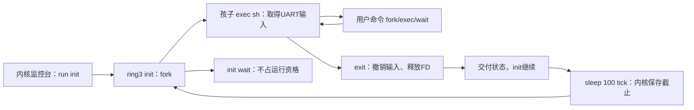

# K36 · 让用户 init 持续监督串口 shell

从 K35 继续。现在用户页可以主动归还，失去父进程的孩子也能回收，但 `run sh` 的 shell 一旦退出，整次用户会话仍会收拢并返回内核监控台。本节增加独立的用户 init：它反复 fork、让孩子 exec 成 sh、wait 取得退出状态，再阻塞等待一段时间后重启 shell。监督策略运行在 ring3；内核继续负责进程资源、等待和串口输入的唯一使用者。

启动后仍先进入熟悉的 `airi>`。输入 `run init` 才进入常驻模式，已有 `run sh` 的退出行为保留。init 管理的 shell 输入 `exit` 后，init 仍活着，下一代 shell 获得新 PID，继续接收命令。本节的 init 只监督一个前台服务，尚无配置化守护进程管理、POSIX 信号或自动开机进入 init。QEMU 的 Ctrl-A X 仍由宿主管理退出，不经过 guest 的按键服务或掉电模型。

<a id="init-roles"></a>
## 三个执行位置各自负责什么

内核启动服务栈原来就能保持一组用户长期运行：有 RUNNABLE 用户时进入其完整现场；有人等待时推进设备、重查条件；所有用户都在等待时执行 hlt 等真实 PIT 事件。K29 的 `session_active` 与 `session_idle` 已将“临时回服务栈”和“整次结束”分开。这里保留这个调度基础，让 init 始终持有一个活用户身份，shell 的一次退出便不再结束整次会话。

init 不读取 UART。它的直接孩子成功 exec 成 sh 后才取得前台输入；shell 再 fork/exec hello 等程序，运行结束后回到 shell，init 仍阻塞在 wait。shell logout 时，内核释放它的输入身份并交付退出状态；init 醒来、等待退避截止，再创建下一代 shell。



这里的 init 是角色名，不硬编码 PID1。启动回归此前已消耗过许多 PID，本次 `run init` 取到的身份由 `[INIT_SESSION]` 记录；所有重启的 shell 都必须指向同一个父 PID。K34 的无父孩子仍交内核托管，不在本节改成完整 Linux init/subreaper 语义。

<a id="init-input"></a>
## FD 引用不等于前台输入资格

K33 给直接启动的 sh 接入 CLOEXEC FD0。fork 会复制这个引用，成功 exec 普通程序会关闭它。现在还需要让 init 在每次 shell 成功装载后重新接入 UART，同时避免两个进程竞争消费同一字节。

沿 init 创建下一代 shell 的这一次 exec 看输入如何交接。`supervisor_pid` 记住本次 `run init` 的监督者，`input_pid` 记住当前唯一 UART 读取者。孩子请求装载 sh 时，内核先确认它的父 PID 就是该监督者；只有这个直接孩子能按这条策略申请前台资格。若另一个进程仍占着输入，exec 在准备新映像以前返回 −16，孩子原来的映像和 FD 都保持。

允许准备新 sh 以后，输入资格仍没有立即改变。ELF 和新地址空间全部准备成功，才进入原来的 exec 提交：保留普通 FD，关闭旧 CLOEXEC 表项，再按前台启动策略清空 FD0、接入固定输入对象。引用接好以后才将孩子的 PID 写入 `input_pid`。因此装载失败不会撤销旧读取者的资格，成功提交才完成输入交接。

FD 表里有输入引用，与真正获准读取仍是两件事。即使 fork 让另一个孩子继承了固定输入对象，`file_transfer` 也会在消费 UART 前比较调用者 PID 与 `input_pid`；不相同就返回 −13，不取走字节。init 自己不读输入，shell logout 后释放资格，下一代 shell 才能沿同一路径接手。

这是一条固定前台服务启动策略，还不是通用 TTY 或权限系统。图形 Terminal 尚无用户 TTY，因此 `run init` 与 `run sh` 在图形入口都给出 UART 指引，避免进入不可见的输入等待。

先更新 `include/airi/file.h` 与 `kernel/fs/file.c` 的输入接入函数：它返回 bool，遇到已占用的 FD0 保持原引用并拒绝。监督 shell 成功 exec 时，调用者按启动策略先关闭其原 FD0，再接入固定输入；直接 sh 则使用全新表。其余文件算法保留。

<!-- write: include/airi/file.h -->
```c
#ifndef AIRI_FILE_H // 内核FD对象与用户整数句柄分开。
#define AIRI_FILE_H // 包含保护。
#include <airi/base.h> // 长度、固定宽度和基础复制。
#include <stdbool.h> // 显式状态。
#define AIRI_FD_COUNT 16u // 每进程最多十六个表项。
#define AIRI_OPEN_READ 1u // 自有ABI标志，不沿用Linux数字。
#define AIRI_OPEN_WRITE 2u // 写访问。
#define AIRI_OPEN_CREATE 4u // 名称不存在时创建。
#define AIRI_OPEN_TRUNCATE 8u // 有写权限才可清空。
#define AIRI_OPEN_CLOEXEC 16u // 成功替换时关闭此表项。
#define AIRI_OPEN_NONBLOCK 32u // 管道可显式选择非阻塞，不支持普通文件open这个标志。
#define AIRI_READY_READ 1u // 管道读不会等待，可能得到数据或EOF。
#define AIRI_READY_WRITE 2u // 当前有读者且有缓冲空间。
#define AIRI_READY_HUP 4u // 读端已无写者，仍须先消费已有数据。
#define AIRI_READY_ERROR 8u // 写端已无读者，下一次写得到EPIPE。
struct airi_open_file; // 全局打开对象由实现拥有。
struct airi_fd_entry { struct airi_open_file *file; bool cloexec; }; // 偏移不放在进程表项中。
struct airi_fd_table { struct airi_fd_entry entries[AIRI_FD_COUNT]; }; // fork逐项增加引用。
void airi_files_init(void); // 仅启动时初始化内存文件系统。
void airi_fd_init(struct airi_fd_table *table); // 初始stdout/stderr指向串口对象。
void airi_fd_clone(struct airi_fd_table *destination, const struct airi_fd_table *source); // 目标必须为空。
void airi_fd_close_all(struct airi_fd_table *table, bool exec_only); // exit关闭全部，exec只关闭标志项。
long airi_fd_open(struct airi_fd_table *table, const char *path, unsigned flags); // 接收已复制的内核路径。
long airi_fd_close(struct airi_fd_table *table, unsigned fd); // 释放表项与其引用。
long airi_fd_dup(struct airi_fd_table *table, unsigned fd, bool cloexec); // 新表项共享偏移。
long airi_fd_seek(struct airi_fd_table *table, unsigned fd, uint64_t offset); // 首版只支持绝对偏移。
long airi_fd_read(struct airi_fd_table *table, unsigned fd, void *buffer, size_t bytes, bool positioned, uint64_t offset); // 输出是内核副本。
long airi_fd_write(struct airi_fd_table *table, unsigned fd, const void *buffer, size_t bytes, bool positioned, uint64_t offset); // 输入不被异步保留。
bool airi_fd_console(const struct airi_fd_table *table, unsigned fd); // 终端发送由设备适配完成。
long airi_fd_pipe(struct airi_fd_table *table, unsigned ends[2], bool nonblocking); // 原子创建两个FD和有界共享缓冲，失败不改输出。
long airi_fd_ready(const struct airi_fd_table *table, unsigned fd); // 本阶段只查询管道当前条件，不订阅事件。
bool airi_fd_nonblocking(const struct airi_fd_table *table, unsigned fd); // 后续等待层据此决定是否可阻塞。
unsigned airi_files_open_count(void); // 不含固定终端对象，用于会话回收检查。
bool airi_fd_input(const struct airi_fd_table *table, unsigned fd); // 判断固定终端输入，设备读取在陷入层。
bool airi_fd_attach_input(struct airi_fd_table *table); // 仅空FD0可接入CLOEXEC输入；已有表项时不改变引用。
#endif // 结束保护。
```
将输入接入函数改为 bool：已有 FD0 时直接拒绝，引用与表项成功建立以后才返回 true。头文件声明和下面的调用点一并更新。

本章每组替换的第一块只用于定位旧文本，敲入第二块替换它，不把两块同时加入文件。各组按正文顺序完成。

<!-- replace: kernel/fs/file.c -->
<!-- before -->
```c
    return file && (file->flags & AIRI_OPEN_NONBLOCK); // 不支持或无效对象不会被当成非阻塞流。
}

void airi_fd_attach_input(struct airi_fd_table *table) { // 调用者保证是刚初始化且槽零为空的新表。
    table->entries[0] = (struct airi_fd_entry){.file=&terminal_input, .cloexec=true}; // exec子程序不能继承shell独占的UART输入。
    ++terminal_input.references; // fork/close使用已有共享引用协议。
}
bool airi_fd_input(const struct airi_fd_table *table, unsigned fd) { // 只比较内核已验证表项身份。
    return get(table, fd) == &terminal_input; // 不把用户整数当硬件地址。
```
<!-- after -->
```c
    return file && (file->flags & AIRI_OPEN_NONBLOCK); // 不支持或无效对象不会被当成非阻塞流。
}

bool airi_fd_attach_input(struct airi_fd_table *table) { // 首次shell与init重启shell都明确要求空FD0。
    if (table->entries[0].file) // 不覆盖已有引用，否则会泄漏并改变调用者文件。
        return false; // 完全保持原表。
    table->entries[0] = (struct airi_fd_entry){.file=&terminal_input, .cloexec=true}; // exec子程序不能继承shell独占的UART输入。
    ++terminal_input.references; // fork/close使用已有共享引用协议。
    return true; // 引用和表项都完成后报告成功。
}
bool airi_fd_input(const struct airi_fd_table *table, unsigned fd) { // 只比较内核已验证表项身份。
    return get(table, fd) == &terminal_input; // 不把用户整数当硬件地址。
```

更新文件检查 `tests/unit/file_test.c`。先在 FD0 打开 /seed，尝试接入输入必须失败，而原文件仍能读到 a；清表后接入成功，重复接入拒绝；原来的 fork、CLOEXEC 和最后引用释放检查继续保留。这样检查的是被拒绝操作是否保住原文件，而不只看一个布尔值。

<!-- write: tests/unit/file_test.c -->
```c
#include <airi/file.h> // 与guest相同的文件算法，宿主不访问UART。
#include <assert.h> // 每条断言验证具体所有权或边界。
#include <stdio.h> // 宿主只输出最终结果。
int main(void) { // 独立进程，每次建立干净RAM目录。
    airi_files_init(); // 与启动一致的只读seed。
    struct airi_fd_table parent, child; // 两份进程表引用同一全局对象。
    airi_fd_init(&parent); // stdout/stderr占1和2，槽0可用。
    assert(airi_fd_open(&parent, "/seed", AIRI_OPEN_WRITE) == -13); // 只读节点不能绕过。
    assert(airi_fd_open(&parent, "/bad/path", AIRI_OPEN_READ) == -22); // 不假装有目录遍历。
    long fd = airi_fd_open(&parent, "/seed", AIRI_OPEN_READ); // 第一份独立打开对象。
    assert(fd == 0); // 最小空编号。
    long dupped = airi_fd_dup(&parent, (unsigned)fd, true); // 同一对象的第二表项。
    assert(dupped == 3 && airi_files_open_count() == 1); // dup不新建全局对象。
    airi_fd_clone(&child, &parent); // fork复制表项、增加引用。
    char data[16] = {0}; // 核对实际返回的文件字节。
    assert(airi_fd_read(&child, 0, data, 2, false, 0) == 2 && !airi_memcmp(data, "ab", 2)); // 子先消费ab。
    airi_fd_close_all(&child, true); // 成功exec只关其CLOEXEC项。
    assert(airi_fd_read(&child, 3, data, 1, false, 0) == -9); // 关闭不影响父同号。
    assert(airi_fd_read(&parent, 3, data, 2, false, 0) == 2 && !airi_memcmp(data, "cd", 2)); // 父dup看到共享偏移。
    assert(airi_fd_read(&child, 0, data, 8, true, 0) == 6); // pread读6字节，不改变偏移4。
    assert(airi_fd_read(&child, 0, data, 2, false, 0) == 2 && !airi_memcmp(data, "ef", 2)); // 普通读继续4。
    airi_fd_close_all(&child, false); // 子退出释放其余引用。
    airi_fd_close_all(&parent, false); // 最后引用归还全局对象。
    assert(!airi_files_open_count()); // 不遗留只增不减的引用。
    airi_fd_init(&parent); // 新会话不清除文件内容。
    fd = airi_fd_open(&parent, "/notes", 15); // 读写+创建+清空。
    assert(fd == 0); // 编号复用。
    assert(airi_fd_write(&parent, 0, "abcdef", 6, false, 0) == 6); // 初始内容。
    assert(airi_fd_write(&parent, 0, "X", 1, true, 1023) == 1); // 显式定位使中间成为洞。
    assert(airi_fd_write(&parent, 0, "Z", 1, true, 1024) == -28); // 容量满错误。
    assert(airi_fd_read(&parent, 0, data, 16, true, 10) == 16); // 洞可见为零。
    for (unsigned i = 0; i < sizeof(data); ++i) // 所有字节必须被明确初始化。
        assert(data[i] == 0); // 不泄漏旧内容。
    while (airi_fd_dup(&parent, 0, false) >= 0) {} // 填满进程表，多个表项仍只用一个对象。
    assert(airi_fd_open(&parent, "/notes", 11) == -24); // 表满时TRUNCATE必须尚未执行。
    assert(airi_fd_read(&parent, 0, data, 6, true, 0) == 6 && !airi_memcmp(data, "abcdef", 6)); // 失败open未清旧内容。
    airi_fd_close_all(&parent, false); // 释放所有共享引用。
    assert(!airi_files_open_count()); // 同一对象不会被过早或重复回收。
    struct airi_fd_table tables[2]; // 两个进程可耗尽全局24个对象。
    airi_fd_init(&tables[0]); // 每个进程还有十四个空FD。
    airi_fd_init(&tables[1]); // 全局容量与单进程上限不同。
    for (unsigned i = 0; i < 24; ++i) // 第一表开14份，第二表开10份。
        assert(airi_fd_open(&tables[i < 14 ? 0 : 1], "/seed", AIRI_OPEN_READ) >= 0); // 每次open得到独立对象。
    assert(airi_fd_open(&tables[1], "/notes", 11) == -23); // 还有FD但没有打开对象，不能truncate。
    airi_fd_close_all(&tables[0], false); // 清全局引用的一部分。
    airi_fd_close_all(&tables[1], false); // 清剩余部分。
    assert(!airi_files_open_count()); // 所有槽均可再次复用。
    airi_fd_init(&parent); // 继续用同一文件系统测试管道资源，不重置已有状态。
    unsigned ends[2] = {77, 88}; // 创建失败必须保留输出身份。
    assert(!airi_fd_pipe(&parent, ends, true) && ends[0] == 0 && ends[1] == 3); // 两个最低空FD。
    assert(airi_fd_ready(&parent, 0) == 0 && airi_fd_ready(&parent, 3) == AIRI_READY_WRITE); // 空管道的双端条件不同。
    assert(airi_fd_read(&parent, 0, data, 1, false, 0) == -11); // 有写者时空读不是EOF。
    char input[100], output[100]; // 模式覆盖整个环并越过容量。
    for (unsigned i = 0; i < sizeof(input); ++i) // 每个位置有明确值。
        input[i] = (char)i; // 可检查FIFO和回绕。
    assert(airi_fd_write(&parent, 3, input, 100, false, 0) == 64); // 容量边界产生短写。
    assert(airi_fd_write(&parent, 3, input, 1, false, 0) == -11 && airi_fd_ready(&parent, 3) == 0); // 满流形成背压。
    assert(airi_fd_read(&parent, 0, output, 10, false, 0) == 10 && !airi_memcmp(output, input, 10)); // 先释放一段空间。
    assert(airi_fd_write(&parent, 3, input, 10, false, 0) == 10); // 新数据跨环尾。
    assert(airi_fd_read(&parent, 0, output, 100, false, 0) == 64 && !airi_memcmp(output, input + 10, 54) && !airi_memcmp(output + 54, input, 10)); // 完整FIFO次序不被回绕改变。
    airi_fd_clone(&child, &parent); // fork后端点存在直到最后共享引用消失。
    assert(!airi_fd_close(&parent, 3) && airi_fd_read(&parent, 0, data, 1, false, 0) == -11); // 子仍持写端，不能提前EOF。
    assert(!airi_fd_close(&child, 3) && airi_fd_ready(&parent, 0) == (AIRI_READY_READ | AIRI_READY_HUP)); // 最后写引用消失才HUP。
    assert(airi_fd_read(&parent, 0, data, 1, false, 0) == 0); // 排空后真正EOF。
    airi_fd_close_all(&child, false); // 关闭子读端引用，不破坏父。
    airi_fd_close_all(&parent, false); // 最后读端结束，缓冲可复用。
    assert(!airi_files_open_count()); // 两端对象全部归还。
    airi_fd_init(&parent); // 新会话再建新管道。
    assert(!airi_fd_pipe(&parent, ends, true)); // 旧流字节必须清零丢弃。
    assert(!airi_fd_close(&parent, ends[0])); // 不再存在任何读者。
    assert(airi_fd_write(&parent, ends[1], input, 1, false, 0) == -32 && airi_fd_ready(&parent, ends[1]) == AIRI_READY_ERROR); // 写端收到EPIPE和错误就绪。
    assert(airi_fd_write(&parent, ends[1], NULL, 0, false, 0) == 0); // 零长度不访问buffer，也不等待对端。
    airi_fd_close_all(&parent, false); // 回收断流。
    airi_fd_init(&parent); // 四个流总共八个端点，小于本进程FD容量。
    for (unsigned i = 0; i < 4; ++i) // 填满独立管道池。
        assert(!airi_fd_pipe(&parent, ends, true)); // 每次两个端点完整成功。
    ends[0] = 77; ends[1] = 88; // 失败输出哨兵。
    assert(airi_fd_pipe(&parent, ends, true) == -28 && ends[0] == 77 && ends[1] == 88 && airi_files_open_count() == 8); // 第五条失败不泄漏半个FD或对象。
    airi_fd_close_all(&parent, false); // 扫描全部表项，端点池也全部回收。
    assert(!airi_files_open_count()); // 后续程序可继续创建流。
    airi_fd_init(&parent); // 新表的FD0可先被普通文件占用。
    assert(airi_fd_open(&parent, "/seed", AIRI_OPEN_READ) == 0); // 明确占住FD0，不改变其他表项。
    assert(!airi_fd_attach_input(&parent) && !airi_fd_input(&parent, 0)); // 失败不得覆盖文件或泄漏其引用。
    assert(airi_fd_read(&parent, 0, data, 1, false, 0) == 1 && data[0] == 'a'); // 原文件与偏移仍能正常使用。
    airi_fd_close_all(&parent, false); // 清理原文件后才能接入输入。
    airi_fd_init(&parent); // 重新建立空输入表。
    assert(airi_fd_attach_input(&parent)); // 只给空FD0接入固定输入。
    assert(!airi_fd_attach_input(&parent)); // 第二次接入被拒绝，不重复增加固定对象引用。
    assert(airi_fd_input(&parent,0) && parent.entries[0].cloexec); // FD0与输出对象身份不同，exec时必须撤销。
    airi_fd_clone(&child,&parent); // fork增加输入对象引用，但不复制设备。
    airi_fd_close_all(&child,true); // 成功exec只关闭CLOEXEC输入，保留stdout/stderr。
    assert(!airi_fd_input(&child,0) && airi_fd_input(&parent,0)); // 子撤销不影响父shell继续读。
    airi_fd_close_all(&child,false); airi_fd_close_all(&parent,false); // 最后输入引用释放不能清空固定对象配置。
    airi_fd_init(&parent); assert(airi_fd_attach_input(&parent)); // 再次启动shell可重新使用相同输入对象。
    assert(airi_fd_input(&parent,0)); airi_fd_close_all(&parent,false); // 重复会话完整回收。
    puts("PASS RAM files/pipes: offsets, fork/exec references, sparse zero, short I/O, FIFO wrap, endpoint lifetime, exhaustion"); // 全部边界通过才发布。
    return 0; // 宿主测试成功。
}
```

<a id="init-sleep"></a>
## 保存截止，让重启等待不占用用户 CPU

init 遇到 shell 退出或 fork 资源失败时都等待 100 个 PIT tick，再尝试创建新 shell。100Hz 配置下这是名义一秒；QEMU 暂停、调试与调度可能改变墙钟观察，不用它充当真实时间服务。一次睡眠只接受 0–6000 tick：0 立即成功，超过范围返回 −22；截止加法还需拒绝 uint64 回绕。

init 调用32号睡眠时，内核把本次绝对截止保存在进程控制块，并保留已有的完整 frame，再将状态设为 USER_IO_WAIT。新的 IO_SLEEP 只是这套等待状态的一种用途，不借用 FD 或用户输出缓冲。init 暂时不再获得用户 CPU，但整个监督会话仍然存在。

普通服务栈上的 `poll_waiters` 反复比较同一个截止，到期才把原 frame 中的 RAX 写为0，并改回 RUNNABLE。恢复以后，init 从原 sleep 调用后继续，而不是重新进入监督程序。重查不会续借时间；其他用户即使一直计算，原有 timer 服务路径仍会回到普通栈处理等待。IRQ 本身继续只记录与交接，不打印、分配或复制用户对象。

**更新 `kernel/process/user.c`。** 改动集中在输入 PID 的授予/撤销、exec 提交、IO_SLEEP 的保存与完成、launch 的 init 身份，以及图形入口的 UART 限制。其余页面、文件和设备接口沿 K35 保留。此时新增 init 的映像边界还需下面的构建接入，所有文件完成后再运行。

等待种类新增 IO_SLEEP，仍保存同一份用户 frame。

<!-- replace: kernel/process/user.c -->
<!-- before -->
```c
#define USER_HEAP_END 0x20000000ull // 动态用户页只占这段独立范围，不接近初始用户栈。
#define PROCESS_COUNT 8u // 有界进程表，不做动态扩容。
enum user_state { USER_UNUSED, USER_RUNNABLE, USER_RUNNING, USER_WAITING, USER_IO_WAIT, USER_ZOMBIE, USER_REAP_PENDING }; // 退出与回收是两个不同状态。
enum io_operation { IO_NONE, IO_READ, IO_WRITE, IO_READY, IO_ASYNC }; // 等待保存操作条件，不保留内核局部buffer。
struct user_page { uint64_t address, physical; unsigned flags; }; // fork需要把同一VA映射到另一个物理页。
struct user_process { // 所有权和调度状态由内核持有，用户只能看到PID。
    bool async_owned; // 本控制块是否持有当前PID的异步owner，局部旧exec副本必须清除此所有权。
```
<!-- after -->
```c
#define USER_HEAP_END 0x20000000ull // 动态用户页只占这段独立范围，不接近初始用户栈。
#define PROCESS_COUNT 8u // 有界进程表，不做动态扩容。
enum user_state { USER_UNUSED, USER_RUNNABLE, USER_RUNNING, USER_WAITING, USER_IO_WAIT, USER_ZOMBIE, USER_REAP_PENDING }; // 退出与回收是两个不同状态。
enum io_operation { IO_NONE, IO_READ, IO_WRITE, IO_READY, IO_ASYNC, IO_SLEEP }; // 等待保存操作条件，不保留内核局部buffer。
struct user_page { uint64_t address, physical; unsigned flags; }; // fork需要把同一VA映射到另一个物理页。
struct user_process { // 所有权和调度状态由内核持有，用户只能看到PID。
    bool async_owned; // 本控制块是否持有当前PID的异步owner，局部旧exec副本必须清除此所有权。
```

在会话身份旁保存监督者和当前 UART 消费者。

<!-- replace: kernel/process/user.c -->
<!-- before -->
```c
static unsigned next_pid = 1, root_pid, timer_switches, wait_blocks; // 每次运行会话的根身份和实际行为计数。
static unsigned io_block_count, io_wake_count, idle_halt_count; // 会话真实I/O阻塞与唤醒次数。
static bool session_idle, service_from_timer; // 是否暂回启动栈服务，和整个会话结束分开。
static bool session_active; // 只有用户会话活动时才接受用户IRQ或系统调用。
static int session_result; // 根用户退出结果，不用最后一个孩子的结果覆盖。
static struct airi_trap_frame *kernel_return; // 指向本轮 int129 保存的继续 frame；每次进入用户时登记，恢复后不能继续借用旧 frame。
```
<!-- after -->
```c
static unsigned next_pid = 1, root_pid, timer_switches, wait_blocks; // 每次运行会话的根身份和实际行为计数。
static unsigned io_block_count, io_wake_count, idle_halt_count; // 会话真实I/O阻塞与唤醒次数。
static bool session_idle, service_from_timer; // 是否暂回启动栈服务，和整个会话结束分开。
static unsigned supervisor_pid, input_pid; // 可选init身份与当前唯一UART输入身份，不是进程槽。
static bool session_active; // 只有用户会话活动时才接受用户IRQ或系统调用。
static int session_result; // 根用户退出结果，不用最后一个孩子的结果覆盖。
static struct airi_trap_frame *kernel_return; // 指向本轮 int129 保存的继续 frame；每次进入用户时登记，恢复后不能继续借用旧 frame。
```

声明 init 的映像边界，稍后用户程序与包装完成后才有定义。

<!-- replace: kernel/process/user.c -->
<!-- before -->
```c
extern const uint8_t airi_user_rsp_bad_start[], airi_user_rsp_bad_end[]; // 不规范用户返回栈。
extern const uint8_t airi_hello_elf_start[], airi_hello_elf_end[]; // 既有独立用户C程序。
extern const uint8_t airi_process_elf_start[], airi_process_elf_end[]; // 新的fork/wait和抢占工作负载。
extern const uint8_t airi_memory_elf_start[], airi_memory_elf_end[]; // 用户页面归还与空洞复用工作负载。
extern const uint8_t airi_orphans_elf_start[], airi_orphans_elf_end[]; // 持续会话中的孤儿回收与槽复用演示。
extern const uint8_t airi_shell_elf_start[], airi_shell_elf_end[]; // 真正用户shell，不是内核命令别名。
```
<!-- after -->
```c
extern const uint8_t airi_user_rsp_bad_start[], airi_user_rsp_bad_end[]; // 不规范用户返回栈。
extern const uint8_t airi_hello_elf_start[], airi_hello_elf_end[]; // 既有独立用户C程序。
extern const uint8_t airi_process_elf_start[], airi_process_elf_end[]; // 新的fork/wait和抢占工作负载。
extern const uint8_t airi_init_elf_start[], airi_init_elf_end[]; // 用户态常驻监督程序。
extern const uint8_t airi_memory_elf_start[], airi_memory_elf_end[]; // 用户页面归还与空洞复用工作负载。
extern const uint8_t airi_orphans_elf_start[], airi_orphans_elf_end[]; // 持续会话中的孤儿回收与槽复用演示。
extern const uint8_t airi_shell_elf_start[], airi_shell_elf_end[]; // 真正用户shell，不是内核命令别名。
```

在初始目录中登记 init。

<!-- replace: kernel/process/user.c -->
<!-- before -->
```c
struct executable { const char *name; const uint8_t *start, *end; }; // 初始映像目录尚不是通用文件系统。
static const struct executable executables[] = { // 每份映像字节由内核只读段长期持有。
    {"sh", airi_shell_elf_start, airi_shell_elf_end}, // 独占串口输入的可选用户程序。
    {"memory", airi_memory_elf_start, airi_memory_elf_end}, // 同一地址空间内释放与重新申请。
    {"orphans", airi_orphans_elf_start, airi_orphans_elf_end}, // 不结束根会话也能回收退出的孤儿。
    {"demo", airi_demo_elf_start, airi_demo_elf_end}, // 页、任务和设备完成串联。
```
<!-- after -->
```c
struct executable { const char *name; const uint8_t *start, *end; }; // 初始映像目录尚不是通用文件系统。
static const struct executable executables[] = { // 每份映像字节由内核只读段长期持有。
    {"sh", airi_shell_elf_start, airi_shell_elf_end}, // 独占串口输入的可选用户程序。
    {"init", airi_init_elf_start, airi_init_elf_end}, // 管理前台shell的常驻用户进程。
    {"memory", airi_memory_elf_start, airi_memory_elf_end}, // 同一地址空间内释放与重新申请。
    {"orphans", airi_orphans_elf_start, airi_orphans_elf_end}, // 不结束根会话也能回收退出的孤儿。
    {"demo", airi_demo_elf_start, airi_demo_elf_end}, // 页、任务和设备完成串联。
```

file_transfer 在读取固定输入对象以前检查消费身份；引用存在也不能代替资格。

<!-- replace: kernel/process/user.c -->
<!-- before -->
```c
        }
        return airi_fd_write(&p->files, (unsigned)fd, buffer, bytes, positioned, offset); // 满管道可返回EAGAIN。
    }
    if (airi_fd_input(&p->files, (unsigned)fd)) { // 只有shell拥有，内核监控台在launch返回前不再轮询UART。
        if (positioned) // 字节流没有文件偏移。
            return -29; // -ESPIPE，不消费字节。
        if (!bytes) // 零长度读取不能登记永久等待，也不消费UART。
```
<!-- after -->
```c
        }
        return airi_fd_write(&p->files, (unsigned)fd, buffer, bytes, positioned, offset); // 满管道可返回EAGAIN。
    }
    if (airi_fd_input(&p->files, (unsigned)fd)) { // 固定输入对象的引用与当前前台读取资格分别检查。
        if (p->pid != input_pid) // fork复制的FD引用本身不转移UART消费权。
            return -13; // -EACCES；不消费设备字节。
        if (positioned) // 字节流没有文件偏移。
            return -29; // -ESPIPE，不消费字节。
        if (!bytes) // 零长度读取不能登记永久等待，也不消费UART。
```

poll_waiters 先处理只有绝对截止的 IO_SLEEP，再进入原异步/FD等待分支。

<!-- replace: kernel/process/user.c -->
<!-- before -->
```c
        if (p->state != USER_IO_WAIT) // 不碰正在运行、wait孩子或已退出者。
            continue; // 检查下一个等待槽。
        long result; // 恢复到用户同一次调用的结果。
        if (p->io == IO_ASYNC) { // 原CQ等待仍保留同一个用户输出地址。
            struct airi_io_completion completion; // 先取得内核数值副本，不借用户指针给引擎。
            result = airi_async_pop(p->pid, &completion); // 空CQ为-11，不代表I/O结果。
            if (result == -11) // 尚未形成可收集结果。
```
<!-- after -->
```c
        if (p->state != USER_IO_WAIT) // 不碰正在运行、wait孩子或已退出者。
            continue; // 检查下一个等待槽。
        long result; // 恢复到用户同一次调用的结果。
        if (p->io == IO_SLEEP) { // 只有截止tick，没有用户缓冲或设备FD。
            if (airi_timer_ticks() < p->io_deadline) // 时钟尚未到期，保留原现场等待。
                continue; // 不恢复用户忙轮询。
            result = 0; // 到期后同一次sleep系统调用成功返回。
        } else if (p->io == IO_ASYNC) { // 原CQ等待仍保留同一个用户输出地址。
            struct airi_io_completion completion; // 先取得内核数值副本，不借用户指针给引擎。
            result = airi_async_pop(p->pid, &completion); // 空CQ为-11，不代表I/O结果。
            if (result == -11) // 尚未形成可收集结果。
```

退出者若占有 UART，先撤销它自己的消费资格，下一代才能接手。

<!-- replace: kernel/process/user.c -->
<!-- before -->
```c
        airi_async_close(p->pid); // QUEUED撤销，ACTIVE内核副本保持到收集。
        p->async_owned = false; // cleanup不重复关闭未来的新epoch。
    }
    airi_fd_close_all(&p->files, false); // exit立即释放文件，僵尸只保留等待状态与待回收内存。
    p->exit_code = code; // 保存给父进程wait读取。
    p->state = USER_ZOMBIE; // 不再运行，但资源和状态尚存在。
```
<!-- after -->
```c
        airi_async_close(p->pid); // QUEUED撤销，ACTIVE内核副本保持到收集。
        p->async_owned = false; // cleanup不重复关闭未来的新epoch。
    }
    if (input_pid == p->pid) // 当前前台shell停止后，init的新孩子才能取得UART。
        input_pid = 0; // 只释放本进程的消费权，不替其他身份撤销。
    airi_fd_close_all(&p->files, false); // exit立即释放文件，僵尸只保留等待状态与待回收内存。
    p->exit_code = code; // 保存给父进程wait读取。
    p->state = USER_ZOMBIE; // 不再运行，但资源和状态尚存在。
```

exec 找到目标以后先判断本次是否申请前台输入；冲突在准备新映像以前拒绝。

<!-- replace: kernel/process/user.c -->
<!-- before -->
```c
    const struct executable *image = find_program(name); // 不存在目标不用分配新根。
    if (!image) // 和损坏格式是两种不同失败。
        return -2; // -ENOENT。
    struct user_process next = {0}; // 临时所有者不在进程表中，尚不能被调度。
    int error = prepare_elf(&next, image->start, (size_t)((uintptr_t)image->end - (uintptr_t)image->start), name, false); // 不创建第二条内核栈，先完整准备新用户空间。
    if (error) // 构造器已回滚next，current所有字段和旧f不变。
```
<!-- after -->
```c
    const struct executable *image = find_program(name); // 不存在目标不用分配新根。
    if (!image) // 和损坏格式是两种不同失败。
        return -2; // -ENOENT。
    bool acquire_input = supervisor_pid && current->parent == supervisor_pid && airi_strlen(name) == 2 && !airi_memcmp(name, "sh", 2); // 只有init的直接shell孩子可获得新前台输入。
    if (acquire_input && input_pid && input_pid != current->pid) // 同一个init也不能同时授权两个读者。
        return -16; // -EBUSY；尚未触碰旧映像或FD。
    struct user_process next = {0}; // 临时所有者不在进程表中，尚不能被调度。
    int error = prepare_elf(&next, image->start, (size_t)((uintptr_t)image->end - (uintptr_t)image->start), name, false); // 不创建第二条内核栈，先完整准备新用户空间。
    if (error) // 构造器已回滚next，current所有字段和旧f不变。
```

新映像准备完成后，exec 才关闭旧 CLOEXEC、接入 FD0并发布 input_pid。失败准备不进入这一段。

<!-- replace: kernel/process/user.c -->
<!-- before -->
```c
    next.files = old.files; // 文件表所有权从旧映像转到新映像，偏移和普通FD继续存在。
    airi_memset(&old.files, 0, sizeof(old.files)); // cleanup旧映像不能重复关闭已转移引用。
    airi_fd_close_all(&next.files, true); // 只有成功提交才关闭CLOEXEC，失败exec不影响原表。
    next.state = USER_RUNNING; // 此身份继续运行，但从新_start开始。
    *current = next; // 把新所有权发布到原进程槽，PID不变。
    if (!airi_vm_activate(&current->space)) // 新根已借到当前内核栈及内核映射。
```
<!-- after -->
```c
    next.files = old.files; // 文件表所有权从旧映像转到新映像，偏移和普通FD继续存在。
    airi_memset(&old.files, 0, sizeof(old.files)); // cleanup旧映像不能重复关闭已转移引用。
    airi_fd_close_all(&next.files, true); // 只有成功提交才关闭CLOEXEC，失败exec不影响原表。
    if (input_pid == next.pid) // 若前台进程自行exec，旧输入权限不能漏到其他映像。
        input_pid = 0; // 成功提交时才撤销，失败exec仍保留旧权限。
    if (acquire_input) { // 本次新映像确实是init管理的shell。
        airi_fd_close(&next.files, 0); // 无表项时-9可忽略；已有普通FD0也按此启动策略关闭。
        if (!airi_fd_attach_input(&next.files)) // 新FD0必须为空且输入引用成功接入。
            airi_panic("cannot attach supervised shell input"); // 事务提交内部不变量错误。
        input_pid = next.pid; // 文件引用完成后才发布唯一消费身份。
    }
    next.state = USER_RUNNING; // 此身份继续运行，但从新_start开始。
    *current = next; // 把新所有权发布到原进程槽，PID不变。
    if (!airi_vm_activate(&current->space)) // 新根已借到当前内核栈及内核映射。
```

在31号归还之后接入32号睡眠：保存截止、原frame与等待状态，然后调度。

<!-- replace: kernel/process/user.c -->
<!-- before -->
```c
    }
    else if (f->rax == 31) // 只归还调用者自己的动态页面，不能释放ELF或初始栈。
        f->rax = (uint64_t)release_user(f->rdi, f->rsi); // 负参数错误保持全部原映射。
    else // 尚未提供的接口都明确拒绝。
        f->rax = (uint64_t)-38ll; // -ENOSYS。
    poll_waiters(); // 文件/流修改完成后立即重查其他等待者，不等用户轮询。
```
<!-- after -->
```c
    }
    else if (f->rax == 31) // 只归还调用者自己的动态页面，不能释放ELF或初始栈。
        f->rax = (uint64_t)release_user(f->rdi, f->rsi); // 负参数错误保持全部原映射。
    else if (f->rax == 32) { // 单调tick睡眠，复用持久等待现场而非用户忙等。
        uint64_t now = airi_timer_ticks(); // 截止以真实PIT事件计数为基准。
        if (f->rdi > 6000) // 一次最多6000tick（名义六十秒），完整64位参数先验证。
            f->rax = (uint64_t)-22ll; // -EINVAL，不改变运行状态。
        else if (!f->rdi) // 零长度是立即成功，不登记等待。
            f->rax = 0; // 和主动yield分开。
        else if (now > UINT64_MAX - f->rdi) // 不让截止计数回绕成已经过期。
            f->rax = (uint64_t)-75ll; // -EOVERFLOW。
        else { // 请求完整有效，保存条件后再退出可运行集合。
            current->io = IO_SLEEP; // poll_waiters不再把它当FD操作。
            current->io_fd = current->io_events = 0; // 清与此次请求无关的旧数值。
            current->io_address = current->io_bytes = 0; // sleep不借用用户指针。
            current->io_deadline = now + f->rdi; // 保留绝对截止，不在每次轮询延长。
            current->state = USER_IO_WAIT; // 此前已经保存实际系统调用frame。
            ++io_block_count; // 记录真正阻塞，而非返回0的空操作。
            airi_log("[WAIT_REGISTER] pid=%u operation=sleep ticks=%llu", current->pid, (unsigned long long)f->rdi); // 普通调用栈记录，不在IRQ打印。
            return schedule(REASON_IO); // 其他用户继续；全阻塞时启动栈hlt等PIT。
        }
    }
    else // 尚未提供的接口都明确拒绝。
        f->rax = (uint64_t)-38ll; // -ENOSYS。
    poll_waiters(); // 文件/流修改完成后立即重查其他等待者，不等用户轮询。
```

launch 区分直接 sh 与 init：前者从空表接入输入，后者自身不读 UART。

<!-- replace: kernel/process/user.c -->
<!-- before -->
```c
        return error; // 调用者可以继续命令，不停机。
    }
    airi_fd_init(&root->files); // 初始stdout/stderr归本次根进程持有。
    if (name && airi_strlen(name)==2 && !airi_memcmp(name,"sh",2)) // 只有直接启动shell时接入UART输入。
        airi_fd_attach_input(&root->files); // CLOEXEC使既有子程序FD0继续可用于普通文件。
    root->pid = next_pid++; // 完整准备后才取得运行身份。
    int async_error = airi_async_open(root->pid); // 完整映像准备后才登记新进程资源上下文。
    if (async_error) { // 未向用户发布，此时根与栈不活动。
```
<!-- after -->
```c
        return error; // 调用者可以继续命令，不停机。
    }
    airi_fd_init(&root->files); // 初始stdout/stderr归本次根进程持有。
    bool direct_shell = name && airi_strlen(name)==2 && !airi_memcmp(name,"sh",2); // init自身不读UART，只监督自己的shell孩子。
    if (direct_shell && !airi_fd_attach_input(&root->files)) // 根的新FD0必须为空。
        airi_panic("cannot attach direct shell input"); // 初始化不变量不成立。
    root->pid = next_pid++; // 完整准备后才取得运行身份。
    int async_error = airi_async_open(root->pid); // 完整映像准备后才登记新进程资源上下文。
    if (async_error) { // 未向用户发布，此时根与栈不活动。
```

根身份建立后，记录这次监督者与输入消费者；普通用户会话不取得监督角色。

<!-- replace: kernel/process/user.c -->
<!-- before -->
```c
    place_frame(root); // 寄存器值进入本进程真实内核栈。
    root->state = USER_RUNNABLE; // 发布首次运行资格。
    root_pid = root->pid; // 会话根身份不会被孩子exit覆盖。
    session_result = 0; // 不继承上次结果。
    timer_switches = 0; // 这次会话实际抢占计数。
    wait_blocks = 0; // 这次会话实际阻塞计数。
```
<!-- after -->
```c
    place_frame(root); // 寄存器值进入本进程真实内核栈。
    root->state = USER_RUNNABLE; // 发布首次运行资格。
    root_pid = root->pid; // 会话根身份不会被孩子exit覆盖。
    supervisor_pid = name && airi_strlen(name)==4 && !airi_memcmp(name,"init",4) ? root_pid : 0; // 只在明确run init的模式授予前台重启资格。
    input_pid = direct_shell ? root_pid : 0; // 直接shell已接入；init的孩子在成功exec时取得资格。
    if (supervisor_pid) // 普通演示的启动路径和观察标记保持。
        airi_log("[INIT_SESSION] pid=%u uart=exclusive", supervisor_pid); // PID不固定为1，身份不等于槽号。
    session_result = 0; // 不继承上次结果。
    timer_switches = 0; // 这次会话实际抢占计数。
    wait_blocks = 0; // 这次会话实际阻塞计数。
```

整次有限会话收尾时撤销这两项身份，不留给下一次 launch。

<!-- replace: kernel/process/user.c -->
<!-- before -->
```c
        if (processes[i].state != USER_UNUSED) // wait已回收槽不重复处理。
            cleanup(&processes[i]); // 收拢剩余僵尸和未被父wait的资源。
    current = NULL; // 不保留已清掉的身份指针。
    kernel_return = NULL; // 下次会话重新登记。
    airi_async_drain(); // 所有owner已关闭，内核仍须结束无主ACTIVE并核对静态池完全回收。
    airi_memory_snapshot(&after); // 全部页和栈回收后验证。
```
<!-- after -->
```c
        if (processes[i].state != USER_UNUSED) // wait已回收槽不重复处理。
            cleanup(&processes[i]); // 收拢剩余僵尸和未被父wait的资源。
    current = NULL; // 不保留已清掉的身份指针。
    supervisor_pid = input_pid = 0; // 有限会话结束后不能把授权留给下次运行。
    kernel_return = NULL; // 下次会话重新登记。
    airi_async_drain(); // 所有owner已关闭，内核仍须结束无主ACTIVE并核对静态池完全回收。
    airi_memory_snapshot(&after); // 全部页和栈回收后验证。
```

图形命令入口同时限制 sh 与 init，仍指向可操作的 UART 路径。

<!-- replace: kernel/process/user.c -->
<!-- before -->
```c
        return true; // 请求已得到明确结果。
    }
#ifdef AIRI_GRAPHICAL_CONSOLE // 当前图形终端尚未接入用户TTY，不能让窗口命令陷入不可见输入等待。
    if (bytes==6 && !airi_memcmp(name,"sh",2)) { // 只限制需要交互输入的shell，其他程序仍可运行。
        airi_console_print(console,"User shell uses UART: start ./airios run, then run sh."); // 给出实际可操作入口。
        return true; // 图形桌面立即继续接收输入。
    }
```
<!-- after -->
```c
        return true; // 请求已得到明确结果。
    }
#ifdef AIRI_GRAPHICAL_CONSOLE // 当前图形终端尚未接入用户TTY，不能让窗口命令陷入不可见输入等待。
    if ((bytes==6 && !airi_memcmp(name,"sh",2)) || (bytes==8 && !airi_memcmp(name,"init",4))) { // shell及其常驻监督模式都需要实际UART输入。
        airi_console_print(console,"User shell uses UART: start ./airios run, then run sh."); // 给出实际可操作入口。
        return true; // 图形桌面立即继续接收输入。
    }
```

用户库头增加 `airi_sleep` 声明，其他声明保持。`unsigned ticks` 是用户包装参数，内核仍验证完整寄存器值，不能依靠 C 调用方的类型作为信任边界。

<!-- write: labs/airios/include/airi_libc.h -->
```c
#ifndef AIRI_USER_LIBC_H // 用户库头与内核基础库分开。
#define AIRI_USER_LIBC_H // 包含保护。
#include <airi/io_abi.h> // 自有固定宽度提交、完成和只读状态，不包含内核结构。
#include <stddef.h> // 用户对象字节长度。
#include <stdint.h> // 用户ABI的64位寄存器值。
void *memcpy(void *destination, const void *source, size_t bytes); // 双方不重叠的用户空间复制。
void *memmove(void *destination, const void *source, size_t bytes); // 允许同一用户数组内重叠移动。
void *memset(void *destination, int value, size_t bytes); // 按字节填充用户对象。
int memcmp(const void *left, const void *right, size_t bytes); // 首个不同无符号字节决定结果。
size_t strlen(const char *text); // 用户有效NUL字符串长度。
long airi_write(unsigned fd, const void *buffer, size_t bytes); // 自有int80 ABI，失败直接返回负数。
long airi_getpid(void); // 获取当前用户身份。
_Noreturn void airi_exit(unsigned code); // 退出不返回用户调用方。
long airi_puts(const char *text); // 有界 FD 写入，不自动补换行。
long airi_fork(void); // 首版内核直接复制用户页，子返回0，父返回子PID。
long airi_waitpid(long pid, int *status); // pid=-1或指定孩子；status是普通退出值。
void *airi_alloc(size_t bytes); // 零填充页申请，失败NULL；显式release整页或进程结束回收。
uint64_t airi_ticks(void); // 实际时钟事件计数。
void airi_yield(void); // 主动交接，不等同于时钟抢占。
long airi_exec(const char *name); // 成功替换映像不返回；失败保留旧PID和调用链，返回负错误。
#define AIRI_READ 1u // 以下标志只属于自有open ABI。
#define AIRI_WRITE 2u // 写访问。
#define AIRI_CREATE 4u // 名字不存在时创建。
#define AIRI_TRUNCATE 8u // 清空可写文件。
#define AIRI_CLOEXEC 16u // 成功exec关闭此表项。
long airi_open(const char *path, unsigned flags); // 平坦绝对名字，返回FD或负错误。
long airi_close(unsigned fd); // 关闭不删除名字。
long airi_dup(unsigned fd, unsigned cloexec); // 与源共享偏移。
long airi_seek(unsigned fd, uint64_t offset); // 只支持绝对定位。
long airi_read(unsigned fd, void *buffer, size_t bytes); // EOF为0，短读是实际完成数。
long airi_pread(unsigned fd, void *buffer, size_t bytes, uint64_t offset); // 不移动共享偏移。
long airi_pwrite(unsigned fd, const void *buffer, size_t bytes, uint64_t offset); // 第四参数R10。
long airi_log_append(const void *data, size_t bytes); // 最多480字节，成功返回从1开始的sequence。
long airi_log_read(unsigned index, void *data, size_t capacity); // 索引从0，返回实际长度。
long airi_log_count(void); // 已恢复有效前缀，错误为负。
#define AIRI_READABLE 1u // 当前read可得到数据或EOF。
#define AIRI_WRITABLE 2u // 当前有读者和空位。
#define AIRI_HANGUP 4u // 最后写者关闭，仍应排空已有数据。
#define AIRI_ERROR 8u // 最后读者关闭，写将EPIPE。
long airi_pipe(unsigned ends[2], unsigned nonblocking); // nonblocking=0阻塞，1暂不可完成时返回-11。
long airi_ready(unsigned fd); // 管道当前条件查询，不是Linux epoll ABI。
long airi_wait_ready(unsigned fd, unsigned events, unsigned ticks); // READ/WRITE条件，0纯查询，最多500tick，超时返回0。
long airi_io_alloc(void); // 注册一个512字节内核buffer，返回句柄而不是指针。
long airi_io_put(uint64_t handle, const void *data, size_t bytes); // IDLE可修改，BUSY返回-16。
long airi_io_get(uint64_t handle, void *data, size_t bytes); // CQ收集后才可读取。
long airi_io_free(uint64_t handle); // 旧句柄-9，BUSY-16。
long airi_io_submit(unsigned operation, uint64_t handle, const struct airi_io_submission *submission); // 0仅接收，描述在返回前已复制。
long airi_io_next(struct airi_io_completion *completion, unsigned wait); // 0不等，1阻塞；返回0仅表示交出一条CQ。
long airi_io_state_get(struct airi_io_state *state); // 当前轮次与同PID退役ACTIVE的只读数值。
long airi_sleep(unsigned ticks); // 0立即成功，1至6000tick真阻塞；此时钟100Hz，不是墙钟。
long airi_release(void *address, size_t bytes); // 解除一至四个完整动态页；允许部分范围，失败不改整段。
long airi_programs(char *names, size_t capacity); // 真实初始ELF目录，每行名称，容量不足不截断。
#endif // 结束包含保护。
```

在 `labs/airios/libc/syscall.c` 末尾追加包装。等待没有用户输出缓冲，成功只需从原调用之后返回 0。

<!-- append: labs/airios/libc/syscall.c -->
```c

long airi_sleep(unsigned ticks) { // 当前只有单调PIT计数，等待期间不消耗用户执行时间。
    return call3(32, ticks, 0, 0); // 0成功或负错误，截止由内核保存。
}
```

<a id="init-user-program"></a>
## 让重启策略成为普通用户代码

新建 `labs/airios/init.c`。init 先检查零 tick 和越界请求，再进入监督循环。fork 成功时，孩子负责 exec sh；父只 wait 本次返回的那个 PID，直到这代 shell 结束，再睡100个 tick 后创建下一代。

两种启动失败也回到这条退避路径。孩子的 exec 失败时，先输出诊断并退出142，父取得这个失败状态后仍先等待再重试。fork 自身失败则根本没有可 wait 的孩子，init 直接退避，避免快速消耗 CPU。wait 关系或睡眠返回条件异常时，init 明确结束并留下串口诊断。

程序在 sleep 前后读取单调 tick，确认至少经过请求的 100 次事件，只有这样才打印 INIT_RESTART。shell 的正常退出和失败退出分别报告，内核不会将应用错误改成启动成功。用户程序既没有内核指针，也不调用宿主重启脚本。

<!-- write: labs/airios/init.c -->
```c
#include <airi_libc.h> // 监督程序在ring3，内核只提供进程、等待与唯一UART消费身份。
int main(void) { // 明确run init后常驻，不用循环演示次数冒充永久服务。
    if (airi_sleep(0) || airi_sleep(6001) != -22) // 零长度与超出6000tick上限都不能意外阻塞。
        return 141; // ABI边界错误不继续提供错误服务。
    airi_puts("[INIT_START] service=sh input=UART restart_delay=100\n"); // 实际用户代码已经开始执行。
    for (;;) { // init持续监督，不随某次shell退出结束。
        long child = airi_fork(); // 新孩子继承输出，但init自身没有UART输入FD。
        if (!child) { // 只有孩子替换映像，监督者保留原代码和wait位置。
            airi_exec("sh"); // 内核只给init直接启动的sh授予前台UART输入。
            airi_puts("[INIT_EXEC_FAILED]\n"); // exec返回意味着明确失败。
            airi_exit(142); // 父取得失败状态后按同样退避策略重试。
        }
        if (child < 0) // 表满或资源耗尽不允许快速重试挤占CPU。
            airi_puts("[INIT_SPAWN_FAILED]\n"); // 本轮没有可wait的孩子。
        else { // 只有实际创建的身份才进入wait。
            int status = -1; // 由同一次wait写入孩子退出结果。
            if (airi_waitpid(child, &status) != child) // 不把未知wait失败当作正常logout。
                return 143; // 监督者内部关系被破坏，明确结束并交回监控台。
            airi_puts(status ? "[INIT_REAP] result=failed\n" : "[INIT_REAP] result=normal\n"); // 状态在释放孩子资源前已由内核交付。
        }
        uint64_t start = airi_ticks(); // 重启退避使用单调tick，不使用墙钟。
        if (airi_sleep(100) || airi_ticks() - start < 100) // 真正离开可运行集合至少100个PIT事件。
            return 144; // 提前恢复或调用错误不能继续快速重启。
        airi_puts("[INIT_RESTART] delay_elapsed=1\n"); // 只有等待截止已满足才开始下一次fork。
    }
}
```

把 init 与它的文件边界分别追加到 Makefile 和 images.S。初始目录中的 init 使用自己的 main、同一份用户入口与库；内核只持有 ELF 字节，通过既有装载器创建独立用户地址空间。

<!-- append: Makefile -->
```make

# init与shell拥有各自用户main，监督策略在ring3运行。
$(OUT)/user/init.elf: $(USER_COMMON) $(OUT)/user/init.o labs/airios/program.ld
# 仍使用自有入口和整数用户库，尚未引入POSIX运行时。
	$(LD) -m elf_x86_64 -nostdlib -static -z max-page-size=0x1000 -z noexecstack -T labs/airios/program.ld $(USER_COMMON) $(OUT)/user/init.o -o $@
# 用户目录包装等本配置init完成。
$(OUT)/labs/airios/images.o: $(OUT)/user/init.elf
# init文件路径作为明确的预处理宏。
$(OUT)/labs/airios/images.o: CPPFLAGS += -DAIRI_INIT_ELF='"$(OUT)/user/init.elf"'
```
<!-- append: labs/airios/images.S -->
```asm

.section .rodata /* 常驻init仍由普通用户ELF装载路径启动。 */
.global airi_init_elf_start, airi_init_elf_end /* 发布文件边界，不在内核直接调用main。 */
airi_init_elf_start: /* 文件首。 */
.incbin AIRI_INIT_ELF /* 当前配置的独立静态ELF。 */
airi_init_elf_end: /* 文件右端。 */
```

## 内核监控台也等待事件

更新 `kernel/main.c`，只把没有按键时的 pause 忙等改为 `airi_arch_idle`。到达这里时 PIT 已初始化并开放，架构函数执行 sti/hlt，最迟由下一次 PIT 事件唤醒后重新轮询 UART 与键盘。设备输入若刚好在检查之后到达，也会由下一次时钟事件重新检查，不会无限睡眠。当前保持周期时钟，并未实现 tickless 或测量真实开发板功耗。

其他初始化、成功标记、命令回显和绘制顺序保持原样。常驻 init 运行期间，UART 由用户 shell 消费；内核监控台的这条循环同步停在 launch 中，不与用户抢字节。

在无输入分支把 pause 改为既有 idle，等待下一次实际 PIT，再回原轮询位置。

<!-- replace: kernel/main.c -->
<!-- before -->
```c
    for (;;) {  // 没有退出条件，内核持续轮询输入。
        int key = airi_input_poll();  // 从虚拟键盘或 UART 取得一个共享键值，0 表示暂无输入。
        if (!key) {  // 没有新键时不处理命令和重画。
            airi_arch_relax();  // 提示当前架构正在忙等；这不是睡眠或调度。
            continue;  // 本轮没有输入，回到下一次设备轮询。
        }
        uint64_t before = console.total_lines;  // 记录输入前日志尾，回车后只回显本次产生的新行。
```
<!-- after -->
```c
    for (;;) {  // 没有退出条件，内核持续轮询输入。
        int key = airi_input_poll();  // 从虚拟键盘或 UART 取得一个共享键值，0 表示暂无输入。
        if (!key) {  // 没有新键时不处理命令和重画。
            airi_arch_idle();  // PIT每10ms唤醒后重查UART/键盘，等待期间暂停CPU。
            continue;  // 跳过当前不适用项，继续检查下一项。
        }
        uint64_t before = console.total_lines;  // 记录输入前日志尾，回车后只回显本次产生的新行。
```

<a id="init-observe"></a>
## 在一次未结束的会话中观察十二代 shell

运行 `./airios run`，输入 `run init`。在用户提示符输入 hello，再输入 exit：你会看到 INIT_REAP、sleep 的 WAIT_REGISTER、随后 WAIT_WAKE 与 INIT_RESTART，再出现新 shell 提示符。新 shell 仍可运行 memory、orphans 和已有存储程序。init 没有退出命令；本模式按 Ctrl-A X 结束测试 QEMU。若想在 shell exit 后返回监控台，使用此前的 `run sh`。

```text
[INIT_START] service=sh input=UART restart_delay=100
...
[INIT_REAP] result=normal
...
[INIT_RESTART] delay_elapsed=1
```

新建 `scripts/init_test.py`。它启动自己的测试 VM，真实连接 UART，命令进入 ring3 init，再驱动十二代 shell，每代都运行 hello，前十一代执行 logout。十二超过八个进程槽，能检查父 wait 后持续复用；全部新 shell 的父 PID 必须相同，而 shell PID 必须不同。检查还拒绝监督者自身的 USER_EXIT，避免把“父已退出、孤儿 shell 仍活着”误当监督成功。

每次请求只匹配该请求之后的完整记录，仍有超时和 finally 清理。最后一代保留服务，由宿主终止测试 VM；结果中的 harness_stopped_vm 明确记录这件事，不能将它写成 guest 关机或物理掉电。QEMU 存活只是一项附加条件，成功还需要十二代真实执行、退出状态、重启截止与父子关系共同成立。

<!-- write: scripts/init_test.py -->
```python
"""Observe a real persistent user supervisor across repeated UART shell exits.""" # 不把宿主脚本当用户shell。
import json # 记录本轮真实结果。
from pathlib import Path # 短控制端点。
import re # 按实际PID关联等待和进展。
import socket # QEMU的UART双向字节流。
import subprocess # 只管理本测试子进程。
import tempfile # 避免UNIX路径长度上限。
import time # 单调总截止。
from boot import command, qmp_execute # 固定硬件与真实限速。
from tools import ROOT # 不依赖调用目录。
def check_init(): # 默认串口主线，不读取frontend或字体。
    work=ROOT/'artifacts/init-normal'; work.mkdir(parents=True,exist_ok=True) # 本测试独占目录。
    result_path=work/'result.json'; result_path.write_text('{"passed":false}\n') # 旧成功立即撤销。
    disk=work/'disk.raw' # 仅测试盘可重置，不动交互run的正式实验盘。
    if disk.is_symlink() or (disk.exists() and (not disk.is_file() or disk.stat().st_size!=8*1024*1024)): # 未知对象不替换。
        raise RuntimeError('Invalid shell-test disk') # 保留异常路径供检查。
    disk.unlink(missing_ok=True) # 下一command排他创建空盘。
    with tempfile.TemporaryDirectory(prefix='airios-init-',dir='/tmp') as directory: # 本次端点随测试销毁。
        qmp=Path(directory)/'qmp.sock'; uart=Path(directory)/'uart.sock' # 控制与设备分开。
        cmd=command('normal',work); cmd[cmd.index('-serial')+1]=f'unix:{uart},server=on,wait=off' # 实际UART而非内存注入。
        cmd+=['-S','-qmp',f'unix:{qmp},server=on,wait=off'] # 连接UART后才继续CPU。
        (work/'command.json').write_text(json.dumps(cmd,indent=2)+'\n') # 固定本次QEMU参数。
        with (work/'qemu.log').open('w') as errors: # QEMU诊断单独保存。
            process=subprocess.Popen(cmd,stdout=errors,stderr=errors); wire=None; data=bytearray() # 保留真实累积字节。
            try: # 任何失败都回收自己的QEMU。
                deadline=time.monotonic()+10 # 等待端点不能无限。
                while not uart.exists(): # CPU还未开始启动。
                    if process.poll() is not None or time.monotonic()>deadline: raise RuntimeError('Init UART unavailable') # 明确失败。
                    time.sleep(.05) # 给QEMU建立端点的机会。
                wire=socket.socket(socket.AF_UNIX,socket.SOCK_STREAM); wire.connect(str(uart)); wire.setblocking(False) # 接收端在CPU之前准备好。
                qmp_execute(qmp,'cont') # 真实继续CPU。
                def output(): # 即使失败也保留已到达的日志。
                    while True: # 取到本轮暂时没有更多字节。
                        try: chunk=wire.recv(4096) # 流不保证一行一次到齐。
                        except BlockingIOError: break # 没字节不是EOF。
                        if not chunk: break # 进程状态由wait检查。
                        data.extend(chunk) # 保持串口真实顺序。
                    (work/'serial.log').write_bytes(data) # 及时落证据。
                    return data.decode(errors='replace') # 诊断不因单个字节丢失。
                def wait(marker,offset=0): # 只接受当前请求后已完整结束的记录。
                    end=time.monotonic()+35 # 每个操作有界。
                    while time.monotonic()<end: # 不重置超时预算。
                        text=output(); tail=text[offset:] # 旧启动输出不能满足新请求。
                        for line in tail.splitlines(keepends=True): # 半行不能被当成功。
                            record=line.removeprefix('airi> ').removesuffix('\n').removesuffix('\r') # 只移除已知提示符。
                            if line.endswith('\n') and (record==marker or (marker.endswith(' ') and record.startswith(marker))): return text # 明确完整记录。
                        if '[AIRI_PANIC]' in tail or process.poll() is not None: raise RuntimeError(f'Shell failed before {marker}') # 不把QEMU存活当成功。
                        time.sleep(.02) # 给真实设备与CPU推进。
                    raise RuntimeError(f'Shell timeout: {marker}; see {work}/serial.log') # 可定位失败证据。
                text=wait('[AIRI_P5_READY] ') # 只在完整内核启动后进入常驻模式。
                wire.sendall(b'run init\n'); text=wait('[INIT_START] service=sh input=UART restart_delay=100',len(text)) # 真正运行用户监督程序。
                supervisor=re.search(r'\[INIT_SESSION\] pid=(\d+) uart=exclusive',text) # 内核记录真实根身份，不假设PID1。
                assert supervisor # 该模式必须明确建立监督身份。
                pid=supervisor.group(1); shells=[]; offset=text.index('[INIT_START]') # 只看本模式之后的shell。
                for generation in range(12): # 超过八槽表容量，不能靠结束launch统一清理。
                    text=wait('[EXEC_COMMIT] ',offset) # 每代shell都必须成功替换成独立ELF。
                    matches=list(re.finditer(r'\[EXEC_COMMIT\] pid=(\d+) program=sh ',text[offset:])) # 只取当前代的真实sh提交。
                    assert matches # 其他程序的exec不能满足shell启动条件。
                    child=matches[-1].group(1); shells.append(child) # 保存每代新身份。
                    assert '[FORK] parent='+pid+' child='+child+' ' in text # 全部shell的父都是同一个init。
                    prompt_at=offset+matches[-1].start(); text=wait('[USER_SHELL_PROMPT]',prompt_at) # 前一代提示符不能提前满足。
                    begin=len(text); wire.sendall(b'hello\n'); text=wait('[SHELL_COMMAND_DONE] name=hello code=0',begin) # 每代都验证输入、子exec与返回。
                    assert '[ELF_USER_OK]' in text[begin:] # UART资格正确留给shell，程序没有偷走输入。
                    if generation==11: break # 第十二代保持服务，不让init自然结束。
                    offset=len(text); wire.sendall(b'exit\n'); text=wait('[INIT_REAP] result=normal',offset) # 用户logout只结束shell，不结束监督者。
                    text=wait('[INIT_RESTART] delay_elapsed=1',offset) # 用户已验证sleep至少经过100个真实tick。
                assert len(set(shells))==12 and process.poll() is None # init仍活着且每代使用新PID。
                assert text.count('[INIT_SESSION]')==1 and 'program init exited' not in text # 不能偷偷结束会话再重启。
                assert not re.search(r'\[USER_EXIT\] pid='+pid+r' ',text) # 监督者本身也不能已退出、只留下孤儿shell继续运行。
                assert len(re.findall(r'\[WAIT_REGISTER\] pid='+pid+r' operation=sleep ticks=100',text))==11 # 每次logout都真正登记退避等待。
                result={'passed':True,'generations':12,'same_supervisor_pid':int(pid),'shell_pids':[int(n) for n in shells],'restart_sleep_ticks':100,'launch_remained_active':True,'harness_stopped_vm':True} # 观察结束由宿主停测试VM，不冒充guest关机。
                result_path.write_text(json.dumps(result,indent=2)+'\n'); print('PASS init: 12 UART shell generations, one supervisor, blocked restart delay, continued service') # 所有路径实际观察后发布。
                return result # 默认test可继续其他会话验证。
            finally: # 包括断言、超时和QEMU错误。
                if wire is not None: wire.close() # 只关闭自己的设备连接。
                process.terminate() # 正常终止测试CPU，不称掉电。
                try: process.wait(timeout=5) # 清理也有期限。
                except subprocess.TimeoutExpired: process.kill(); process.wait() # 不遗留测试进程。
```

更新 `scripts/manage.py`，在默认串口 test 的原用户 shell 检查后调用 check_init。图形测试保留自己的入口，常驻 UART 会话不在图形窗口中启动。其他构建与 Linux 分派保持原样。

导入本节新增的 init 检查入口。

<!-- replace: scripts/manage.py -->
<!-- before -->
```python
from tools import ROOT, tool, make_command  # 复用路径、工具查找与构建参数，不另建工具选择规则。
from deps import prepare  # 复用外部依赖下载与校验，统一入口先调用它。
from boot import check, command  # check 等待启动完成，command 只组装交互QEMU参数。
from shell_test import check_shell # 真正用户shell与端到端存储演示。
from storage_test import check_storage_restart # 跨启动恢复与真实QMP节流下的CQ等待。
from console_test import check_console  # 复用真实键盘和UART输入验证。
```
<!-- after -->
```python
from tools import ROOT, tool, make_command  # 复用路径、工具查找与构建参数，不另建工具选择规则。
from deps import prepare  # 复用外部依赖下载与校验，统一入口先调用它。
from boot import check, command  # check 等待启动完成，command 只组装交互QEMU参数。
from init_test import check_init # 常驻监督与UART重新授权的真实会话。
from shell_test import check_shell # 真正用户shell与端到端存储演示。
from storage_test import check_storage_restart # 跨启动恢复与真实QMP节流下的CQ等待。
from console_test import check_console  # 复用真实键盘和UART输入验证。
```

在原真实用户 shell 检查之后验证十二代监督，后面的存储检查保持。

<!-- replace: scripts/manage.py -->
<!-- before -->
```python
        (ROOT/'artifacts'/('desktop-console-tests.json' if args.graphics else 'console-tests.json')).write_text(json.dumps(console_results,indent=2)+'\n')  # 保存三次实际输入验证结果。
        if not args.graphics: # 当前用户shell只独占串口，图形终端尚无用户TTY接入。
            check_shell() # 同一核心构建实际执行用户解析、fork/exec/wait和慢设备I/O。
        check_storage_restart('desktop-normal' if args.graphics else 'normal') # 正式日志双启动恢复，另以第三个guest验证慢设备CQ等待。
    else:  # 普通build/run/debug共用指定配置构建路径。
        build(args.profile)  # build/run/debug先构建调用者选择的配置。
```
<!-- after -->
```python
        (ROOT/'artifacts'/('desktop-console-tests.json' if args.graphics else 'console-tests.json')).write_text(json.dumps(console_results,indent=2)+'\n')  # 保存三次实际输入验证结果。
        if not args.graphics: # 当前用户shell只独占串口，图形终端尚无用户TTY接入。
            check_shell() # 同一核心构建实际执行用户解析、fork/exec/wait和慢设备I/O。
            check_init() # 同一监督者重启十二代shell，不结束会话清空资源。
        check_storage_restart('desktop-normal' if args.graphics else 'normal') # 正式日志双启动恢复，另以第三个guest验证慢设备CQ等待。
    else:  # 普通build/run/debug共用指定配置构建路径。
        build(args.profile)  # build/run/debug先构建调用者选择的配置。
```

<!-- run -->
```sh
./airios test # 启动、主机边界、输入、页面/孤儿、十二代init服务与存储恢复一起验证。
```

当前可运行结果是一个长期等待和重启前台服务的用户 init，沿用真实页表、进程、FD 与设备等待路径。它仍由 `run init` 显式启动，launch 保留诊断返回位置；还没有把启动自检与正式启动策略拆开，也没有服务配置、异常退出退避上限或通用 TTY。P7 接下来继续扩大受控内存/ELF 容量与设备中断服务，再为线程、C++ 和服务器路径建立运行条件。
