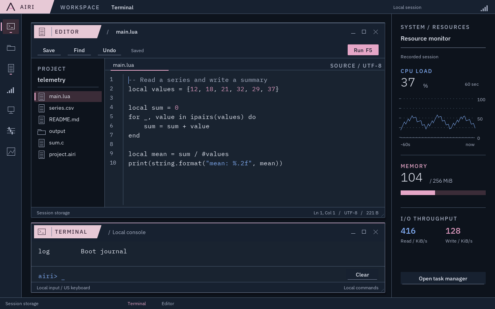
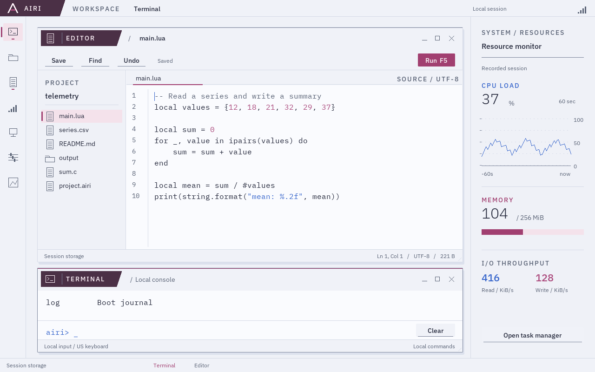
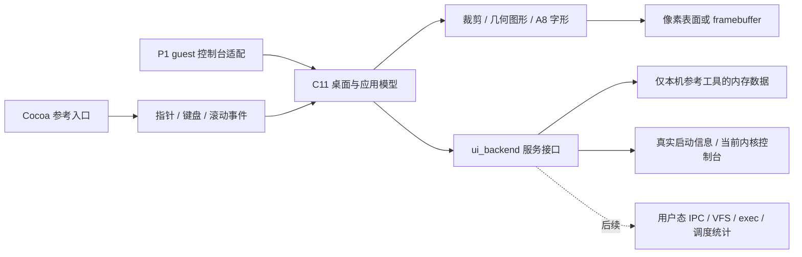
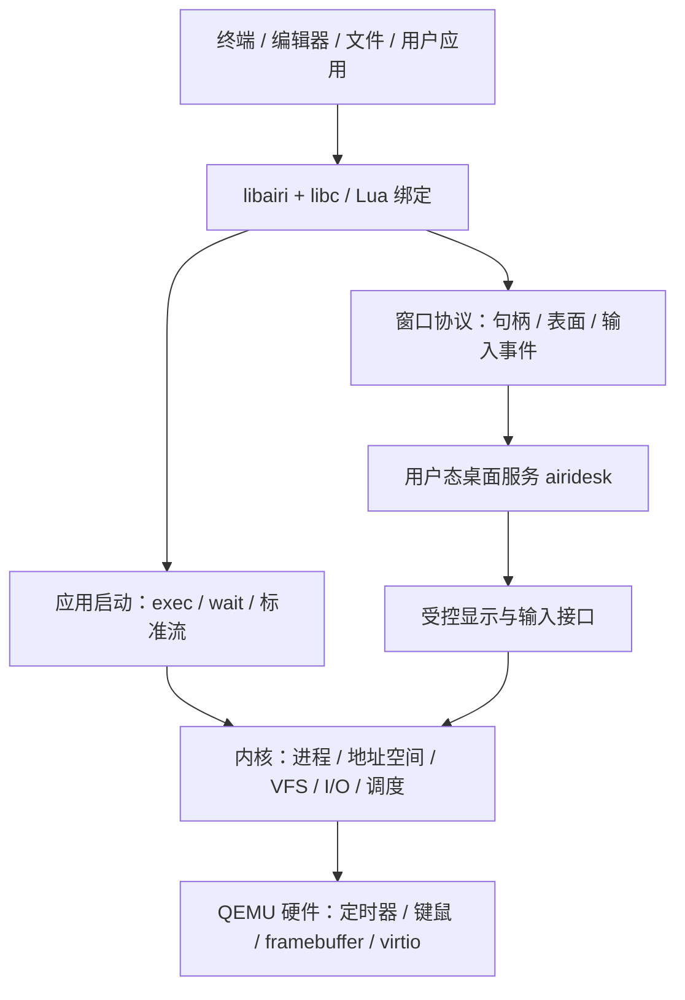

# AiriOS 前端设计与实现基线

版本：Frontend 3，2026-10-12。本文说明当前参考前端的设计与实现边界；图形教程从 G11 逐步建立这些能力，各检查点以对应章节为准。学习路线于 2026-10-15 调整为可选图形支线，视觉基线保持。桌面包含七个基础应用，共用文件、编辑与窗口状态，后续内核服务通过适配层接入。

串口内核与 Linux 实验独立推进，完整工作站属于长期目标。先从[图形教程入口](../dev-log/graphics/README.md)区分带敲、参考预览与 guest 运行；主线的[当前路线](https://github.com/Airo-dynamic/Airi-OS-Test/blob/main/docs/roadmap.md)再说明内核能力怎样继续增长。



## 产品用途与信息组织

桌面围绕文件、程序和计算任务组织。用户从 Files 进入项目，在 Editor 修改源码，通过 Terminal 或 Run 请求运行，在 Tasks 观察任务，在 Data viewer 查看结果文件。System 提供设备和故障诊断，Settings 集中处理界面偏好。

当前完成这些工作流的前端状态、布局和事件逻辑。参考工作区可以实际编辑、保存、创建和管理会话内存中的文件；运行程序、持久存储和真实调度统计需要未来 guest 服务。本机窗口用“Session storage”说明会话内存存储，在统计页用“Recorded session”说明记录数据。QEMU 只接入真实启动信息和当前内核控制台。参考后端仍为固定内存数据，不代表宿主遥测；这项实现边界在文档维护，不在每个窗口重复展示开发说明。

主界面使用正常应用名称、路径、单位和操作动词。实现阶段、课程编号、ABI 和驱动知识放在文档中；未接入的服务通过明确的状态与错误表达。没有虚构账号、时钟、安全等级、磁盘在线状态或扫描动画。

## 视觉规范

目标是洁净、精密的通用工作站。冷中性色承担长期阅读，粉色标出当前对象和主要操作，蓝色标出输入焦点，粉色同时贯穿标题身份片、选择与主要读数。窗口、导航、工具、内容和状态有各自稳定的位置；显著元素对应对象、状态或操作。

视觉结构采用斜切身份片、细线外框与独立操作轨。日间身份片为深梅粉，夜间为浅雾粉；系统入口与应用标题使用同一种轮廓，内容区保持适合代码与日志的稳定底面；48 px 标题中图标、应用名、当前对象与窗口操作各占明确位置。短分区标签使用 14 px、500 字重、增加 2 px 字距的 Plex Sans，正文、路径与代码保持正常字距。A 形标识只保留在系统入口。窗口标题片的斜切轮廓区分可拖动身份区与右侧内容操作区；大块正文不使用斜切边缘。

这次校准重新对照了前期的《极乐空间》洁净控制室与《遗落战境》Light Table。参考对象是统一的设备语言、严格对齐的功能模块、主读数与辅助刻度之间的比例。GMUNK 的[项目说明](https://gmunk.com/oblivion-gfx/Print)与 Jake Sargeant 的[工作记录](https://www.mn8studio.com/project/oblivion-vika-control-station)提供了共同网格和多屏功能分工的依据；电影原图保留为外部参考，不打包为系统资产。

资源仪表统一左缘、分区横线和数值基线。CPU 固定 0–100% 纵轴；点线仅用作图内刻度。内存按可用、引导保留和内核三个真实类别绘制比例，标签声明分母范围；读写速率各有单位。没有装饰网格、虚构设备编号和没有含义的扫描动画。Editor 与 Terminal 在样板里上下对齐，终端连接身份放入标题，清屏靠近输入，减少重复工具区。

日常界面只说明当前对象、状态与操作。FRONTEND REFERENCE、fixture、future service、design workspace 等开发标签留在源码与文档；示例源码不夹带能力免责声明，设置页不摆放无操作用途的配色样板。用户尝试不可用操作时才显示具体失败原因，已有输入仍保留。

日间与夜间共享布局和应用状态，使用分别校准的语义调色板。默认 Night，Settings → Appearance 可切换；图形Terminal中输入 `theme day` 或 `theme night` 经可选消费者改变同一桌面偏好；纯串口目标没有主题功能。切换不重建窗口、不重新载入文件，不改变选择、光标或未保存内容。偏好目前不跨进程重启保存。

| 角色 | Day | Night | 用途 |
|---|---|---|---|
| Background | `#EFF1F7` | `#0D131C` | 桌面 |
| Panel | `#F0F2F8` | `#172130` | 工具与辅助栏 |
| Chrome / Ink | `#4B3046` / `#FFF4FA` | `#E7C9D6` / `#39283A` | 系统壳体与标题前景 |
| Surface | `#FAFBFE` | `#192330` | 内容表面 |
| Raised | `#F4E2EB` | `#3B2C38` | 当前选择 |
| Text | `#24283B` | `#E7EBF5` | 主文字 |
| Muted | `#586174` | `#A9B2C6` | 次文字 |
| Accent | `#A13F70` | `#E5A6C7` | 粉色身份、选中标记 |
| Blue | `#3564CB` | `#83AFF7` | 焦点、输入、字符串 |
| Pink | `#AA487B` | `#DD99BE` | 标识和少量类别 |
| Control | `#7B849A` | `#758198` | 可操作边界 |
| Error / Warning / Success | `#B92F4F` / `#845C15` / `#2A7265` | `#F0919E` / `#E5BA73` / `#76C8AD` | 独立语义反馈 |

日间次文字与粉色较计划初值稍深，保证选中和按下表面上的对比。轻分隔线仅组织区域；识别控件所需的边界使用更清楚的 Control。主按钮使用粉色实面，普通动作有操作基线，列表有侧标，活动窗口有连续顶边；错误保留明确文字，按下反馈增加文字位移。

控件以 8 px 网格、4 px 紧凑关系为基础；窗口与控件圆角 2 px，外框 1 px。标题栏 48 px、工具栏 44 px、状态栏 27 px。公共窗口内容矩形同时用于绘图和命中测试；尺寸集中在 `frontend/include/render.h`，应用内部的表格与图形布局仍由对应应用负责。

IBM Plex Sans 用于界面，12/14 px 正文使用 400 字重，14 px 控件、16/22 px 标题使用 500；32 px 仪表读数使用 300；Plex Mono 14/16 px 保持 400。锁定的同一字体通过 Pillow 12.3.0 生成八套 A8 覆盖率，常规构建不需要字体转换器。圆角使用整数子像素覆盖率，保持现有 CPU 软件渲染路径。



当前字形集覆盖可打印 ASCII。源文本以字节保存，中文输入、完整 Unicode 字形与整形尚未实现；界面使用英文，教学材料使用中文。macOS 参考应用把同一像素表面映射到 Cocoa 窗口，Retina 放大与 QEMU 原生像素显示可能有清晰度差别。

## 桌面与窗口

- 顶部系统栏 36 px：应用菜单、当前应用、会话来源、资源侧栏开关。
- 左侧启动器 56 px：七个应用；指针停留显示名称，活动窗口有标记。
- 底部任务栏 30 px：数据来源、已打开的窗口与当前窗口。
- 可选资源侧栏 268 px：CPU 曲线、内存组成、读写速率、Tasks 入口；不足 1120 px 自动隐藏。
- 应用窗口：拖动、右下角调整尺寸、最小化、最大化/恢复、关闭、点击聚焦和 Alt-Tab 切换。

本轮验证 1280×800、1024×768 和 1600×900，并不限定未来支持范围。布局适配与高 DPI 字体/控件缩放分开推进。1280×800 是基线；1024×768 隐藏应用内部分侧栏；1600×900 保留较大的工作区。参考窗口最低为 1024×768。640×480 只做绘图边界检查，不作为完整可用布局。

本版每个基础应用一个窗口，共七个；没有多文档标签页、多桌面、自由安装应用或独立用户进程的窗口协议。未来窗口服务可以扩展同一视觉组件，但需另实现进程隔离和表面生命周期。

## 应用清单与交互

| 应用 | 已实现前端行为 | 将来接入的真实服务 |
|---|---|---|
| Terminal | 控制台输入、命令历史、输出分页、滚轮、Clear、粘贴；保留实际 P1 命令 | shell、标准流、管道、前后台进程与退出码 |
| Files | Places、路径 Up、搜索、目录优先的名称排序、列表选择、双击/Enter 打开；新文件/目录、重命名、删除确认、复制/剪切/粘贴、刷新 | VFS、目录句柄、持久工作卷 |
| Editor | 项目文件列表、单文档、多行输入、行号、注释/字符串/数字配色、方向/Home/End、选择和鼠标拖选、剪贴板、一次撤销/重做、查找、保存、Run、未保存关闭确认；光标自动纵横滚动 | 文档读写、应用启动与诊断输出 |
| Tasks | CPU 图、物理内存条、进程表、筛选、顺序切换、选择、详情、End task 确认、刷新/重试 | 调度统计和终止服务 |
| System | Overview、Memory、Storage、Devices、Journal；内存清单滚动、Preferences/Files 入口 | 启动信息；未来卷、PCI 枚举和持续日志 |
| Settings | Appearance、Keyboard、Display、About；Night / Day 两种完整主题、两种列表密度、快捷键说明 | 会话偏好；未来持久设置 |
| Data viewer | 从 Files 打开真实参考 CSV，校验格式，绘制带单位的坐标和时间序列，显示文件名/行数 | 相同文件服务；应用产生的结果文件 |

Editor 和 Files 使用相同 provider；保存后文件大小与重新读取的内容一致。Data viewer 读取相同文件，支持有一行表头、最多 60 行非负整数 `time,value`，时间严格递增。非法输入报告错误并保留已有图表；当前不是完整 CSV/科学绘图软件。

查找选择第一个匹配；一次 Undo 在上一次编辑前后切换。打开其他文档前必须先保存当前修改或通过关闭操作放弃。文档上限 8191 字节；超过容量不破坏原文或当前选择。初期不实现语法分析、自动补全、语言服务器和二进制文件编辑。

### 键盘约定

| 输入 | 行为 |
|---|---|
| Alt-Tab | 在已打开窗口之间切换 |
| Ctrl/Cmd-S | 保存文档 |
| Ctrl/Cmd-F | Editor 查找；Files/Tasks 筛选 |
| Ctrl/Cmd-A、C、X、V | 文本全选和剪贴板；Files 用 C/X/V 处理文件 |
| Ctrl/Cmd-Z | 上一次编辑的撤销/重做 |
| F5 | Editor 请求执行，不绕过启动服务 |
| Esc | 取消对话框、查找或菜单 |
| Enter | 确认输入/对话框；Files 打开选中项 |
| Delete | 删除字符；Files 打开删除确认 |
| 滚轮 / PgUp / PgDn | 滚动当前应用 |

控件绘制支持悬停、按下、选中、焦点和禁用；当前键盘焦点实际用于编辑/查找/筛选/对话框，通用按钮 Tab 遍历尚未实现。Cocoa 参考应用接受 Cmd 或 Ctrl。guest 当前仍使用 P1 键盘入口：F1 Terminal、F2 Memory、F3 Devices、F4 Journal；`theme day` / `theme night` 切换整个控制台主题。未来桌面事件绑定不能误当作已经接入的 guest 驱动。

## 状态与错误规范

服务视图覆盖正常、空、加载中、错误和离线五种状态。Files/Tasks 错误提供 Retry；失败不清空编辑缓冲或伪造成功。创建和重命名输入框支持全选、粘贴和容量限制。

删除、结束任务和未保存关闭使用确认框。未保存关闭提供 Cancel / Discard / Save；保存失败留下文档，取消 Save As 不在下一次保存时误关窗口。信息对话框按实际文字宽度换行，并对输入文本裁剪，避免内容越出边界。

参考 provider 的运行操作始终报告 `Application execution is not connected`；End task 只改变参考进程记录。参考文件存储在本次进程内存，关闭后重置；不是宿主桌面文件，也不是 guest 文件系统。目录复制和目录重命名返回明确错误，留待 VFS provider。

## 数据定义

Tasks 与资源侧栏读取同一份 `ui_stats` 快照；CPU 0–100%，内存为 KiB，图示转为 MiB；60 个样本按 60 秒参考窗口显示。参考快照是固定数据，不是本机 Mac 或当前 guest 的性能。

System/Memory 显示 `AiriBootInfo` 的物理起点、排他结束地址和分类。USABLE、被保留的 BOOT RECLAIM 与 KERNEL 只是启动库存，不代表实时分配器用量。QEMU 的 Devices 仍是固定端点说明，Journal 仍是交接事实，不声称完整设备枚举或持续日志。

存储参考视图说明容量上限和易失性，不画没有数据来源的磁盘使用率。未来接入真实统计时，来源、单位和时间窗口必须一起接入。

## 代码边界与接入方式



`ui_backend` 是前端调用边界，不是系统调用 ABI：

- `files(context, path, out, capacity)` 返回有界目录快照。
- `read(context, id, out, capacity)` 返回有界文档。
- `action(context, directory, operation, id, name, data, error, capacity)` 接收明确目标目录，返回成功或具体错误。
- `tasks(context, out, capacity, stats)` 返回同一采样快照中的任务与资源。
- `boot` 为有效 `AiriBootInfo`，生命周期覆盖整个 UI；回调在返回前完成输出写入，不保留调用者栈指针。

状态结构持有快照和编辑缓冲；provider 持有服务数据。`ui_refresh` 限制记录数与百分比范围。应用服务可在未来通过适配层把请求发给用户态服务；异步请求、每个服务独立状态、权限和句柄 generation 需要随真实服务实现。不要直接把这些宿主 C 指针搬成可信内核参数。

| 文件 | 职责 |
|---|---|
| `frontend/include/ui.h` | 数据、事件与服务接口 |
| `frontend/render/draw.c` | 像素写入、裁剪、文字与几何图标 |
| `frontend/core/{state,paint,commands,pointer,editing}.c` | 桌面、窗口、编辑状态、对话框与输入 |
| `frontend/apps/builtin.c` | 绘制与点击分派 |
| `frontend/apps/{terminal,files,editor,tasks,system,settings,viewer}.c` | 各应用布局和控件命中 |
| `frontend/apps/common.c`、`documents.c` | 共用控件与文档/CSV 打开 |
| `frontend/backends/reference.c` | 本机参考数据和会话文件，排除在 kernel SOURCES 外 |
| `frontend/platform/macos/preview.m` | Cocoa 事件和像素展示、无窗口截图入口 |
| `kernel/console/display.c` | 当前 guest 的有限视图适配 |
| `scripts/font_atlas.py` | 字体图集生成；正常编译使用已提交图集 |
| `tests/unit/ui_test.c` | 前端行为与边界检查 |

当前软件绘图直接重绘表面，未实现脏矩形合成、完整双缓冲或 GPU。参考程序由 Cocoa 触发重绘，guest 由实际输入/状态变化触发绘图。当前内核集成是 P1 诊断过渡；未来桌面/应用应在用户态服务中运行，不继续把文件和程序执行塞进内核绘图函数。

## 运行、验收与后续扩展

```sh
cd /Users/bilibili/Desktop/AiriOS
./airios ui-preview
./airios ui-preview --app tasks
./airios ui-preview --app files --state error
./airios ui-test
./airios run
./airios test
```

`ui-preview` 构建并打开 `build/ui/AiriOS Frontend.app`。`ui-test` 校验字体、执行 ASan/UBSan 模型检查，并生成 84 张双主题应用/尺寸/状态截图（生成结果位于 artifacts/frontend）。`test` 同时验证独立 kernel ELF、正常/故障启动和实际键盘/UART。验收见 [前端验收](verification.md)。

本次前端基线完成后，依次把 P2/P3/P4 的内存、用户进程、标准流和 VFS 接入现有应用，再接入真实统计和持久项目。软件运行路径、应用窗口协议和系统内开发工具仍按 [工作站路线](design.md) 实现。新增能力优先融入已有工作流，前端截图不能作为后端实现证据。


## AiriOS 工作站设计 v2

设计日期：2026-10-09。本文保留完整工作站目标。桌面和七个应用的前端设计、交互与共享 C 渲染已完成，见 [前端基线](design.md)；用户进程、持久工作卷和系统内开发工具仍是后续实现。

## 1. 定位与完成条件

AiriOS 是能运行程序、处理文件与计算任务的个人图形工作站。它仍使用自己编写的 x86-64 内核，以学习预算实现一套小而连贯的操作系统。工业科幻风格表达设备可靠、信息清楚和操作直接；常规系统能力承担学习与展示机制的作用。

工作站扩展完成时应形成以下实际工作流；这些不属于当前内核首轮验收：

1. 启动，进入桌面，打开终端、文件管理器和编辑器。
2. 新建项目目录，编辑并保存源码、输入数据和项目配置。
3. 在 guest 内运行 Lua 程序，或运行为 AiriOS ABI 编译的静态 C ELF。
4. 程序获得独立地址空间、PID、标准输入输出、退出码；支持前台和后台运行。
5. 图形程序创建自己的窗口，接收输入，绘制内容；另一个程序计算时桌面仍响应。
6. 用任务管理器观察真实 CPU 时间、物理内存和 I/O，停止失控程序。
7. 保存结果，正常同步并重启后再次打开项目。

最终验收用“项目 → 编辑 → 运行 → 观察 → 结果文件 → 重启恢复”衡量。课程编号与内部机制名称留在文档和调试工具中。

## 2. 桌面组织

| 组成 | 使用目的 | 首版行为 |
|---|---|---|
| 顶部系统栏 | 当前应用、会话与系统入口 | 高 36 px；系统菜单、应用标题；时钟取得真实时间源后才出现 |
| 左侧启动器 | 打开应用和切换正在运行的窗口 | 宽 56 px；图形图标、名称提示、键盘快捷键 |
| 工作区域 | 终端、编辑器、文件和应用窗口 | 默认使用大部分屏幕；允许移动、调整大小、关闭和切换焦点 |
| 可选监视侧栏 | 工作时观察资源 | 宽约 280 px，默认收起；显示真实采样，与任务管理器同源 |
| 窗口状态栏 | 当前任务的上下文 | 文件路径、编辑状态、行列、退出码、任务进度；按应用需要显示 |

系统启动后进入工作区域，不强制打开总览仪表盘。应用窗口可并排使用；首版最多 8 个窗口、16 个用户进程，超限返回明确错误，限额待实测再校准。分辨率基线仍为 1280×800，布局验证覆盖 1024×768 和 1600×900；低分辨率使用紧凑布局。

应用共享菜单、对话框、滚动条、焦点、选择和剪贴板约定。鼠标操作具备对应键盘入口：Alt-Tab 切换、Ctrl-S 保存、Ctrl-F 查找、F5 运行；关闭未保存文件需要处理保存状态。首版单用户本地会话，不制造登录、安全等级或企业身份等无实际实现的装饰。

## 3. 视觉与字体

- 配色采用本文前部的 Day / Night 语义表；粉色负责身份与选择，蓝色负责焦点，粉色贯穿标题与主要读数。
- 通常使用正常大小写。全大写只用于短标签；长度、文件名和技术标识保留原样。
- UI 字体已用 IBM Plex Sans 12/14/16/22 px；代码与终端用 IBM Plex Mono 14–16 px。遵守字体许可并锁定资源版本。图表不依赖等宽排字。
- 网格与间距以 8 px 为基础；图标采用简单线形；窗口边界、表格和工具栏明确，避免把每个值包装成独立卡片。
- 字体采用灰度抗锯齿。首版在构建时把锁定字体生成不同尺寸的字形覆盖率图集，guest 按真实字形度量和基线混合绘制；不使用放大的 5×7 字形作为桌面字体。后续可在用户态接入 TrueType 光栅化。
- 不依赖 GPU，先完成 CPU 软件绘图、裁剪、脏区域更新和双缓冲。仅在内容变化时重绘；监视采样默认 1 秒一次，不追求固定高帧率。

《极乐空间》轨道控制系统提供秩序与统一设备语言的参考，《遗落战境》提供对齐和图形质量的参考；真实桌面与 NASA 操作界面用于校准功能依据。字体清晰度和真实交互以日常可用为标准。参考材料见文末。

## 4. 基础应用与共同底座

| 应用 | 首版完整能力 | 共用系统机制 |
|---|---|---|
| Terminal | 命令行、历史、路径、重定向、管道、前后台任务、退出码、中断前台程序 | 进程、FD、管道、等待队列、终端输入输出 |
| Files | 路径浏览、新建目录、复制、移动、删除、打开文件；显示错误与容量 | VFS、文件和目录句柄、持久存储 |
| Editor | 多行文本、行号、选择、撤销、查找、保存、运行；按目录组织项目 | 相同 VFS、应用启动服务、剪贴板、输入事件 |
| Tasks | 进程列表、父子关系、CPU 时间、内存、运行/等待状态、停止任务 | 调度器统计、进程资源、任务终止 |
| System | 内存、设备、卷、日志与错误详情 | 内核只读统计接口与实际设备枚举 |
| 用户应用 | 终端程序和独立图形程序；读取输入、计算、保存输出 | libc 子集、静态 ELF、窗口 SDK |

窗口上的“运行”与终端执行使用同一个启动路径。Files 和 Editor 读取相同文件系统。Tasks 与侧栏查询相同统计快照。任务、卷和请求详情放在这些常规工具的详情视图中，避免为每一项内核机制另做一个专用演示应用。

终端首版语法限定为分词、引号、管道、输入/输出重定向与后台符号。`cd` 是 shell 内建；`ls`、`cat`、计算和数据处理工具逐步成为独立用户程序。先用每个终端会话的输入输出端点与前台 PID 实现交互，不宣称完整 POSIX PTY、作业控制或 Bash 兼容。

## 5. 软件运行与开发环境

### 5.1 应用格式

原生程序采用静态 x86-64 ELF，链接 AiriOS 的 crt0、libc 子集与应用 SDK。内核校验段范围、权限、入口和用户栈，建立独立地址空间，再启动用户态任务。Linux 和 macOS 的现成可执行文件不能因此直接运行。

系统调用采用独立、版本化 Airi ABI。进程使用整数句柄访问文件、窗口和服务；内核验证用户指针与长度。应用的非法地址或退出释放自己的资源，不能破坏其他程序或桌面服务。

libc 从实际软件依赖反推支持范围：内存与字符串、malloc/free、整数格式化、errno、文件流、目录与 argv/envp；再补 setjmp/longjmp、必要数学和时间函数。明确记录支持与不支持的行为。用户任务需要正确保存浮点/SSE 状态，不能把 Lua 浮点运算或普通编译器生成的 SIMD 指令遗漏在切换之外。

### 5.2 开发路径

建议先完成两条运行路径：

- guest 内的 Editor + 官方 Lua 运行时：编辑、保存、执行、读写项目文件和绘制应用窗口均在 AiriOS 内完成。Lua 是独立用户进程；编辑器通过启动服务运行它。无限循环可以被调度器抢占和终止。
- 宿主 LLVM 交叉编译 C：SDK 提供头文件、crt0 和静态库，构建 AiriOS ELF 并打包导入。guest 负责真实执行；文档清楚区分编译发生在哪台机器。

项目先使用普通目录、源文件、资源与小型配置文件；避免首轮引入包仓库、完整 IDE、语言服务器与联网依赖管理。GUI SDK 对 C 和 Lua 提供窗口创建、图形表面、文字、矩形/线条、事件、定时器与呈现。一个脚本能创建自己的窗口和处理文件，不能只在编辑器内求值并伪装成程序运行。

随后移植 TinyCC，使 guest 内形成“编辑 C → 编译静态 ELF → 启动”的链路。TinyCC 已有 ELF 输出能力，但移植仍需解决编译器本身的 libc/文件依赖、AiriOS 目标启动文件、库与 ABI；不能把下载源码等同于已可运行。TinyCC与Lua运行时属于工作站支线，不纳入当前内核与Linux I/O首轮交付。

## 6. 图形程序与系统边界



内核负责隔离、调度、驱动和句柄生命周期。桌面服务在用户态管理窗口、布局、焦点与合成；应用绘制自己的像素表面，不直接访问设备地址。初期 P1 的内核启动控制台保留作故障诊断，用户态桌面接管后不成为各应用的渲染位置。

首版表面使用 ARGB8888。客户端和桌面服务共享由内核授权映射的表面页，以带宽、尺寸和数量上限控制资源。为避免合成时客户端修改同一缓冲区，采用前后缓冲与交接序号：present 交出已完成缓冲，收到 release 才能再次写入。脏区域必须裁剪并校验溢出，不能把共享指针作为可信内核对象。

窗口消息采用有边界、可等待的本地队列：创建/关闭、呈现/释放、鼠标、键盘、焦点与尺寸改变。队列满明确返回或施加背压，不能静默丢弃关闭和缓冲释放。事件等待接入原计划的等待队列；不忙轮询全部应用。应用退出关闭窗口并回收表面，桌面服务异常时保留串口诊断。

输入文本统一按 UTF-8 保存；首版键盘为 US 布局，支持已打包字符的显示。完整中文输入法、文本整形和任意字体安装另列后续能力，不能把 UTF-8 存储等同于全部文字系统已实现。

## 7. 资源图形的数据定义

| 展示 | 数据来源与含义 | 用户操作 |
|---|---|---|
| CPU 时间曲线与进程排行 | 定时器采样的运行/空闲 ticks；同一时间窗口中的比值 | 找到任务、查看或终止 |
| 物理内存组成与应用用量 | 分配器的页状态、保留页和空闲页；共享页单独说明 | 查看进程映射，区分虚拟地址空间与物理占用 |
| I/O 吞吐、延迟与队列深度 | 设备真实提交/完成时间、字节和在途数 | 查看发起进程、目标文件和错误 |
| 存储卷空间 | 挂载文件系统的已用/空闲块，明确单位 | 打开文件、检查卷或同步 |
| 任务进度 | 应用主动报告的已处理/总量；没有总量就显示活动状态 | 查看输出、取消任务 |

图形采用时间序列、组成条、排序表和必要的详情图；有坐标、单位、采样窗口和缺失状态。CPU 曲线在调度器/时间源完成后出现；P1 的 boot USABLE 不能当作实时“空闲内存”。不以请求提交当完成，不以写入完成当持久化。

## 8. 文件与持久项目

P4 的 ramfs 用于早期用户程序和 VFS 验证。原来的独立追加日志实验继续用于理解存储同步与故障模型。可用工作站还需要目录、文件更新和重启恢复，不能把内存文件系统当成持久项目存储。

建议在可用性扩展中接入 littlefs 作为第一个持久工作卷，自己实现 VFS、块设备驱动及适配层。它原本面向 flash，在 virtio 磁盘上的 read/prog/erase/sync 语义需要专门适配与测试；sync 必须映射真实设备 FLUSH 和宿主磁盘后端约定。没有正确同步链路时不声称掉电保证，挂载失败也不能自动格式化用户项目卷。该依赖到实现阶段再固定版本与许可。

目录建议：`/bin` 为应用，`/lib` 为运行时/资源，`/home/airi/projects` 为项目，`/var/log` 为日志。首次单用户，可写工作卷与只读系统映像分开。用已保存项目验证正常重启恢复；崩溃与掉电模型单独测试。

## 9. 实施顺序与预算调整

原 P1–P6 的内核与 Linux 学习路径继续作为基础，其 16 周预算不能自动覆盖新增的完整桌面和开发环境。增加一条可选工作站支线，按依赖接入：

| 里程碑 | 前置条件 | 实际交付与验收 | 辅助参考实现下的初估增量 |
|---|---|---|---|
| W1 图形基础 | P1；中断输入随 P2/P3 接入 | 抗锯齿正常字体、软件表面、统一控件与布局；真实 QEMU 像素/边界测试 | 10–16 小时 |
| W2 应用与窗口 | P2/P3 | 用户态静态 ELF、标准流、任务切换与 FPU 状态；两个独立 GUI/CLI 程序同时运行 | 10–18 小时 |
| W3 文件与编辑 | P4 | 编辑器、项目目录、Files、持久工作卷；保存后重启仍可读取 | 16–26 小时 |
| W4 系统内开发 | W2/W3 + libc 依赖审计 | Lua 用户运行时、C SDK 导入、Lua GUI 绑定、前后台任务；源码错误和死循环可处理 | 20–36 小时 |
| W5 工作站验收 | P5/P6 + W4 | 同时编辑、计算和观察资源；结果保存、取消、进程崩溃与窗口回收 | 8–14 小时 |

增量合计约 64–110 小时，属于初估，允许与内核阶段穿插，不是交付承诺。TinyCC 系统内移植另做 4–8 小时依赖与目标 ABI 验证，再估完整投入；需要首轮 C 编译时，应提前此路线并调整其余范围，不能挤成“顺手加一个编译按钮”。

新增阶段以可运行的原生程序与工作流验收；界面先在小型宿主测试程序中验证纯绘图/控件，再在 QEMU 中验证用户态与系统调用，宿主测试窗口不替代 guest 功能。

## 10. 当前实现边界

P1 内核与本会话的全部前端基线已经完成。七个基础应用使用同一套 C11 模型和抗锯齿渲染，提供可操作的 Cocoa 参考窗口；Files/Editor 共用会话内存 provider，Data viewer 实际读取参考 CSV。窗口、编辑、文件操作、偏好、列表、图表、对话框和故障状态均有实现和测试。

QEMU 使用相同字体和绘图代码，实际接入 Terminal 与 System 的启动内存、设备端点和启动记录。其键盘入口仍为 P1 的 F1–F4，没有 guest 鼠标、用户进程、文件系统或桌面 IPC。参考窗口明确显示设计数据来源；执行按钮尚未启动程序。

前端验收覆盖 ASan/UBSan 事件与边界测试、84 张双主题应用/尺寸/状态截图、四种启动路径及 QEMU 键盘/UART。完整工作站的 W2–W5 服务继续独立推进；W1 的字体、控件和布局已落地，脏区域合成与双缓冲仍需补齐。见 [前端验收](verification.md)。

## 11. 调研与选型依据

- [Stellaro：Alien Romulus 实体控制面板](https://stellaro.studio/en/projects/alien-romulus/)：用途、设备质感和状态层级的视觉参考。
- [Jamie McCallen 屏幕设计访谈](https://www.pushing-pixels.org/2018/10/12/the-art-and-craft-of-screen-graphics-interview-with-jamie-mccallen.html)：包含 Elysium 工业场景与屏幕设计过程；电影风格不是系统能力的证据。
- [IBM Plex 官方仓库](https://github.com/IBM/plex)：Sans/Mono 字体资源与许可来源。
- [stb_truetype 源码](https://raw.githubusercontent.com/nothings/stb/master/stb_truetype.h)：字体覆盖率与度量实现参考。上游明确不处理不可信字体；初期使用固定资源，避免内核解析任意字体。
- [Lua 官方下载](https://www.lua.org/download.html)与 [Lua 5.5 手册](https://www.lua.org/manual/5.5/manual.html)：当前官方版本为 5.5.1，候选移植版本待依赖审计后锁定；Lua 协程不等于 OS 线程。
- [TinyCC 官方文档](https://bellard.org/tcc/tcc-doc.html)：编译与 ELF 输出的候选实现，不代表已经适配 AiriOS。
- [littlefs 官方仓库](https://github.com/littlefs-project/littlefs)：文件/目录与块设备回调的候选实现；上游持久性语义仍依赖正确 sync 适配。
- [QEMU i8042 源码](https://raw.githubusercontent.com/qemu/qemu/v11.1.2/hw/input/pckbd.c)：当前固定虚拟平台的键盘端口与翻译行为参考。

## 本轮样板与校准

`build/ui/airios-ui --theme day --scenario workspace --snapshot /tmp/airios-day.ppm` 生成真实共享 C 像素。`--theme night` 使用相同初始数据。三组场景是 `workspace`、`save-error`、`system-tasks`；`controls` 是公共控件状态表，不作为 guest 应用。84 张回归图保存在 `artifacts/frontend/`，文件名包含 `day-` 或 `night-`。

保存失败样板向参考 provider 提交不存在的文件 ID，错误来自实际返回值。对话框显示 Save failed 和恢复说明，编辑器内容仍在。System/Tasks 组合中启动库存与参考任务各自标明来源；后续接入真实服务时不需要改变主题接口。

颜色关系按 [Carbon 颜色角色](https://www.carbondesignsystem.com/building-blocks/foundations/color/overview)组织，布局职责参照 [KDE 布局与导航](https://develop.kde.org/hig/layout_and_nav/)。对比校准使用 [W3C 文字对比](https://www.w3.org/WAI/WCAG22/Understanding/contrast-minimum.html)与[非文字对比](https://www.w3.org/WAI/WCAG22/Understanding/non-text-contrast.html)的阈值；这是本轮视觉检查目标，不表示整个操作系统通过完整无障碍认证。
